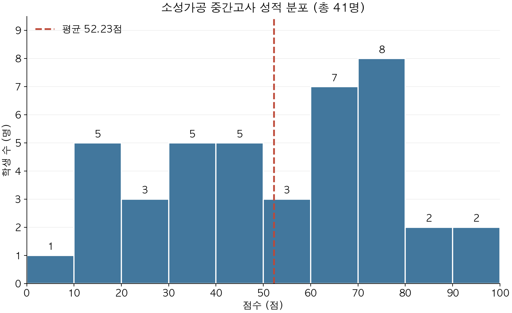

## 성적 분포

총 **41명**의 평균 점수는 **52.23점**입니다.

{: width="600" style="max-width: 100%; height: auto; display: block; margin: 0 auto;" }

점수 구간은 10점 간격이며, 각 구간은 하한 이상·상한 미만입니다(마지막 구간은 상한 포함).
빨간 점선은 평균 점수를 나타냅니다.

## 학번별 성적

| 학번 | 중간고사 |
| --- | ---: |
| 20225019 | 14.5 |
| 20225028 | 82 |
| 20225035 | 56.5 |
| 20225040 | 47.5 |
| 20225041 | 27.5 |
| 20225048 | 61.5 |
| 20225066 | 57 |
| 20225073 | 27.5 |
| 20225080 | 33.5 |
| 20245013 | 36.5 |
| 20245014 | 76.5 |
| 20245017 | 9.5 |
| 20245019 | 17 |
| 20245036 | 44 |
| 20245051 | 45 |
| 20245063 | 37.5 |
| 20175104 | 37 |
| 20205128 | 65.5 |
| 20205129 | 62.5 |
| 20205152 | 71 |
| 20215018 | 67.5 |
| 20215025 | 46 |
| 20215028 | 61.5 |
| 20215037 | 70.5 |
| 20215045 | 74 |
| 20215046 | 78 |
| 20215054 | 92 |
| 20215055 | 95.5 |
| 20215061 | 85.5 |
| 20215062 | 13 |
| 20215080 | 72.5 |
| 20225038 | 63 |
| 20225043 | 15 |
| 20225044 | 45 |
| 20225045 | 52 |
| 20225057 | 34.5 |
| 20225060 | 26.5 |
| 20225072 | 76 |
| 20235038 | 66 |
| 20235048 | 19.5 |
| 20235051 | 78.5 |
