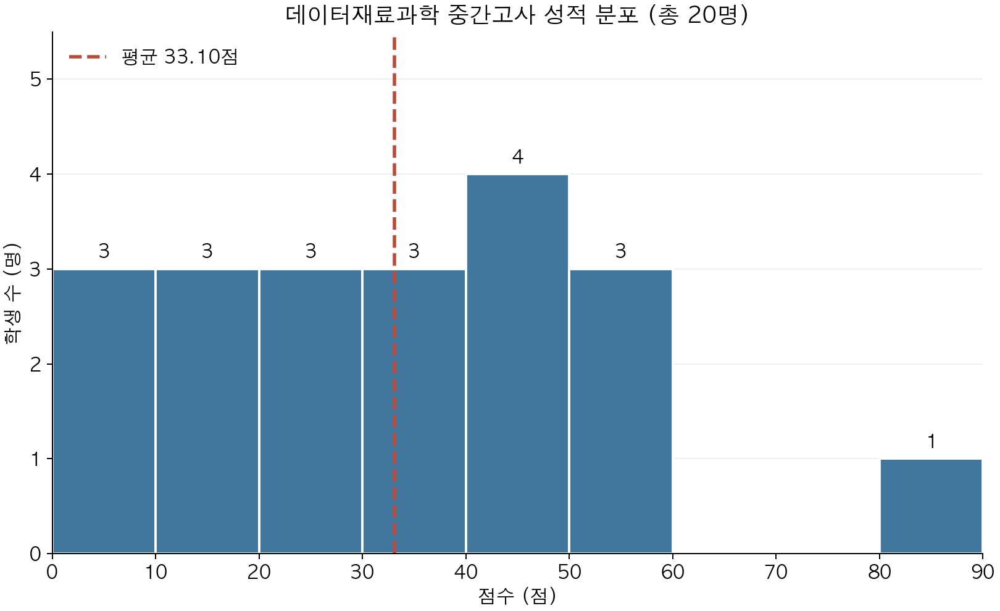

## 성적 분포

총 **20명**의 평균 점수는 **33.10점**입니다.

{: width="600" style="max-width: 100%; height: auto; display: block; margin: 0 auto;" }

점수 구간은 10점 간격이며, 각 구간은 하한 이상·상한 미만입니다(마지막 구간은 상한 포함).
빨간 점선은 평균 점수를 나타냅니다.

## 학번별 성적

| 학번 | 중간고사 |
| --- | ---: |
| 20262296 | 43 |
| 20262297 | 48 |
| 20262298 | 2 |
| 20262299 | 6 |
| 20262300 | 19 |
| 20262301 | 15 |
| 20262302 | 52 |
| 20262303 | 47 |
| 20262304 | 7 |
| 20262305 | 50 |
| 20262306 | 39 |
| 20262308 | 16 |
| 20262310 | 29 |
| 20262311 | 32 |
| 20262312 | 56 |
| 20262314 | 81 |
| 20262315 | 42 |
| 20262317 | 23 |
| 20262318 | 20 |
| 20262319 | 35 |
