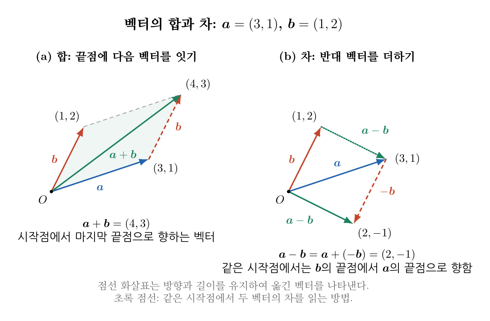
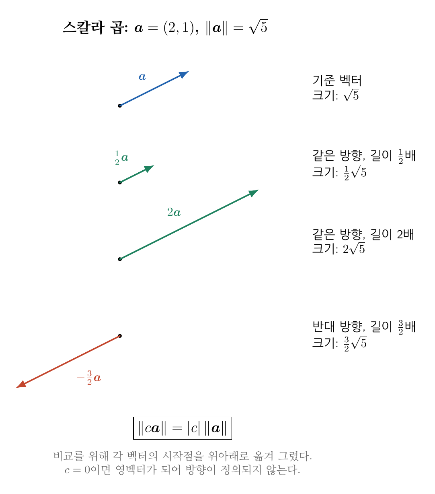
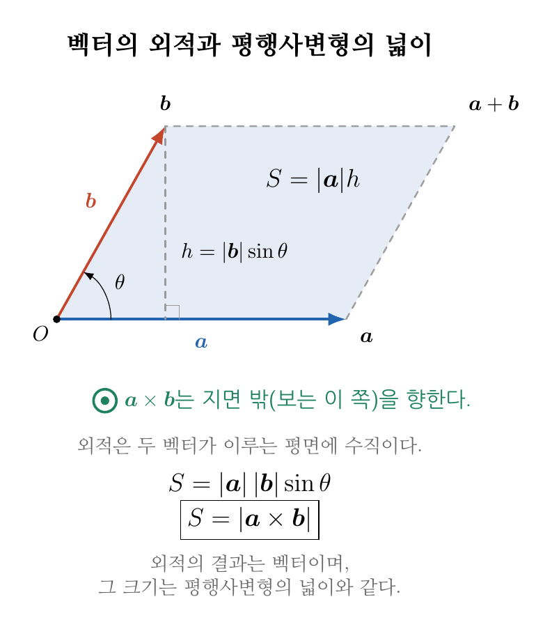

**Contents**

* TOC
{:toc}

# 1. 학습 목표

이번 강의가 끝나면 다음을 할 수 있어야 한다.

- 벡터를 1차원 NumPy 배열로 나타낼 수 있다.
- 벡터의 합, 차와 스칼라 곱을 계산할 수 있다.
- 벡터의 크기와 단위벡터를 구할 수 있다.
- 내적을 이용하여 두 벡터의 수직 여부와 끼인 각을 구할 수 있다.
- 외적의 방향과 크기를 설명하고 NumPy로 계산할 수 있다.

# 2. 벡터와 NumPy 배열

벡터(vector)는 크기(magnitude)와 방향(direction)을 함께 나타내는 물리량이다. 3차원 벡터
$\boldsymbol a$는 다음과 같이 세 성분으로 나타낼 수 있다.

$$
[\boldsymbol a]=
\begin{bmatrix}
a_x\\a_y\\a_z
\end{bmatrix}
$$

1차원 NumPy 배열로 벡터를 아래와 같이 나타낼 수 있다.

~~~python
import numpy as np
a = np.array([3.0, 4.0, 5.0])
print(a)
print(a.shape)
print(a.ndim)
print(a.size)
~~~

벡터 성분은 앞선 강의에서 배운 인덱싱(indexing)으로 선택한다.

~~~python
print(a[0])
print(a[1])
print(a[2])
~~~

위의 배열 <code>a</code>는 1차원 배열이었다. 아래는 2차원 배열이다. 둘을 구분할 수 있어야
한다.

~~~python
import numpy as np
a = np.array([[3.0], [4.0], [5.0]])
print(a)
print(a.shape)
print(a.ndim)
print(a.size)
~~~

## 2.1. 벡터 자체와 좌표성분 구분하기

온도(temperature)는 하나의 값으로 나타내는 스칼라(scalar)이고, 힘(force)과
변위(displacement)는 방향도 필요한 벡터다. 벡터의 성분을 쓰려면 먼저 기준 방향인
 **기저벡터(basis vector)**를 정해야 한다.
서로 수직이고 길이가 1인 기저($\boldsymbol e_x, \boldsymbol e_y, \boldsymbol e_z$)를 사용하면

$$
\boldsymbol a=a_x\boldsymbol e_x+a_y\boldsymbol e_y+a_z\boldsymbol e_z
$$

로 쓴다. 예를 들어 $\boldsymbol a=3\boldsymbol e_x+4\boldsymbol e_y$는
첫 번째 방향으로 3, 두 번째 방향으로 4만큼의 성분을 갖는다.
좌표축을 바꾸면 같은 벡터도 성분값이 달라질 수 있지만, 벡터의 크기와 물리적 의미는 유지된다.
이 강의의 길이·내적 공식은 **같은 직교정규 기저에서 표현한 실수 성분**에 적용한다.

측정값 세 개를 배열에 저장했다고 해서 반드시 공간상의 벡터인 것은 아니다.
서로 다른 세 시편의 온도를 저장한 배열과 한 힘의 세 방향 성분을 저장한 배열은 모양이 같아도 의미가 다르다.
배열을 만들기 전에 각 원소의 의미와 단위를 먼저 적자.

## 2.2. 1차원 배열과 행·열 배열의 차이

수학에서 열벡터로 표기해도 NumPy의 shape이 자동으로 열 배열이 되는 것은 아니다.

~~~python
vector = np.array([3.0, 4.0, 0.0])
column = vector[:, None]
row = vector[None, :]
print(vector.shape, column.shape, row.shape)
print(vector.T.shape)
~~~

결과는 각각 <code>(3,)</code>, <code>(3, 1)</code>, <code>(1, 3)</code>이며,
1차원 배열의 <code>.T</code>는 shape을 바꾸지 않는다.
특히 <code>vector + column</code>은 브로드캐스팅 때문에 <code>(3, 3)</code> 배열이 된다.
성분별 덧셈을 의도했다면 두 배열을 모두 <code>(3,)</code>으로 맞춰야 한다.

# 3. 벡터의 합과 차

두 벡터의 합과 차는 같은 위치의 성분끼리 계산한다.

$$
[\boldsymbol a]+[\boldsymbol b]
=
\begin{bmatrix}
a_x+b_x\\
a_y+b_y\\
a_z+b_z
\end{bmatrix}
$$

~~~python
a = np.array([3.0, 4.0, 5.0])
b = np.array([3.0, -5.0, -2.0])

vector_sum = a + b
vector_difference = a - b

print(vector_sum)
print(vector_difference)
~~~

결과는 각각 $[6,-1,3]$과 $[0,9,7]$이다. 두 배열의 shape이 같아야 성분별로
자연스럽게 더하고 뺄 수 있다.

{: style="width: 1000px; max-width: 100%; height: auto;"}

그림은 기하학적 의미를 보기 위한 별도의 2차원 예제다.
$\boldsymbol a=(3,1)$, $\boldsymbol b=(1,2)$일 때 합은 $(4,3)$, 차는 $(2,-1)$이다.
합을 구할 때는 $\boldsymbol a$의 끝점에 $\boldsymbol b$의 시작점을 옮겨 붙인다.
이때 벡터의 길이와 방향은 유지한다.
차는 $\boldsymbol a+(-\boldsymbol b)$로 계산한다.
두 벡터를 같은 시작점에서 그렸다면 **$\boldsymbol b$의 끝점에서 $\boldsymbol a$의 끝점으로 향하는 화살표**도
$\boldsymbol a-\boldsymbol b$를 나타낸다. 순서를 바꾸면 차의 방향이 반대가 된다.

# 4. 벡터의 크기

벡터 $\boldsymbol a$의 크기(Euclidean norm)는

$$
\|\boldsymbol a\|_2
=
\sqrt{a_x^2+a_y^2+a_z^2}
$$

이다.

줄여서 다음과 같이 표기하기도 한다.

$$
|\boldsymbol a|
$$

벡터 $(3,4,0)$의 크기를 직접 계산하면

$$
\sqrt{3^2+4^2+0^2}=5
$$

이다.

NumPy의 원소별 연산과 집계 연산을 이용할 수 있다.

~~~python
a = np.array([3.0, 4.0, 0.0])

magnitude = np.sqrt((a**2).sum())
print(magnitude)
~~~

NumPy가 제공하는 <code>np.linalg.norm()</code>을 사용하면 더 간단하다.

~~~python
magnitude = np.linalg.norm(a)
print(magnitude)
~~~

# 5. 스칼라와 벡터의 곱

벡터에 하나의 수인 스칼라 $c$를 곱하면 모든 성분에 $c$가 곱해진다.

$$
c[\boldsymbol a]
=
\begin{bmatrix}
ca_x\\ca_y\\ca_z
\end{bmatrix}
$$

~~~python
a = np.array([1.0, 2.0, 3.0])
scaled = 0.5 * a

print(scaled)
~~~

이는 앞선 NumPy 강의에서 배운 배열과 스칼라의 브로드캐스팅이다. 양의 값을 곱하면
방향은 같고 크기가 변한다. 음의 값을 곱하면 방향도 반대가 된다.

{: style="width: 680px; max-width: 100%; height: auto;"}

그림에서는 $\boldsymbol a=(2,1)$을 기준으로 배율을 비교했다.
$\tfrac12\boldsymbol a=(1,0.5)$는 같은 방향으로 길이가 절반이며,
$2\boldsymbol a=(4,2)$는 같은 방향으로 길이가 두 배다.
$-\tfrac32\boldsymbol a=(-3,-1.5)$는 반대 방향이고 길이는 원래의 1.5배다.
이를 일반화하면

$$
\|c\boldsymbol a\|=|c|\,\|\boldsymbol a\|
$$

이다. **크기는 음수가 될 수 없으므로 배율의 절댓값을 사용한다.**
$c=0$이면 영벡터가 되며 방향은 정의되지 않는다.

# 6. 단위벡터

크기가 1인 벡터를 단위벡터(unit vector)라고 한다. 0이 아닌 벡터를 그 크기로 나누면
같은 방향의 단위벡터를 얻는다.

$$
\widehat{\boldsymbol a}
=
\frac{\boldsymbol a}{\|\boldsymbol a\|_2}
$$

~~~python
def unit_vector(vector):
    magnitude = np.linalg.norm(vector)
    if magnitude == 0:
        raise ValueError("zero vector has no direction")
    return vector / magnitude

a = np.array([3.0, 4.0, 0.0])
a_unit = unit_vector(a)

print(a_unit)
print(np.linalg.norm(a_unit))
~~~

영벡터는 방향이 없으므로 단위벡터로 만들 수 없다.

# 7. 내적

두 벡터의 내적(dot product)은 같은 위치의 성분을 곱한 뒤 모두 더한 값이다.

$$
\boldsymbol a\mathbin{\cdot}\boldsymbol b
=
\sum_{i=1}^{n}a_i b_i
$$

3차원에서는

$$
\boldsymbol a\mathbin{\cdot}\boldsymbol b
=a_1b_1+a_2b_2+a_3b_3
$$

이다.

NumPy 배열은 인덱스가 0부터 시작하므로, 이의 수식을 0부터 시작하는 인덱스로 바꾸어야 한다. 즉, $a_1b_1+a_2b_2+a_3b_3$ 는 NumPy에서는 <code>a[0]*b[0]+a[1]*b[1]+a[2]*b[2]</code> 가 된다.

~~~python
a = np.array([1.0, 2.0, 3.0])
b = np.array([4.0, 5.0, 6.0])

dot_product = (a * b).sum()
print(dot_product)
~~~

NumPy에서는 다음 두 표현을 사용할 수 있다.

~~~python
print(np.dot(a, b))  # 내적
print(a @ b)         # 내적
~~~

여기서 <code>@</code>는 NumPy 배열의 **행렬곱 연산자**이며,
<code>a @ b</code>는 <code>np.matmul(a, b)</code>와 같다.
이 예제처럼 두 배열이 길이가 같은 **1차원 실수 배열**이면, 대응하는 성분을 곱해
더한 내적을 계산한다. 따라서 <code>(a * b).sum()</code>,
<code>np.dot(a, b)</code>, <code>a @ b</code>의 결과는 모두 스칼라 32이다.
즉, $1\times4+2\times5+3\times6=32$이다.

반면 <code>a * b</code>만 계산하면 합을 하지 않으므로
내적이 아니라 원소별 곱 배열 <code>[4., 10., 18.]</code>이 나온다.
<code>@</code>를 항상 내적 연산자로 해석해서는 안 된다.
두 배열이 2차원이면 행렬곱을 계산하며, 이는 다음 기회에 다루도록 하자.

두 벡터가 모두 영벡터가 아니고 내적이 0이면 두 벡터는 서로 수직이다.

~~~python
x_direction = np.array([1.0, 0.0, 0.0])
y_direction = np.array([0.0, 1.0, 0.0])

print(x_direction @ y_direction)
~~~

# 8. 두 벡터 사이의 각

내적은 두 벡터 사이의 각 $\theta$와 다음 관계를 갖는다.

$$
\boldsymbol a\mathbin{\cdot}\boldsymbol b
=
|\boldsymbol a|
|\boldsymbol b|
\cos\theta
$$

따라서

$$
\theta
=
\cos^{-1}
\left(
\frac{\boldsymbol a\mathbin{\cdot}\boldsymbol b}
{|\boldsymbol a||\boldsymbol b|}
\right)
$$

이다.

~~~python
def angle_between(vect_a, vect_b):
    mag_a = np.linalg.norm(vect_a)
    mag_b = np.linalg.norm(vect_b)

    if mag_a == 0 or mag_b == 0:
        raise ValueError("zero vector has no direction")

    cosine = (
        vect_a @ vect_b
        / (mag_a * mag_b)
    )

    cosine = np.clip(cosine, -1.0, 1.0)
    angle_rad = np.arccos(cosine)

    return np.degrees(angle_rad)

a = np.array([1.0, 0.0, 0.0])
b = np.array([0.0, 1.0, 0.0])

print(angle_between(a, b))
~~~

결과는 90도이다. <code>np.arccos()</code>의 결과는 radian이고,
<code>np.degrees()</code>가 degree로 변환한다. 부동소수점 계산 때문에 cosine이
아주 조금 1보다 커지거나 -1보다 작아지는 것을 막기 위해 <code>np.clip()</code>을 사용했다.

# 9. 외적

3차원 벡터의 외적(cross product)은 두 벡터에 모두 수직인 새로운 벡터이다.

$$
[\boldsymbol a]\times[\boldsymbol b]
=
\begin{bmatrix}
a_yb_z-a_zb_y\\
a_zb_x-a_xb_z\\
a_xb_y-a_yb_x
\end{bmatrix}
$$

~~~python
a = np.array([1.0, 0.0, 0.0])
b = np.array([0.0, 1.0, 0.0])

# manual calculation. # x->0; y->1; z->2
cross_product=np.zeros(3)
cross_product[0]=a[1]*b[2]-a[2]*b[1]
cross_product[1]=a[2]*b[0]-a[0]*b[2]
cross_product[2]=a[0]*b[1]-a[1]*b[0]

# np.cross 메소드를 사용하여 외적 계산
cross_product = np.cross(a, b)
print(cross_product)
~~~

결과는 $[0,0,1]$이다. 방향은 오른손 법칙을 따른다.

외적은 순서를 바꾸면 부호가 바뀐다.

$$
\boldsymbol b\times\boldsymbol a
=
-\boldsymbol a\times\boldsymbol b
$$

~~~python
print(np.cross(b, a))
~~~

외적의 크기는 두 벡터가 만드는 평행사변형(parallelogram)의 넓이이다.

$$
|\boldsymbol a\times\boldsymbol b|
=
|\boldsymbol a|
|\boldsymbol b|
\sin\theta
$$

{: style="max-width: 100%; height: auto;"}

그림에서 파란 벡터 $\boldsymbol a$를 밑변으로 잡으면 밑변의 길이는
$|\boldsymbol a|$이다. 빨간 벡터 $\boldsymbol b$의 끝에서 밑변에 수선을 내리면
높이는 $h=|\boldsymbol b|\sin\theta$가 된다. 따라서 넓이 $S$는

$$
S=\text{밑변}\times\text{높이}
=|\boldsymbol a|h
=|\boldsymbol a|\,|\boldsymbol b|\sin\theta
=|\boldsymbol a\times\boldsymbol b|
$$

이다. **외적 자체는 벡터이고, 그 크기가 평행사변형의 넓이**라는 점을 구분하자.
그림의 초록색 원 안의 점은 외적 벡터가 종이 밖, 즉 독자 쪽을 향함을 뜻한다.
이 방향은 $$\boldsymbol a$$에서 $$\boldsymbol b$$로 손가락을 감는 오른손 법칙으로 정한다.
순서를 바꾸면 외적의 방향은 반대가 되지만 넓이는 같다.
두 벡터가 평행하면 평행사변형이 선분으로 퇴화하여 넓이와 외적의 크기가 모두 0이 된다.

## 9.1. 내적·외적·원소별 곱 구분하기

| 연산 | NumPy 표현 | 결과 | 대표적인 용도 |
|---|---|---|---|
| 원소별 곱 | <code>a * b</code> | 같은 길이의 배열 | 원소별 가중치 적용 |
| 내적 | <code>a @ b</code> | 스칼라 | 각도 |
| 외적 | <code>np.cross(a, b)</code> | 3성분 벡터 | 면의 법선, 넓이 |

여기서 외적은 **cross product**를 뜻한다.
<code>np.outer(a, b)</code>가 계산하는 outer product는 $$a_i b_j$$를 성분으로 갖는 행렬이며 다른 연산이다.
평면 벡터의 외적을 구할 때도 이 자료에서는 $$z$$성분을 0으로 두어 3성분 배열로 입력한다.

외적의 방향은 입력 순서에 따라 달라진다. 평행한 두 벡터의 외적은 영벡터이므로,
그 외적을 정규화하여 면의 단위법선을 만들 수 없다.

# 10. 재료공학 예제

## 10.1. 두 힘의 합력

한 점에 두 힘이 작용한다고 하자.

~~~python
force_1 = np.array([100.0, 0.0, 0.0])
force_2 = np.array([0.0, 50.0, 0.0])

resultant = force_1 + force_2
resultant_magnitude = np.linalg.norm(resultant)

print(resultant)
print(resultant_magnitude)
~~~

합력은 $[100,50,0]$ N이고 크기는 약 111.8 N이다.

## 10.2. 입방정에서 결정방향 사이의 각

입방정(cubic crystal)에서는 결정방향 $[uvw]$를 성분이 $(u,v,w)$인 벡터로
다룰 수 있다. $[100]$과 $[110]$ 사이의 각을 계산해 보자.

~~~python
direction_1 = np.array([1.0, 0.0, 0.0])
direction_2 = np.array([1.0, 1.0, 0.0])

angle_deg = angle_between(
    direction_1,
    direction_2,
)

print(angle_deg)
~~~

결과는 45도이다. 비입방정(non-cubic)에서는 격자상수를 고려해야 하므로 같은 방법을 그대로 적용할 수 없다.

## 10.3. 평행사변형의 넓이

두 격자벡터가 만드는 평행사변형의 넓이는 외적의 크기로 구할 수 있다. 아래 예제에서는
두 벡터가 수직이므로 $\sin\theta=1$이며, 넓이는 두 벡터의 크기를 곱한 값이다.

~~~python
lattice_a = np.array([2.0, 0.0, 0.0])
lattice_b = np.array([0.0, 3.0, 0.0])

area = np.linalg.norm(
    np.cross(lattice_a, lattice_b)
)

print(area)
~~~

넓이는 6이다. 격자벡터의 단위가 nm라면 넓이 단위는 nm$^2$이다.

## 10.4. 여러 변위벡터의 크기를 한 번에 계산하기

영상에서 추적한 세 점의 변위가 다음과 같다고 하자. 각 **행은 한 점**, 각 열은 $x,y,z$ 성분이며 단위는 $\mu\mathrm m$다.

~~~python
displacements = np.array([
    [3.0, 4.0, 0.0],
    [0.0, 0.0, 2.0],
    [1.0, 2.0, 2.0],
])
lengths = np.linalg.norm(displacements, axis=1)
print(lengths)  # [5.0, 2.0, 3.0]
~~~

<code>axis=1</code>은 각 행의 성분을 모아 크기를 구한다는 뜻이다.
<code>np.linalg.norm(displacements)</code>처럼 축을 생략하면 이 예제에서는 모든 원소의 제곱합에 제곱근을 취한 **하나의 값**이 나오므로,
점별 변위 크기와 구분해야 한다.

# 11. 자주 하는 실수

- 두 벡터의 shape이 서로 다른데 성분별 연산을 시도한다.
- $a * b$를 내적이라고 생각한다.
- 영벡터를 크기로 나누어 단위벡터를 만들려고 한다.
- radian과 degree를 구분하지 않는다.
- 외적에서 벡터 순서를 바꾸어도 결과가 같다고 생각한다.
- 배열 차원(<code>ndim</code>)과 물리학적 벡터 차원을 혼동한다.

# 12. 정리

- 벡터는 1차원 NumPy 배열로 나타낼 수 있다.
- 벡터의 합과 차는 같은 위치의 성분끼리 계산한다.
- <code>np.linalg.norm()</code>은 벡터의 크기를 계산한다.
- 단위벡터는 벡터를 그 크기로 나누어 구한다.
- 내적 결과는 스칼라이며 두 벡터의 끼인 각과 관계된다.
- 외적 결과는 두 입력 벡터에 모두 수직인 벡터이다.

## 12.1. 두 강의를 연결하는 종합 실습

TODO: 파일 추가 후 복구
[기울어진 격자와 원자 이동 실습]()에서 위치 변환, 변위, 투영, 넓이와 역변환을 함께 연습할 수 있다.


# 13. 연습 문제

## 문제 1

두 벡터 $$\boldsymbol a=(1,2,3)$$과 $$\boldsymbol b=(2,0,1)$$의 합을 구하라.

<!--
풀이와 해답:
a+b=(3,2,4)이다.
-->

## 문제 2

벡터 $$(3,4,0)$$의 크기를 구하라.

<!--
풀이와 해답:
sqrt(3^2+4^2)=5이다.
-->

## 문제 3

벡터 <code>a</code>의 크기를 NumPy로 계산하는 표현을 쓰시오.

<!--
풀이와 해답:
np.linalg.norm(a)
-->

## 문제 4

$\boldsymbol a=(1,0,0)$과 $\boldsymbol b=(0,2,0)$의 내적을 구하라.

<!--
풀이와 해답:
내적은 0이다. 두 벡터는 서로 수직이다.
-->

## 문제 5

다음 코드에서 <code>a * b</code>와 <code>a @ b</code>의 결과를 각각 구하라.

~~~python
a = np.array([1, 2, 3])
b = np.array([4, 5, 6])
~~~

<!--
풀이와 해답:
a*b는 [4,10,18]이고 a@b는 32이다.
-->

## 문제 6

$\boldsymbol a=(1,0,0)$과 $\boldsymbol b=(0,1,0)$의 외적을 구하라.

<!--
풀이와 해답:
a cross b=(0,0,1)이다.
-->

## 문제 7

<code>np.arccos()</code>가 반환한 각도의 기본 단위는 무엇인가?

<!--
풀이와 해답:
radian이다.
-->

## 문제 8: 위치와 변위

두 점의 위치가 $\boldsymbol r_P=(1,2,0)\,\mathrm{mm}$,
$\boldsymbol r_Q=(4,6,0)\,\mathrm{mm}$다.
$P$에서 $Q$로 향하는 변위, 거리와 단위방향벡터를 손으로 구하고 NumPy로 확인하라.

<!--
풀이와 해답:
변위 r_Q-r_P=(3,4,0) mm, 거리 5 mm, 단위방향벡터 (0.6,0.8,0)이다.
delta = np.array([4.,6.,0.]) - np.array([1.,2.,0.])
length = np.linalg.norm(delta); direction = delta / length
-->

## 문제 9: 배열의 shape과 브로드캐스팅

다음 코드에서 세 배열의 shape과 <code>a + column</code>의 결과를 예상한 뒤 실행하라.
성분별 합 $(2,4,6)$을 얻으려면 어떻게 고쳐야 하는가?

~~~python
a = np.array([1.0, 2.0, 3.0])
column = a[:, None]
result = a + column
~~~

<!--
풀이와 해답:
a는 (3,), column은 (3,1), result는 (3,3)이다.
결과는 [[2,3,4],[3,4,5],[4,5,6]]이다.
a + column[:,0] 또는 a + column.ravel()로 두 입력을 (3,)으로 맞추면 된다.
-->

## 문제 10: 예각·직각·둔각 구분하기

$\boldsymbol a=(1,0,0)$에 대하여
$(1,1,0)$, $(0,2,0)$, $(-1,1,0)$과의 내적과 끼인각을 각각 구하라.
<code>angle_between()</code>으로 확인하고, 영벡터를 입력했을 때 각도를 구할 수 없는 이유도 설명하라.

<!--
풀이와 해답:
내적은 각각 1, 0, -1이며 각은 45도, 90도, 135도이다.
영벡터는 방향이 없고 각도 공식의 분모가 0이 된다.
-->

## 문제 11: 외적·면적·법선

두 변이 $\boldsymbol a=(2,0,0)\,\mathrm{nm}$,
$\boldsymbol b=(1,3,0)\,\mathrm{nm}$인 삼각형을 생각하자.
외적, 삼각형의 넓이, 오른손 법칙에 따른 단위법선을 구하라.
외적의 입력 순서를 바꾸면 넓이와 법선은 각각 어떻게 되는가?

<!--
풀이와 해답:
a cross b=(0,0,6) $\mathrm{nm}^2$, 삼각형 넓이는 외적 크기의 절반인 3 $\mathrm{nm}^2$이다.
단위법선은 (0,0,1)이다. 순서를 바꾸면 법선은 (0,0,-1)이지만 넓이는 같다.
-->

## 문제 12: 점별 크기와 배열 전체의 크기

다음 배열의 각 행은 하나의 변위벡터이며 단위는 mm다.
<code>np.linalg.norm(D, axis=1)</code>과 <code>np.linalg.norm(D)</code>를 각각 구하고 의미를 비교하라.

~~~python
D = np.array([[3.0, 4.0, 0.0], [0.0, 0.0, 12.0]])
~~~

<!--
풀이와 해답:
axis=1 결과는 [5,12] mm로 두 점의 변위 크기이다.
축을 생략한 결과는 sqrt(9+16+144)=13 mm로 전체 배열의 제곱합에 제곱근을 취한 값이다.
13 mm를 어느 한 점의 변위 크기로 해석하면 안 된다.
-->

## 문제 13: 결정방향과 잘못된 정규화

입방정에서 $[110]$과 $[111]$ 사이의 각을 구하라.
또한 다음 코드의 <code>normal</code>이 유효한 단위법선인지 설명하고,
영벡터의 정규화를 막는 조건을 추가하라.

~~~python
a = np.array([1.0, 2.0, 3.0])
b = 2.0 * a
cross = np.cross(a, b)
# normal = cross / np.linalg.norm(cross)
~~~

<!--
풀이와 해답:
cos(theta)=2/(sqrt(2)*sqrt(3))이므로 약 35.2644도다.
a와 b는 평행하므로 외적이 영벡터이며 단위법선은 정의되지 않는다.
magnitude = np.linalg.norm(cross)
if magnitude == 0:
    raise ValueError("parallel vectors do not define a unique plane normal")
normal = cross / magnitude
실제 측정값에서 거의 평행한지 판정할 때는 데이터의 크기와 오차에 맞는 허용오차가 필요하다.
-->

[이전 강의]() | [강의 목록]() | [다음 강의]()
