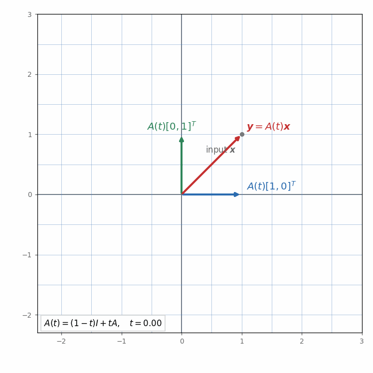
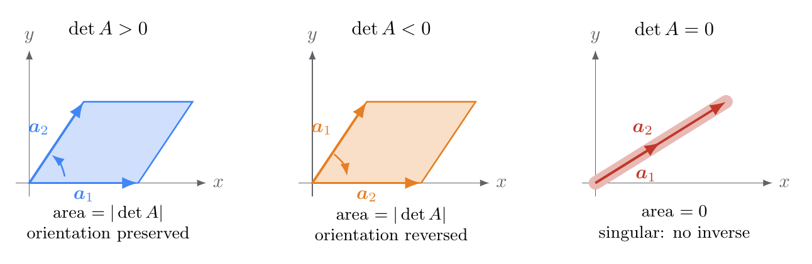
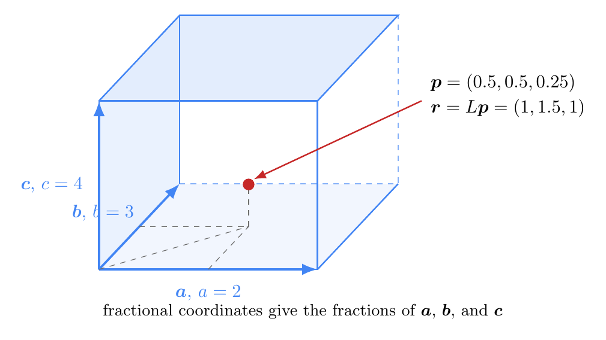
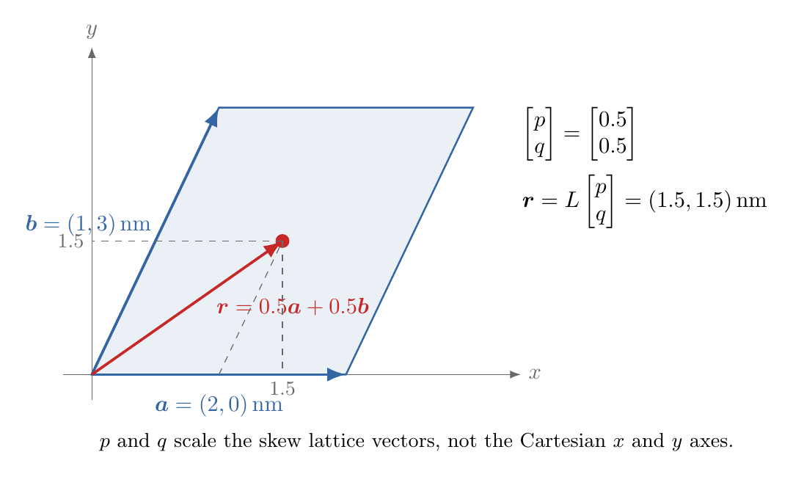

**목차**

* TOC
{:toc}

# 1. 학습 목표

이 자료에서 $[\boldsymbol A]$, $[\boldsymbol x]$는 행렬·벡터의 성분을 모은 배열을 뜻한다.
수식에서는 행렬곱을 $[\boldsymbol A][\boldsymbol x]$처럼 붙여 쓰고, Python 코드에서는 <code>A @ x</code>로 쓴다.

이번 강의가 끝나면 다음을 할 수 있어야 한다.

- 행렬을 2차원 NumPy 배열로 나타낼 수 있다.
- 원소별 곱과 행렬곱을 구분할 수 있다.
- 행렬–벡터곱과 행렬곱을 손으로 계산하고 NumPy로 확인할 수 있다.
- 행렬–벡터곱을 벡터와 격자의 선형변환으로 해석할 수 있다.
- 행렬곱이 가능한 shape 조건을 판단할 수 있다.
- 단위행렬, 전치행렬, 행렬식과 역행렬의 의미를 설명할 수 있다.
- <code>np.linalg.solve()</code>로 간단한 연립방정식을 풀 수 있다.

11장에서는 두 벡터의 내적으로 스칼라를 구했다. 이번 장에서는 행렬의 각 행과
벡터의 내적을 모아 새로운 벡터를 만들고, 이를 행렬곱과 선형변환으로 확장한다.
인덱스를 이용한 합산 규칙과 <code>np.einsum</code>은 다음 13장에서 다룬다.

# 2. 행렬과 NumPy 배열

$m$행 $n$열의 행렬은 $m\times n$ 행렬이라고 한다.

$$
[\boldsymbol A]=
\begin{bmatrix}
1&2&3\\
4&5&6
\end{bmatrix}
$$

은 2행 3열 행렬이다.

~~~python
import numpy as np
A = np.array([
    [1.0, 2.0, 3.0],
    [4.0, 5.0, 6.0],
])

print(A)
print(A.shape)
print(A.ndim)
~~~

<code>A.shape</code>은 <code>(2, 3)</code>이고 <code>A.ndim</code>은 2이다.
이 장의 수식에서는 첨자를 1부터, Python에서는 인덱스를 0부터 센다.
따라서 수식의 $A_{ij}$는 코드의 <code>A[i-1, j-1]</code>에 대응한다.
예를 들어 수식의 $A_{12}$는 코드의 <code>A[0, 1]</code>이다.

~~~python
print(A[0, 0])
print(A[1, 2])
~~~

# 3. 행렬의 합과 원소별 곱

shape이 같은 두 행렬의 합과 차는 같은 위치의 성분끼리 계산한다.

~~~python
A = np.array([
    [1.0, 2.0],
    [3.0, 4.0],
])
B = np.array([
    [5.0, 6.0],
    [7.0, 8.0],
])

print(A + B)
print(A - B)
~~~

별표 연산자 <code>*</code>는 행렬곱이 아니라 원소별 곱을 계산한다.

~~~python
elementwise_product = A * B
print(elementwise_product)
~~~

결과는

$$
\begin{bmatrix}
5&12\\
21&32
\end{bmatrix}
$$

이다.

# 4. 행렬–벡터곱

행렬

$$
[\boldsymbol A]=
\begin{bmatrix}
1&2\\
3&4
\end{bmatrix}
$$

와 벡터

$$
[\boldsymbol x]=
\begin{bmatrix}
5\\6
\end{bmatrix}
$$

의 곱은 각 행과 벡터의 내적으로 계산한다.

$$
[\boldsymbol A][\boldsymbol x]
=
\begin{bmatrix}
1\times5+2\times6\\
3\times5+4\times6
\end{bmatrix}
=
\begin{bmatrix}
17\\39
\end{bmatrix}
$$

~~~python
A = np.array([
    [1.0, 2.0],
    [3.0, 4.0],
])
x = np.array([5.0, 6.0])

result = A @ x

print(result)
print(result.shape)
~~~

$(m,n)$ 행렬과 shape이 $(n,)$인 벡터를 곱하면 shape이 $(m,)$인 벡터가 나온다.

## 행렬–벡터곱을 선형변환으로 해석하기

행렬 $[\boldsymbol A]$를 벡터 $[\boldsymbol x]$에 곱하면 새 벡터
$[\boldsymbol y]=[\boldsymbol A][\boldsymbol x]$를 얻는다. 이를 입력 벡터 $\boldsymbol x$를
출력 벡터 $\boldsymbol y$로 보내는 **선형변환(linear transformation)**으로 해석할 수 있다.
같은 행렬을 평면의 모든 벡터에 적용하면 격자와 그 안의 벡터가 함께 변한다.

두 기본 벡터 $[1,0]^T$, $[0,1]^T$의 변환 결과는 각각 행렬 $[\boldsymbol A]$의
첫 번째와 두 번째 열이다. 따라서 행렬의 열을 보면 기본 두 방향이 어디로
이동하는지 알 수 있다.

  

*그림: $[\boldsymbol A(t)]=(1-t)[\boldsymbol I]+t[\boldsymbol A]$로 행렬을 서서히 바꾸면
격자, 기본 벡터, 입력 벡터가 같은 변환을 따라 연속적으로 변한다.*

애니메이션의 마지막 상태에서는

$$
[\boldsymbol A]=\begin{bmatrix}1.2&0.6\\0.2&1.1\end{bmatrix},
\qquad
[\boldsymbol x]=\begin{bmatrix}1\\1\end{bmatrix},
\qquad
[\boldsymbol y]=[\boldsymbol A][\boldsymbol x]
=\begin{bmatrix}1.8\\1.3\end{bmatrix}
$$

이다. 선형변환은 벡터의 덧셈과 스칼라곱을 보존하므로,

$\boldsymbol A(c\boldsymbol u+d\boldsymbol v)=c\boldsymbol A\boldsymbol u+d\boldsymbol A\boldsymbol v$
를 만족한다.

# 5. 행렬곱

두 행렬

$$
[\boldsymbol A]=
\begin{bmatrix}
1&2\\
3&4
\end{bmatrix},
\qquad
[\boldsymbol B]=
\begin{bmatrix}
2&0\\
1&3
\end{bmatrix}
$$

의 곱을 생각하자. 결과의 각 성분은 $A$의 한 행과 $B$의 한 열의 내적이다.

$$
\begin{aligned}
C_{11}&=1\times2+2\times1=4,\\
C_{12}&=1\times0+2\times3=6,\\
C_{21}&=3\times2+4\times1=10,\\
C_{22}&=3\times0+4\times3=12.
\end{aligned}
$$

따라서

$$
[\boldsymbol C]
=
[\boldsymbol A][\boldsymbol B]
=
\begin{bmatrix}
4&6\\
10&12
\end{bmatrix}
$$

이다.

~~~python
A = np.array([
    [1.0, 2.0],
    [3.0, 4.0],
])
B = np.array([
    [2.0, 0.0],
    [1.0, 3.0],
])

C = A @ B

print(C)
~~~

일반적으로 $A$가 $(l,m)$ 행렬이고 $B$가 $(m,n)$ 행렬이면

$$
C_{ij}
=
\sum_{k=1}^{m}A_{ik}B_{kj}
$$

이고 결과 $C$는 $l$행 $n$열, 즉 shape이 $(l,n)$인 행렬이다.

$$
C_{ij}
=
\sum_{k=1}^{m}A_{ik}B_{kj}

\text{ with } i=1,2,..., l \ \ j=1,2,...,n
$$

학습을 위해 반복문으로 같은 계산을 구현하면 다음과 같다.

~~~python
rows_a, columns_a = A.shape
rows_b, columns_b = B.shape

C_loop = np.zeros((rows_a, columns_b))

for i in range(rows_a):
    for j in range(columns_b):
        for k in range(columns_a):
            C_loop[i, j] += A[i, k] * B[k, j]

print(C_loop)
print(np.allclose(C, C_loop))
~~~

실제 계산에서는 보통 최적화된 행렬곱 <code>A @ B</code>를 사용한다.
<code>np.allclose()</code>는 작은 부동소수점 오차를 허용하여 두 결과가 같은지 확인한다.

# 6. 행렬곱의 shape

행렬곱에서는 앞 행렬의 **열 개수**와 뒤 행렬의 **행 개수**가 같아야 한다.
shape을 나란히 적었을 때 안쪽의 두 수가 같아야 한다는 뜻이다.

$$
(l,m)(m,n)\rightarrow(l,n)
$$

예를 들어 다음 곱은 가능하다.

~~~python
A = np.ones((2, 3))
B = np.ones((3, 4))

C = A @ B

print(C.shape)
~~~

$(2,3)(3,4)$의 안쪽 크기 3이 같고 결과 shape은 $(2,4)$이다.

다음 곱은 안쪽 크기가 다르므로 계산할 수 없다.

~~~text
(2, 3) @ (2, 4)
~~~

행렬곱은 일반적으로 순서를 바꿀 수 없다.

$$
[\boldsymbol A][\boldsymbol B]
\ne
[\boldsymbol B][\boldsymbol A]
$$

shape에 따라 한쪽 순서의 곱만 가능한 경우도 있다.

# 7. 단위행렬과 전치행렬

## 7.1. 단위행렬

단위행렬(identity matrix)은 대각성분이 1이고 나머지가 0인 정사각행렬이다.

~~~python
I = np.eye(3)
x = np.array([2.0, 3.0, 4.0])

print(I)
print(I @ x)
~~~

단위행렬을 곱하면 원래 벡터나 행렬이 유지된다.

$$
[\boldsymbol I][\boldsymbol x]=[\boldsymbol x]
$$

## 7.2. 전치행렬

전치(transpose)는 행과 열을 바꾼다.

~~~python
A = np.array([
    [1.0, 2.0, 3.0],
    [4.0, 5.0, 6.0],
])

A_transpose = A.T

print(A.shape)
print(A_transpose.shape)
print(A_transpose)
~~~

$(2,3)$ 행렬의 전치는 $(3,2)$ 행렬이다.

## 7.3. 곱의 전치는 순서를 뒤집는다

$$
([\boldsymbol A][\boldsymbol B])^T=[\boldsymbol B]^T[\boldsymbol A]^T.
$$

$[\boldsymbol A]$가 $2\times3$, $[\boldsymbol B]$가 $3\times4$이면
곱의 전치는 $4\times2$다. 오른쪽도 $(4\times3)(3\times2)$이므로 같은 shape을 갖는다.
<code>A.T @ B.T</code>로 쓰면 이 예제에서는 곱 자체가 불가능하다.

다음 실습에서 왼쪽 $(AB)^T$와 오른쪽 $B^T A^T$를 각각 계산해 비교해 보자.

~~~python
A = np.array([
    [1.0, 2.0, 3.0],
    [4.0, 5.0, 6.0],
])

B = np.array([
    [1.0, 0.0, 2.0, 1.0],
    [0.0, 1.0, 1.0, 2.0],
    [1.0, 1.0, 0.0, 1.0],
])

left = (A @ B).T
right = B.T @ A.T

print(left)
print(right)
print(left.shape, right.shape)
print(np.allclose(left, right))
~~~

두 결과의 shape은 모두 <code>(4, 2)</code>이고,
<code>np.allclose(left, right)</code>는 <code>True</code>를 출력한다.
이때 전치는 각 행렬에만 적용되는 것이 아니라 **곱의 순서까지 반대로 바꾼다**는 점에 주의하자.

# 8. 행렬식과 역행렬

## 8.1. 행렬식

[행렬식(determinant)](https://ko.wikipedia.org/wiki/행렬식)은 정사각행렬에 대해 정의되는 스칼라이다. 2×2 행렬에서는

$$
\det
\begin{bmatrix}
a&b\\c&d
\end{bmatrix}
=ad-bc
$$

이다.

~~~python
A = np.array([
    [2.0, 1.0],
    [1.0, 3.0],
])

determinant = np.linalg.det(A)
print(determinant)
~~~

행렬식이 0이면 역행렬이 존재하지 않는다.

## 8.2. 역행렬

역행렬(inverse matrix)은 다음 관계를 만족한다.

$$
[\boldsymbol A]^{-1}[\boldsymbol A]
=
[\boldsymbol I]
$$

~~~python
A_inverse = np.linalg.inv(A)

print(A_inverse)
print(A_inverse @ A)
~~~

부동소수점 계산 결과는 정확한 정수 대신 0에 매우 가깝거나 1에 매우 가까운 값으로
나타날 수 있다. 두 배열이 가까운지 확인할 때는 <code>np.allclose()</code>를 사용한다.

~~~python
print(
    np.allclose(
        A_inverse @ A,
        np.eye(2),
    )
)
~~~

## 8.3. 행렬식의 기하학적 의미와 특이행렬

2차원에서 $\lvert\det[\boldsymbol A]\rvert$는 행렬의 두 열이 만드는 평행사변형의 넓이이며,
행렬식의 부호는 변환이 방향을 뒤집는지를 나타낸다.
$\det[\boldsymbol A]=0$이면 넓이가 0으로 줄어 역행렬이 존재하지 않으며, 이런 행렬을 **특이행렬(singular matrix)**이라 한다.

  

*그림: 두 열벡터가 만드는 넓이는 $\lvert\det[\boldsymbol A]\rvert$이다. 부호가 바뀌면 방향이 뒤집히고, 행렬식이 0이면 평행사변형이 선으로 줄어든다.*

# 9. 연립방정식 풀기

다음 연립방정식을 생각하자.

$$
\begin{aligned}
2x_1+x_2&=5,\\
x_1+3x_2&=6.
\end{aligned}
$$

행렬 형태는

$$
[\boldsymbol A][\boldsymbol x]=[\boldsymbol b]
$$

이며

$$
[\boldsymbol A]=
\begin{bmatrix}2&1\\1&3\end{bmatrix},
\quad
[\boldsymbol x]=
\begin{bmatrix}x_1\\x_2\end{bmatrix},
\quad
[\boldsymbol b]=
\begin{bmatrix}5\\6\end{bmatrix}
$$

이다.

~~~python
A = np.array([
    [2.0, 1.0],
    [1.0, 3.0],
])
b = np.array([5.0, 6.0])

x = np.linalg.solve(A, b)

print(x)
print(A @ x)
~~~

해는 $x_1=1.8$, $x_2=1.4$이고 <code>A @ x</code>는 원래 우변 $b$와 같다.

연립방정식을 풀 때는 역행렬을 직접 계산하여 <code>np.linalg.inv(A) @ b</code>로
구하기보다 <code>np.linalg.solve(A, b)</code>를 사용하는 것이 좋다.

## 9.1. 해를 구한 뒤에는 잔차를 확인한다

계산된 해가 $[\boldsymbol x]$이면 **잔차(residual)**를
$[\boldsymbol r]=[\boldsymbol A][\boldsymbol x]-[\boldsymbol b]$로 정의한다.

~~~python
A = np.array([[2.0, 1.0], [1.0, 3.0]])
b = np.array([5.0, 6.0])
x = np.linalg.solve(A, b)
residual = A @ x - b
print(x)                          # [1.8, 1.4]
print(residual)
print(np.allclose(A @ x, b))       # True
~~~

잔차가 작다는 것은 방정식을 잘 만족한다는 뜻이다.
다만 계수행렬이 거의 특이하면 작은 입력 오차에도 해가 크게 달라질 수 있으므로,
잔차가 작다는 사실만으로 측정 오차까지 작은 해라고 단정할 수는 없다.

<code>np.linalg.solve()</code>는 여기서 다루는 정사각이고 특이하지 않은 계수행렬에 사용한다.
특이행렬의 연립방정식은 우변에 따라 해가 없거나 무한히 많을 수 있다.
측정식 개수와 미지수 개수가 다른 최소제곱 문제는
[제16강 최소자승법]()에서 다룬다.

# 10. 재료공학 예제

## 10.1. 격자 좌표를 실제 위치로 변환하기

직교하는 격자벡터의 길이가 $a=2$, $b=3$, $c=4$라고 하자. [분율좌표(fractional coordinates)](https://en.wikipedia.org/wiki/Fractional_coordinates)
$\boldsymbol p=(0.5,0.5,0.25)$를 실제 위치로 바꾸는 행렬은

$$
[\boldsymbol L]=
\begin{bmatrix}
2&0&0\\
0&3&0\\
0&0&4
\end{bmatrix}
$$

이다.

  

*그림: 분율좌표 $(0.5,0.5,0.25)$는 각 격자벡터 $\boldsymbol a$, $\boldsymbol b$, $\boldsymbol c$의 0.5, 0.5, 0.25배를 더한 위치를 뜻한다.*

~~~python
lattice_matrix = np.diag([2.0, 3.0, 4.0])
fractional_position = np.array([
    0.5,
    0.5,
    0.25,
])

cartesian_position = (
    lattice_matrix @ fractional_position
)

print(cartesian_position)
~~~

결과는 $(1,1.5,1)$이다.

## 10.2. 두 격자점 사이의 거리

~~~python
fractional_p = np.array([0.0, 0.0, 0.0])
fractional_q = np.array([0.5, 0.5, 0.25])

cartesian_p = lattice_matrix @ fractional_p
cartesian_q = lattice_matrix @ fractional_q

distance = np.linalg.norm(
    cartesian_q - cartesian_p
)

print(distance)
~~~

두 점 사이의 거리는 $\sqrt{1^2+1.5^2+1^2}\approx2.062$이다.

## 10.3. 기울어진 격자와 여러 점의 위치

평면 내 격자벡터를 $\boldsymbol a=(2,0)\,\mathrm{nm}$,
$\boldsymbol b=(1,3)\,\mathrm{nm}$로 정하자. 이 벡터들을 **열**에 배치하면

$$
[\boldsymbol L]=\begin{bmatrix}2&1\\0&3\end{bmatrix},
\qquad
[\boldsymbol r]=[\boldsymbol L]\begin{bmatrix}p\\q\end{bmatrix}
=p\begin{bmatrix}2\\0\end{bmatrix}+q\begin{bmatrix}1\\3\end{bmatrix}
$$

  

*그림: 분율좌표 $(p,q)=(0.5,0.5)$는 직교좌표축이 아니라 기울어진 격자벡터 $\boldsymbol a$, $\boldsymbol b$를 각각 0.5배한 뒤 더한다.*

이다. $p=q=0.5$이면 실제 위치는 $(1.5,1.5)\,\mathrm{nm}$다.
분율좌표의 성분 $p,q$는 무차원이며, 격자벡터에 곱해 실제 위치를 만든다.
기울어진 격자에서는 분율좌표의 성분을 제곱해 더한 뒤 제곱근을 구해도 실제 거리가 되지 않는다.
먼저 격자행렬로 실제 직교좌표 성분을 구한 뒤 벡터의 크기를 계산해야 한다.

여러 점을 **행마다 하나씩** 저장했다면 <code>L @ P</code> 대신 <code>P @ L.T</code>를 쓴다.
한 점에 대한 식을 전치하면 $([\boldsymbol L][\boldsymbol p])^T=[\boldsymbol p]^T[\boldsymbol L]^T$이기 때문이다.

~~~python
L = np.array([[2.0, 1.0], [0.0, 3.0]])
P = np.array([[0.0, 0.0], [0.5, 0.5], [1.0, 0.0]])
positions = P @ L.T
print(positions)  # [[0.0, 0.0], [1.5, 1.5], [2.0, 0.0]]
print(np.allclose(positions[1], L @ P[1]))  # True
~~~

여기서 구하는 것은 지정한 두 점의 직접 거리다. 주기적 경계조건에서 가장 가까운 원자 이미지를 찾는 문제는 별도의 처리가 필요하다.

# 11. 자주 하는 실수

- <code>A * B</code>를 행렬곱이라고 생각한다.
- 행렬곱 전에 두 행렬의 shape을 확인하지 않는다.
- 수학의 첨자와 Python 인덱스의 시작 번호를 혼동한다.
- $AB=BA$라고 생각한다.
- 정사각행렬이 아닌 행렬의 행렬식이나 역행렬을 구하려 한다.
- 행렬식이 0인 행렬의 역행렬을 구하려 한다.
- 연립방정식 계산에서 역행렬을 불필요하게 직접 구한다.

# 12. 정리

- 행렬은 2차원 NumPy 배열로 나타낼 수 있다.
- <code>*</code>는 원소별 곱이고 <code>@</code>는 행렬곱이다.
- 행렬–벡터곱은 각 행과 벡터의 내적으로 계산한다.
- 행렬–벡터곱 $\boldsymbol y=\boldsymbol A\boldsymbol x$는 벡터와 격자를 바꾸는 선형변환으로 해석할 수 있다.
- $(l,m)$ 행렬과 $(m,n)$ 행렬의 곱은 $(l,n)$ 행렬이다.
- <code>np.eye()</code>는 단위행렬을 만든다.
- <code>A.T</code>는 전치행렬이다.
- <code>np.linalg.det()</code>와 <code>np.linalg.inv()</code>로 행렬식과 역행렬을 계산한다.
- 연립방정식은 <code>np.linalg.solve()</code>로 푼다.

TODO: 파일 추가 후 복구
[기울어진 격자와 원자 이동 실습]()에서 위치 변환, 변위, 투영, 넓이와 역변환을 함께 연습할 수 있다.


# 13. 연습 문제

## 문제 1

다음 행렬의 shape을 쓰시오.

$$
\begin{bmatrix}
1&2&3\\
4&5&6
\end{bmatrix}
$$

<!--
풀이와 해답:
2행 3열이므로 shape은 (2,3)이다.
-->

## 문제 2

NumPy에서 원소별 곱과 행렬곱에 사용하는 연산자를 각각 쓰시오.

<!--
풀이와 해답:
원소별 곱은 *이고 행렬곱은 @이다.
-->

## 문제 3

다음 행렬–벡터곱을 계산하라.

$$
\begin{bmatrix}
1&0\\
0&2
\end{bmatrix}
\begin{bmatrix}
3\\4
\end{bmatrix}
$$

<!--
풀이와 해답:
결과는 (3,8)^T이다.
-->

## 문제 4

shape이 $(2,3)$인 행렬과 $(3,4)$인 행렬을 곱할 수 있는가? 결과 shape도 쓰시오.

<!--
풀이와 해답:
안쪽 크기 3이 같으므로 곱할 수 있고 결과 shape은 (2,4)이다.
-->

## 문제 5

단위행렬 $\boldsymbol I$와 벡터 $\boldsymbol x$의 곱은 무엇인가?

<!--
풀이와 해답:
I x=x이므로 원래 벡터 x이다.
-->

## 문제 6

다음 2×2 행렬

$\begin{bmatrix}2&1\\1&3\end{bmatrix}$

의 행렬식을 구하라.

<!--
풀이와 해답:
2 곱하기 3에서 1 곱하기 1을 빼면 5이다.
-->

## 문제 7

행렬 $A$와 벡터 $b$로 이루어진 연립방정식 $Ax=b$를 푸는 NumPy 함수를 쓰시오.

<!--
풀이와 해답:
np.linalg.solve(A, b)를 사용한다.
-->

[이전 강의]() | [강의 목록]() | [다음 강의]()
