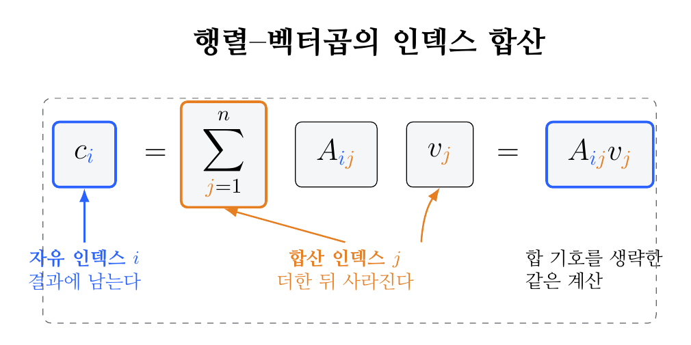
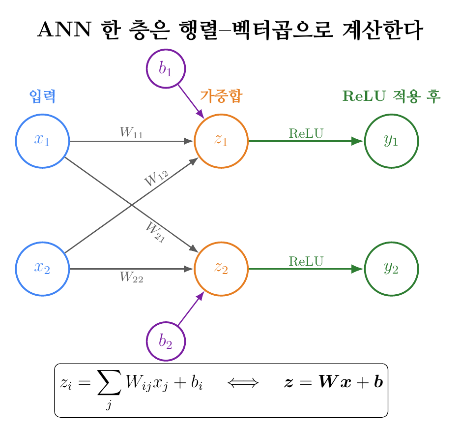

**목차**

* TOC
{:toc}

# 1. 학습 목표

이 자료에서 $[\boldsymbol A]$, $[\boldsymbol x]$는 행렬·벡터의 성분을 모은 배열을 뜻한다.
행렬곱은 $[\boldsymbol A][\boldsymbol x]$처럼 붙여 쓴다.

11·12장에서 배운 내적, 행렬–벡터곱과 행렬곱을 인덱스로 간단히 다시 쓴다.
새로운 계산법을 많이 추가하기보다, **반복되는 인덱스는 더하고 결과에 남는 인덱스는 유지한다**는
한 가지 원리를 이해하는 데 초점을 둔다. 마지막에는 같은 행렬–벡터곱이
간단한 인공신경망(ANN)의 한 층에서 어떻게 사용되는지 살펴본다.

- 자유 인덱스와 합산 인덱스를 구분할 수 있다.
- 벡터·행렬 연산을 명시적인 합과 아인슈타인 합 규약(Einstein summation convention)으로 표현할 수 있다.
- 내적, 행렬–벡터곱과 행렬곱의 간단한 <code>np.einsum</code> 표현을 읽을 수 있다.
- 행렬–벡터곱을 간단한 인공신경망의 순전파 계산과 연결할 수 있다.

# 2. [아인슈타인 합 규약(Einstein summation convention)](https://freshrimpsushi.github.io/ko/posts/90/)과 [`np.einsum`](https://numpy.org/doc/stable/reference/generated/numpy.einsum.html) 함수

`np.einsum` 공식 문서는 영문이므로, 처음 읽을 때는
[한국어 아인슈타인 합 표기와 `einsum` 예제](https://mz-moonzoo.tistory.com/65)를 함께 참고할 수 있다.

**Einstein summation convention**은 우리말로 흔히 **아인슈타인 합 규약**이라고 한다.
여기서 convention은 수학적 법칙이라기보다, 한 항에서 같은 첨자가 두 번 나타나면
그 첨자에 대해 합을 취하기로 한 **표기상의 약속**을 뜻한다. 이 약속을 이용하면
벡터와 행렬 연산의 합 기호($\sum$)를 생략하여 수식을 간결하게 쓸 수 있다.

아래 수식에서는 벡터를 $\boldsymbol a$처럼 굵게 쓰고,
스칼라와 개별 성분은 $a$, $a_i$처럼 보통 굵기로 쓴다.
수식 아래에 붙이는 성분 번호를 **첨자**라고 하며, 이 장에서는 코드와 연결하기 위해 **인덱스**라고도 부른다.

## 2.1. 자유 인덱스와 합산 인덱스

이 장의 수식에서는 성분 번호를 1부터, Python 코드에서는 0부터 센다.
예를 들어 수식의 $a_1$은 코드의 <code>a[0]</code>이다.

12장의 행렬–벡터곱을 다시 쓰면

$$
c_i=\sum_{j=1}^{n}A_{ij}v_j
$$

이다. $i$는 결과의 성분을 선택하는 **자유 인덱스(free index)**, $j$는 합을 구한 뒤 사라지는
**합산 인덱스(summation index)**다. 이 표기 약속에서는 한 항 안에서 두 번 나타나는 합산 인덱스의
합 기호를 생략하여 $c_i=A_{ij}v_j$로 쓴다.
반면 $c_i=a_i+b_i$에서는 오른쪽의 각 항에 $i$가 한 번씩 나타나므로 $i$를 합산하지 않는다.
인덱스의 반복은 등식 전체가 아니라 **각 항 안에서** 판단한다.

{: style="width: 760px; max-width: 100%; height: auto; display: block; margin: auto;" }

*그림: 파란색 자유 인덱스 $i$는 결과 $c_i$에 남고, 주황색 합산 인덱스 $j$는
대응하는 성분을 곱해 더한 뒤 결과에서 사라진다.*

<a id="3-벡터-스케일링-스칼라-곱"></a>
<a id="5-단위-벡터-unit"></a>
<a id="61-같은-방향의-단위-벡터-구하기"></a>

# 3. 11·12장의 연산을 인덱스로 연결하기

11장에서는 벡터의 성분별 연산과 내적을 배웠고, 12장에서는 행렬의 각 행과 벡터의
내적을 모아 행렬–벡터곱을 만들고 이를 행렬곱으로 확장했다. 이 장에서는 계산법을
다시 익히기보다, 같은 연산에서 **어떤 인덱스가 결과에 남고 어떤 인덱스를 합산하는지** 읽는다.

| 앞에서 배운 연산 | 인덱스 표현 | 인덱스의 역할 |
| --- | --- | --- |
| 벡터의 합 | $c_i=a_i+b_i$ | $i$가 결과에 남는다. |
| 벡터와 스칼라의 곱 | $b_i=ca_i$ | $i$가 결과에 남는다. |
| 벡터의 크기 | $\lVert\boldsymbol a\rVert=\sqrt{a_i a_i}$ | 반복된 $i$를 합산하여 스칼라를 만든다. |
| 벡터의 내적 | $c=a_i b_i$ | 반복된 $i$를 합산하여 스칼라를 만든다. |
| 행렬–벡터곱 | $c_i=A_{ij}v_j$ | $i$는 남고 $j$는 합산한다. |
| 행렬곱 | $C_{ij}=A_{ik}B_{kj}$ | $i,j$는 남고 $k$는 합산한다. |

앞의 두 행처럼 한 항에서 인덱스가 한 번 나타나면 그 인덱스는 결과의 위치를 정한다.
뒤의 네 행처럼 한 항에서 인덱스가 두 번 나타나면 이 표기 약속에 따라 그
인덱스를 합산한다. 이 구분이 13장의 새 내용이며, 다음 절부터 익숙한 연산을
반복문과 `np.einsum`으로 비교한다.


<a id="65-내적-inner-dot"></a>

# 4. 익숙한 연산을 인덱스로 읽기

## 4.1. 벡터의 내적

11장에서 배운 내적은 대응하는 성분을 곱해 모두 더하므로 결과가 스칼라다.

$$
c=\sum_{i=1}^{n}a_i b_i=a_i b_i
$$

```python
a = np.array([1, 2, 3])
b = np.array([4, 5, 6])

c_loop = 0
for i in range(len(a)):
    c_loop += a[i] * b[i]

c_matmul = a @ b
c_einsum = np.einsum('i,i->', a, b)
print(c_loop, c_matmul, c_einsum)  # 32 32 32
```

반복문에서 사라지는 `i`가 합산 인덱스다. `einsum`에서도 `i`를
`->` 뒤에 쓰지 않았으므로 모든 성분을 더해 스칼라를 만든다.

<a id="66-nxn행렬과-n벡터-곱"></a>

## 4.2. 행렬–벡터곱

12장에서 행렬의 각 행과 벡터의 내적을 계산하여 새 벡터를 만들었다.

$$
c_i=\sum_{j=1}^{n}A_{ij}v_j=A_{ij}v_j
$$

```python
A = np.array([[2, 1],
              [3, 1]])
v = np.array([3, 1])
c_loop = np.zeros(A.shape[0], dtype=int)

for i in range(A.shape[0]):
    for j in range(A.shape[1]):
        c_loop[i] += A[i, j] * v[j]

c_matmul = A @ v
c_einsum = np.einsum('ij,j->i', A, v)
print(c_loop)  # [7 10]
print(np.array_equal(c_loop, c_matmul))
print(np.array_equal(c_loop, c_einsum))
```

`i`는 결과 벡터의 위치를 정하므로 남고, `j`는 한 행의 성분을 더한 뒤 사라진다.
따라서 `'ij,j->i'`는 12장의 `A @ v`를 인덱스로 그대로 적은 표현이다.

<a id="67-행렬-곱1-single-dot"></a>

## 4.3. 행렬곱

12장의 행렬곱은 두 행렬에서 서로 대응하는 $k$ 인덱스에 대해 곱한 값을 더한다.

$$
C_{ij}=\sum_{k=1}^{n}A_{ik}B_{kj}=A_{ik}B_{kj}
$$

```python
A = np.array([[1, 2],
              [3, 4]])
B = np.array([[5, 6],
              [7, 8]])

C_matmul = A @ B
C_einsum = np.einsum('ik,kj->ij', A, B)
print(C_matmul)
# [[19 22]
#  [43 50]]
print(np.array_equal(C_matmul, C_einsum))  # True
```

`i`와 `j`는 결과 행렬의 두 축으로 남고, `k`는 합산한다.
이처럼 입력 인덱스와 출력 인덱스를 비교하면 결과의 shape도 예측할 수 있다.


# 5. `np.einsum` 기초

`np.einsum`은 배열의 각 축에 `i`, `j`, `k` 같은 이름을 붙여
어느 인덱스를 결과에 남기고 어느 인덱스를 합산할지 적는 함수다.
처음에는 다음 세 가지 표현만 읽을 수 있으면 충분하다.

| 계산 | `einsum` 표현 | 익숙한 NumPy 표현 | 결과 |
| --- | --- | --- | --- |
| 벡터 내적 | `np.einsum('i,i->', a, b)` | `a @ b` | 스칼라 |
| 행렬–벡터곱 | `np.einsum('ij,j->i', A, v)` | `A @ v` | 벡터 |
| 행렬곱 | `np.einsum('ik,kj->ij', A, B)` | `A @ B` | 행렬 |

문자열은 다음 순서로 읽는다.

1. 쉼표 앞뒤의 글자는 입력 배열의 축 이름이다.
2. `->` 뒤의 글자는 결과에 남는 인덱스다.
3. 입력에는 있지만 결과에는 없는 인덱스는 합산한다.

예를 들어 `'ij,j->i'`에서 `j`는 입력에만 있으므로 합산하고,
`i`는 출력에 남으므로 결과는 벡터가 된다.

## 5.1. 원소별 곱과 내적 구분하기

두 벡터의 **원소별 곱**은 각 위치의 곱을 그대로 남긴 벡터이고,
**내적**은 그 곱을 모두 더한 스칼라다.

```python
a = np.array([1, 2, 3])
b = np.array([4, 5, 6])

elementwise = np.einsum('i,i->i', a, b)
dot = np.einsum('i,i->', a, b)

print(elementwise)  # [ 4 10 18]
print(dot)          # 32
```

`'i,i->i'`는 `i`를 결과에 남기므로 `a * b`와 같고,
`'i,i->'`는 `i`를 결과에서 없애 합산하므로 `a @ b`와 같다.
단순한 내적이나 행렬곱에서는 `@`가 더 읽기 쉽다.
`einsum`은 수식의 인덱스와 코드를 직접 비교하고 싶을 때 유용하다.

## 5.2. `'ik,kj->ij'`와 `'ik,jk->ij'`의 차이

두 표현은 모두 `k`를 합산하고 `i,j`를 결과에 남긴다.
그러나 두 번째 배열에서 인덱스를 붙이는 순서가 다르므로 계산도 달라진다.

$$
C_{ij}=\sum_k A_{ik}B_{kj},
\qquad
D_{ij}=\sum_k A_{ik}B_{jk}
$$

| 표현 | 두 번째 배열에서 사용하는 성분 | 계산의 의미 | 같은 NumPy 표현 |
| --- | --- | --- | --- |
| `'ik,kj->ij'` | $B_{kj}$ | $A$의 $i$번째 행과 $B$의 $j$번째 열의 내적 | `A @ B` |
| `'ik,jk->ij'` | $B_{jk}$ | $A$의 $i$번째 행과 $B$의 $j$번째 행의 내적 | `A @ B.T` |

같은 $2\times2$ 배열을 사용하여 결과를 비교해 보자.

```python
A = np.array([[1, 2],
              [3, 4]])
B = np.array([[5, 6],
              [7, 8]])

C = np.einsum('ik,kj->ij', A, B)
D = np.einsum('ik,jk->ij', A, B)

print(C)
# [[19 22]
#  [43 50]]

print(D)
# [[17 23]
#  [39 53]]

print(np.array_equal(C, A @ B))    # True
print(np.array_equal(D, A @ B.T))  # True
```

첫 번째 식의 $C_{11}$은 $A$의 첫 번째 행 $[1,2]$와 $B$의 첫 번째 열 $[5,7]^T$를
내적하므로 $1\times5+2\times7=19$다.
두 번째 식의 $D_{11}$은 $A$와 $B$의 첫 번째 행 $[1,2]$, $[5,6]$을
내적하므로 $1\times5+2\times6=17$이다.
즉, `kj`를 `jk`로 바꾸는 것은 단순한 글자 순서 변경이 아니라
두 번째 배열을 전치하여 사용하는 것과 같다.

# 6. ANN으로 연결하는 아주 간단한 예제

[인공신경망(artificial neural network, ANN)](https://developers.google.com/machine-learning/crash-course/neural-networks/activation-functions?hl=ko)의
한 층은 입력값에 가중치를 곱해 더하고
편향(bias)을 더하는 계산으로 시작한다. 입력이 두 개이고 뉴런이 두 개인 가장 간단한
경우를 생각하자.

$$
\boldsymbol z=\boldsymbol W\boldsymbol x+\boldsymbol b,
\qquad
z_i=W_{ij}x_j+b_i
$$

{: style="width: 680px; max-width: 100%; height: auto; display: block; margin: auto;" }

*그림: 각 입력 $x_j$는 가중치 $W_{ij}$를 통해 각 뉴런의 가중합 $z_i$에 연결된다.
편향 $b_i$를 더한 뒤 ReLU를 적용하여 출력 $y_i$를 얻는다.*

$$
\boldsymbol W=
\begin{bmatrix}
0.5&1.0\\
-1.0&2.0
\end{bmatrix},
\qquad
\boldsymbol x=
\begin{bmatrix}
2\\1
\end{bmatrix},
\qquad
\boldsymbol b=
\begin{bmatrix}
0.5\\0
\end{bmatrix}.
$$

첫 번째 뉴런과 두 번째 뉴런의 입력 합은 각각

$$
z_1=0.5\times2+1.0\times1+0.5=2.5,
\qquad
z_2=-1.0\times2+2.0\times1+0=0
$$

이므로 $\boldsymbol z=[2.5,0]^T$이다. 각 뉴런의 가중치는 $\boldsymbol W$의 한 행에
들어 있고, 합산 인덱스 $j$는 두 입력을 더한 뒤 사라진다. 자유 인덱스 $i$는 두 뉴런의
출력 위치로 남는다.

```python
W = np.array([[ 0.5, 1.0],
              [-1.0, 2.0]])
x = np.array([2.0, 1.0])
b = np.array([0.5, 0.0])

z_matmul = W @ x + b
z_einsum = np.einsum('ij,j->i', W, x) + b
print(z_matmul)                         # [2.5 0. ]
print(np.allclose(z_matmul, z_einsum)) # True
```

ANN에서는 이 값에 활성화 함수(activation function)를 적용한다. 예를 들어
ReLU는 음수는 0으로 바꾸고 0 이상은 그대로 두므로
`y = np.maximum(0, z_matmul)`의 결과도 이 예제에서는 `[2.5, 0.0]`이다.
여기서 핵심은 새로운 행렬 연산이 아니라, 12장의 행렬–벡터곱과 13장의
`'ij,j->i'` 표현이 ANN 한 층의 기본 계산에 그대로 사용된다는 점이다.

# 7. 정리

- 11·12장의 벡터·행렬 연산을 인덱스로 쓰면 결과의 축과 합산할 축을 구분할 수 있다.
- 자유 인덱스는 결과에 남고, 합산 인덱스는 합을 구한 뒤 사라진다.
- 아인슈타인 합 규약(Einstein summation convention)에서는 한 항 안에서 두 번 나타나는 인덱스의 합 기호를 생략한다.
- <code>einsum</code>에서는 <code>-></code> 뒤에 결과에 남길 인덱스를 적는다.
- ANN 한 층의 가중합도 행렬–벡터곱이며, $z_i=W_{ij}x_j+b_i$로 표현할 수 있다.
- 간단한 내적과 행렬곱에는 <code>@</code>를 사용하고, 인덱스 표현과 비교할 때 <code>einsum</code>을 활용한다.


---

[이전 강의](/assets/lecture_notes/1_2_data_mse/data_mse_12_행렬연산기초.md) · [강의 목록](/_lectures/1_2_data_mse.md) · [다음 강의](/assets/lecture_notes/1_2_data_mse/data_mse_14_기초_matplotlib1.md)
