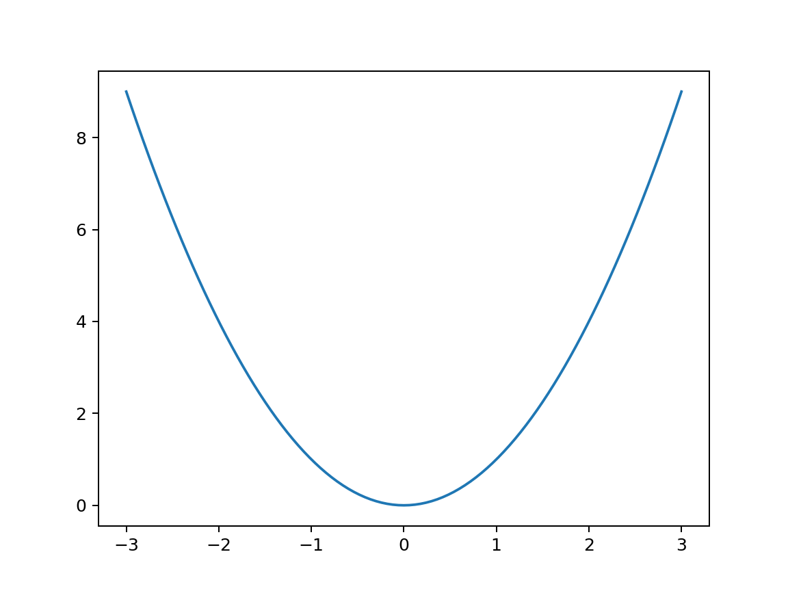
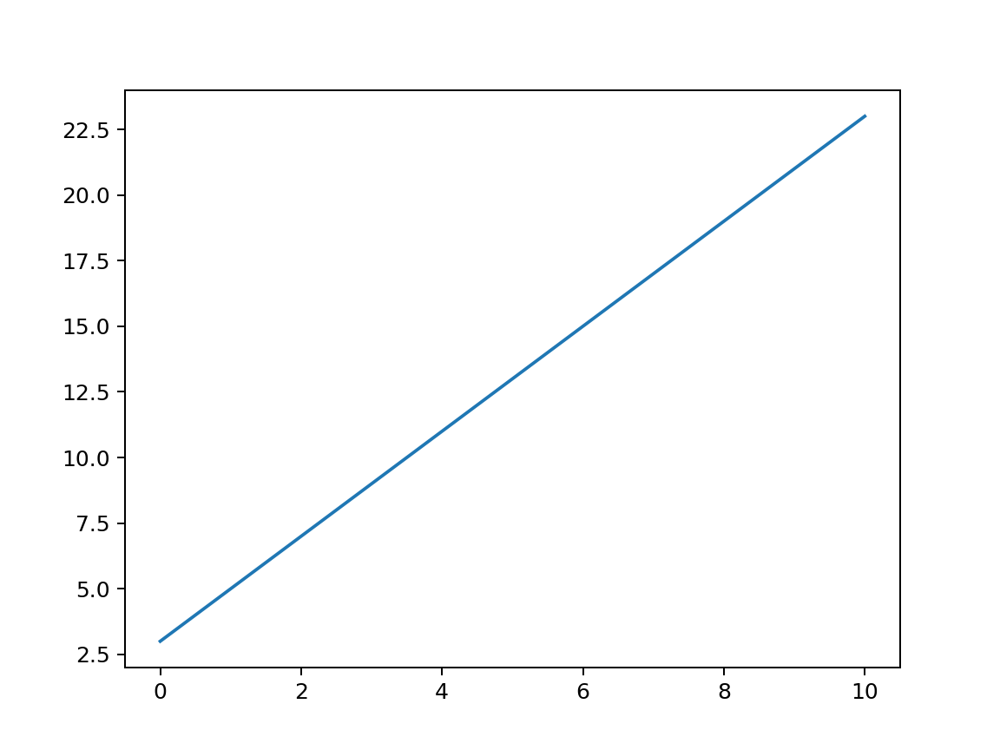
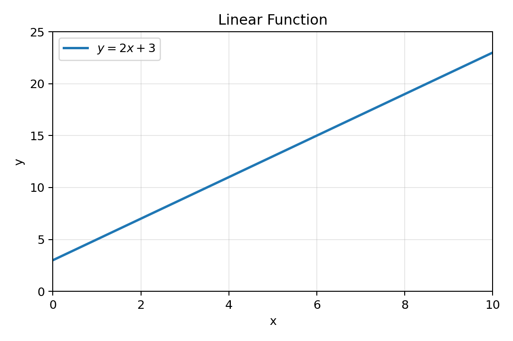
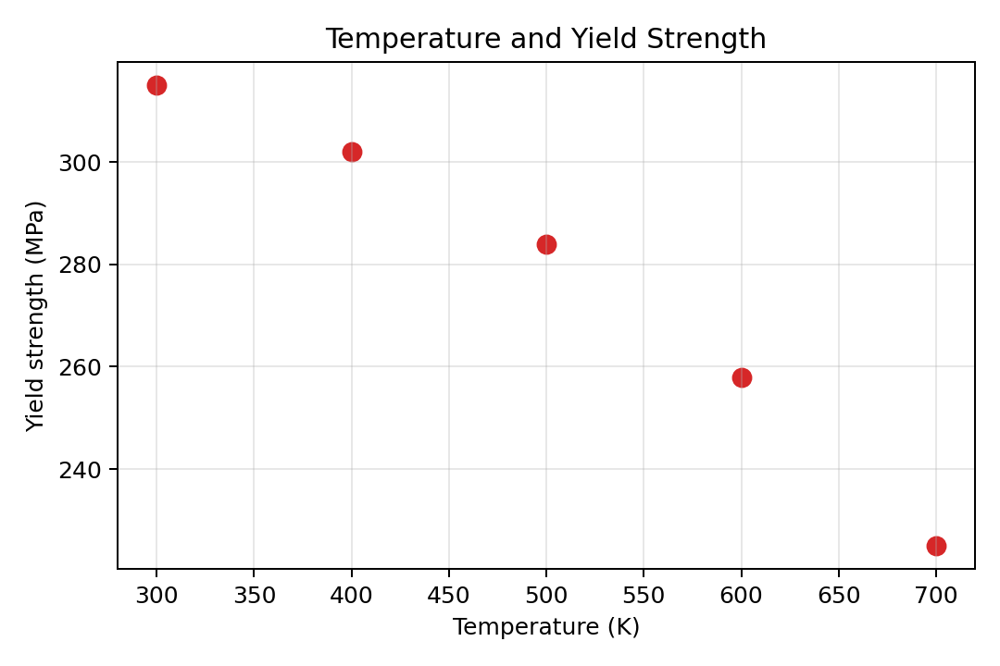
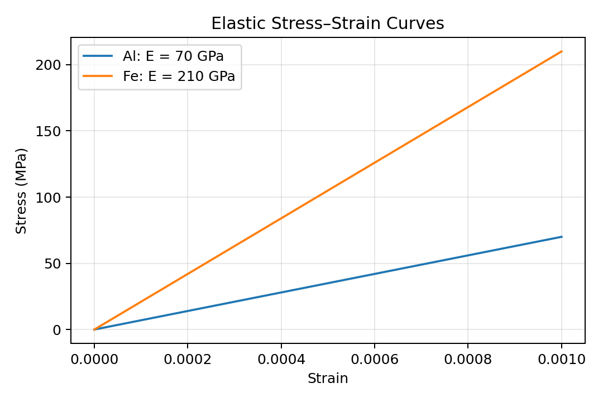
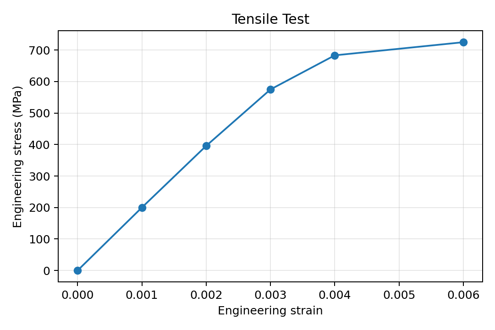
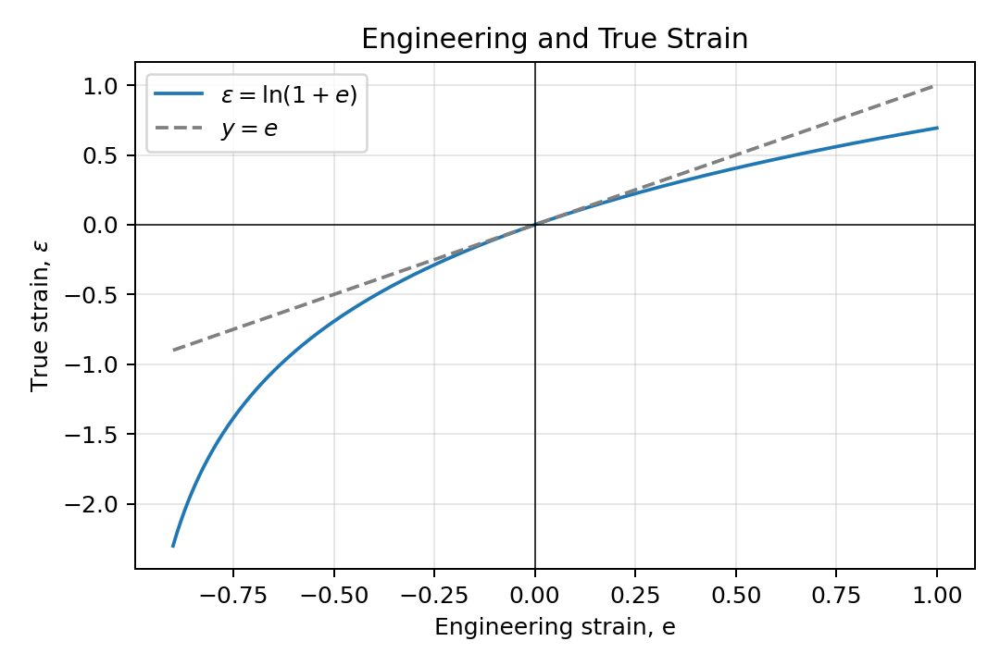
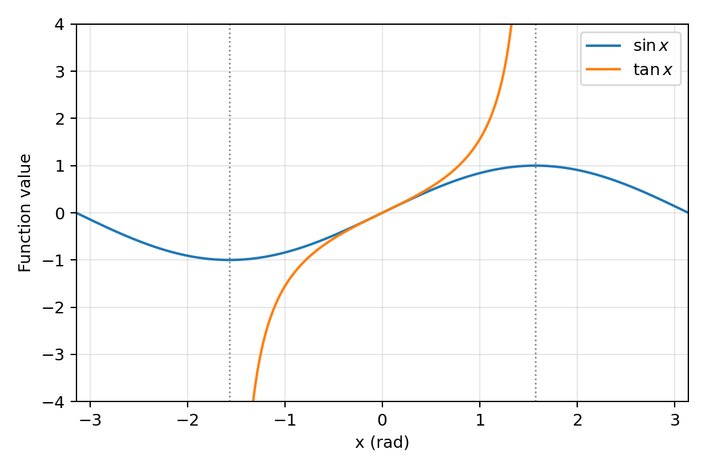
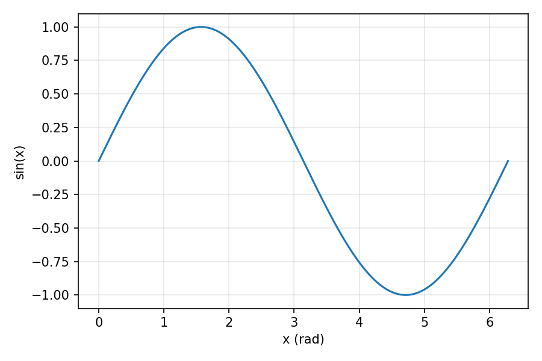

**목차**

* TOC
{:toc}

# 1. 학습 목표

이번 강의가 끝나면 다음을 할 수 있어야 한다.

- NumPy 배열을 선 그래프와 산점도로 나타낼 수 있다.
- Figure와 Axes의 역할을 구분할 수 있다.
- 제목, 축 이름, 범례와 격자선을 추가할 수 있다.
- 한 그래프에서 여러 데이터를 비교할 수 있다.
- 응력–변형률 데이터를 그래프로 나타낼 수 있다.
- 완성한 그림을 파일로 저장할 수 있다.

9–13장에서는 배열을 계산하고 벡터·행렬 연산으로 해석했다.
이번 장에서는 그 결과를 **좌표 쌍 → 하나의 그래프 → 의미와 단위를 갖춘 그림**으로 표현한다.
15장에서는 여러 그래프, 로그축, 오차막대와 공간 분포로 확장한다.
예제의 재료 데이터는 그래프 작성법을 익히도록 만든 예시 데이터이며, 특정 재료의 실험 결과가 아니다.

# 2. Matplotlib 시작하기

[Matplotlib](https://matplotlib.org/)은 Python에서 데이터를 시각화할 때 널리 사용하는
라이브러리다. 보통 NumPy는 데이터를 계산하고, Matplotlib은 계산 결과를 그림으로
표현하는 데 사용한다.

~~~python
import numpy as np
import matplotlib.pyplot as plt
~~~

관례적으로 <code>numpy</code>는 <code>np</code>, <code>matplotlib.pyplot</code>은
<code>plt</code>라는 이름으로 불러온다.

각 장의 코드는 처음부터 순서대로 실행한다. 새 Notebook이나 Python 실행 환경에서는 위의 import를 먼저 실행한다.
설치가 필요하면 사용하는 Python 환경의 터미널에서 다음 명령을 실행한다.

~~~sh
python -m pip install matplotlib
~~~

Notebook에서는 셀 아래에 그림이 표시되고, 일반 Python 스크립트에서는 실행 환경에 따라
<code>plt.show()</code>가 그림 창을 표시한다. 각 예제는 새 Figure를 만들어 앞의 그림과 구분한다.

# 3. 선 그래프

선 그래프(line plot)는 $x$와 $y$의 관계 또는 값의 연속적인 변화를 표현하기에
적합하다. <code>np.linspace()</code>로 $x$ 좌표를 만들고, 앞선 NumPy 강의에서 배운
원소별 연산으로 $y$ 좌표를 계산해 보자.

~~~python
x = np.linspace(-3.0, 3.0, 101)
y = x**2 # element-wise operation

plt.plot(x, y)
plt.show()
~~~

{: style="width: 720px; max-width: 100%; height: auto;"}

<code>x</code>와 <code>y</code>에는 같은 개수의 값이 들어 있다. 같은 인덱스의 두 값
$(x_i,y_i)$가 하나의 좌표가 되고, 선 그래프는 이 점들을 **입력 순서대로** 연결한다.
<code>plot()</code>이 $x$를 자동 정렬하거나 점 사이의 실제 값을 알아내는 것은 아니다.
이 장에서는 <code>x</code>와 <code>y</code>를 길이가 같은 1차원 배열로 준비한다.

~~~python
print(x.shape, y.shape)  # (101,) (101,)
~~~

함수 그래프는 $x$를 증가하는 순서로 준비하는 것이 자연스럽다.
측정 경로 자체를 나타내는 경우에는 측정 순서를 유지해야 한다.

# 4. Figure와 Axes

- **Figure**는 그림 전체를 담는 캔버스다.
- **Axes**는 실제 그래프가 그려지는 좌표 영역이다.
- **Axis**는 그 영역의 개별 $x$축 또는 $y$축을 관리한다. <code>ax</code>는 Axis 하나가 아니라 Axes 객체다.

<code>plt.subplots()</code>는 Figure와 Axes를 함께 만든다.

~~~python
x = np.linspace(0.0, 10.0, 101)
y = 2.0 * x + 3.0

fig, ax = plt.subplots()
ax.plot(x, y)
plt.show()
~~~

{: style="width: 720px; max-width: 100%; height: auto;"}

이후에는 어느 그래프를 수정하는지 명확한 객체 지향(object-oriented) 방식을 사용한다.
즉, <code>plt.plot()</code>보다 <code>ax.plot()</code>을 주로 사용한다.
<code>fig</code>와 <code>ax</code>는 우리가 붙인 변수명이며, <code>plt.subplots()</code>의
두 반환값을 각각 저장한 것이다. 15장에서는 하나의 Figure에 Axes를 여러 개 만든다.

# 5. 그래프 꾸미기

그래프에는 데이터의 의미와 단위를 표시해야 한다.

~~~python
x = np.linspace(0.0, 10.0, 101)
y = 2.0 * x + 3.0

fig, ax = plt.subplots(figsize=(6, 4))
ax.plot(x, y, color="tab:blue", linewidth=2, label=r"$y=2x+3$")
ax.set_title("Linear Function")
ax.set_xlabel("x")
ax.set_ylabel("y")
ax.set_xlim(0.0, 10.0)
ax.set_ylim(0.0, 25.0)
ax.grid(True, alpha=0.3)
ax.legend()
fig.tight_layout()
plt.show()
~~~

{: style="width: 720px; max-width: 100%; height: auto;"}

| 명령 | 역할 |
|---|---|
| <code>ax.set_title()</code> | 그래프 제목 |
| <code>ax.set_xlabel()</code> | $x$축 이름과 단위 |
| <code>ax.set_ylabel()</code> | $y$축 이름과 단위 |
| <code>ax.set_xlim()</code> | $x$축 표시 범위 |
| <code>ax.set_ylim()</code> | $y$축 표시 범위 |
| <code>ax.grid()</code> | 격자 표시 |
| <code>ax.legend()</code> | 범례 표시 |

<code>figsize=(6, 4)</code>는 그림의 가로·세로 길이를 인치(inch) 단위로 지정한다.
<code>label</code>은 범례에 사용할 이름을 등록하고, <code>legend()</code>가 실제 범례를 표시한다.
<code>tight_layout()</code>은 축 이름 등의 간격을 조정한다.
<code>set_xlim()</code>, <code>set_ylim()</code>은 표시 범위를 바꾸므로, 중요한 데이터가 잘리지 않는지도 확인하자.
이 예제의 $x,y$는 단위가 없는 수학적 변수다.

# 6. 산점도 (scatter plot)

산점도(scatter plot)는 측정값처럼 서로 떨어진 데이터의 관계를 나타내기에 적합하다.

~~~python
temperature = np.array([300, 400, 500, 600, 700])
strength = np.array([315, 302, 284, 258, 225])

fig, ax = plt.subplots(figsize=(6, 4))
ax.scatter(temperature, strength, color="tab:red", s=60)
ax.set_xlabel("Temperature (K)")
ax.set_ylabel("Yield strength (MPa)")
ax.set_title("Temperature and Yield Strength")
ax.grid(True, alpha=0.3)
fig.tight_layout()
plt.show()
~~~

{: style="width: 720px; max-width: 100%; height: auto;"}

여기에서 <code>s</code>는 표식의 면적을 포인트 제곱(pt²) 단위로 지정한다.
포인트(point)는 인쇄·화면 표시에서 쓰는 길이 단위이며 1 pt는 1/72인치다. <code>s</code>는 반지름이 아니다. 측정된 점 사이의 값이 알려져 있지 않다면 선으로
연결하기보다 산점도로 먼저 표현하는 것이 자연스럽다.

# 7. 여러 데이터 비교하기

하나의 Axes에 <code>ax.plot()</code>을 여러 번 호출하면 여러 데이터를 함께 비교할 수
있다. 각 데이터에 <code>label</code>을 지정하고 범례를 표시하자.

~~~python
strain = np.linspace(0.0, 0.001, 101)
stress_al = 70_000 * strain
stress_fe = 210_000 * strain

fig, ax = plt.subplots(figsize=(6, 4))
ax.plot(strain, stress_al, label="Al: E = 70 GPa")
ax.plot(strain, stress_fe, label="Fe: E = 210 GPa")
ax.set_xlabel("Strain")
ax.set_ylabel("Stress (MPa)")
ax.set_title("Elastic Stress–Strain Curves")
ax.grid(True, alpha=0.3)
ax.legend()
fig.tight_layout()
plt.show()
~~~

{: style="width: 720px; max-width: 100%; height: auto;"}

응력의 단위를 MPa로 사용했으므로 영률도 $70\,000$ MPa와 $210\,000$ MPa로
계산하였다. 여기서는 선형 탄성 모델 $\sigma=E e$를 비교한다.
실제 재료에는 항복과 소성변형이 있으므로 이 직선을 임의의 큰 변형률까지 연장해
실제 응력–변형률 곡선으로 해석하면 안 된다. 탄성 범위는 재료와 조건에 따라 달라진다.
변형률 0.001은 0.1%이며, 위 그래프는 백분율이 아닌 무차원 값을 사용한다.

# 8. 재료공학 예제: 응력–변형률 곡선

초기 길이가 $L_0$, 초기 단면적이 $A_0$인 인장시험편에서
[공칭 변형률(engineering strain)](https://en.wikipedia.org/wiki/Strain_%28mechanics%29#Engineering_strain)과 공칭 응력(engineering stress)은

$$
e=\frac{\Delta L}{L_0},
\qquad
\sigma=\frac{F}{A_0}
$$

이다. 초기 길이 $50$ mm, 폭 $6$ mm, 두께 $2$ mm인 시험편의 측정값을 그래프로
나타내자. $1\ \mathrm{N/mm^2}=1\ \mathrm{MPa}$이다.

~~~python
displacement = np.array([0.00, 0.05, 0.10, 0.15, 0.20, 0.30])  # mm
force = np.array([0, 2400, 4750, 6900, 8200, 8700])             # N

initial_length = 50.0  # mm
width = 6.0            # mm
thickness = 2.0        # mm
initial_area = width * thickness

engineering_strain = displacement / initial_length
engineering_stress = force / initial_area

fig, ax = plt.subplots(figsize=(6, 4))
ax.plot(engineering_strain, engineering_stress, marker="o")
ax.set_xlabel("Engineering strain")
ax.set_ylabel("Engineering stress (MPa)")
ax.set_title("Tensile Test")
ax.grid(True, alpha=0.3)
fig.tight_layout()
plt.show()
~~~

{: style="width: 720px; max-width: 100%; height: auto;"}

<code>marker="o"</code>는 입력한 측정 지점을 원으로 표시한다.
연결선은 측정 순서의 경향을 보여 주며, 두 점 사이를 실제로 측정했다는 뜻은 아니다.
여기서 <code>displacement</code>는 표점거리 $L_0$에서 측정한 늘어난 길이 $\Delta L$로 가정한다.
시험기 크로스헤드 변위를 사용할 때는 시험기·그립의 변형 등이 포함될 수 있어
시편의 표점거리 변화와 바로 같다고 볼 수 없다.

## 8.1. 공칭 변형률과 진 변형률 비교하기

초기 길이 $L_0$가 $L$로 변했을 때 공칭 변형률(engineering strain)은
$e=(L-L_0)/L_0$이고, 같은 길이 변화의 [진 변형률(true strain, logarithmic strain)](https://en.wikipedia.org/wiki/Strain_%28mechanics%29#Logarithmic_strain)은
$\varepsilon=\ln(L/L_0)$이다. 따라서

$$
\frac{L}{L_0}=1+e,
\qquad
\varepsilon=\ln(1+e),
\qquad e>-1
$$

의 관계가 있다. 두 변형률은 모두 무차원이며,
$e>0$은 인장, $-1<e<0$은 압축에 해당한다.
$e=-1$은 길이가 0이 되는 경우이므로 로그를 계산할 수 없다.

아래에서는 공칭 변형률을 $x$축, 진 변형률을 $y$축에 놓고,
두 값이 같을 때의 기준선 $y=e$와 비교한다.

~~~python
e = np.linspace(-0.9, 1.0, 401)
true_strain = np.log1p(e)  # np.log(1 + e)와 같은 함수값

fig, ax = plt.subplots(figsize=(6, 4))
ax.plot(e, true_strain, label=r"$\varepsilon=\ln(1+e)$")
ax.plot(e, e, linestyle="--", color="gray", label=r"$y=e$")
ax.axhline(0, color="black", linewidth=0.6)
ax.axvline(0, color="black", linewidth=0.6)
ax.set_xlabel("Engineering strain, e")
ax.set_ylabel(r"True strain, $\varepsilon$")
ax.set_title("Engineering and True Strain")
ax.legend()
ax.grid(True, alpha=0.3)
fig.tight_layout()
plt.show()
~~~

{: style="width: 720px; max-width: 100%; height: auto;"}

원점 부근에서는 $\ln(1+e)\approx e$이므로 두 값이 거의 같다.
하지만 $e=1$이면 길이가 두 배가 되어 $\varepsilon=\ln 2\approx0.693$이고,
$e=-0.5$이면 길이가 절반이 되어 $\varepsilon=\ln 0.5\approx-0.693$이다.
인장에서는 진 변형률이 공칭 변형률보다 작고,
압축에서는 진 변형률의 값이 더 작고, 음수의 절댓값은 더 크다.
앞의 인장시험 예제는 $0\le e\le0.006$인 작은 범위여서,
여기서는 차이를 보기 위해 더 넓은 변형률 범위를 사용했다.

# 9. 삼각함수와 정의역

배열을 계산할 때는 함수가 정의되는 범위를 먼저 확인한다.
NumPy의 삼각함수에는 각도를 **라디안(radian)** 단위로 넣는다.
$y=\sin x$는 $-\pi\le x\le\pi$에서 계산할 수 있지만,
$y=\tan x$는 $x=\pm\pi/2$에서 정의되지 않는다.

아래에서는 $-\pi/2<x<\pi/2$인 한 구간의 탄젠트만 그린다.
점근선(asymptote) 가까이에서는 값이 매우 커지므로, 두 함수를 비교할 때 표시 범위를 함께 확인하자.

~~~python
x_sin = np.linspace(-np.pi, np.pi, 401)
delta = 0.05  # 점근선과의 거리 (rad)
x_tan = np.linspace(-np.pi / 2 + delta, np.pi / 2 - delta, 401)

fig, ax = plt.subplots(figsize=(6, 4))
ax.plot(x_sin, np.sin(x_sin), label=r"$\sin x$")
ax.plot(x_tan, np.tan(x_tan), label=r"$\tan x$")
ax.axvline(-np.pi / 2, color="gray", linestyle=":", linewidth=1)
ax.axvline(np.pi / 2, color="gray", linestyle=":", linewidth=1)
ax.set_xlim(-np.pi, np.pi)
ax.set_ylim(-4, 4)
ax.set_xlabel("x (rad)")
ax.set_ylabel("Function value")
ax.legend()
ax.grid(True, alpha=0.3)
fig.tight_layout()
plt.show()
~~~

{: style="width: 720px; max-width: 100%; height: auto;"}

수직 점선은 점근선의 위치다. $y$축 범위 밖의 탄젠트 값은 화면에서 잘리며,
실제 값이 $\pm4$에서 끝난다는 뜻은 아니다.
<code>np.linspace()</code>에서 점근선이 우연히 빠졌더라도,
그 양쪽 점을 한 번에 연결하면 존재하지 않는 연결선이 나타날 수 있다.
여러 구간을 그릴 때는 불연속점에서 구간을 나누어 그려야 한다.

# 10. 그림 저장하기

<code>fig.savefig()</code>로 그림을 저장할 수 있다. 저장 명령은 일반적으로
<code>plt.show()</code>보다 앞에 둔다.

~~~python
x = np.linspace(0.0, 2.0 * np.pi, 201)
y = np.sin(x)

fig, ax = plt.subplots(figsize=(6, 4))
ax.plot(x, y)
ax.set_xlabel("x (rad)")
ax.set_ylabel("sin(x)")
ax.grid(True, alpha=0.3)
fig.tight_layout()
fig.savefig("sine_curve.png", dpi=150)
plt.close(fig)
~~~

{: style="width: 720px; max-width: 100%; height: auto;"}

저장 위치는 Python의 현재 작업 폴더를 기준으로 한다.
<code>figsize=(6, 4)</code>에 <code>dpi=150</code>이면 기본 PNG 크기는 900×600픽셀이다.
글·선 중심의 그림은 <code>fig.savefig("sine_curve.pdf")</code>로 벡터 형식으로도 저장할 수 있다.
<code>plt.close(fig)</code>는 Figure를 닫아 메모리를 정리하며, 이미 저장된 파일은 유지된다.
화면에도 표시하려면 저장 다음에 <code>plt.show()</code>를 호출한다.

# 11. 자주 하는 실수

- 이 장의 1차원 좌표 배열 <code>x</code>, <code>y</code>는 길이를 맞춘다.
- 로그·삼각함수의 정의역과 불연속점을 확인한 뒤 계산하고 그린다.
- 축 이름만 쓰고 단위를 빠뜨리지 않도록 한다.
- <code>label</code>과 함께 <code>ax.legend()</code>도 호출해야 범례가 나타난다.
- 측정값의 점과 모델의 선이 무엇을 의미하는지 구분해서 표시한다.

# 12. 정리

- <code>ax.plot(x, y)</code>는 선 그래프를, <code>ax.scatter(x, y)</code>는 산점도를 그린다.
- Figure는 그림 전체이고 Axes는 실제 좌표 영역이다.
- 제목, 축 이름, 단위, 범례를 표시해야 그래프의 의미가 분명해진다.
- NumPy의 배열 연산 결과를 Matplotlib으로 바로 시각화할 수 있다.

# 13. 연습 문제

## 문제 1

다음 코드의 빈칸을 채워 $y=3x$를 선 그래프로 나타내시오.

~~~python
x = np.linspace(0.0, 5.0, 51)
y = 3.0 * x
fig, ax = plt.subplots()
# 여기에 코드를 작성한다.
plt.show()
~~~

<!--
풀이와 해답:
ax.plot(x, y)
-->

## 문제 2

선 그래프와 산점도는 각각 어떤 종류의 데이터를 표현하기에 적합한지 설명하시오.

<!--
풀이와 해답:
선 그래프는 연속적인 변화나 함수의 경향에, 산점도는 서로 떨어진 측정값에 적합하다.
-->

## 문제 3

그래프에 $x$축 이름 <code>Time (s)</code>와 $y$축 이름
<code>Temperature (K)</code>를 추가하는 코드를 쓰시오.

<!--
풀이와 해답:
ax.set_xlabel("Time (s)")
ax.set_ylabel("Temperature (K)")
-->

## 문제 4

공칭 변형률 $e=\Delta L/L_0$와 진 변형률 $\varepsilon=\ln(L/L_0)$의 관계는 아래와 같다.

$$
\varepsilon = \ln(1 + e),\qquad e>-1.
$$

공칭 변형률을 $x$축, 진 변형률을 $y$축으로 하여,
공칭 변형률이 -0.9에서 1까지 변할 때 두 값의 관계를 그리는 코드를 작성하시오.
$e=-1$을 포함할 수 없는 이유도 설명하시오.

<!--
풀이와 해답:
import numpy as np
import matplotlib.pyplot as plt
eps_engi = np.linspace(-0.9, 1, 201)
eps_true = np.log1p(eps_engi)  # ln(1 + e)
fig, ax = plt.subplots()
ax.plot(eps_engi, eps_true)
ax.set_xlabel("Engineering strain, e")
ax.set_ylabel(r"True strain, $\varepsilon$")
ax.grid(True, alpha=0.3)
fig.tight_layout()
plt.show()
e=-1이면 L=0이고 ln(0)은 유한한 실수값을 갖지 않는다. e<-1도 실수 로그의 정의역 밖이다.
-->

## 문제 5: 표시 범위와 저장

<code>fig, ax = plt.subplots(figsize=(6, 4))</code>로 만든 그림을
150 dpi의 PNG 파일 <code>result.png</code>로 저장하는 코드를 쓰시오.
또한 <code>ax.set_ylim(0, 100)</code>으로 설정했을 때 120인 데이터는 어떻게 표시되는가?

<!--
풀이와 해답:
fig.savefig("result.png", dpi=150)
기본 저장 크기는 900×600픽셀이다.
y=120인 점은 표시 범위 밖에서 잘리지만 원본 배열의 값은 바뀌지 않는다.
-->

---

[이전 강의](/assets/lecture_notes/1_2_data_mse/data_mse_13_행렬벡터연산고급_Ein.md) · [강의 목록](/_lectures/1_2_data_mse.md) · [다음 강의](/assets/lecture_notes/1_2_data_mse/data_mse_15_기초_matplotlib2.md)
