**목차**

* TOC
{:toc}

# 1. 학습 목표

- 하나의 Figure에 여러 Axes를 배치할 수 있다.
- 선의 종류, 색과 표식을 구분하여 데이터를 비교할 수 있다.
- 값의 범위가 매우 넓을 때 로그축을 사용할 수 있다.
- 평균과 표준편차를 오차막대로 표시하고, 표준오차와 구분할 수 있다.
- 2차원 색상 그래프와 간단한 3차원 그래프를 그릴 수 있다.

14장에서 익힌 <code>fig, ax</code>를 바탕으로 여러 Axes, 로그축, 오차막대를
사용한다. 이어 10장의 배열 축과 브로드캐스팅을 이용해 격자 위의 스칼라 분포를
그린다. 이 장의 재료 데이터와 공간 분포는 그래프 작성법을 익히기 위한 예시다.

# 2. 여러 그래프 배치하기

서로 단위나 크기가 다른 데이터를 한 Axes에 겹치면 읽기 어려울 수 있다.
<code>plt.subplots()</code>에 행과 열의 개수를 지정해 여러 Axes를 배치하자.

~~~python
import numpy as np
import matplotlib.pyplot as plt

temperature = np.array([300, 400, 500, 600, 700])
strength = np.array([315, 302, 284, 258, 225])
elongation = np.array([12, 14, 17, 21, 26])

fig, axes = plt.subplots(1, 2, figsize=(10, 4))
axes[0].plot(temperature, strength, marker="o")
axes[0].set_xlabel("Temperature (K)")
axes[0].set_ylabel("Yield strength (MPa)")
axes[0].grid(True, alpha=0.3)

axes[1].plot(temperature, elongation, marker="s", color="tab:orange")
axes[1].set_xlabel("Temperature (K)")
axes[1].set_ylabel("Elongation (%)")
axes[1].grid(True, alpha=0.3)

fig.suptitle("Mechanical Properties")
fig.tight_layout()
plt.show()
~~~

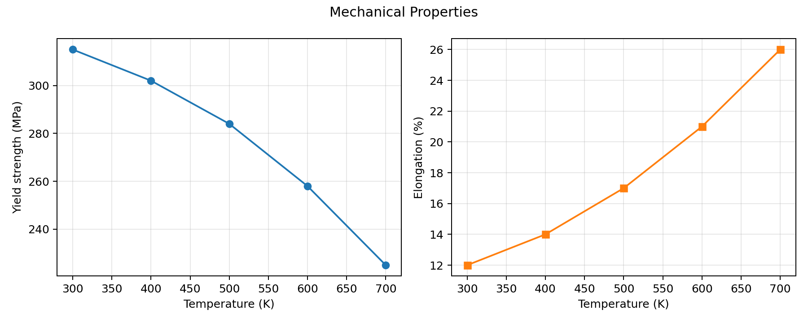{: style="width: 1000px; max-width: 100%; height: auto;"}

## 2.1. `axes`의 shape 확인하기

기본 설정에서 <code>plt.subplots()</code>는 Axes 하나를 반환하지만,
여러 Axes를 만들면 <code>axes</code>는 NumPy 객체 배열이 된다.

| 생성 명령 | 두 번째 반환값 | 선택 방법 |
|---|---|---|
| <code>plt.subplots()</code> | Axes 하나 | <code>ax.plot(...)</code> |
| <code>plt.subplots(1, 2)</code> | shape <code>(2,)</code> 배열 | <code>axes[0].plot(...)</code> |
| <code>plt.subplots(2, 2)</code> | shape <code>(2, 2)</code> 배열 | <code>axes[0, 1].plot(...)</code> |

<code>squeeze=False</code>를 지정하면 1행·1열인 경우에도 항상 2차원 Axes 배열을 반환한다.
이는 10장에서 배운 배열 shape과 인덱싱을 적용하는 또 하나의 예다.
<code>sharex=True</code>는 여러 그래프가 같은 $x$축 범위를 공유하도록 한다.
같은 물리량을 비교할 때 축 범위를 맞추면 그래프의 높이 차이를 실제 값의 차이로 해석하기 쉽다.

# 3. 선과 점의 모양 바꾸기

색만으로 데이터를 구분하지 말고 선의 종류와 표식도 함께 다르게 지정하자.

~~~python
strain = np.linspace(0.0, 0.001, 101)

fig, ax = plt.subplots(figsize=(6, 4))
ax.plot(strain, 70_000 * strain, linestyle="-", marker="o", markevery=20, label="Al: E = 70 GPa")
ax.plot(strain, 210_000 * strain, linestyle="--", marker="s", markevery=20, label="Fe: E = 210 GPa")
ax.set_xlabel("Strain")
ax.set_ylabel("Stress (MPa)")
ax.legend()
ax.grid(True, alpha=0.3)
fig.tight_layout()
plt.show()
~~~

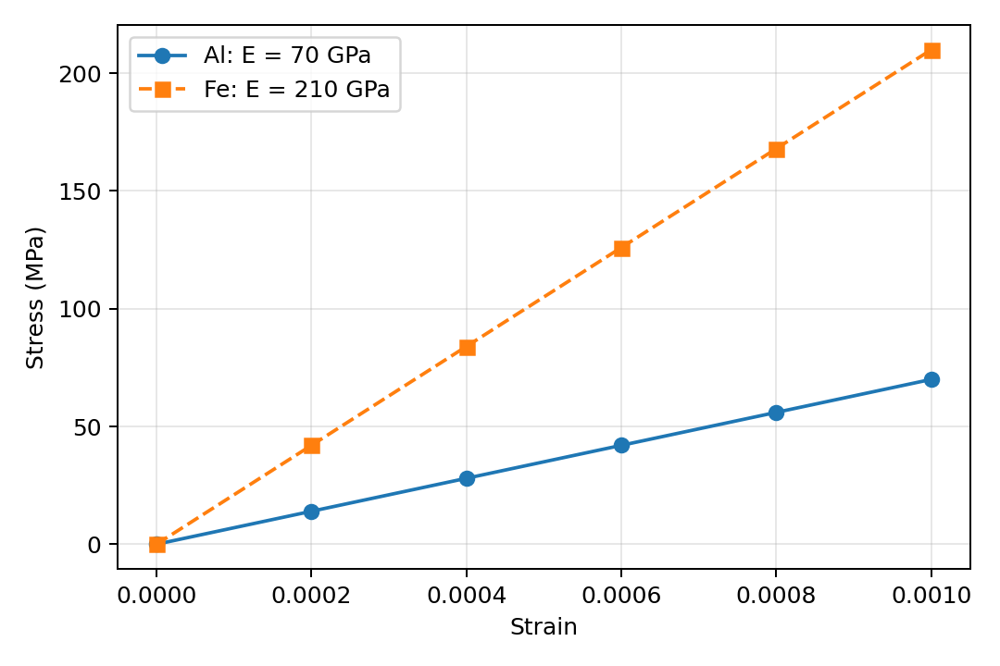{: style="width: 720px; max-width: 100%; height: auto;"}

대표적인 선 종류는 실선 <code>"-"</code>, 파선(대시선) <code>"--"</code>, 점선
<code>":"</code>이고, 표식에는 원 <code>"o"</code>, 사각형 <code>"s"</code>,
삼각형 <code>"^"</code> 등이 있다.

<code>markevery=20</code>은 데이터 점 20개 간격으로 표식을 그린다. 여기서 표식은 계산한 점이며 실험점을 뜻하지 않는다.
14장과 같은 이상적인 선형 탄성 모델이며, 실제 재료의 소성변형까지 나타내는 곡선은 아니다.

# 4. 로그축

확산계수처럼 여러 자릿수에 걸쳐 변하는 값에는 로그축(logarithmic scale)이 유용하다.
같은 데이터를 선형축(linear scale)과 로그축에 각각 그려 차이를 비교해 보자.

~~~python
temperature = np.array([700, 800, 900, 1000, 1100])
diffusivity = np.array([2.0e-17, 3.0e-15, 1.2e-13, 2.1e-12, 1.8e-11])

fig, axes = plt.subplots(1, 2, figsize=(10, 4))

axes[0].plot(temperature, diffusivity, marker="o")
axes[0].set_title("Linear scale")
axes[0].set_xlabel("Temperature (K)")
axes[0].set_ylabel(r"Diffusivity ($m^2/s$)")
axes[0].grid(True, alpha=0.3)

axes[1].semilogy(temperature, diffusivity, marker="o")
axes[1].set_title("Logarithmic y-scale")
axes[1].set_xlabel("Temperature (K)")
axes[1].set_ylabel(r"Diffusivity ($m^2/s$)")
axes[1].grid(True, which="both", alpha=0.3)

fig.tight_layout()
plt.show()
~~~

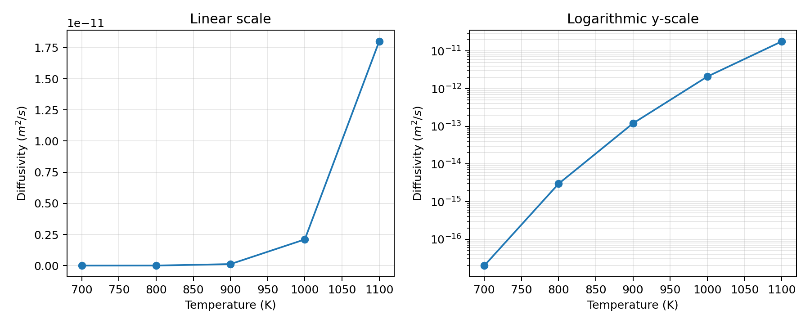{: style="width: 960px; max-width: 100%; height: auto;"}

왼쪽 선형축에서는 가장 큰 값이 세로축 범위를 지배하므로 낮은 온도의 작은 확산계수들이
0 부근에 눌려 서로 구분하기 어렵다. 오른쪽 로그축에서는 $10^{-17}$부터 $10^{-11}$까지의
각 자릿수가 일정한 간격으로 펼쳐져 작은 값들의 변화도 함께 읽을 수 있다.

<code>ax.semilogy()</code>는 $y$축만 로그축으로 만든다. 로그축에는 0이나 음수를
표시할 수 없다. 이 조건은 로그로 표시하는 축에 적용된다.
예를 들어 <code>semilogy</code>에서는 $y$가 양수여야 한다.

로그축에서 같은 간격은 같은 차이가 아니라 같은 **비율**을 뜻한다.
예를 들어 $10^{-16}$에서 $10^{-15}$까지와 $10^{-12}$에서 $10^{-11}$까지의 간격은 같다.
<code>semilogx()</code>는 $x$축만, <code>loglog()</code>는 두 축을 로그로 표시한다.
이는 좌표축 표시를 바꾸는 것이며 원본 <code>diffusivity</code> 배열을 로그값으로 바꾸지는 않는다.
또한 확산계수를 온도에 대해 로그축으로 표시했다고 해서 반드시 직선이 되는 것은 아니다.

# 5. 오차막대

같은 조건에서 여러 번 측정했다면 평균값과 데이터의 퍼짐을 함께 표현한다.
다음 배열의 각 행은 한 온도 조건, 각 열은 독립적인 반복 측정값이며 단위는 MPa다.
10장의 <code>axis=1</code> 집계로 조건별 평균과 표본 표준편차(sample standard deviation)를 계산한다.

~~~python
temperature = np.array([300, 400, 500, 600])
strength_measurements = np.array([
    [312.0, 320.0, 328.0],
    [298.0, 305.0, 312.0],
    [272.0, 282.0, 292.0],
    [246.0, 255.0, 264.0],
])
mean_strength = strength_measurements.mean(axis=1)
std_strength = strength_measurements.std(axis=1, ddof=1)

fig, ax = plt.subplots(figsize=(6, 4))
ax.errorbar(
    temperature,
    mean_strength,
    yerr=std_strength,
    fmt="o",
    capsize=4,
)
ax.set_xlabel("Temperature (K)")
ax.set_ylabel("Yield strength (MPa)")
ax.set_title("Mean and Sample SD (n = 3)")
ax.grid(True, alpha=0.3)
fig.tight_layout()
plt.show()
~~~

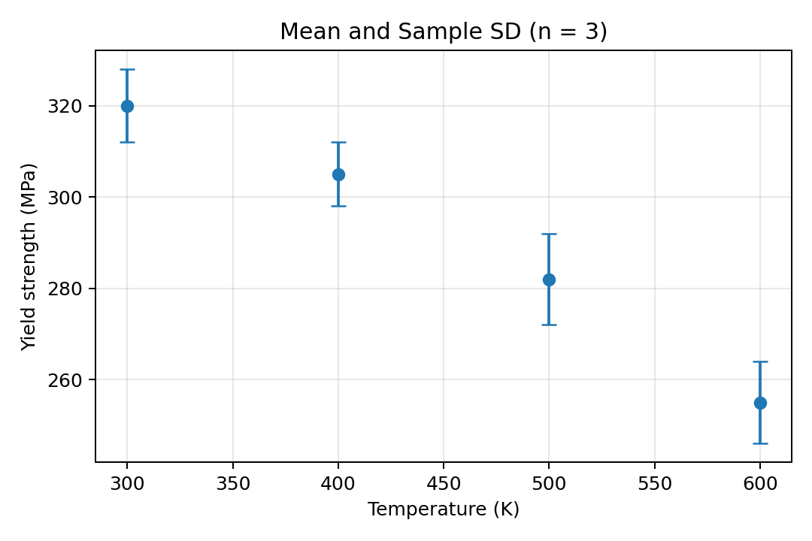{: style="width: 720px; max-width: 100%; height: auto;"}

이 예제의 오차막대는 **평균에서 위아래로 표본 표준편차($s$)만큼 떨어진 범위**를 나타낸다.
<code>ddof=1</code>은 표본 표준편차를 구할 때 제곱편차 합을 $n-1$로 나눈다는 뜻이다.
9장에서 기본 <code>std()</code>로 구한 값은 <code>ddof=0</code>으로, 분모가 $n$이다.

[표준편차(standard deviation)](https://ko.wikipedia.org/wiki/표준편차) $s$는 개별 측정값의 퍼짐을 나타낸다.
독립적이고 같은 분포에서 얻은 $n$회 반복 측정에 대해
[평균의 표준오차(standard error of the mean, SEM)](https://en.wikipedia.org/wiki/Standard_error)는 $s/\sqrt{n}$로 추정한다.
두 값은 의미가 다르며, 표준편차를 곧바로 평균의 불확실성(uncertainty)이나 신뢰구간(confidence interval)이라고 부르면 안 된다.
측정기가 항상 한쪽으로 치우친 값을 내는 **계통오차(systematic error)** 등은 반복 측정값의 퍼짐만으로 평가할 수 없다.
그림 설명에는 오차막대가 나타내는 값과 반복 횟수($n=3$)를 명시하자.
예를 들어 “점은 3회 반복 측정의 평균이며, 오차막대는 평균 ± 표본 표준편차($s$)를 나타낸다”라고 쓴다.
<code>yerr</code>에는 위아래 오차막대의 **길이**를 넣으며, 이 예제에서는 같은 길이를 양쪽에 적용한다.

# 6. 2차원 색상 그래프

두 위치 좌표에 따라 물리량이 변할 때 색으로 크기를 나타낼 수 있다.
먼저 좌표 격자와 배열 shape을 확인한 뒤, 시편 표면의 온도 분포를 그려 보자.

## 6.1. <code>meshgrid</code>로 좌표 배열 만들기

다음과 같이 두 변수를 갖는 함수를 생각하자.

$$
f(x,y)=x^2+y^2
$$

이 함수를 그리려면 여러 $x$와 $y$의 조합에서 함수값을 계산해야 한다. 먼저
<code>np.linspace()</code>로 각각의 1차원 좌표를 만든다.

~~~python
x = np.linspace(-2.0, 2.0, 5)
y = np.linspace(-1.0, 1.0, 3)

print(x)
print(y)
~~~

<code>np.meshgrid(x, y, indexing="xy")</code>는 모든 $(x,y)$ 조합을 계산할 수 있도록 두 개의
2차원 좌표 배열 <code>X</code>와 <code>Y</code>를 만든다.

~~~python
X, Y = np.meshgrid(x, y, indexing="xy")

print(X)
print(Y)
print(X.shape, Y.shape)
~~~

<code>X</code>의 각 행에는 $x$ 좌표가 반복되고, <code>Y</code>의 각 열에는 $y$ 좌표가
반복된다. 따라서 같은 위치의 <code>X[i, j]</code>와 <code>Y[i, j]</code>가 격자점
하나의 좌표를 나타낸다. NumPy의 원소별 연산을 적용하면 모든 격자점의 함수값을 한 번에
구할 수 있다.

~~~python
Z = X**2 + Y**2

print(Z)
print(Z.shape)
~~~

예를 들어 <code>X[0, 0] = -2</code>, <code>Y[0, 0] = -1</code>이므로
<code>Z[0, 0] = 5</code>이다.
<code>indexing="xy"</code>에서는 <code>X.shape == Y.shape == (len(y), len(x))</code>이며,
여기서는 <code>(3, 5)</code>다. 즉, <code>X[i, j] == x[j]</code>, <code>Y[i, j] == y[i]</code>다.
첫 번째 인덱스가 $y$, 두 번째가 $x$에 대응하는 점에 주의하자.
<code>indexing="xy"</code>는 기본 설정이며, <code>indexing="ij"</code>를 쓰면 축 순서가 달라진다.

10장의 브로드캐스팅으로도 같은 함수값을 계산할 수 있다.

~~~python
Z_broadcast = x[None, :]**2 + y[:, None]**2
print(Z_broadcast.shape)               # (3, 5)
print(np.allclose(Z, Z_broadcast))      # True
~~~

<code>x[None, :]</code>는 <code>(1, 5)</code>, <code>y[:, None]</code>은
<code>(3, 1)</code>이므로, 합의 결과는 <code>(3, 5)</code>다.

## 6.2. 온도 분포를 색으로 표현하기

아래 분포는 좌표 $x,y$와 분포의 폭을 정하는 길이 $a$에 대해

$$
T(x,y)=T_0+\Delta T\exp\left[-\left(\frac{x}{a}\right)^2-\left(\frac{y}{a}\right)^2\right]
$$

로 정한 예시다. $T_0=300$ K, $\Delta T=500$ K, $a=1$ mm이며,
지수 안의 값은 무차원이다. 원점에서 온도는 800 K이고, 멀어질수록 300 K에 가까워진다.

~~~python
x = np.linspace(-2.0, 2.0, 101)
y = np.linspace(-2.0, 2.0, 101)
X, Y = np.meshgrid(x, y, indexing="xy")
length_scale = 1.0  # mm
temperature = 300.0 + 500.0 * np.exp(-((X / length_scale)**2 + (Y / length_scale)**2))

fig, ax = plt.subplots(figsize=(6, 5))
image = ax.contourf(X, Y, temperature, levels=20, cmap="inferno")
colorbar = fig.colorbar(image, ax=ax)
ax.set_xlabel("x (mm)")
ax.set_ylabel("y (mm)")
ax.set_title("Surface Temperature")
ax.set_aspect("equal")
colorbar.set_label("Temperature (K)")
fig.tight_layout()
plt.show()
~~~

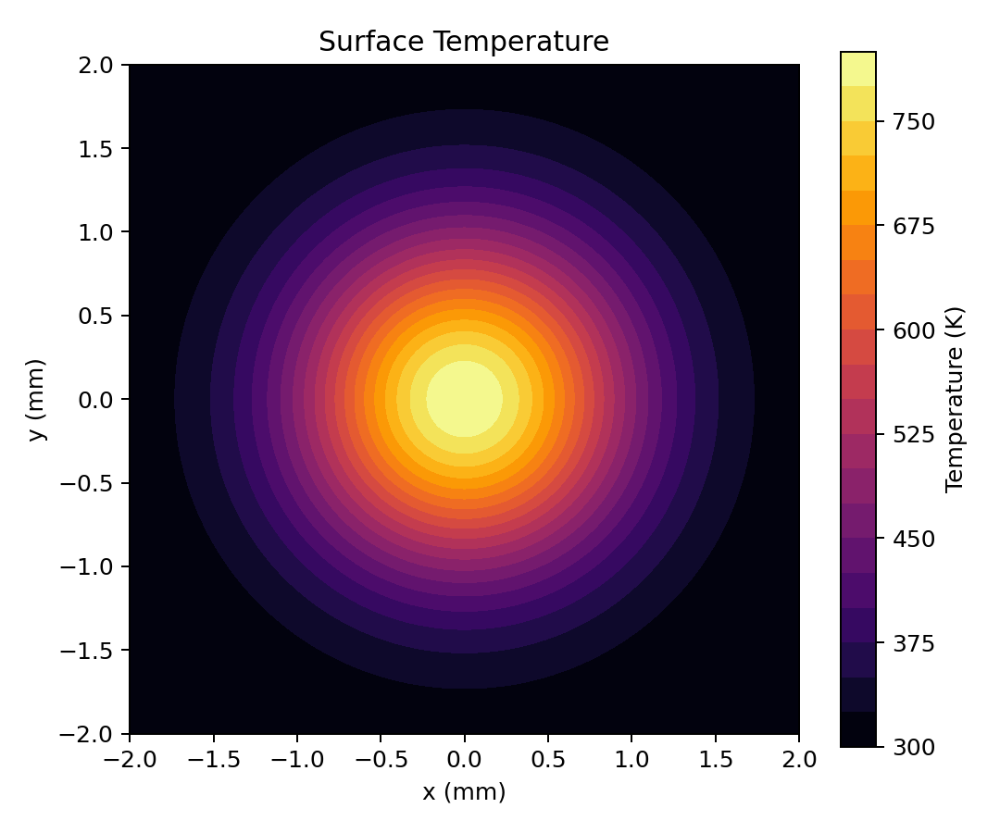{: style="width: 720px; max-width: 100%; height: auto;"}

<code>np.meshgrid()</code>는 1차원 좌표 배열로 2차원 격자를 만든다. 색상 막대(colorbar)에는
색이 나타내는 물리량과 단위를 표시한다.
값을 색에 대응시키는 컬러맵(colormap)은 <code>cmap</code>으로, 채워진 등고선 구간은 <code>levels</code>로 지정한다.
<code>set_aspect("equal")</code>은 $x,y$의 단위 길이를 같은 화면 길이로 표시한다.
서로 다른 온도 분포를 비교할 때는 색과 값의 대응 범위도 같게 설정해야 한다.

# 7. 2차원 격자 데이터와 3차원 그래프

## 7.1. 등고선으로 표현하기

등고선(contour)은 함수값이 같은 점들을 연결한 선이다. 3차원 표면을 위에서 내려다본
것처럼 2차원 평면에 함수의 변화를 표현할 수 있다. 앞에서 계산한
$Z=X^2+Y^2$를 <code>ax.contour()</code>에 전달해 보자.

~~~python
x = np.linspace(-2.0, 2.0, 101)
y = np.linspace(-2.0, 2.0, 101)
X, Y = np.meshgrid(x, y, indexing="xy")
Z = X**2 + Y**2

fig, ax = plt.subplots(figsize=(6, 5))
levels = np.arange(1.0, 8.0, 1.0)  # 높이 1, 2, ..., 7
contours = ax.contour(X, Y, Z, levels=levels, cmap="viridis")
ax.clabel(contours, inline=True, fontsize=9)

ax.set_xlabel("x")
ax.set_ylabel("y")
ax.set_title(r"Contours of $f(x,y)=x^2+y^2$")
ax.set_aspect("equal")
ax.grid(True, alpha=0.2)

fig.tight_layout()
plt.show()
~~~

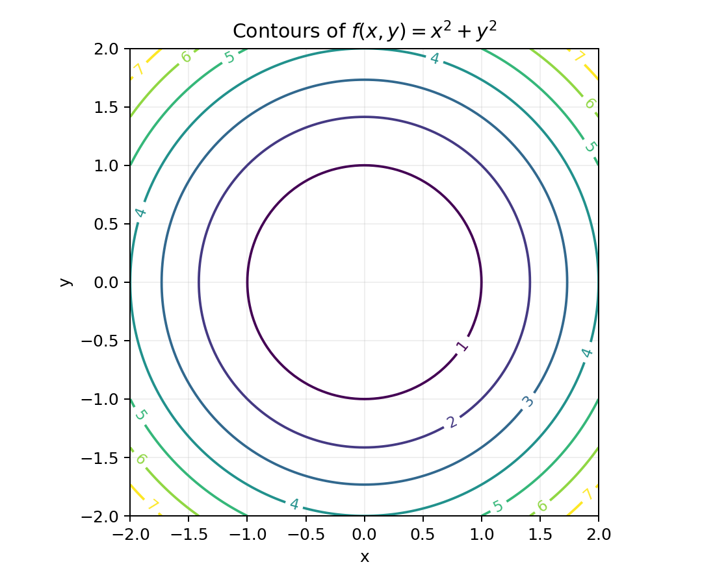{: style="width: 720px; max-width: 100%; height: auto;"}

정수 <code>levels=8</code>은 알고리즘이 적당한 등고선 높이를 자동 선택하도록 요청하며,
정확히 8개의 선을 보장하지는 않는다.
위 예제처럼 배열로 지정하면 해당 높이(1, 2, …, 7)의 등고선을 그린다.
<code>ax.clabel()</code>은 각 등고선 위에 해당 함수값을 표시한다. 이 함수에서는
원점에서 거리가 같은 점의 함수값이 같으므로 등고선이 원 모양으로 나타난다.

등고선 사이도 색으로 채우고 싶다면 <code>contour()</code> 대신
<code>contourf()</code>를 사용한다.

~~~python
fig, ax = plt.subplots(figsize=(6, 5))
filled = ax.contourf(X, Y, Z, levels=20, cmap="viridis")
contours = ax.contour(X, Y, Z, levels=levels, colors="black", linewidths=0.6)
ax.clabel(contours, inline=True, fontsize=8)
fig.colorbar(filled, ax=ax, label="f(x, y)")

ax.set_xlabel("x")
ax.set_ylabel("y")
ax.set_title(r"Filled contours of $f(x,y)=x^2+y^2$")
ax.set_aspect("equal")

fig.tight_layout()
plt.show()
~~~

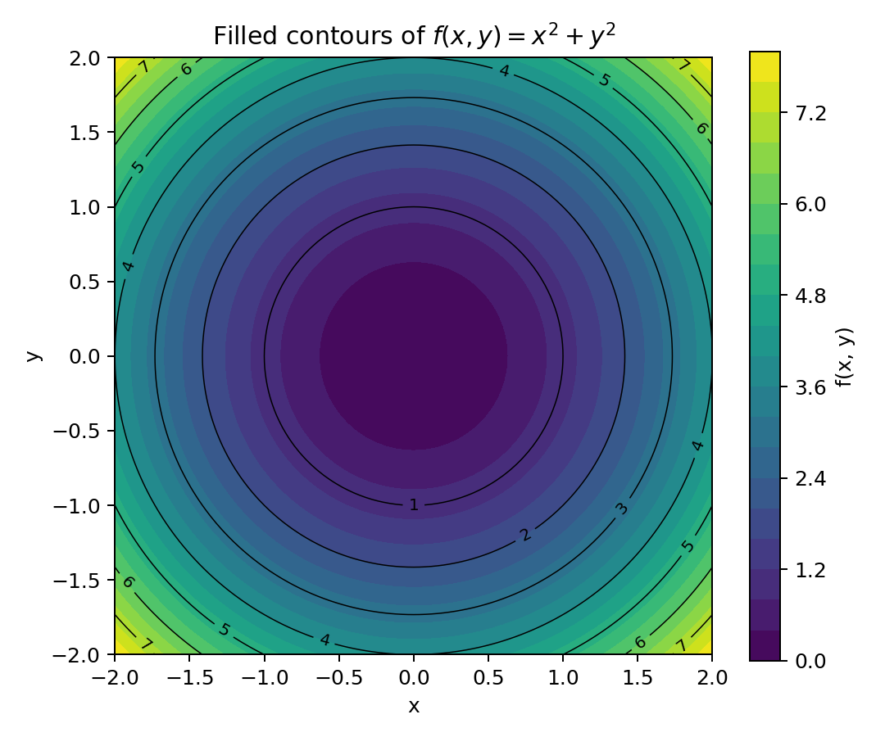{: style="width: 720px; max-width: 100%; height: auto;"}

아래의 회전 GIF는 원본 데이터와 축 범위를 고정하고 카메라의 방위각만 바꾸어 만든 것이다.
한 바퀴를 약 8초 동안 천천히 돌려 보여 준다.
같은 모양을 여러 방향에서 보며 깊이와 가려진 위치를 확인해 보자.
코드에서 시점을 직접 바꾸려면 <code>ax.view_init(elev=25, azim=45)</code>처럼
<code>elev</code>(고도각)와 <code>azim</code>(방위각)을 도 단위로 지정한다.
회전하는 것은 관찰 시점이며, 데이터의 좌표를 회전시키는 것은 아니다.

## 7.2. 3차원 격자선 그리기

6.1절과 같은 함수 $f(x,y)=x^2+y^2$를 다시 사용한다.
계산한 $Z=f(X,Y)$를 <code>plot_wireframe()</code>에 전달하면 격자선으로 이루어진
3차원 표면의 격자선(wireframe)을 그릴 수 있다. 표면 모양을 더 촘촘하게 나타내도록 좌표의 개수를 늘려 보자.

~~~python
x = np.linspace(-2.0, 2.0, 51)
y = np.linspace(-2.0, 2.0, 51)
X, Y = np.meshgrid(x, y, indexing="xy")
Z = X**2 + Y**2

fig = plt.figure(figsize=(7, 5))
ax = fig.add_subplot(111, projection="3d")
ax.plot_wireframe(X, Y, Z, color="tab:blue", linewidth=0.6)
ax.set_xlabel("x")
ax.set_ylabel("y")
ax.set_zlabel("f(x, y)")
ax.set_title(r"$z=x^2+y^2$")
fig.tight_layout()
plt.show()
~~~

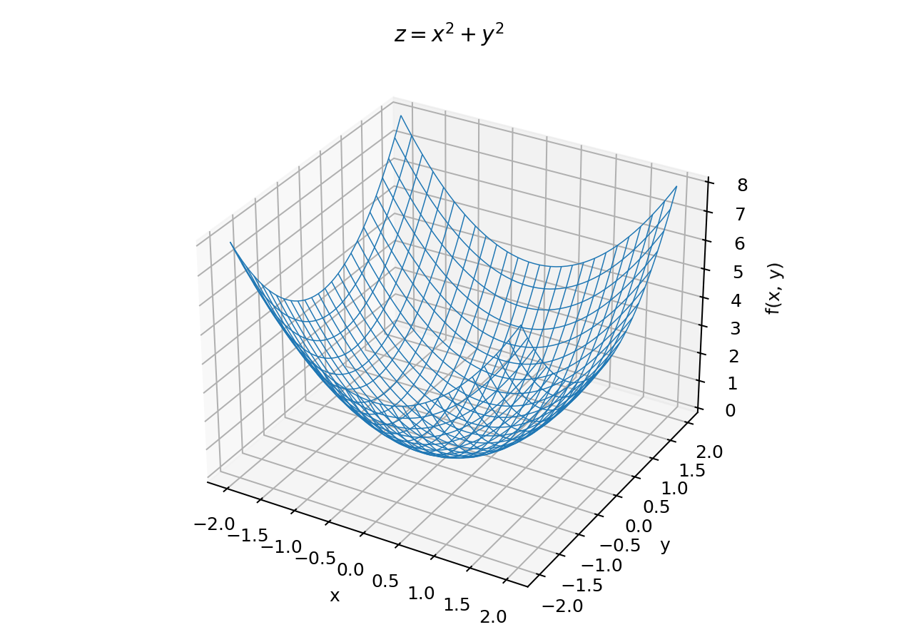{: style="width: 840px; max-width: 100%; height: auto;"}

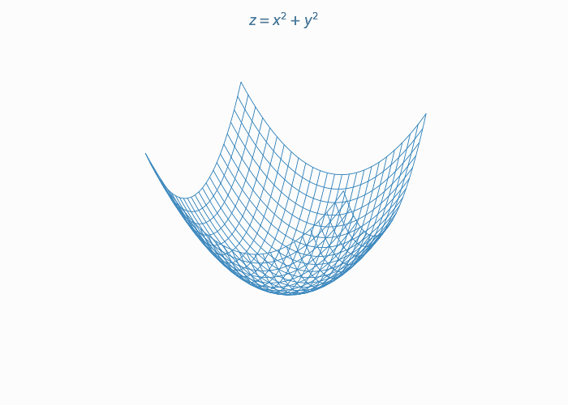{: style="width: 720px; max-width: 100%; height: auto;"}

<code>plot_wireframe()</code>에는 shape이 같은 2차원 배열 <code>X</code>, <code>Y</code>,
<code>Z</code>가 필요하다. 여기서 <code>projection="3d"</code>는 세 좌표축을 가진 Axes를 만든다.
하지만 입력 <code>X</code>, <code>Y</code>, <code>Z</code>는 각각 **2차원 격자 배열**이다.
화면의 3차원 표현과 NumPy 배열의 <code>ndim</code>을 구분하자.
<code>111</code>은 1행 1열 배치의 첫 번째 Axes라는 뜻이며,
<code>fig.add_subplot(1, 1, 1, projection="3d")</code>로 풀어 쓸 수 있다.

## 7.3. 색칠된 표면 그리기

7.2절의 <code>X</code>, <code>Y</code>, <code>Z</code>를 그대로 사용한다.
격자선 대신 색칠된 표면을 그리고 싶다면 다음과 같이
<code>plot_surface()</code>를 사용한다.

~~~python
fig = plt.figure(figsize=(7, 5))
ax = fig.add_subplot(111, projection="3d")
surface = ax.plot_surface(X, Y, Z, cmap="viridis")
ax.set_xlabel("x")
ax.set_ylabel("y")
ax.set_zlabel("f(x, y)")
fig.colorbar(surface, ax=ax, shrink=0.7, label="f(x, y)")
fig.tight_layout()
plt.show()
~~~

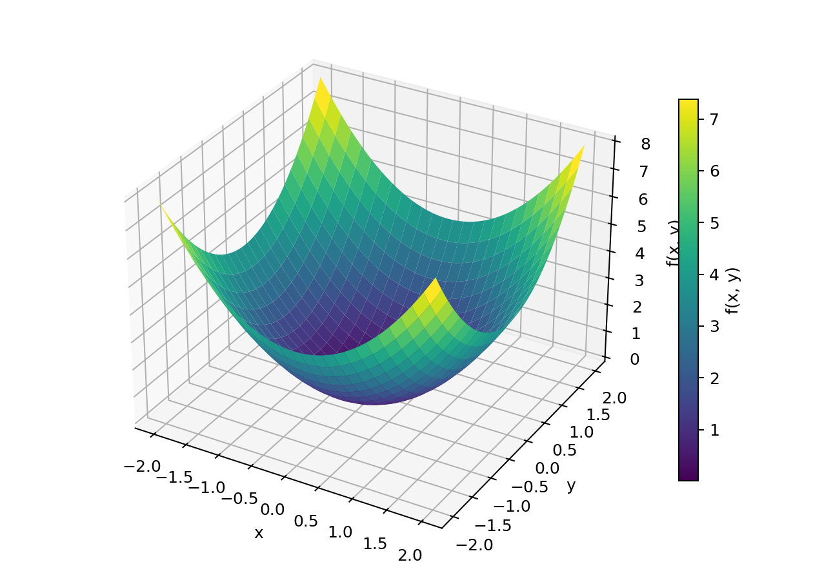{: style="width: 840px; max-width: 100%; height: auto;"}

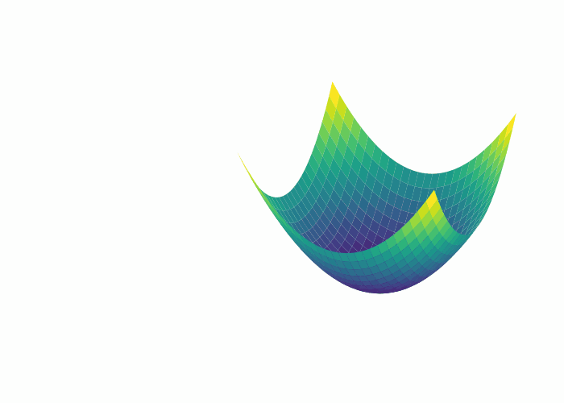{: style="width: 720px; max-width: 100%; height: auto;"}

# 8. 자주 하는 실수

- <code>plt.subplots(1, 2)</code>가 반환한 <code>axes</code>는 Axes 배열이다.
- 로그로 표시하는 축의 데이터에 0이나 음수를 넣지 않는다.
- 색상 그래프에는 물리량과 단위를 표시한 색상 막대(colorbar)를 추가한다.
- <code>plot_surface()</code>의 <code>X</code>, <code>Y</code>, <code>Z</code> shape은 같아야 한다.

# 9. 정리

- 여러 Axes를 이용하면 서로 다른 데이터를 읽기 쉽게 비교할 수 있다.
- 넓은 범위의 양수 데이터에는 로그축이 유용하다.
- 오차막대에는 표준편차·표준오차 등 무엇을 표시했는지와 반복 횟수를 명시한다.
- <code>contourf()</code>는 2차원 분포를 색으로 나타낸다.
- <code>contour()</code>는 함수값이 같은 위치를 등고선으로 나타낸다.
- <code>plot_wireframe()</code>과 <code>plot_surface()</code>는 격자 위의 스칼라값을 표면 높이로 그린다.

[Matplotlib 기초 3](/assets/lecture_notes/1_2_data_mse/data_mse_15_기초_matplotlib3.md)에서는 격자 위의 벡터를 화살표로 그린 뒤 3차원 결정방향과 원자 배열을 그린다.

# 10. 연습 문제

## 문제 1

한 Figure에 1행 2열의 Axes를 만드는 코드를 쓰시오.

<!--
풀이와 해답:
fig, axes = plt.subplots(1, 2)
-->

## 문제 2

확산계수 $10^{-18}$부터 $10^{-10}$까지를 표시할 때 선형축과 로그축 중 어느 것이 더
적절한가?

<!--
풀이와 해답:
값이 여러 자릿수에 걸쳐 변하므로 로그축이 더 적절하다.
-->

## 문제 3

온도 배열 <code>temperature</code>, 평균 경도 <code>hardness</code>, 표준편차 <code>hardness_std</code>가 주어졌다.
온도에 따른 평균 경도를 표준편차 오차막대와 함께
그리는 한 줄의 코드를 쓰시오.

<!--
풀이와 해답:
ax.errorbar(temperature, hardness, yerr=hardness_std, marker="o", capsize=4)
-->

## 문제 4

3차원 Axes를 만드는 다음 코드의 빈칸을 채우시오.

~~~python
fig = plt.figure()
ax = fig.add_subplot(111, __________)
~~~

<!--
풀이와 해답:
projection="3d"
-->

## 문제 5: 격자 shape과 인덱싱

<code>x = np.linspace(-2, 2, 5)</code>, <code>y = np.linspace(-1, 1, 3)</code>일 때
<code>X, Y = np.meshgrid(x, y, indexing="xy")</code>의 shape을 쓰시오.
또한 <code>X[1, 2]</code>, <code>Y[1, 2]</code>와
<code>Z = X**2 + Y**2</code>의 <code>Z[1, 2]</code> 값을 구하시오.

<!--
풀이와 해답:
X, Y, Z의 shape은 모두 (3, 5)다.
X[1, 2] = x[2] = 0, Y[1, 2] = y[1] = 0이므로 Z[1, 2] = 0이다.
-->

## 문제 6: 오차막대의 의미

한 조건에서 독립적으로 9회 반복 측정한 표본 표준편차가 6 MPa다.
평균 ± 표준편차를 그릴 때와 평균 ± 표준오차를 그릴 때 각각 <code>yerr</code>에 넣을 값을 구하고,
두 오차막대가 무엇을 나타내는지 설명하시오.

<!--
풀이와 해답:
평균 ± 표준편차: yerr=6, 개별 측정값의 퍼짐을 나타낸다.
평균 ± 표준오차: yerr=6/np.sqrt(9)=2, 평균의 표준오차 추정값을 나타낸다.
둘 중 어느 것도 정의를 밝히지 않은 채 신뢰구간이라고 부르지 않는다.
-->

## 문제 7: 2차원 Axes 배열

<code>fig, axes = plt.subplots(2, 2)</code>로 만든 그림에서
첫 번째 행·두 번째 열의 Axes에 <code>x</code>, <code>y</code>의 선 그래프를 그리는 코드를 쓰시오.

<!--
풀이와 해답:
axes[0, 1].plot(x, y)
-->

API의 세부 옵션은 공식 문서의
[여러 Axes 만들기](https://matplotlib.org/stable/api/_as_gen/matplotlib.pyplot.subplots.html),
[meshgrid](https://numpy.org/doc/stable/reference/generated/numpy.meshgrid.html),
[등고선](https://matplotlib.org/stable/api/_as_gen/matplotlib.axes.Axes.contour.html)을 참고한다.

---

[이전 강의](/assets/lecture_notes/1_2_data_mse/data_mse_14_기초_matplotlib1.md) · [강의 목록](/_lectures/1_2_data_mse.md) · [다음 강의](/assets/lecture_notes/1_2_data_mse/data_mse_15_기초_matplotlib3.md)
