**목차**

* TOC
{:toc}

# 1. 학습 목표

- 하나의 Figure에 여러 Axes를 배치할 수 있다.
- 선의 종류, 색과 표식을 구분하여 데이터를 비교할 수 있다.
- 값의 범위가 매우 넓을 때 로그축을 사용할 수 있다.
- 평균과 표준편차를 오차막대로 표시하고, 표준오차와 구분할 수 있다.
- 2차원 색상 그래프와 간단한 3차원 그래프를 그릴 수 있다.
- 결정방향을 단위벡터로 바꾸어 3차원 공간에 표현할 수 있다.
- SC·BCC·FCC의 분율좌표로 단위격자와 반복 격자를 그릴 수 있다.
- HCP와 FCC의 적층 순서를 비교하고 HCP의 육각기둥 구조를 그릴 수 있다.
- 원자 중심을 나타내는 산점도와 반지름을 갖는 경구 모형을 구분할 수 있다.

14장에서 익힌 <code>fig, ax</code>를 바탕으로, 데이터의 구조에 맞는 표현을 고른다.
여러 물리량은 여러 Axes로, 넓은 값의 범위는 로그축으로, 반복 측정은 오차막대로 나타낸다.
이어 10장의 배열 축·브로드캐스팅과 11장의 단위벡터를 이용해 공간 분포와 방향을 그린다.
이 장의 재료 데이터와 공간 분포는 그래프 작성법을 익히도록 만든 예시다.

# 2. 여러 그래프 배치하기

서로 단위나 크기가 다른 데이터를 한 Axes에 겹치면 읽기 어려울 수 있다.
<code>plt.subplots()</code>에 행과 열의 개수를 지정해 여러 Axes를 배치하자.

~~~python
import numpy as np
import matplotlib.pyplot as plt

temperature = np.array([300, 400, 500, 600, 700])
strength = np.array([315, 302, 284, 258, 225])
elongation = np.array([12, 14, 17, 21, 26])

fig, axes = plt.subplots(1, 2, figsize=(10, 4))
axes[0].plot(temperature, strength, marker="o")
axes[0].set_xlabel("Temperature (K)")
axes[0].set_ylabel("Yield strength (MPa)")
axes[0].grid(True, alpha=0.3)

axes[1].plot(temperature, elongation, marker="s", color="tab:orange")
axes[1].set_xlabel("Temperature (K)")
axes[1].set_ylabel("Elongation (%)")
axes[1].grid(True, alpha=0.3)

fig.suptitle("Mechanical Properties")
fig.tight_layout()
plt.show()
~~~

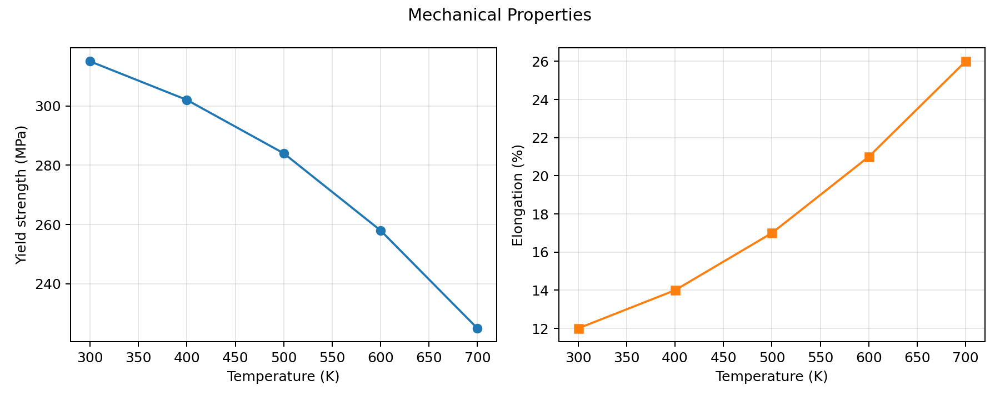{: style="width: 1000px; max-width: 100%; height: auto;"}

## 2.1. `axes`의 shape 확인하기

기본 설정에서 <code>plt.subplots()</code>는 Axes 하나를 반환하지만,
여러 Axes를 만들면 <code>axes</code>는 NumPy 객체 배열이 된다.

| 생성 명령 | 두 번째 반환값 | 선택 방법 |
|---|---|---|
| <code>plt.subplots()</code> | Axes 하나 | <code>ax.plot(...)</code> |
| <code>plt.subplots(1, 2)</code> | shape <code>(2,)</code> 배열 | <code>axes[0].plot(...)</code> |
| <code>plt.subplots(2, 2)</code> | shape <code>(2, 2)</code> 배열 | <code>axes[0, 1].plot(...)</code> |

<code>squeeze=False</code>를 지정하면 1행·1열인 경우에도 항상 2차원 Axes 배열을 반환한다.
이는 10장에서 배운 배열 shape과 인덱싱을 적용하는 또 하나의 예다.
<code>sharex=True</code>는 여러 그래프가 같은 $x$축 범위를 공유하도록 한다.
같은 물리량을 비교할 때 축 범위를 맞추면 그래프의 높이 차이를 실제 값의 차이로 해석하기 쉽다.

# 3. 선과 점의 모양 바꾸기

색만으로 데이터를 구분하지 말고 선의 종류와 표식도 함께 다르게 지정하자.

~~~python
strain = np.linspace(0.0, 0.001, 101)

fig, ax = plt.subplots(figsize=(6, 4))
ax.plot(strain, 70_000 * strain, linestyle="-", marker="o", markevery=20, label="Al: E = 70 GPa")
ax.plot(strain, 210_000 * strain, linestyle="--", marker="s", markevery=20, label="Fe: E = 210 GPa")
ax.set_xlabel("Strain")
ax.set_ylabel("Stress (MPa)")
ax.legend()
ax.grid(True, alpha=0.3)
fig.tight_layout()
plt.show()
~~~

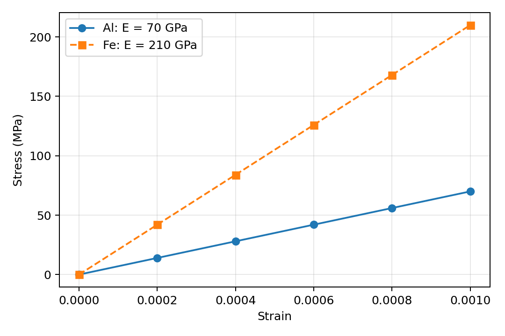{: style="width: 720px; max-width: 100%; height: auto;"}

대표적인 선 종류는 실선 <code>"-"</code>, 파선(대시선) <code>"--"</code>, 점선
<code>":"</code>이고, 표식에는 원 <code>"o"</code>, 사각형 <code>"s"</code>,
삼각형 <code>"^"</code> 등이 있다.

<code>markevery=20</code>은 데이터 점 20개 간격으로 표식을 그린다. 여기서 표식은 계산한 점이며 실험점을 뜻하지 않는다.
14장과 같은 이상적인 선형 탄성 모델이며, 실제 재료의 소성변형까지 나타내는 곡선은 아니다.

# 4. 로그축

확산계수처럼 여러 자릿수에 걸쳐 변하는 값에는 로그축(logarithmic scale)이 유용하다.
같은 데이터를 선형축(linear scale)과 로그축에 각각 그려 차이를 비교해 보자.

~~~python
temperature = np.array([700, 800, 900, 1000, 1100])
diffusivity = np.array([2.0e-17, 3.0e-15, 1.2e-13, 2.1e-12, 1.8e-11])

fig, axes = plt.subplots(1, 2, figsize=(10, 4))

axes[0].plot(temperature, diffusivity, marker="o")
axes[0].set_title("Linear scale")
axes[0].set_xlabel("Temperature (K)")
axes[0].set_ylabel(r"Diffusivity ($m^2/s$)")
axes[0].grid(True, alpha=0.3)

axes[1].semilogy(temperature, diffusivity, marker="o")
axes[1].set_title("Logarithmic y-scale")
axes[1].set_xlabel("Temperature (K)")
axes[1].set_ylabel(r"Diffusivity ($m^2/s$)")
axes[1].grid(True, which="both", alpha=0.3)

fig.tight_layout()
plt.show()
~~~

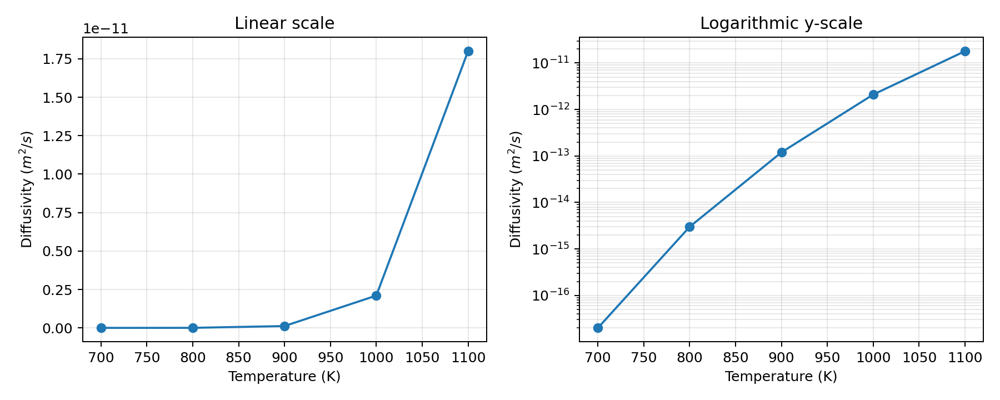{: style="width: 960px; max-width: 100%; height: auto;"}

왼쪽 선형축에서는 가장 큰 값이 세로축 범위를 지배하므로 낮은 온도의 작은 확산계수들이
0 부근에 눌려 서로 구분하기 어렵다. 오른쪽 로그축에서는 $10^{-17}$부터 $10^{-11}$까지의
각 자릿수가 일정한 간격으로 펼쳐져 작은 값들의 변화도 함께 읽을 수 있다.

<code>ax.semilogy()</code>는 $y$축만 로그축으로 만든다. 로그축에는 0이나 음수를
표시할 수 없다. 이 조건은 로그로 표시하는 축에 적용된다.
예를 들어 <code>semilogy</code>에서는 $y$가 양수여야 한다.

로그축에서 같은 간격은 같은 차이가 아니라 같은 **비율**을 뜻한다.
예를 들어 $10^{-16}$에서 $10^{-15}$까지와 $10^{-12}$에서 $10^{-11}$까지의 간격은 같다.
<code>semilogx()</code>는 $x$축만, <code>loglog()</code>는 두 축을 로그로 표시한다.
이는 좌표축 표시를 바꾸는 것이며 원본 <code>diffusivity</code> 배열을 로그값으로 바꾸지는 않는다.
또한 확산계수를 온도에 대해 로그축으로 표시했다고 해서 반드시 직선이 되는 것은 아니다.

# 5. 오차막대

같은 조건에서 여러 번 측정했다면 평균값과 데이터의 퍼짐을 함께 표현한다.
다음 배열의 각 행은 한 온도 조건, 각 열은 독립적인 반복 측정값이며 단위는 MPa다.
10장의 <code>axis=1</code> 집계로 조건별 평균과 표본 표준편차(sample standard deviation)를 계산한다.

~~~python
temperature = np.array([300, 400, 500, 600])
strength_measurements = np.array([
    [312.0, 320.0, 328.0],
    [298.0, 305.0, 312.0],
    [272.0, 282.0, 292.0],
    [246.0, 255.0, 264.0],
])
mean_strength = strength_measurements.mean(axis=1)
std_strength = strength_measurements.std(axis=1, ddof=1)

fig, ax = plt.subplots(figsize=(6, 4))
ax.errorbar(
    temperature,
    mean_strength,
    yerr=std_strength,
    fmt="o",
    capsize=4,
)
ax.set_xlabel("Temperature (K)")
ax.set_ylabel("Yield strength (MPa)")
ax.set_title("Mean and Sample SD (n = 3)")
ax.grid(True, alpha=0.3)
fig.tight_layout()
plt.show()
~~~

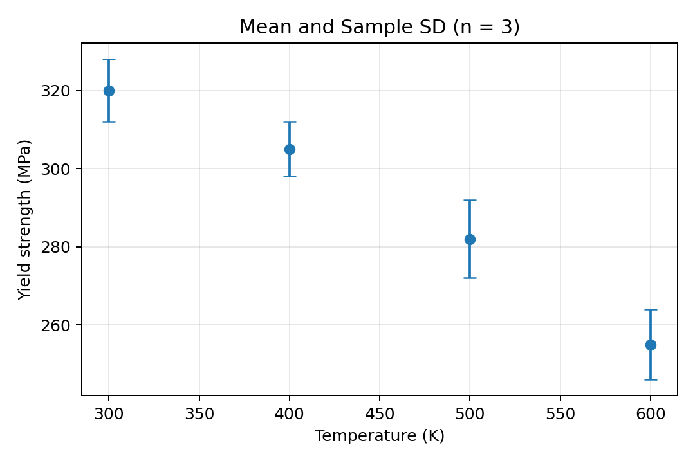{: style="width: 720px; max-width: 100%; height: auto;"}

이 예제의 오차막대는 **평균에서 위아래로 표본 표준편차($s$)만큼 떨어진 범위**를 나타낸다.
<code>ddof=1</code>은 표본 표준편차를 구할 때 제곱편차 합을 $n-1$로 나눈다는 뜻이다.
9장에서 기본 <code>std()</code>로 구한 값은 <code>ddof=0</code>으로, 분모가 $n$이다.

[표준편차(standard deviation)](https://ko.wikipedia.org/wiki/표준편차) $s$는 개별 측정값의 퍼짐을 나타낸다.
독립적이고 같은 분포에서 얻은 $n$회 반복 측정에 대해
[평균의 표준오차(standard error of the mean, SEM)](https://en.wikipedia.org/wiki/Standard_error)는 $s/\sqrt{n}$로 추정한다.
두 값은 의미가 다르며, 표준편차를 곧바로 평균의 불확실성(uncertainty)이나 신뢰구간(confidence interval)이라고 부르면 안 된다.
측정기가 항상 한쪽으로 치우친 값을 내는 **계통오차(systematic error)** 등은 반복 측정값의 퍼짐만으로 평가할 수 없다.
그림 설명에는 오차막대가 나타내는 값과 반복 횟수($n=3$)를 명시하자.
예를 들어 “점은 3회 반복 측정의 평균이며, 오차막대는 평균 ± 표본 표준편차($s$)를 나타낸다”라고 쓴다.
<code>yerr</code>에는 위아래 오차막대의 **길이**를 넣으며, 이 예제에서는 같은 길이를 양쪽에 적용한다.

# 6. 2차원 색상 그래프

두 위치 좌표에 따라 물리량이 변할 때 색으로 크기를 나타낼 수 있다.
먼저 좌표 격자와 배열 shape을 확인한 뒤, 시편 표면의 온도 분포를 그려 보자.

## 6.1. <code>meshgrid</code>로 좌표 배열 만들기

다음과 같이 두 변수를 갖는 함수를 생각하자.

$$
f(x,y)=x^2+y^2
$$

이 함수를 그리려면 여러 $x$와 $y$의 조합에서 함수값을 계산해야 한다. 먼저
<code>np.linspace()</code>로 각각의 1차원 좌표를 만든다.

~~~python
x = np.linspace(-2.0, 2.0, 5)
y = np.linspace(-1.0, 1.0, 3)

print(x)
print(y)
~~~

<code>np.meshgrid(x, y, indexing="xy")</code>는 모든 $(x,y)$ 조합을 계산할 수 있도록 두 개의
2차원 좌표 배열 <code>X</code>와 <code>Y</code>를 만든다.

~~~python
X, Y = np.meshgrid(x, y, indexing="xy")

print(X)
print(Y)
print(X.shape, Y.shape)
~~~

<code>X</code>의 각 행에는 $x$ 좌표가 반복되고, <code>Y</code>의 각 열에는 $y$ 좌표가
반복된다. 따라서 같은 위치의 <code>X[i, j]</code>와 <code>Y[i, j]</code>가 격자점
하나의 좌표를 나타낸다. NumPy의 원소별 연산을 적용하면 모든 격자점의 함수값을 한 번에
구할 수 있다.

~~~python
Z = X**2 + Y**2

print(Z)
print(Z.shape)
~~~

예를 들어 <code>X[0, 0] = -2</code>, <code>Y[0, 0] = -1</code>이므로
<code>Z[0, 0] = 5</code>이다.
<code>indexing="xy"</code>에서는 <code>X.shape == Y.shape == (len(y), len(x))</code>이며,
여기서는 <code>(3, 5)</code>다. 즉, <code>X[i, j] == x[j]</code>, <code>Y[i, j] == y[i]</code>다.
첫 번째 인덱스가 $y$, 두 번째가 $x$에 대응하는 점에 주의하자.
<code>indexing="xy"</code>는 기본 설정이며, <code>indexing="ij"</code>를 쓰면 축 순서가 달라진다.

10장의 브로드캐스팅으로도 같은 함수값을 계산할 수 있다.

~~~python
Z_broadcast = x[None, :]**2 + y[:, None]**2
print(Z_broadcast.shape)               # (3, 5)
print(np.allclose(Z, Z_broadcast))      # True
~~~

<code>x[None, :]</code>는 <code>(1, 5)</code>, <code>y[:, None]</code>은
<code>(3, 1)</code>이므로, 합의 결과는 <code>(3, 5)</code>다.

## 6.2. 온도 분포를 색으로 표현하기

아래 분포는 좌표 $x,y$와 분포의 폭을 정하는 길이 $a$에 대해

$$
T(x,y)=T_0+\Delta T\exp\left[-\left(\frac{x}{a}\right)^2-\left(\frac{y}{a}\right)^2\right]
$$

로 정한 예시다. $T_0=300$ K, $\Delta T=500$ K, $a=1$ mm이며,
지수 안의 값은 무차원이다. 원점에서 온도는 800 K이고, 멀어질수록 300 K에 가까워진다.

~~~python
x = np.linspace(-2.0, 2.0, 101)
y = np.linspace(-2.0, 2.0, 101)
X, Y = np.meshgrid(x, y, indexing="xy")
length_scale = 1.0  # mm
temperature = 300.0 + 500.0 * np.exp(-((X / length_scale)**2 + (Y / length_scale)**2))

fig, ax = plt.subplots(figsize=(6, 5))
image = ax.contourf(X, Y, temperature, levels=20, cmap="inferno")
colorbar = fig.colorbar(image, ax=ax)
ax.set_xlabel("x (mm)")
ax.set_ylabel("y (mm)")
ax.set_title("Surface Temperature")
ax.set_aspect("equal")
colorbar.set_label("Temperature (K)")
fig.tight_layout()
plt.show()
~~~

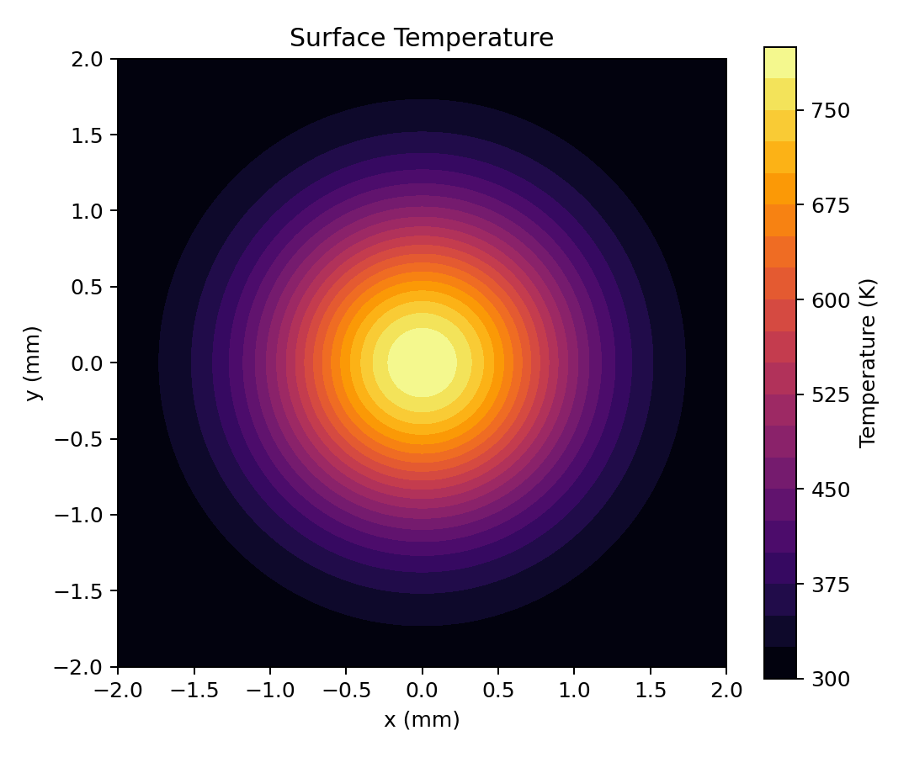{: style="width: 720px; max-width: 100%; height: auto;"}

<code>np.meshgrid()</code>는 1차원 좌표 배열로 2차원 격자를 만든다. 색상 막대(colorbar)에는
색이 나타내는 물리량과 단위를 표시한다.
값을 색에 대응시키는 컬러맵(colormap)은 <code>cmap</code>으로, 채워진 등고선 구간은 <code>levels</code>로 지정한다.
<code>set_aspect("equal")</code>은 $x,y$의 단위 길이를 같은 화면 길이로 표시한다.
서로 다른 온도 분포를 비교할 때는 색과 값의 대응 범위도 같게 설정해야 한다.

# 7. 2차원 격자 데이터와 3차원 그래프

## 7.1. 등고선으로 표현하기

등고선(contour)은 함수값이 같은 점들을 연결한 선이다. 3차원 표면을 위에서 내려다본
것처럼 2차원 평면에 함수의 변화를 표현할 수 있다. 앞에서 계산한
$Z=X^2+Y^2$를 <code>ax.contour()</code>에 전달해 보자.

~~~python
x = np.linspace(-2.0, 2.0, 101)
y = np.linspace(-2.0, 2.0, 101)
X, Y = np.meshgrid(x, y, indexing="xy")
Z = X**2 + Y**2

fig, ax = plt.subplots(figsize=(6, 5))
levels = np.arange(1.0, 8.0, 1.0)  # 높이 1, 2, ..., 7
contours = ax.contour(X, Y, Z, levels=levels, cmap="viridis")
ax.clabel(contours, inline=True, fontsize=9)

ax.set_xlabel("x")
ax.set_ylabel("y")
ax.set_title(r"Contours of $f(x,y)=x^2+y^2$")
ax.set_aspect("equal")
ax.grid(True, alpha=0.2)

fig.tight_layout()
plt.show()
~~~

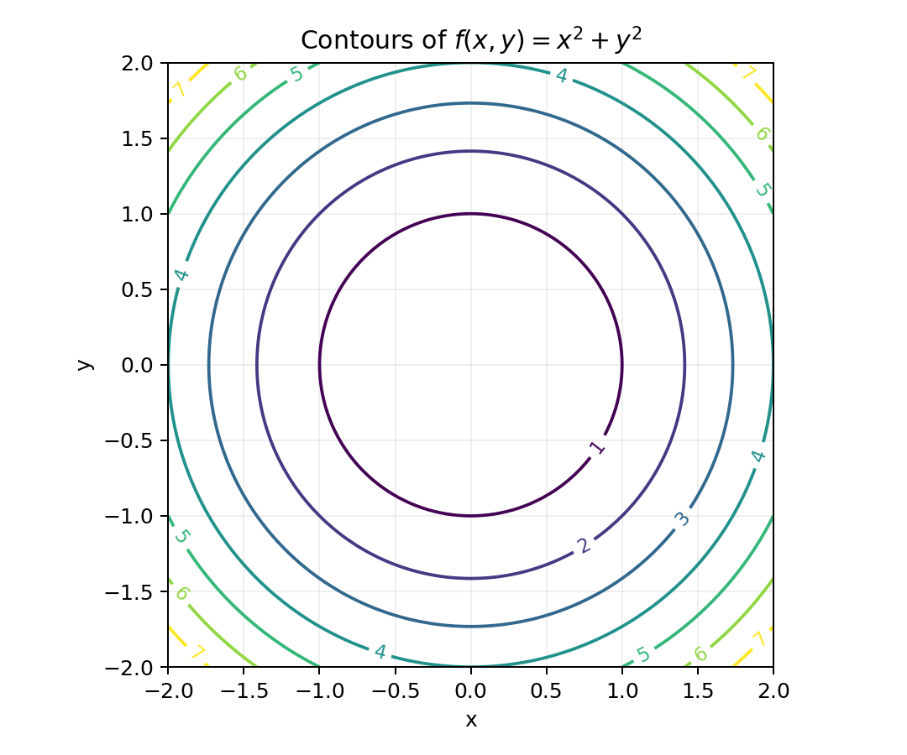{: style="width: 720px; max-width: 100%; height: auto;"}

정수 <code>levels=8</code>은 알고리즘이 적당한 등고선 높이를 자동 선택하도록 요청하며,
정확히 8개의 선을 보장하지는 않는다.
위 예제처럼 배열로 지정하면 해당 높이(1, 2, …, 7)의 등고선을 그린다.
<code>ax.clabel()</code>은 각 등고선 위에 해당 함수값을 표시한다. 이 함수에서는
원점에서 거리가 같은 점의 함수값이 같으므로 등고선이 원 모양으로 나타난다.

등고선 사이도 색으로 채우고 싶다면 <code>contour()</code> 대신
<code>contourf()</code>를 사용한다.

~~~python
fig, ax = plt.subplots(figsize=(6, 5))
filled = ax.contourf(X, Y, Z, levels=20, cmap="viridis")
contours = ax.contour(X, Y, Z, levels=levels, colors="black", linewidths=0.6)
ax.clabel(contours, inline=True, fontsize=8)
fig.colorbar(filled, ax=ax, label="f(x, y)")

ax.set_xlabel("x")
ax.set_ylabel("y")
ax.set_title(r"Filled contours of $f(x,y)=x^2+y^2$")
ax.set_aspect("equal")

fig.tight_layout()
plt.show()
~~~

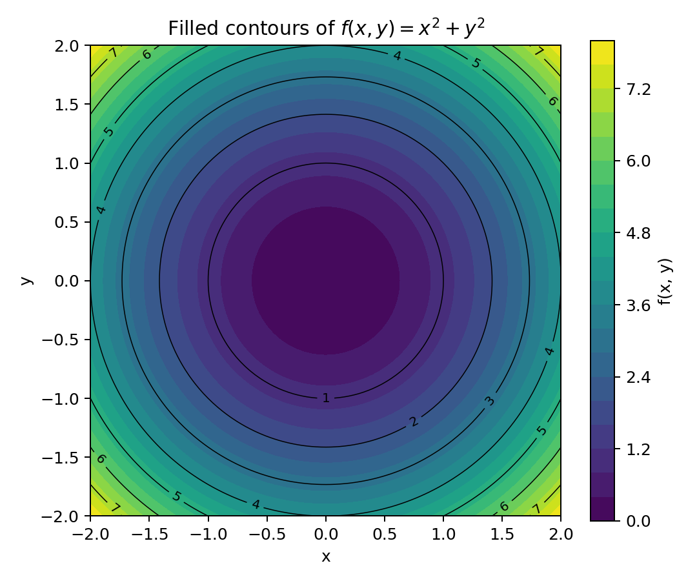{: style="width: 720px; max-width: 100%; height: auto;"}

아래의 회전 GIF는 원본 데이터와 축 범위를 고정하고 카메라의 방위각만 바꾸어 만든 것이다.
한 바퀴를 약 8초 동안 천천히 돌려 보여 준다.
같은 모양을 여러 방향에서 보며 깊이와 가려진 위치를 확인해 보자.
코드에서 시점을 직접 바꾸려면 <code>ax.view_init(elev=25, azim=45)</code>처럼
<code>elev</code>(고도각)와 <code>azim</code>(방위각)을 도 단위로 지정한다.
회전하는 것은 관찰 시점이며, 데이터의 좌표를 회전시키는 것은 아니다.

## 7.2. 3차원 격자선 그리기

6.1절과 같은 함수 $f(x,y)=x^2+y^2$를 다시 사용한다.
계산한 $Z=f(X,Y)$를 <code>plot_wireframe()</code>에 전달하면 격자선으로 이루어진
3차원 표면의 격자선(wireframe)을 그릴 수 있다. 표면 모양을 더 촘촘하게 나타내도록 좌표의 개수를 늘려 보자.

~~~python
x = np.linspace(-2.0, 2.0, 51)
y = np.linspace(-2.0, 2.0, 51)
X, Y = np.meshgrid(x, y, indexing="xy")
Z = X**2 + Y**2

fig = plt.figure(figsize=(7, 5))
ax = fig.add_subplot(111, projection="3d")
ax.plot_wireframe(X, Y, Z, color="tab:blue", linewidth=0.6)
ax.set_xlabel("x")
ax.set_ylabel("y")
ax.set_zlabel("f(x, y)")
ax.set_title(r"$z=x^2+y^2$")
fig.tight_layout()
plt.show()
~~~

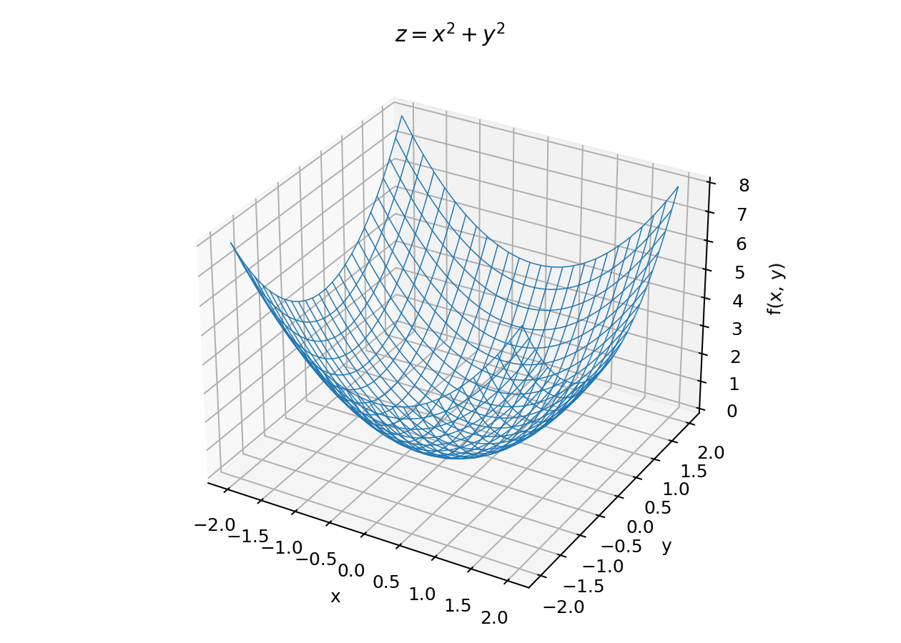{: style="width: 840px; max-width: 100%; height: auto;"}

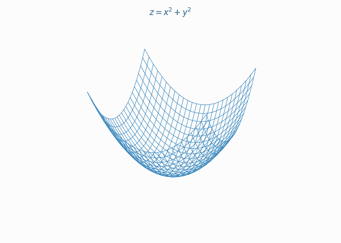{: style="width: 720px; max-width: 100%; height: auto;"}

<code>plot_wireframe()</code>에는 shape이 같은 2차원 배열 <code>X</code>, <code>Y</code>,
<code>Z</code>가 필요하다. 여기서 <code>projection="3d"</code>는 세 좌표축을 가진 Axes를 만든다.
하지만 입력 <code>X</code>, <code>Y</code>, <code>Z</code>는 각각 **2차원 격자 배열**이다.
화면의 3차원 표현과 NumPy 배열의 <code>ndim</code>을 구분하자.
<code>111</code>은 1행 1열 배치의 첫 번째 Axes라는 뜻이며,
<code>fig.add_subplot(1, 1, 1, projection="3d")</code>로 풀어 쓸 수 있다.

## 7.3. 색칠된 표면 그리기

7.2절의 <code>X</code>, <code>Y</code>, <code>Z</code>를 그대로 사용한다.
격자선 대신 색칠된 표면을 그리고 싶다면 다음과 같이
<code>plot_surface()</code>를 사용한다.

~~~python
fig = plt.figure(figsize=(7, 5))
ax = fig.add_subplot(111, projection="3d")
surface = ax.plot_surface(X, Y, Z, cmap="viridis")
ax.set_xlabel("x")
ax.set_ylabel("y")
ax.set_zlabel("f(x, y)")
fig.colorbar(surface, ax=ax, shrink=0.7, label="f(x, y)")
fig.tight_layout()
plt.show()
~~~

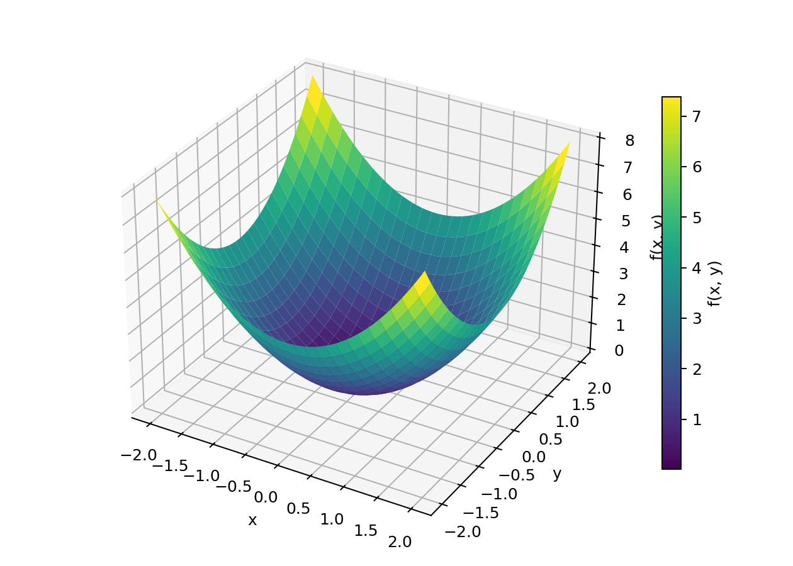{: style="width: 840px; max-width: 100%; height: auto;"}

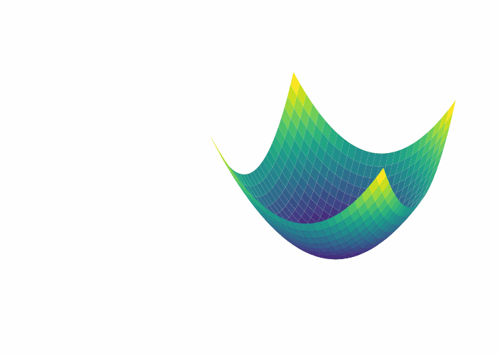{: style="width: 720px; max-width: 100%; height: auto;"}

# 8. 재료공학 예제: 결정방향과 격자

## 8.1. 결정방향을 화살표로 그리기

11장의 입방정 결정방향을 다시 사용한다. 서로 직교하는 결정축을 같은 길이 척도로 표현하면,
[입방정(cubic crystal system)](https://en.wikipedia.org/wiki/Cubic_crystal_system)의 결정방향 $[uvw]$는 벡터 $(u,v,w)$와 나란하다. 방향을
표현하기 위해 다음과 같이 단위벡터로 바꾼다.

$$
\widehat{\boldsymbol d}
=\frac{1}{\sqrt{u^2+v^2+w^2}}
\begin{bmatrix}u\\v\\w\end{bmatrix}
$$

~~~python
def unit_direction(uvw):
    direction = np.asarray(uvw, dtype=float)
    if direction.shape != (3,):
        raise ValueError("uvw must contain exactly three components")
    magnitude = np.linalg.norm(direction)
    if magnitude == 0:
        raise ValueError("[000] has no direction")
    return direction / magnitude

print(unit_direction([1, 1, 0]))
~~~

$[100]$, $[010]$, $[001]$, $[110]$ 방향을 화살표로 나타내자.

~~~python
directions = np.array([
    [1, 0, 0],
    [0, 1, 0],
    [0, 0, 1],
    [1, 1, 0],
])
labels = ["[100]", "[010]", "[001]", "[110]"]

fig = plt.figure(figsize=(7, 6))
ax = fig.add_subplot(111, projection="3d")

for direction, label in zip(directions, labels):
    vector = unit_direction(direction)
    ax.quiver(0, 0, 0, *vector, arrow_length_ratio=0.12)
    ax.text(*(1.08 * vector), label)

ax.set_xlim(0, 1.2)
ax.set_ylim(0, 1.2)
ax.set_zlim(0, 1.2)
ax.set_xlabel("x")
ax.set_ylabel("y")
ax.set_zlabel("z")
ax.set_title("Directions in a Cubic Crystal")
ax.set_box_aspect((1, 1, 1))
fig.tight_layout()
plt.show()
~~~

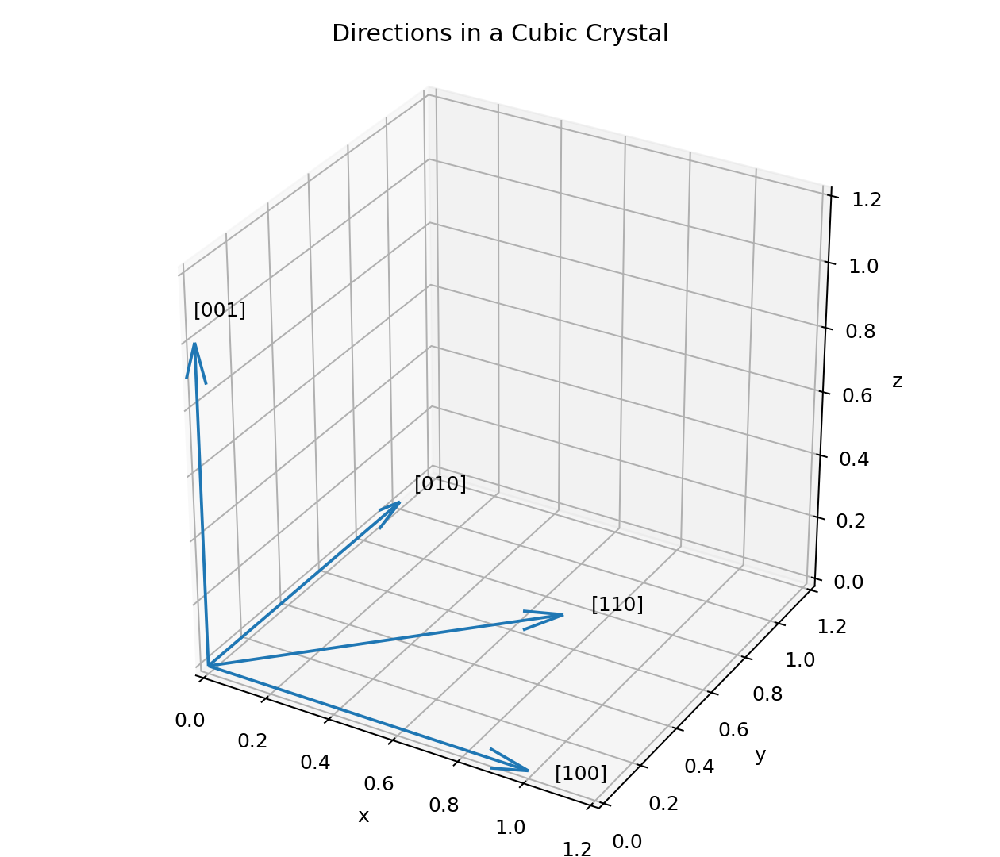{: style="width: 840px; max-width: 100%; height: auto;"}

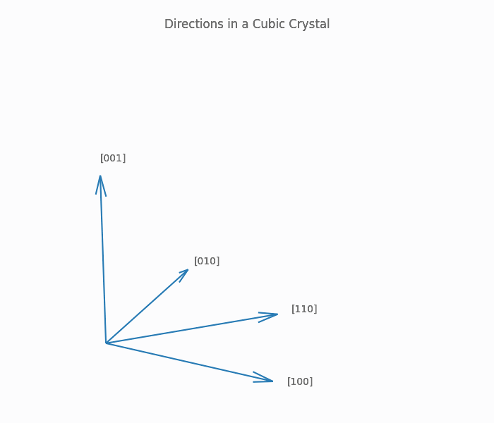{: style="width: 720px; max-width: 100%; height: auto;"}

<code>np.asarray()</code>는 리스트 등의 입력을 NumPy 배열로 다룰 수 있게 하며,
여기서는 실수형 3성분 배열인지도 확인한다.
<code>zip(directions, labels)</code>는 방향과 이름을 같은 위치끼리 하나씩 짝짓는다.[^zip-for-loop]
<code>*vector</code>는 세 성분을 개별 인자로 풀어 쓰는 문법이다. 예를 들어
<code>ax.quiver(0, 0, 0, *vector)</code>는
<code>ax.quiver(0, 0, 0, vector[0], vector[1], vector[2])</code>와 같다.
화살표의 시작점이 원점이고, 뒤의 세 값이 방향 성분이다.
<code>set_box_aspect((1, 1, 1))</code>와 동일한 세 축 범위는 공간적 비율을 읽는 데 도움이 된다.
음의 성분을 가진 방향을 추가하면 축 범위도 음수까지 넓혀야 한다.
비입방정에서는 12장의 격자행렬처럼 격자벡터를 이용해 실제 좌표 성분으로 바꾼 뒤 정규화해야 한다.

[^zip-for-loop]: <code>zip(A, B)</code>는 두 반복 가능한 객체(iterable)의 원소를
    <code>(A[0], B[0])</code>, <code>(A[1], B[1])</code>, …처럼 튜플로 묶어 차례로
    내놓는 반복자(iterator)를 만든다. 따라서
    <code>for a, b in zip(A, B):</code>에서 각 튜플은 변수 <code>a</code>와 <code>b</code>로
    바로 풀린다. 두 객체의 길이가 다르면 기본 <code>zip()</code>은 더 짧은 쪽이
    끝나는 순간 반복을 멈춘다. 예를 들어
    <code>list(zip([1, 2, 3], ["A", "B"]))</code>의 결과는
    <code>[(1, "A"), (2, "B")]</code>이다.

결정면의 극점도(pole figure)와 입체투영(stereographic projection)은 별도의 결정학
강의에서 다룬다.

## 8.2. 분율좌표로 SC·BCC·FCC 만들기

결정구조를 배웠다면 원자의 좌표를 직접 만들고 그리는 실습을 해 보자.
여기서는 각 격자점에 같은 종류의 원자가 하나씩 놓인 구조를 다룬다.
SC는 단순입방(simple cubic), BCC는 체심입방(body-centered cubic),
FCC는 면심입방(face-centered cubic) 구조를 뜻한다.
이 경우 격자점이 곧 원자의 중심 위치에 해당한다.
입방체의 변 길이는 격자상수(lattice parameter) $a$이고, [분율좌표(fractional coordinates)](https://en.wikipedia.org/wiki/Fractional_coordinates) $(p,q,r)$에 대응하는 실제 위치는

$$
(x,y,z)=a(p,q,r)
$$

이다. 이는 12장의 격자행렬이 $a\boldsymbol I$인 경우다.
아래에서는 결정의 대칭성을 알아보기 쉽도록 정한 입방체 모양의
**[관용 단위격자(conventional unit cell)](https://en.wikipedia.org/wiki/Primitive_cell#Conventional_cell)**를 사용한다.
격자점 하나에 해당하는 부피를 갖는 **[원시 단위격자(primitive unit cell)](https://en.wikipedia.org/wiki/Primitive_cell#Primitive_cell)**와는 구분한다.
BCC와 FCC의 관용 단위격자에는 경계의 공유 비율을 고려했을 때 각각 격자점 2개와 4개가 포함된다.

각 축 방향으로 격자상수의 정수배만큼 평행이동하여 전체 구조를 만들 수 있도록, 기준 원자 위치를 다음처럼 정한다.

| 구조 | 정수 평행이동으로 반복할 분율좌표 |
|---|---|
| SC | $(0,0,0)$ |
| BCC | $(0,0,0)$, $(1/2,1/2,1/2)$ |
| FCC | $(0,0,0)$, $(0,1/2,1/2)$, $(1/2,0,1/2)$, $(1/2,1/2,0)$ |

예를 들어 FCC의 $(0,1/2,1/2)$를 $x$ 방향으로 한 셀 옮기면
$(1,1/2,1/2)$가 되어 반대쪽 면의 중심이 나온다.
표에는 평행이동으로 반복할 기준 원자 위치만 적었다.
단위격자의 경계에 보이는 모든 원자 중심을 나열한 것은 아니다.

~~~python
cubic_sites = {
    "SC": np.array([[0.0, 0.0, 0.0]]),
    "BCC": np.array([
        [0.0, 0.0, 0.0],
        [0.5, 0.5, 0.5],
    ]),
    "FCC": np.array([
        [0.0, 0.0, 0.0],
        [0.0, 0.5, 0.5],
        [0.5, 0.0, 0.5],
        [0.5, 0.5, 0.0],
    ]),
}

def cubic_points(structure, repeats=1):
    # 0 <= p, q, r <= repeats인 닫힌 영역의 원자 중심을 만든다.
    points = []
    for i in range(repeats + 1):
        for j in range(repeats + 1):
            for k in range(repeats + 1):
                shifted = cubic_sites[structure] + np.array([i, j, k])
                inside = np.all(shifted <= repeats, axis=1)
                points.extend(shifted[inside])
    return np.array(points)

for structure in cubic_sites:
    points = cubic_points(structure)
    print(structure, points.shape)
# SC (8, 3), BCC (9, 3), FCC (14, 3)
~~~

배열의 각 행은 원자 중심 하나, 각 열은 $p,q,r$ 성분을 나타낸다.
<code>cubic_sites[structure]</code>의 shape은 <code>(m, 3)</code>이며,
<code>[i, j, k]</code>를 더하면 10장에서 배운 브로드캐스팅으로 기준 위치 $m$개를 함께 옮긴다.
<code>np.all(..., axis=1)</code>은 각 좌표의 세 성분이 모두 범위 안에 있는지 검사한다.
영역의 바깥 경계도 그리기 위해 평행이동 횟수에 <code>repeats</code>를 포함한다. 다만
범위를 벗어난 원자 중심은 불리언 인덱싱, 즉 조건을 만족하는 원소만 선택하는 방법으로 제외한다.

**그림의 점 개수와 단위격자당 유효 원자 수는 다르다.**
입방체의 내부와 경계에 표시한 점은 SC 8개, BCC 9개, FCC 14개다.
하지만 꼭짓점 원자는 이웃 셀 8개가, 면 중심 원자는 이웃 셀 2개가 공유하므로
원자를 공유하는 비율을 고려한 단위격자당 원자 수는 다음과 같다.

$$
N_{\mathrm{SC}}=8\times\frac18=1,\qquad
N_{\mathrm{BCC}}=8\times\frac18+1=2,\qquad
N_{\mathrm{FCC}}=8\times\frac18+6\times\frac12=4.
$$

구조와 원자 수는 [Cambridge의 입방정 구조 자료](https://www.gan.msm.cam.ac.uk/resources/crystalmodels/cubic)도 참고하자.

## 8.3. 세 단위격자를 나란히 비교하기

먼저 셀의 12개 모서리를 그리는 함수를 만든다.
두 꼭짓점의 좌표 중 한 성분만 다르면 같은 모서리의 양 끝이다.

~~~python
def draw_cubic_cell(ax, origin, length):
    corners = np.array([
        [i, j, k]
        for i in (0, 1)
        for j in (0, 1)
        for k in (0, 1)
    ])
    for index, start in enumerate(corners):
        for end in corners[index + 1:]:
            if np.count_nonzero(start != end) == 1:
                edge = np.array(origin) + length * np.array([start, end])
                ax.plot(edge[:, 0], edge[:, 1], edge[:, 2],
                        color="gray", linewidth=0.8, alpha=0.6)

fig = plt.figure(figsize=(12, 4))
for index, structure in enumerate(cubic_sites):
    ax = fig.add_subplot(1, 3, index + 1, projection="3d")
    points = cubic_points(structure)
    ax.scatter(points[:, 0], points[:, 1], points[:, 2],
               s=70, color="tab:blue", depthshade=False)
    draw_cubic_cell(ax, origin=[0, 0, 0], length=1.0)
    ax.set(xlabel="x/a", ylabel="y/a", zlabel="z/a", title=structure,
           xlim=(-0.1, 1.1), ylim=(-0.1, 1.1), zlim=(-0.1, 1.1))
    ax.set_xticks([0, 0.5, 1])
    ax.set_yticks([0, 0.5, 1])
    ax.set_zticks([0, 0.5, 1])
    ax.set_box_aspect((1, 1, 1))
    ax.view_init(elev=20, azim=30)
fig.subplots_adjust(left=0.08, right=0.98, bottom=0.12, top=0.88, wspace=0.25)
plt.show()
~~~

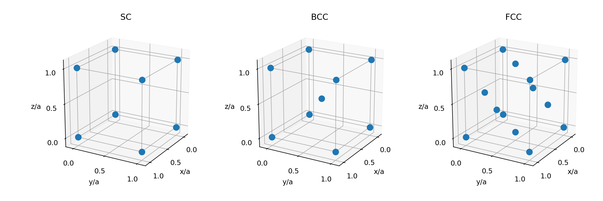{: style="width: 1100px; max-width: 100%; height: auto;"}

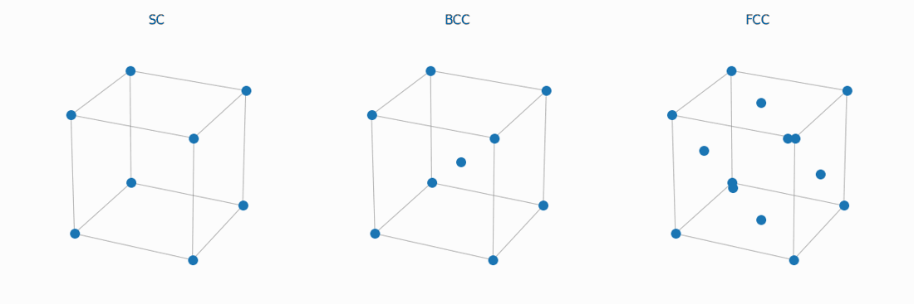{: style="width: 1100px; max-width: 100%; height: auto;"}

<code>ax.scatter(x, y, z)</code>는 3차원 점을 그린다.
여기서는 좌표를 $a$로 나눈 무차원 좌표로 표시했다.
회색 선은 단위격자의 테두리이며 원자 사이의 결합을 뜻하지 않는다.
점은 원자 중심의 위치를 나타낸다. <code>s=70</code>은 화면의 표식 크기이며 실제 원자 반지름이 아니다.
<code>view_init()</code>의 <code>elev</code>와 <code>azim</code>은 시선의 고도각과 방위각을 도(degree) 단위로 지정한다.

## 8.4. FCC를 2×2×2셀로 반복하기

격자상수를 $a=0.4$ nm로 가정하고 각 방향에 셀을 2개씩 배치하자.
이는 특정 원소의 실측값이 아니라 분율좌표를 길이로 환산하기 위한 예제 설정이다.

~~~python
repeats = 2
a = 0.4  # nm
fractional_points = cubic_points("FCC", repeats=repeats)
positions = a * fractional_points

fig = plt.figure(figsize=(7, 6))
ax = fig.add_subplot(111, projection="3d")
ax.scatter(positions[:, 0], positions[:, 1], positions[:, 2],
           s=45, color="tab:blue", depthshade=False)
for i in range(repeats):
    for j in range(repeats):
        for k in range(repeats):
            draw_cubic_cell(ax, origin=a * np.array([i, j, k]), length=a)
ax.set(xlabel="x (nm)", ylabel="y (nm)", zlabel="z (nm)",
       title="FCC: 2 x 2 x 2 conventional cells",
       xlim=(-0.05, repeats * a + 0.05),
       ylim=(-0.05, repeats * a + 0.05),
       zlim=(-0.05, repeats * a + 0.05))
ax.set_box_aspect((1, 1, 1))
ax.view_init(elev=20, azim=30)
fig.tight_layout()
plt.show()

print(positions.shape)  # (63, 3)
~~~

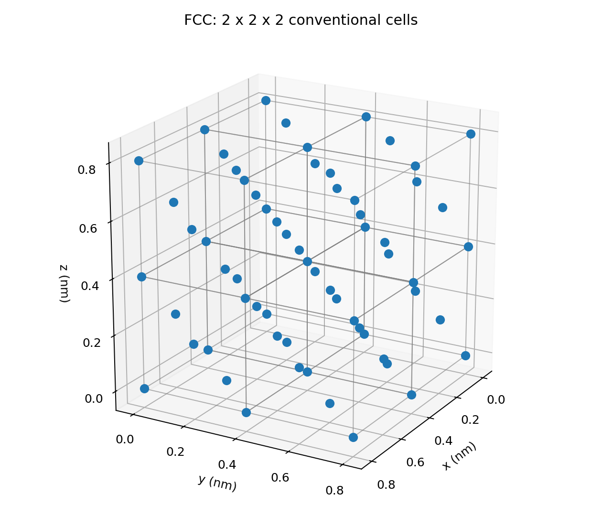{: style="width: 720px; max-width: 100%; height: auto;"}

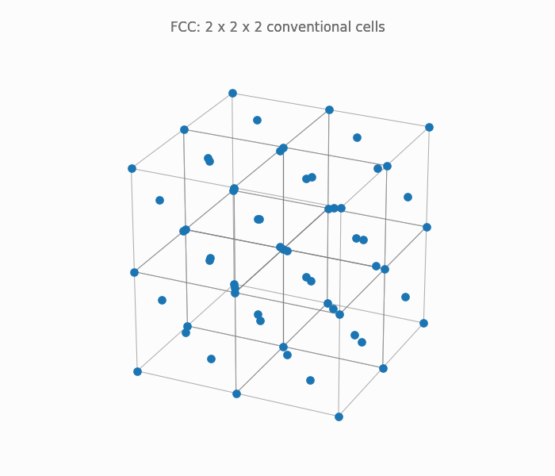{: style="width: 720px; max-width: 100%; height: auto;"}

그린 원자 중심의 좌표 범위는 각 방향으로 0–0.8 nm다.
표시한 63개는 바깥 경계의 원자 중심도 모두 하나씩 센 점의 개수다.
경계에서 원자를 공유하는 비율까지 고려해 계산한 원자 수 $8\times4=32$와 구분하자.
이 코드는 같은 위치의 원자 중심을 셀마다 중복해서 만들지 않는다.
<code>"FCC"</code>를 <code>"SC"</code>나 <code>"BCC"</code>로 바꾸면 같은 방법으로 다른 구조도 비교할 수 있다.

## 8.5. HCP와 FCC의 조밀충전층 적층 비교하기

[조밀충전(close packing)](https://www.iucr.org/what-we-do/education/pamphlets/close-packed-structures)은
같은 크기의 구를 빈 공간이 작도록 배열하는 방법이다.
한 층에서 원자 중심을 삼각 격자(triangular lattice)로 배열하고,
다음 층의 원자를 그 아래층의 세 원자 사이 오목한 자리에 놓으면 조밀충전층을 쌓을 수 있다.

첫 층의 가로 위치를 A, 두 번째 층의 위치를 B라고 하자.
세 번째 층이 첫 층과 같은 가로 위치로 돌아오면 **ABAB…**인
**조밀육방구조(hexagonal close-packed structure, HCP)**가 된다.
반면 세 번째 층을 A·B와 다른 위치 C에 놓으면 **ABCABC…**인 FCC가 된다.
A·B·C는 원자의 종류가 아니라, 위에서 보았을 때 층이 놓이는 서로 다른 위치다.

| 구조 | 층의 반복 순서 | 조밀충전층 | 층을 쌓는 방향 |
|---|---|---|---|
| HCP | ABAB… | 기저면(basal plane) $(0001)$ | $[0001]$ |
| FCC | ABCABC… | $(111)$면 | $[111]$ |

아래 그림에서는 두 구조의 **적층 방향을 모두 화면의 $z$축**으로 맞추었다.
따라서 FCC 그림의 $z$축은 앞 절의 입방체 $[001]$ 방향이 아니라 $[111]$ 방향이다.
HCP의 $(0001)$, $[0001]$은 육방정에서 사용하는 네 지수 표기이며,
이 실습에서는 각각 바닥면과 그 수직 방향이라고 이해하면 된다.

여기서는 같은 층의 최근접 원자 중심 사이 거리를 $a=1$로 놓아 좌표를 무차원화한다.
이 $a$는 HCP의 바닥면 격자상수와 같지만, FCC 입방체의 격자상수 $a_{\mathrm{FCC}}$와는
$a_{\mathrm{FCC}}=\sqrt{2}a$의 관계가 있다.
같은 크기의 구가 맞닿는 이상적인 모델에서는 이웃 층 사이 거리가

$$
h=\sqrt{\frac{2}{3}}a
$$

이고, HCP에서 A층이 다시 나오는 높이는

$$
c=2h,\qquad \frac{c}{a}=\sqrt{\frac{8}{3}}\approx1.633
$$

이다. 실제 HCP 재료의 $c/a$는 이 이상적인 값과 다를 수 있다.

~~~python
a = 1.0  # 같은 층의 최근접 원자 중심 간 거리로 좌표를 정규화
u = np.array([a, 0.0, 0.0])
v = np.array([a / 2, np.sqrt(3) * a / 2, 0.0])
layer_spacing = np.sqrt(2 / 3) * a

base_layer = np.array([
    i * u + j * v
    for i in range(-1, 2)
    for j in range(-1, 2)
])
layer_offsets = {
    "A": np.array([0.0, 0.0, 0.0]),
    "B": (u + v) / 3,
    "C": 2 * (u + v) / 3 - u,
}
layer_colors = {"A": "tab:blue", "B": "tab:orange", "C": "tab:green"}

def stacked_layers(sequence):
    return np.array([
        base_layer + layer_offsets[letter]
        + np.array([0.0, 0.0, k * layer_spacing])
        for k, letter in enumerate(sequence)
    ])

fig = plt.figure(figsize=(12, 6))
for panel, (name, sequence) in enumerate([
    ("HCP", "ABABAB"), ("FCC", "ABCABC"),
]):
    ax = fig.add_subplot(1, 2, panel + 1, projection="3d")
    layers = stacked_layers(sequence)  # shape: (6, 9, 3)
    for k, (letter, points) in enumerate(zip(sequence, layers)):
        ax.scatter(points[:, 0] / a, points[:, 1] / a, points[:, 2] / a,
                   color=layer_colors[letter], s=60, depthshade=False,
                   label=letter if k == sequence.index(letter) else None)
    ax.plot([0, 0], [0, 0], [0, 5 * layer_spacing / a],
            linestyle="--", color="gray", alpha=0.5)
    ax.set(xlabel="x/a", ylabel="y/a", zlabel="z/a",
           title=f"{name}: {sequence}",
           xlim=(-1.8, 2.2), ylim=(-1.1, 1.6), zlim=(-0.2, 4.4))
    ax.set_zticks(np.arange(6) * layer_spacing / a)
    ax.set_zticklabels([f"{k * layer_spacing / a:.2f} {letter}"
                        for k, letter in enumerate(sequence)], fontsize=8)
    ax.set_xticks([-1, 0, 1, 2])
    ax.set_yticks([-1, 0, 1])
    ax.set_box_aspect((4.0, 2.7, 4.6))
    ax.view_init(elev=15, azim=-65)
    ax.legend(loc="upper left", title="Layer position")
fig.subplots_adjust(left=0.06, right=0.90, bottom=0.10, top=0.90, wspace=0.30)
plt.show()
~~~

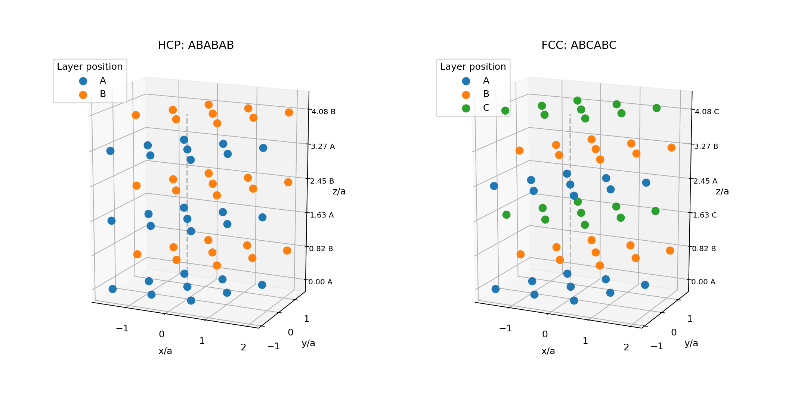{: style="width: 1100px; max-width: 100%; height: auto;"}

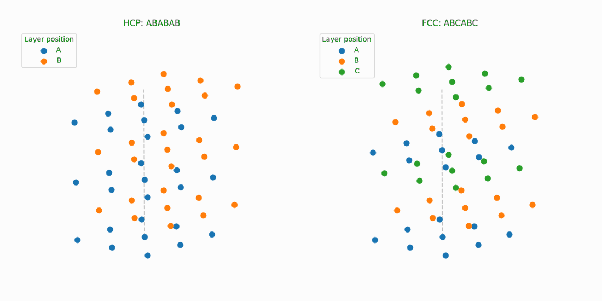{: style="width: 1100px; max-width: 100%; height: auto;"}

<code>layers</code>의 세 축은 순서대로 층, 그 층의 원자, 좌표 성분을 뜻한다.
한 층에 원자 중심 9개를 표시했고, 구조를 읽기 쉽게 6개 층만 그렸다.
회색 점선은 같은 가로 좌표를 확인하기 위한 수직 기준선이며 결합선이 아니다.
HCP에서는 두 층 뒤에, FCC에서는 세 층 뒤에 같은 색의 원자 배열이 같은 가로 위치로 돌아오는지 확인하자.
위에서 보면 겹치는 점도 있으므로 옆에서 본 그림과 회전 영상을 함께 비교하는 것이 좋다.
이 그림은 적층 순서를 보여 주기 위한 유한한 영역의 원자 중심 배치이며, 원자 반지름을 나타낸 그림은 아니다.

## 8.6. HCP의 육각기둥 구조 그리기

이번에는 HCP의 A–B–A 세 층을 육각기둥(hexagonal prism) 안에 표시한다.
아래·위 A층에는 육각형의 꼭짓점 6개와 중심 1개가 있고,
중간 B층에는 원자 중심 3개가 있다.
파란 점과 주황 점은 각각 A·B층을 구분하며, 서로 다른 원소를 뜻하지 않는다.

**HCP 구조 자체를 하나의 브라베 격자(Bravais lattice)와 동일시하면 안 된다.**
HCP는 육방 브라베 격자에 원자 2개를 기본 원자 배열(basis, motif)로 붙여 만든 구조다.
앞 절의 두 벡터 $\boldsymbol u,\boldsymbol v$처럼 바닥면 벡터 사이 각도를 $60^\circ$로 잡으면,
세 격자벡터는 $\boldsymbol u,\boldsymbol v,c\boldsymbol e_z$이고,
그에 대한 기본 원자 배열의 분율좌표는 $(0,0,0)$, $(1/3,1/3,1/2)$로 쓸 수 있다.
문헌에서 바닥면 벡터를 $120^\circ$로 잡으면 분율좌표의 표기도 달라지므로,
좌표만 비교하기 전에 어떤 격자벡터를 사용했는지 확인해야 한다.
이때 원자 배열을 뜻하는 basis는 11장의 공간 좌표축을 정하는 기저벡터(basis vector)와 구분하자.

교과서에서 자주 그리는 **큰 육각기둥은 원자 2개짜리 셀 3개에 해당하는 부피**를 갖는다.
따라서 경계의 원자를 공유하는 비율까지 고려하면 이 큰 육각기둥의 원자 수는

$$
N=12\times\frac16+2\times\frac12+3=6
$$

이다. 꼭짓점 원자 12개는 각각 이웃 육각기둥 6개가 공유하고,
위·아래 면 중심의 원자 2개는 각각 두 육각기둥이 공유한다.
기둥 내부 B층의 원자 3개는 모두 포함된다.
그림에 표시한 원자 중심은 $12+2+3=17$개지만, 공유 비율을 고려한 원자 수는 6개다.

~~~python
c = 2 * layer_spacing  # 이상적인 HCP의 c/a = sqrt(8/3)
angles = np.arange(6) * np.pi / 3
hexagon = a * np.column_stack([
    np.cos(angles), np.sin(angles), np.zeros(6),
])
base_sites = np.vstack([hexagon, np.zeros(3)])
a_sites = np.vstack([base_sites, base_sites + np.array([0.0, 0.0, c])])
b_sites = np.array([
    (hexagon[k] + hexagon[(k + 1) % 6]) / 3
    + np.array([0.0, 0.0, c / 2])
    for k in (0, 2, 4)
])

fig = plt.figure(figsize=(7, 6))
ax = fig.add_subplot(111, projection="3d")
for height in (0.0, c):
    ring = np.vstack([hexagon, hexagon[0]]) + np.array([0.0, 0.0, height])
    ax.plot(ring[:, 0] / a, ring[:, 1] / a, ring[:, 2] / a,
            color="gray", linewidth=1)
for corner in hexagon:
    ax.plot([corner[0] / a] * 2, [corner[1] / a] * 2, [0, c / a],
            color="gray", linewidth=1)
ax.scatter(a_sites[:, 0] / a, a_sites[:, 1] / a, a_sites[:, 2] / a,
           s=90, color=layer_colors["A"], depthshade=False, label="A layers")
ax.scatter(b_sites[:, 0] / a, b_sites[:, 1] / a, b_sites[:, 2] / a,
           s=90, color=layer_colors["B"], depthshade=False, label="B layer")
ax.set(xlabel="x/a", ylabel="y/a", zlabel="z/a",
       title="HCP: A-B-A in a hexagonal prism",
       xlim=(-1.3, 1.3), ylim=(-1.3, 1.3), zlim=(-0.15, c / a + 0.15))
ax.set_box_aspect((2.6, 2.6, c / a + 0.3))
ax.view_init(elev=20, azim=-55)
ax.legend(loc="upper left")
fig.subplots_adjust(left=0.12, right=0.84, bottom=0.12, top=0.88)
plt.show()
~~~

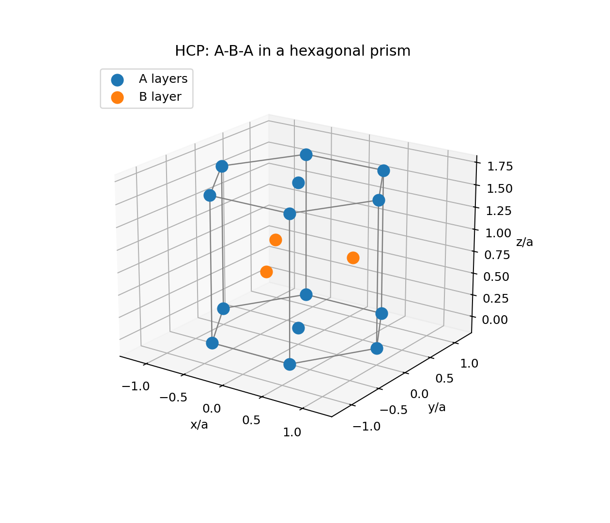{: style="width: 840px; max-width: 100%; height: auto;"}

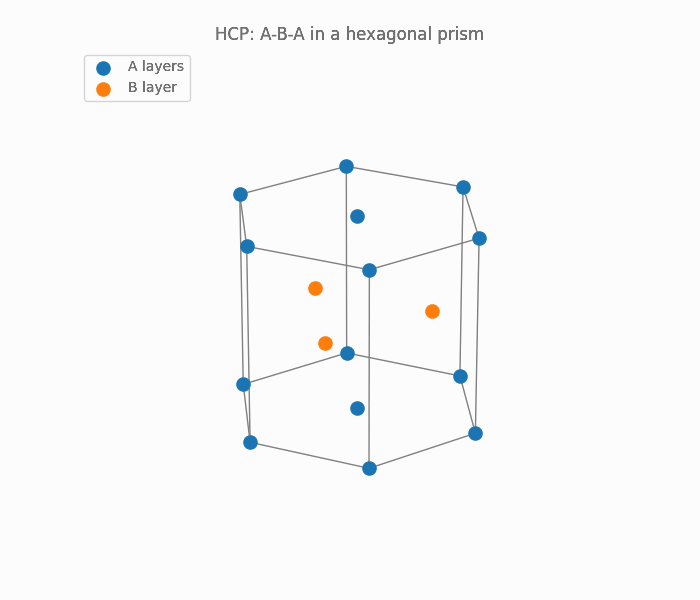{: style="width: 840px; max-width: 100%; height: auto;"}

<code>np.column_stack()</code>은 좌표 성분을 열로 묶고,
<code>np.vstack()</code>은 원자 좌표들을 행 방향으로 이어 붙인다.
모서리의 회색 선은 육각기둥의 테두리이며 원자 사이 결합을 뜻하지 않는다.
HCP의 두 원자 기본 배열은 [TU Graz의 HCP 강의자료](https://lampz.tugraz.at/~hadley/ss1/crystalstructure/structures/hcp/hcp.php),
큰 육각기둥의 원자 수는 [IIT Bombay의 결정구조 강의자료](https://homepages.iitb.ac.in/~alsangle/MM219_Lectures_23-24.html)를 참고하자.

## 8.7. 원자를 경구 모형으로 표현하기

앞의 산점도는 원자 **중심의 위치**만 보여 주었다.
이번에는 원자를 반지름이 일정하고 서로 겹치지 않는 구로 나타내는
**경구 모형(hard-sphere model)**으로 원자의 접촉과 빈 공간을 살펴보자.
실제 원자는 딱딱한 공이 아니며, 이 모형은 결정구조의 기하학적 관계를 이해하기 위한 근사다.

8.5절의 $a$는 같은 층에서 가장 가까운 원자 중심 사이 거리이므로,
구들이 맞닿으려면 반지름을 $R=a/2$로 정한다.
이는 <code>scatter(..., s=...)</code>의 점 크기를 키우는 것과 다르다.
산점도 표식은 화면에서의 크기인 반면, 아래 구의 반지름은 **원자 좌표와 같은 길이 단위**를 사용한다.

구의 중심을 $(x_0,y_0,z_0)$라고 할 때 표면의 좌표는

$$
x=x_0+R\sin\theta\cos\phi,\qquad
y=y_0+R\sin\theta\sin\phi,\qquad
z=z_0+R\cos\theta
$$

로 계산할 수 있다. 여기서 $0\le\theta\le\pi$, $0\le\phi\le2\pi$다.
15장 앞부분의 <code>meshgrid()</code>와 <code>plot_surface()</code>를 함께 사용해 보자.
이 절의 코드는 8.5·8.6절에서 만든 좌표와 색상 설정을 이어서 사용한다.

~~~python
from matplotlib.patches import Patch

def draw_hard_sphere(ax, center, radius, color):
    phi = np.linspace(0, 2 * np.pi, 49)
    theta = np.linspace(0, np.pi, 25)
    PHI, THETA = np.meshgrid(phi, theta)
    x = center[0] + radius * np.sin(THETA) * np.cos(PHI)
    y = center[1] + radius * np.sin(THETA) * np.sin(PHI)
    z = center[2] + radius * np.cos(THETA)
    ax.plot_surface(x, y, z, color=color, linewidth=0,
                    antialiased=True, shade=True)
~~~

### 세 번째 층의 위치를 구로 비교하기

가려지는 원자를 줄이기 위해 HCP는 ABA, FCC는 ABC의 **세 층만** 그린다.
위쪽 층에 가려지는 원자도 있으므로 회전 영상과 앞의 원자 중심 그림을 함께 보자.
색은 층의 가로 위치를 구분하며, 원소의 종류를 구분하지 않는다.

~~~python
radius = a / 2
fig = plt.figure(figsize=(12, 6))
for panel, (name, sequence) in enumerate([("HCP", "ABA"), ("FCC", "ABC")]):
    ax = fig.add_subplot(1, 2, panel + 1, projection="3d")
    for letter, points in zip(sequence, stacked_layers(sequence)):
        for center in points:
            draw_hard_sphere(ax, center, radius, layer_colors[letter])
    ax.set(xlabel="x/a", ylabel="y/a", zlabel="z/a",
           title=f"{name}: {sequence} (hard spheres)",
           xlim=(-2.1, 2.6), ylim=(-1.5, 2.0), zlim=(-0.6, 2.3))
    ax.set_box_aspect((4.7, 3.5, 2.9))
    ax.set_xticks([-1, 0, 1, 2])
    ax.set_yticks([-1, 0, 1])
    ax.set_zticks([0, layer_spacing, 2 * layer_spacing])
    ax.set_zticklabels([f"{z / a:.2f}" for z in [0, layer_spacing, 2 * layer_spacing]])
    ax.view_init(elev=25, azim=-65)
    ax.legend(handles=[Patch(facecolor=layer_colors[letter], label=letter)
                       for letter in dict.fromkeys(sequence)], loc="upper left")
fig.subplots_adjust(left=0.06, right=0.90, bottom=0.10, top=0.90, wspace=0.30)
plt.show()
~~~

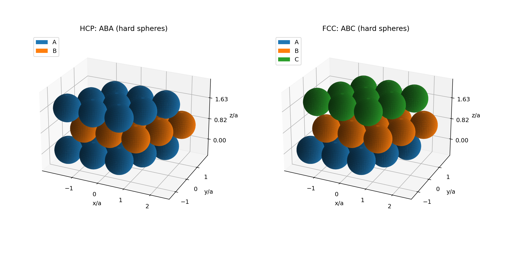{: style="width: 1100px; max-width: 100%; height: auto;"}

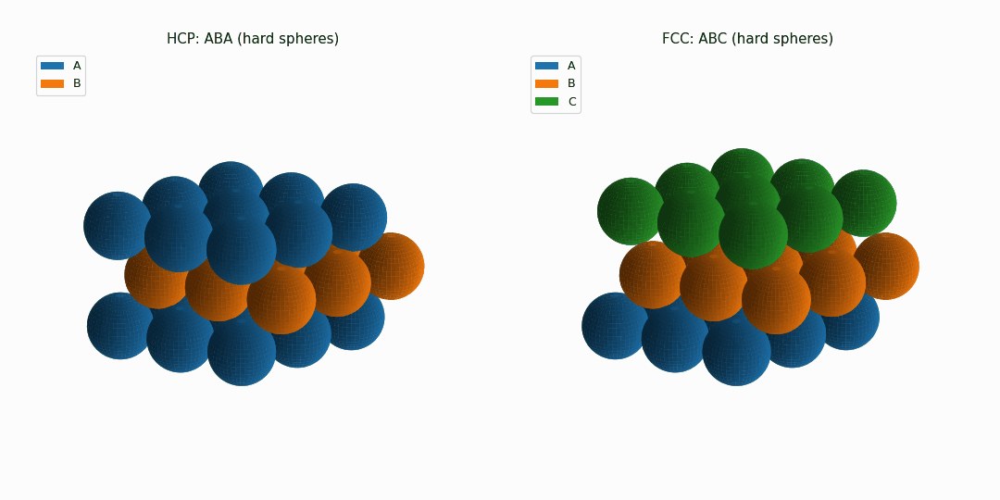{: style="width: 1100px; max-width: 100%; height: auto;"}

두 모형 모두 같은 층과 이웃 층의 최근접 원자가 맞닿는다.
원자 중심 그림과 비교하여 세 번째 층의 위치와 층 사이 빈 공간을 찾아보자.
반투명 구를 사용하지 않았으므로 뒷면의 원자는 앞쪽 구에 가려진다.

### HCP 육각기둥을 경구 모형으로 보기

8.6절에서 만든 A·B층의 중심 좌표를 그대로 사용한다.
원자 중심 사이 거리와 구의 반지름을 같은 비율로 그려야 하므로,
세 축의 **단위 길이가 화면에서도 같도록** 표시 범위와 <code>set_box_aspect()</code>를 함께 맞춘다.

~~~python
fig = plt.figure(figsize=(7, 6))
ax = fig.add_subplot(111, projection="3d")
for points, color in [(a_sites, layer_colors["A"]), (b_sites, layer_colors["B"])]:
    for center in points:
        draw_hard_sphere(ax, center, radius, color)
for height in (0.0, c):
    ring = np.vstack([hexagon, hexagon[0]]) + np.array([0.0, 0.0, height])
    ax.plot(ring[:, 0], ring[:, 1], ring[:, 2], color="gray", linewidth=0.8)
for corner in hexagon:
    ax.plot([corner[0]] * 2, [corner[1]] * 2, [0, c], color="gray", linewidth=0.8)
ax.set(xlabel="x/a", ylabel="y/a", zlabel="z/a",
       title="HCP hexagonal prism: hard spheres",
       xlim=(-1.6, 1.6), ylim=(-1.6, 1.6), zlim=(-0.6, c + 0.6))
ax.set_box_aspect((3.2, 3.2, c + 1.2))
ax.view_init(elev=20, azim=-55)
ax.legend(handles=[Patch(facecolor=layer_colors["A"], label="A layers"),
                   Patch(facecolor=layer_colors["B"], label="B layer")], loc="upper left")
fig.subplots_adjust(left=0.12, right=0.84, bottom=0.12, top=0.88)
plt.show()
~~~

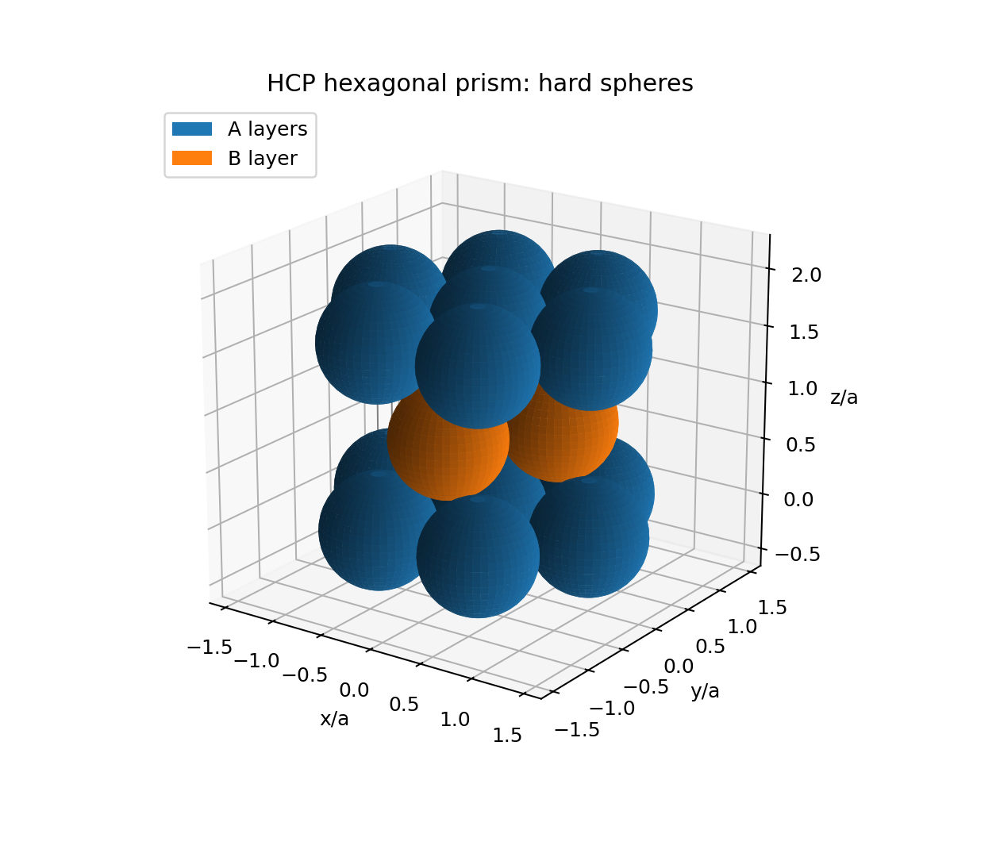{: style="width: 840px; max-width: 100%; height: auto;"}

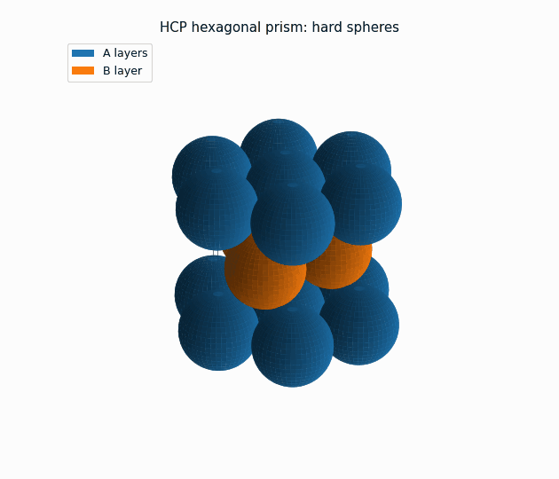{: style="width: 840px; max-width: 100%; height: auto;"}

이 그림은 경계의 원자를 잘라 내지 않고 **구 전체**를 그렸다.
따라서 꼭짓점과 위·아래 면 중심의 구는 육각기둥의 테두리 밖으로도 나온다.
기둥 안에 포함되는 원자 수를 계산할 때는 여전히 8.6절의 공유 비율을 적용한다.
앞에서 그린 FCC 입방체에 경구 모형을 적용한다면,
입방체 격자상수 $a_{\mathrm{FCC}}$에 대해 $R=a_{\mathrm{FCC}}/(2\sqrt{2})$를 사용해야 한다.
층 내부의 최근접 거리 $a$와 입방체의 격자상수를 혼동하지 않도록 주의하자.
관련 설명은 [IIT Bombay의 경구 모형과 결정구조 강의자료](https://homepages.iitb.ac.in/~alsangle/MM219_Lectures_23-24.html)를 참고한다.

# 9. 자주 하는 실수

- <code>plt.subplots(1, 2)</code>가 반환한 <code>axes</code>는 Axes 배열이다.
- 로그로 표시하는 축의 데이터에 0이나 음수를 넣지 않는다.
- 색상 그래프에는 물리량과 단위를 표시한 색상 막대(colorbar)를 추가한다.
- <code>plot_surface()</code>의 <code>X</code>, <code>Y</code>, <code>Z</code> shape은 같아야 한다.
- 영벡터 $[000]$은 방향을 나타내지 않는다.
- 격자 그림에 표시된 점의 개수와 단위격자당 유효 원자 수를 혼동하지 않는다.
- HCP·FCC 적층 그림의 색을 서로 다른 원소로 해석하지 않는다.
- FCC의 적층 방향 $[111]$을 입방체의 $[001]$ 방향과 혼동하지 않는다.

# 10. 정리

- 여러 Axes를 이용하면 서로 다른 데이터를 읽기 쉽게 비교할 수 있다.
- 넓은 범위의 양수 데이터에는 로그축이 유용하다.
- 오차막대에는 표준편차·표준오차 등 무엇을 표시했는지와 반복 횟수를 명시한다.
- <code>contourf()</code>는 2차원 분포를 색으로 나타낸다.
- <code>contour()</code>는 함수값이 같은 위치를 등고선으로 나타낸다.
- <code>plot_wireframe()</code>, <code>plot_surface()</code>, <code>quiver()</code>로
  3차원 값과 방향을 표현할 수 있다.
- 원자 중심 좌표를 행마다 저장하고, 정수 평행이동으로 반복 격자를 만들 수 있다.
- HCP는 ABAB…, FCC는 ABCABC… 순서로 조밀충전층이 반복된다.

14·15장에서는 주어진 데이터와 계산한 함수를 구분해 그렸다.
다음 16장에서는 측정값에 가장 잘 맞는 모델의 계수를 최소자승법으로 구하고,
측정점·적합 곡선·잔차를 함께 살펴본다.

# 11. 연습 문제

## 문제 1

한 Figure에 1행 2열의 Axes를 만드는 코드를 쓰시오.

<!--
풀이와 해답:
fig, axes = plt.subplots(1, 2)
-->

## 문제 2

확산계수 $10^{-18}$부터 $10^{-10}$까지를 표시할 때 선형축과 로그축 중 어느 것이 더
적절한가?

<!--
풀이와 해답:
값이 여러 자릿수에 걸쳐 변하므로 로그축이 더 적절하다.
-->

## 문제 3

온도 배열 <code>temperature</code>, 평균 경도 <code>hardness</code>, 표준편차 <code>hardness_std</code>가 주어졌다.
온도에 따른 평균 경도를 표준편차 오차막대와 함께
그리는 한 줄의 코드를 쓰시오.

<!--
풀이와 해답:
ax.errorbar(temperature, hardness, yerr=hardness_std, marker="o", capsize=4)
-->

## 문제 4

3차원 Axes를 만드는 다음 코드의 빈칸을 채우시오.

~~~python
fig = plt.figure()
ax = fig.add_subplot(111, __________)
~~~

<!--
풀이와 해답:
projection="3d"
-->

## 문제 5: 격자 shape과 인덱싱

<code>x = np.linspace(-2, 2, 5)</code>, <code>y = np.linspace(-1, 1, 3)</code>일 때
<code>X, Y = np.meshgrid(x, y, indexing="xy")</code>의 shape을 쓰시오.
또한 <code>X[1, 2]</code>, <code>Y[1, 2]</code>와
<code>Z = X**2 + Y**2</code>의 <code>Z[1, 2]</code> 값을 구하시오.

<!--
풀이와 해답:
X, Y, Z의 shape은 모두 (3, 5)다.
X[1, 2] = x[2] = 0, Y[1, 2] = y[1] = 0이므로 Z[1, 2] = 0이다.
-->

## 문제 6: 오차막대의 의미

한 조건에서 독립적으로 9회 반복 측정한 표본 표준편차가 6 MPa다.
평균 ± 표준편차를 그릴 때와 평균 ± 표준오차를 그릴 때 각각 <code>yerr</code>에 넣을 값을 구하고,
두 오차막대가 무엇을 나타내는지 설명하시오.

<!--
풀이와 해답:
평균 ± 표준편차: yerr=6, 개별 측정값의 퍼짐을 나타낸다.
평균 ± 표준오차: yerr=6/np.sqrt(9)=2, 평균의 표준오차 추정값을 나타낸다.
둘 중 어느 것도 정의를 밝히지 않은 채 신뢰구간이라고 부르지 않는다.
-->

## 문제 7: 2차원 Axes 배열

<code>fig, axes = plt.subplots(2, 2)</code>로 만든 그림에서
첫 번째 행·두 번째 열의 Axes에 <code>x</code>, <code>y</code>의 선 그래프를 그리는 코드를 쓰시오.

<!--
풀이와 해답:
axes[0, 1].plot(x, y)
-->

## 문제 8: 단위격자의 점과 원자 수

FCC 단위격자 그림에는 점이 14개 보인다. 단위격자당 원자 수가 4인 이유를 설명하시오.
또한 <code>cubic_points("BCC", repeats=1)</code>의 shape을 쓰시오.

<!--
풀이와 해답:
FCC는 꼭짓점 8개×1/8 + 면 중심 6개×1/2 = 4개다.
그림의 14개는 경계 공유를 고려하지 않고 표시한 원자 중심의 개수다.
BCC 함수의 결과 shape은 (9, 3)이다. 꼭짓점 8개와 체심 1개를 그린다.
-->

## 문제 9: 격자상수와 실제 좌표

FCC에서 원점과 분율좌표 $(0,1/2,1/2)$인 원자 중심 사이의 거리를,
격자상수 $a=0.4$ nm일 때 NumPy로 구하시오.
$2\times2\times2$ 격자의 <code>positions</code>를 만든 뒤 $a$만 0.5로 바꾸면
이미 계산한 좌표도 자동으로 바뀌는지 설명하시오.

<!--
풀이와 해답:
displacement = 0.4 * np.array([0.0, 0.5, 0.5])
distance = np.linalg.norm(displacement)
거리 = a/sqrt(2) ≈ 0.2828 nm다.
a를 바꿔도 기존 positions 배열은 바뀌지 않는다.
positions = a * fractional_points를 다시 실행해야 한다.
-->

## 문제 10: 세 번째 층의 위치

첫 두 조밀충전층이 AB일 때, 세 번째 층을 어디에 놓으면 HCP가 되고 어디에 놓으면 FCC가 되는가?
또한 이 예제의 FCC 그림에서 $z$축이 입방체의 $[001]$ 방향인지 설명하시오.

<!--
풀이와 해답:
세 번째 층을 첫 층과 같은 가로 위치 A에 놓으면 ABA…, 즉 HCP가 된다.
A·B와 다른 위치 C에 놓으면 ABC…, 즉 FCC가 된다.
FCC 그림의 z축은 조밀충전 (111)면에 수직인 [111] 방향이다.
-->

## 문제 11: HCP의 두 셀과 원자 수

원자 중심이 17개 표시된 큰 HCP 육각기둥의 유효 원자 수를 계산하시오.
이것이 원자 2개짜리 셀의 원자 수와 다른 이유도 설명하시오.

<!--
풀이와 해답:
꼭짓점 12×1/6 + 위·아래 면 중심 2×1/2 + 내부 3 = 6개다.
큰 육각기둥의 부피는 원자 2개짜리 셀의 3배이므로 모순이 아니다.
그림에 표시한 중심의 개수와 경계 공유를 고려한 원자 수는 다르다.
-->

API의 세부 옵션은 공식 문서의
[여러 Axes 만들기](https://matplotlib.org/stable/api/_as_gen/matplotlib.pyplot.subplots.html),
[meshgrid](https://numpy.org/doc/stable/reference/generated/numpy.meshgrid.html),
[등고선](https://matplotlib.org/stable/api/_as_gen/matplotlib.axes.Axes.contour.html)을 참고한다.

---

[이전 강의](/assets/lecture_notes/1_2_data_mse/data_mse_14_기초_matplotlib1.md) · [강의 목록](/_lectures/1_2_data_mse.md) · [다음 강의](/assets/lecture_notes/1_2_data_mse/data_mse_16_최소자승법.md)
