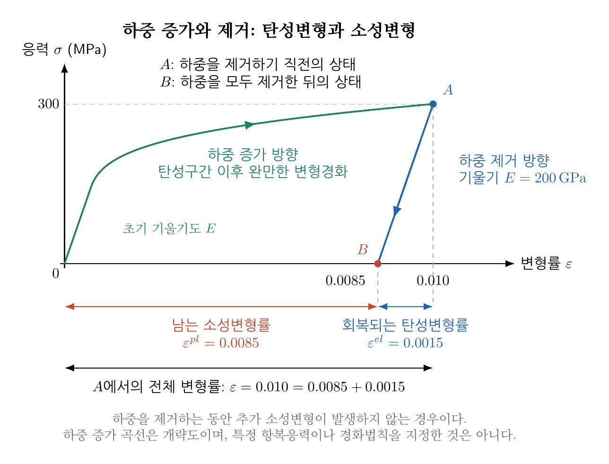
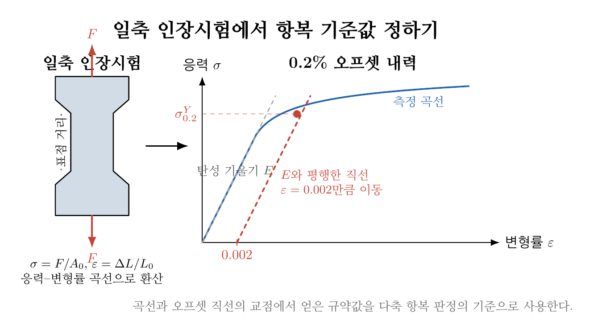
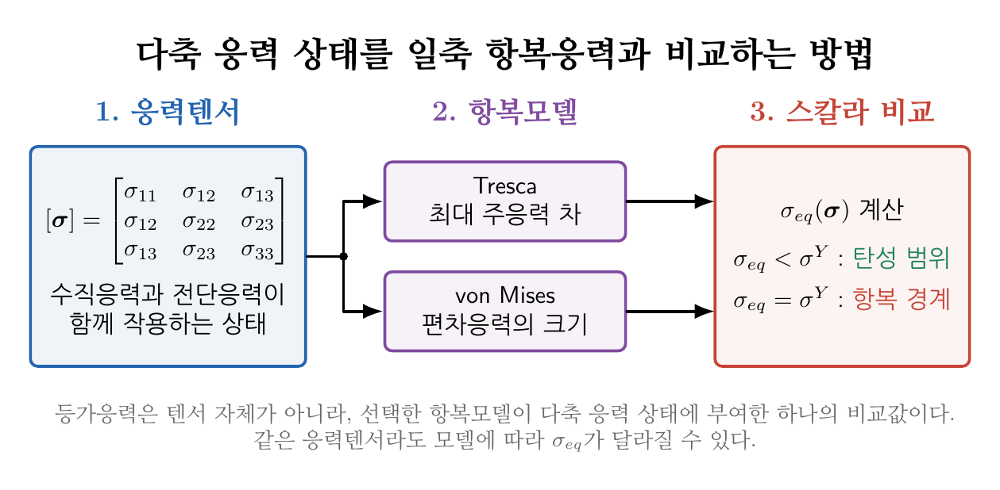
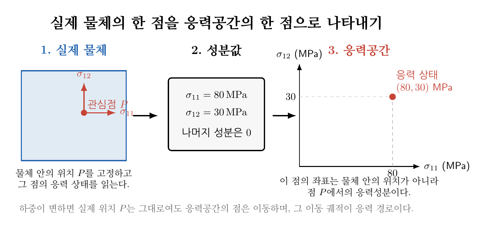
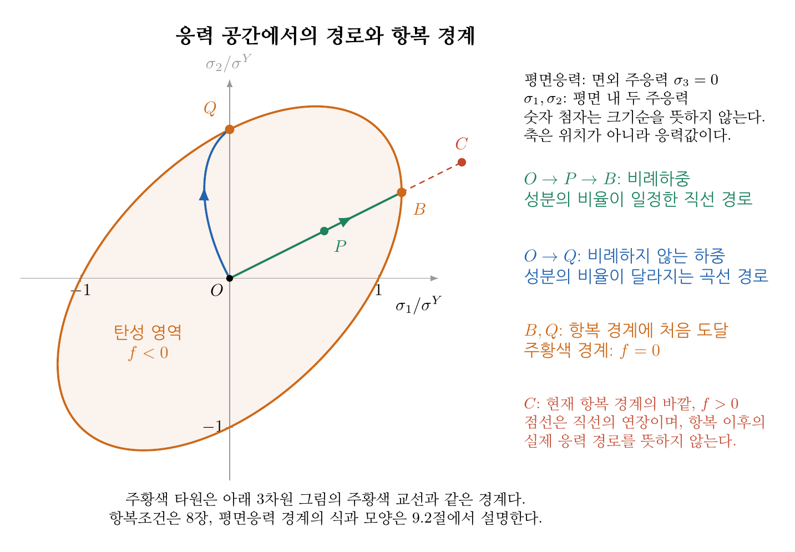

**목차**

* TOC
{:toc}

# 1. 탄성 한계와 항복(yielding)

금속 시편을 작은 힘으로 당겼다가 하중을 제거하면 대체로 원래 형상으로 돌아온다.
이처럼 하중 제거 시 회복되는 변형이 **탄성변형(elastic deformation)**이다.
하중을 충분히 증가시키면 제거 후에도 변형이 남기 시작한다.
이 영구적인 변형이 **소성변형(plastic deformation)**이며,
소성변형이 시작되는 현상을 **항복(yielding)**이라 한다.

## 1.1. 소성변형이 시작되어도 탄성변형은 존재한다

미소변형(infinitesimal strain)에서는 전체 변형률(total strain)을 다음처럼 탄성 변형률
과 소성 변형률의 합으로 분해한다.

$$
\varepsilon=\varepsilon^{el}+\varepsilon^{pl}.
$$

일축 선형탄성 관계는 전체 변형률이 아니라 탄성변형률에 적용된다.

$$
\sigma=E\varepsilon^{el}
=E(\varepsilon-\varepsilon^{pl}).
$$

항복 전에는 소성변형률이 0이므로 (즉 $\varepsilon^{pl}=0$), 익숙한 Hooke의 법칙
$\sigma=E\varepsilon$을 사용할 수 있다.
항복 이후에도 탄성변형률은 존재하며 응력과 연결된다.
따라서 “소성변형이 시작되면 탄성변형이 멈춘다”라고 이해하면 안 된다.

예를 들어 $E=200\,\mathrm{GPa}$인 재료가 $\sigma=300\,\mathrm{MPa}$에서
전체 변형률 $0.010$에 도달했다면

$$
\varepsilon^{el}=\frac{300}{200000}=0.0015,
\qquad
\varepsilon^{pl}=0.010-0.0015=0.0085.
$$

하중을 제거하는 동안 추가 소성변형이 발생하지 않는다면, 탄성변형률 $0.0015$가 회복되고,
소성변형률 $0.0085$가 잔류한다.

{: style="width: 1000px; max-width: 100%; height: auto;"}

그림의 초록색 곡선은 원점에서 $A$까지 하중을 증가시키는 경로이고, 파란색 직선은 하중을 제거하는 경로다.
초기 탄성구간과 하중 제거 경로의 기울기는 모두 탄성계수 $E$다.
하중 증가 곡선은 변형경화의 모습을 보여주는 개략도이며, 특정 항복응력이나 경화법칙을 지정한 것은 아니다.
가로축에서 $B$부터 $A$의 수직 투영점까지의 거리는 회복되는 탄성변형률이고,
원점부터 $B$까지의 거리는 남는 소성변형률이다.

## 1.2. 항복과 파괴는 다른 현상이다

항복은 소성변형의 시작을 나타내며, 균열 발생이나 파단과 동일한 조건이 아니다.
성형공정은 소성변형을 이용하므로 항복 이후의 거동이 중요하다.
반면 영구적인 형상 변화가 허용되지 않는 구조물에서는 항복을 피하도록 설계할 수 있다.

항복조건만으로는 파단 시점이나 네킹 시점을 알 수 없다.
이 강의에서는 먼저 **주어진 응력 상태에서 소성변형이 시작될 조건**을 다룬다.

# 2. 항복응력 (yield stress)

## 2.1. 일축 인장시험에서 얻는 기준값

일축 인장시험에서 소성변형이 시작되는 응력을 **항복응력(yield stress)** 또는
**항복강도(yield strength)**라고 한다. 이 강의에서는 이를 $\sigma^Y$로 표기한다.
항복응력은 응력의 단위를 가지며, 등가응력(equivalent stress)과 비교할 때 같은 단위를 사용해야 한다.

금속에 따라 명확한 항복점이 나타나기도 하고 탄성에서 소성으로 점진적으로 넘어가기도 한다.
명확한 항복점이 없는 경우에는 0.2% 오프셋 내력과 같은 규약값을 사용한다.
0.2% 오프셋 내력은 탄성 직선과 평행한 직선을 변형률 $0.002$만큼 옮겨
응력–변형률 곡선과 만나는 점에서 정한다.
이는 소성변형의 최초 발생을 직접 측정한 값과 반드시 같지는 않다.

{: style="width: 900px; max-width: 100%; height: auto; display: block; margin: 0 auto;" }

*그림: 인장시험에서 얻은 응력–변형률 곡선에 탄성 기울기와 평행한 직선을
$0.002$만큼 이동하여 그린다. 곡선과 이 직선의 교점에 해당하는 응력을 0.2% 오프셋 내력으로 정한다.*

## 2.2. 재료와 시험 조건에 따른 변화

항복응력은 모든 금속에 공통인 상수가 아니다.
재료의 조성, 미세조직, 열처리, 온도와 변형률속도 등에 따라 달라질 수 있다.
재료가 소성변형으로 경화하면(즉 $\varepsilon^{pl}$가 증가하면) 이후의 항복응력 값도
달라질 수 있다.

이 강의에서는 비교를 명확히 하기 위해 다음을 가정한다.

- 주어진 온도와 시험 조건에서 항복응력 $\sigma^Y$가 알려져 있다.
- 거시적으로 등방인 치밀한 연성금속(ductile metal)의 초기 항복(initial yielding)을 다룬다.
- 인장과 압축의 항복응력 크기가 같다고 가정한다.
- 속도 비의존 항복조건을 사용하며, 별도 언급이 없으면 초기 잔류응력은 없다.

경화, 이방성, 압력 의존성이 중요하면 이 가정을 확장해야 한다.

# 3. 항복응력(yield stress)의 중요성

항복응력이 높다는 것은 주어진 조건에서 소성변형을 시작시키기 위해
더 큰 응력이 필요하다는 뜻이다. 이는 재료가 가진 **소성변형에 대한 저항**으로 해석할 수 있다.

일축 인장에서는 스칼라 응력 값 하나와 항복응력을 비교하면 된다.
하지만 실제 부품에는 수직응력과 전단응력이 동시에 작용할 수 있다.
예를 들어 축을 당기면서 비틀면 인장과 전단이 함께 존재한다.
이때 단순히 응력성분 중 가장 큰 숫자 하나를 골라 $\sigma^Y$와 비교하는 것은 충분하지 않다.

따라서 일축시험에서 얻은 기준값을 **다축 응력 상태**(multiaxial stress state)에도 적용할 수 있는 규칙이 필요하다.
이를 위해 먼저 응력텐서를 일축 항복응력과 비교할 수 있는 스칼라 값으로 환산하는 **등가응력**(equivalent stress)을 정의하고,
그 값과 항복응력을 비교하여 항복조건을 구성한다.

# 4. 등가 응력 (equivalent stress)

일반적인 응력 상태는 대칭 응력텐서로 나타낸다.

$$
[\boldsymbol\sigma]=
\begin{bmatrix}
\sigma_{11}&\sigma_{12}&\sigma_{13}\\
\sigma_{12}&\sigma_{22}&\sigma_{23}\\
\sigma_{13}&\sigma_{23}&\sigma_{33}
\end{bmatrix}.
$$

이를 일축 항복응력과 비교할 수 있는 스칼라로 환산한 것이
**등가응력(equivalent stress)** $\sigma_{eq}$이다.

{: style="width: 900px; max-width: 100%; height: auto; display: block; margin: 0 auto;" }

*그림: 응력텐서의 여러 성분을 각각 항복응력과 비교하지 않는다. 선택한 항복모델로
하나의 등가응력 $\sigma_{eq}$을 계산한 뒤, 일축시험에서 얻은 $\sigma^Y$와 비교한다.*

## 4.1. 등가응력은 어떤 종류의 세기인가?

등가응력은 단순히 “모든 응력의 크기”를 뜻하지 않는다.
**선택한 항복모델의 관점에서 일축 응력과 비교하기 위한 세기**다.
같은 응력 상태라도 Tresca와 von Mises 등의 모델이 부여하는 값이 다를 수 있다.

두 등가응력은 일축 상태에서 다음을 만족하도록 정의한다.

$$
[\boldsymbol\sigma]
=\begin{bmatrix}
\sigma&0&0\\
0&0&0\\
0&0&0
\end{bmatrix}
\quad\Longrightarrow\quad \sigma_{eq}=\lvert\sigma\rvert.
$$

이 보정 덕분에 일축시험의 $\sigma^Y$를 다축 항복조건에도 사용할 수 있다.
등가응력 자체에는 방향이 없지만, 원래 응력텐서의 방향 정보가 사라지는 것은 아니다.
면력이나 주축이 필요하면 원래 텐서를 사용해야 한다.

## 4.2. 같은 응력 상태에는 같은 등가응력

[11장](/assets/lecture_notes/3_1_metal_plasticity/metal_plasticity_11_stress_transformation.md)에서 보았듯이 좌표축을 회전하면 응력성분은 바뀌지만 물리적 응력 상태는 같다.
따라서 같은 상태를 다른 기저로 표현했다는 이유만으로 항복 여부가 달라져서는 안 된다.
Tresca와 von Mises 등가응력은 모두 이 조건을 만족한다.

등방 재료에서는 주응력을 사용하면 방향에 대한 정보를 분리하여
세 주응력의 조합으로 항복조건을 표현할 수 있다.
세 주응력은 $\sigma_1,\sigma_2,\sigma_3$으로 표기하며, 숫자 첨자 자체에 크기순의 의미를 부여하지 않는다.
특히 평면응력의 주응력 공간에서는 $\sigma_1,\sigma_2$를 평면 내 성분,
$\sigma_3=0$을 면외 성분으로 사용한다.
최대 전단응력과 Tresca 등가응력을 계산할 때에는 부호를 포함하여

$$
\sigma_{\max}=\max(\sigma_1,\sigma_2,\sigma_3),
\qquad
\sigma_{\min}=\min(\sigma_1,\sigma_2,\sigma_3)
$$

을 정한다. [11장](/assets/lecture_notes/3_1_metal_plasticity/metal_plasticity_11_stress_transformation.md)의 크기순 정렬과 같은 계산이지만, 여기서는 정렬 결과를 최대·최소 첨자로 명시한다.
평면응력 상태에서도 면외 주응력 0을 포함한 **세 주응력**을 사용한다.

# 5. 항복 조건 (스칼라 응력)

## 5.1. 탄성 범위와 항복의 경계

일축 응력 상태(uniaxial stress state)에서는 스칼라 값 하나로 응력 상태를 대표할 수 있으며, 그 값을 $\sigma$로 표기 하자.
일축 인장(uniaxial tension)과 일축 압축(uniaxial compression) 환경에서 항복강도가 같다면 초기 탄성 범위와 항복의 경계는 각각

$$
\lvert\sigma\rvert<\sigma^Y \quad\text{(탄성 범위)},
$$

$$
\boxed{\lvert\sigma\rvert=\sigma^Y}\quad\text{(항복의 경계)}
$$

이다. 예를 들어 $\sigma^Y=100\,\mathrm{MPa}$이라면
$\sigma=100\,\mathrm{MPa}$의 인장과 $\sigma=-100\,\mathrm{MPa}$의 압축이
동일한 항복 기준(yield criterion)에 도달한다.
위의 항복 조건식($\lvert\sigma\rvert\le\sigma^Y$)에서 절댓값을 쓰는 것은 인장·압축 대칭이라는 재료모델의 가정이다.
실제 재료의 인장과 압축 항복강도가 다르면 다른 표현이 필요하다.

## 5.2. 항복 이후의 응력은 어떻게 되는가?

완전소성(perfect plasticity) 모델의 일축 인장에서는 항복 이후 응력이 $\sigma^Y$에 머무르면서
소성변형이 증가할 수 있다. 변형경화 재료에서는 소성변형에 따라 항복 수준이 증가한다.
따라서 실제 인장시험에서 응력이 초기 항복응력보다 커졌다고 해서 모순인 것은 아니다.
초기 항복응력과 현재의 항복 수준을 구분해야 한다.

이후에는 먼저 항복 수준을 고정하고, 어떤 응력 조합이 그 경계에 도달하는지 살펴본다.

# 6. 항복 조건 (응력 텐서)

다축 응력 상태에서는 개별 응력성분을 항복응력과 따로 비교하지 않고,
응력텐서 전체에서 계산한 등가응력을 기준값과 비교한다.
따라서 일축 상태의 $\lvert\sigma\rvert=\sigma^Y$는
다축 상태에서 $\sigma_{eq}(\boldsymbol\sigma)=\sigma^Y$로 확장된다.
다음 절에서는 이 비교를 항복함수로 표현하고, 응력 공간에서 그 의미를 살펴본다.

# 7. 응력텐서에서 항복함수로

앞서 정의한 등가응력 $\sigma_{eq}(\boldsymbol\sigma)$를 일축 항복응력 $\sigma^Y$와 비교하면
다축 응력 상태에서도 항복의 경계를 정할 수 있다.
항복 조건을 수학적으로 표현한 것이 항복함수(yield function)이며, 항복함수는 다음처럼 정의할 수 있다.

$$
\boxed{f(\boldsymbol\sigma)=\sigma_{eq}(\boldsymbol\sigma)-\sigma^Y}.
$$

## 7.1. 응력 공간(stress space)과 주응력 공간(principal stress space)

실제 물리공간에서는 좌표축의 방향을 기저벡터
$\boldsymbol e_1,\boldsymbol e_2,\boldsymbol e_3$로 나타내고,
한 점의 위치를 이 기저에 대한 좌표성분 $(x_1,x_2,x_3)$로 나타낸다.
따라서 물리공간의 점 하나는 물체 안의 한 위치를 뜻한다.
이와 달리 **응력 공간(stress space)**에서는 좌표축이 응력성분이고,
점 하나가 물체의 한 위치에서의 **응력 상태**를 나타낸다.
축의 단위도 길이가 아니라 MPa와 같은 응력 단위다.

예를 들어 두 성분 $\sigma_{11}$과 $\sigma_{12}$만 변하고 나머지 성분은 0이면,
$(\sigma_{11},\sigma_{12})=(80,30)\,\mathrm{MPa}$인 점은
수직응력 $80\,\mathrm{MPa}$와 전단응력 $30\,\mathrm{MPa}$가 함께 작용하는 상태다.
이 점의 좌표는 물체 안에서의 위치나 변위가 아니다.

{: style="width: 900px; max-width: 100%; height: auto; display: block; margin: 0 auto;" }

*그림: 실제 물체의 위치 $P$와 응력공간의 점은 서로 다른 의미를 갖는다. 위치 $P$를
고정한 채 하중을 바꾸면, $P$에서 측정되는 응력성분이 달라져 응력공간의 점이 이동한다.*

일반적인 대칭 응력텐서에는 독립성분이 여섯 개 있으므로,
전체 응력 상태는 여섯 성분을 좌표로 하는 공간의 한 점으로 나타낸다.
여섯 차원을 직접 그릴 수는 없지만, 몇 성분을 고정한 단면이나
주응력을 사용하는 공간으로 항복조건을 살펴볼 수 있다.

**주응력 공간(principal stress space)**은 세 좌표축을
$\sigma_1,\sigma_2,\sigma_3$으로 정한 공간이다.
예를 들어 $(100,0,0)\,\mathrm{MPa}$는 일축 인장 상태이고,
$(100,100,0)\,\mathrm{MPa}$는 등2축 인장 상태다.
두 점은 물체의 서로 다른 위치를 뜻하는 것이 아니라 서로 다른 응력 상태를 뜻한다.

등방 재료의 항복조건은 주축의 절대 방향에 의존하지 않으므로
세 주응력만으로 표현할 수 있다.

## 7.2. 하중 경로와 항복면

물체의 한 위치를 고정하고 하중을 변화시키면, 그 위치의 응력 상태가 달라진다.
이를 응력 공간에서는 점의 이동으로 나타내며,
그 점이 지나간 경로를 **응력 경로(stress path)**라고 한다.
즉, 물체 내부를 따라 이동하는 경로가 아니라 한 위치에서 응력이 변해 온 경로다.

예를 들어 처음 응력이 0이고, 일축 인장응력만 증가시키면
주응력 공간의 점은 원점에서 한 좌표축을 따라 이동한다.
응력성분의 비율이 일정한 비례하중에서는

$$
\boldsymbol\sigma(\alpha)=\alpha\boldsymbol\sigma_0,
\qquad \alpha\ge0
$$

이므로 응력 공간의 점이 원점에서 뻗는 직선을 따라 이동한다.
응력성분의 비율이 달라지는 하중에서는 경로가 꺾이거나 휘어질 수 있다.

이제 항복함수 $f=0$을 만족하는 모든 응력 상태를 모으면
**항복면(yield surface)**을 얻는다.
항복면은 **실제 물체의 표면이 아니라 응력 공간에서 탄성 영역의 경계를 나타내는 면**이다.
일축 응력축에서는 두 점 $\sigma=\pm\sigma^Y$으로 나타나고,
2차원 응력 공간의 단면에서는 곡선, 3차원 주응력 공간에서는 곡면으로 나타난다.
전체 6차원 응력 공간에서도 같은 경계 개념을 적용한다.

초기 응력이 0인 상태에서 하중을 증가시키는 경우,
응력 경로가 항복면에 처음 닿는 순간이 초기 항복의 경계에 도달한 순간이다.
같은 재료라도 하중 경로에 따라 항복면에 닿는 점과 그때의 개별 응력성분은 달라질 수 있다.
이 절에서는 현재 항복 수준을 고정하여 내부·위·외부를 다음처럼 구분한다.

| 항복함수 | 응력 상태의 위치 | 해석 |
|---|---|---|
| $f<0$ | 항복면 내부 | 현재 모델에서 탄성 응력 변화가 가능한 영역 |
| $f=0$ | 항복면 위 | 항복의 경계, 소성변형이 진행되거나 하중을 줄여 탄성 영역으로 이동 가능 |
| $f>0$ | 항복면 외부 | 현재 항복 수준의 속도 비의존 모델에서는 **허용되지 않는** 상태 |

{: style="width: 1100px; max-width: 100%; height: auto;"}

그림은 면외 주응력이 0인 평면응력 단면을 예로 보여준다.
가로축과 세로축은 평면 내(in-plane) 두 주응력을 일축 항복응력($\sigma^Y$)으로 나눈 값이며,
$1,2$는 평면 내 두 주축을 구분하는 첨자이며, 이 그림에서는 면외 주응력을 $\sigma_3=0$으로 둔다.
점 $P$는 항복 경계 안에 있고, 경로가 $B$ 또는 $Q$에 처음 닿으면 초기 항복의 경계에 도달한다.
점 $C$는 현재 항복 경계의 바깥을 비교하기 위해 표시했으며, 점선은 실제 소성변형 중의 응력 경로가 아니다.
주황색 곡선에는 8장의 von Mises 항복조건을 사용했으며,
평면응력 항복궤적의 식과 3차원 항복면과의 관계는 9.4절에서 설명한다.

이 그림은 항복면과 응력 경로의 개념을 먼저 보여주기 위해 von Mises 항복경계를 예로 사용했다.
정수압 축, 편차응력, $\pi$-plane과 3차원 항복면의 관계는 von Mises 식을 유도한 뒤 9.4절에서 설명한다.

## 7.3. 항복면 위에 있다는 것과 소성변형이 증가한다는 것

항복면에 도달했다는 사실만으로 매 순간 소성변형이 증가한다고 단정할 수는 없다.
항복면에서 하중을 줄이면 추가 소성변형 없이 응력이 감소하면서 항복면 내부로 이동할 수 있다.
반면 하중을 계속 증가시키려는 경우에는 소성변형과 경화를 함께 고려해야 한다.

항복조건은 **소성변형이 가능한 경계**를 정한다.
소성변형률이 어느 방향으로 얼마나 증가하는지는 13장의 유동법칙과
이후에 다룰 경화법칙이 결정한다.

# 8. 핵심 정리와 다음 강의

- 항복은 소성변형의 시작이며 파괴와 다르다.
- 항복 이후에도 탄성변형률과 소성변형률은 함께 존재할 수 있다.
- 다축 응력 상태는 선택한 항복모델을 통해 등가응력으로 환산한다.
- 항복함수 $f=\sigma_{eq}-\sigma^Y$에서 $f=0$이 항복의 경계다.
- 응력공간의 한 점은 물체의 위치가 아니라 한 위치에서의 응력 상태를 뜻한다.

다음 [12-2장](/assets/lecture_notes/3_1_metal_plasticity/metal_plasticity_12_yield_criteria.md)에서는
이 일반론을 Tresca와 von Mises 항복조건에 적용하여 실제 등가응력과 항복 여부를 계산한다.

# 9. 연습 문제

## 문제 1: 탄성변형률과 잔류변형률

$E=200\,\mathrm{GPa}$인 재료가 일축 응력 $250\,\mathrm{MPa}$에서
전체 변형률 $0.006$에 도달했다.
탄성변형률과 소성변형률을 구하고, 추가 소성변형 없이 응력을 0까지 줄인 뒤 남는 변형률을 구하라.

<!--
풀이와 해답:
탄성변형률=250/200000=0.00125이다.
소성변형률=0.006-0.00125=0.00475이다.
응력을 줄이는 동안 추가 소성변형이 없다면 잔류변형률은 0.00475이다.
-->

## 문제 2: 항복면 위에서 하중 줄이기

일축 인장으로 초기 항복응력 $\sigma^Y$에 도달한 뒤 응력을 조금 감소시켰다.
“항복면에 한 번 도달했으므로 이후에도 반드시 소성변형률이 증가한다”는 설명이
옳은지 판단하라. 항복조건과 유동법칙의 역할도 구분하라.

<!--
풀이와 해답:
틀리다. 역방향 항복에 이르지 않도록 하중을 줄이면 추가 소성변형률이 0일 수 있다.
항복조건은 응력 공간에서 허용되는 영역과 소성하중의 경계를 정한다.
소성변형률 증가의 방향과 크기는 하중 경로, 유동법칙과 경화법칙을 함께 고려해 결정한다.
-->

---

[이전 강의](/assets/lecture_notes/3_1_metal_plasticity/metal_plasticity_11_stress_transformation.md) · [강의 목록](/_lectures/3_1_metal_plasticity.md) · [다음 강의](/assets/lecture_notes/3_1_metal_plasticity/metal_plasticity_12_yield_criteria.md)
