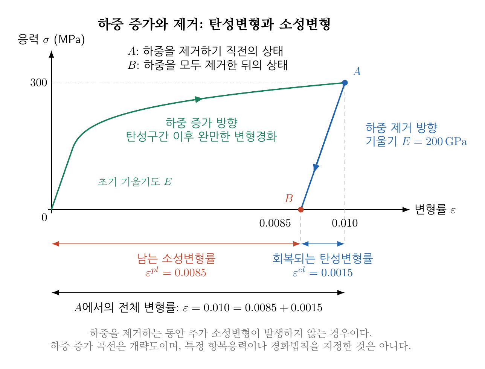
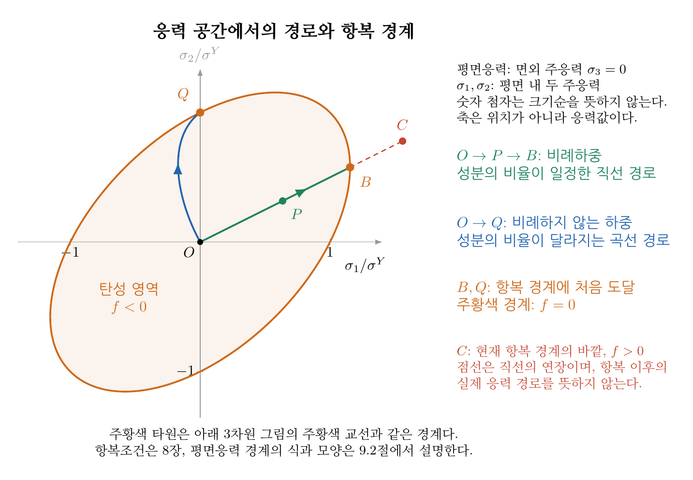
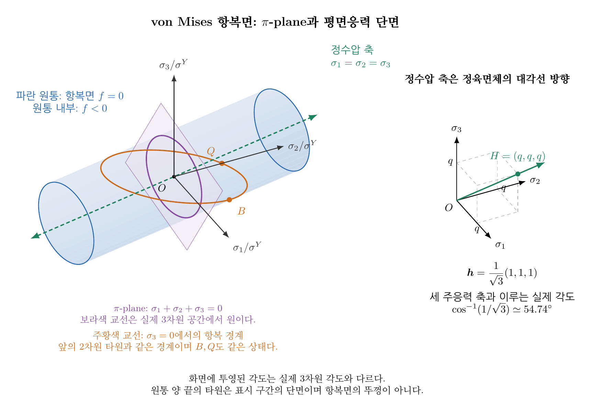
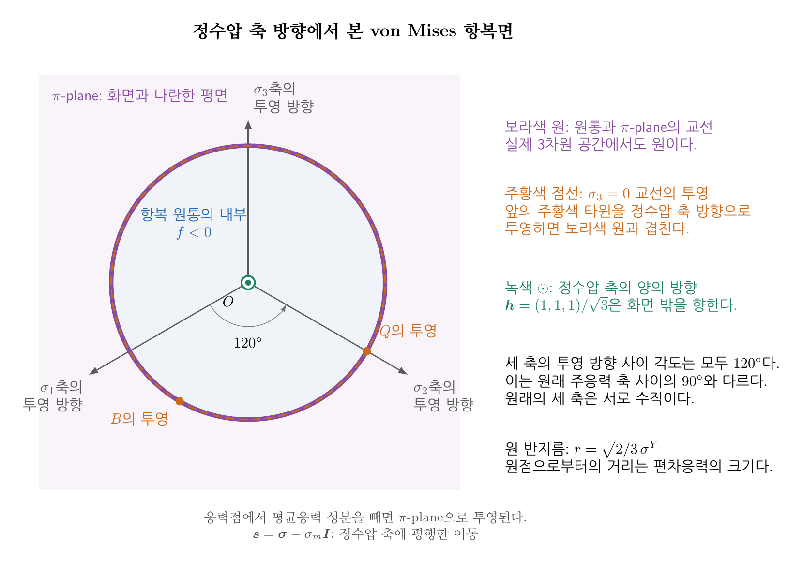

**목차**

* TOC
{:toc}

# 1. 탄성 한계와 항복(yielding)

금속 시편을 작은 힘으로 당겼다가 하중을 제거하면 대체로 원래 형상으로 돌아온다.
이처럼 하중 제거 시 회복되는 변형이 **탄성변형(elastic deformation)**이다.
하중을 충분히 증가시키면 제거 후에도 변형이 남기 시작한다.
이 영구적인 변형이 **소성변형(plastic deformation)**이며,
소성변형이 시작되는 현상을 **항복(yielding)**이라 한다.

## 1.1. 소성변형이 시작되어도 탄성변형은 존재한다

미소변형(infinitesimal strain)에서는 전체 변형률(total strain)을 다음처럼 탄성 변형률
과 소성 변형률의 합으로 분해한다.

$$
\varepsilon=\varepsilon^{el}+\varepsilon^{pl}.
$$

일축 선형탄성 관계는 전체 변형률이 아니라 탄성변형률에 적용된다.

$$
\sigma=E\varepsilon^{el}
=E(\varepsilon-\varepsilon^{pl}).
$$

항복 전에는 소성변형률이 0이므로 (즉 $\varepsilon^{pl}=0$), 익숙한 Hooke의 법칙
$\sigma=E\varepsilon$을 사용할 수 있다.
항복 이후에도 탄성변형률은 존재하며 응력과 연결된다.
따라서 “소성변형이 시작되면 탄성변형이 멈춘다”라고 이해하면 안 된다.

예를 들어 $E=200\,\mathrm{GPa}$인 재료가 $\sigma=300\,\mathrm{MPa}$에서
전체 변형률 $0.010$에 도달했다면

$$
\varepsilon^{el}=\frac{300}{200000}=0.0015,
\qquad
\varepsilon^{pl}=0.010-0.0015=0.0085.
$$

하중을 제거하는 동안 추가 소성변형이 발생하지 않는다면, 탄성변형률 $0.0015$가 회복되고,
소성변형률 $0.0085$가 잔류한다.

{: style="width: 1000px; max-width: 100%; height: auto;"}

그림의 초록색 곡선은 원점에서 $A$까지 하중을 증가시키는 경로이고, 파란색 직선은 하중을 제거하는 경로다.
초기 탄성구간과 하중 제거 경로의 기울기는 모두 탄성계수 $E$다.
하중 증가 곡선은 변형경화의 모습을 보여주는 개략도이며, 특정 항복응력이나 경화법칙을 지정한 것은 아니다.
가로축에서 $B$부터 $A$의 수직 투영점까지의 거리는 회복되는 탄성변형률이고,
원점부터 $B$까지의 거리는 남는 소성변형률이다.

## 1.2. 항복과 파괴는 다른 현상이다

항복은 소성변형의 시작을 나타내며, 균열 발생이나 파단과 동일한 조건이 아니다.
성형공정은 소성변형을 이용하므로 항복 이후의 거동이 중요하다.
반면 영구적인 형상 변화가 허용되지 않는 구조물에서는 항복을 피하도록 설계할 수 있다.

항복조건만으로는 파단 시점이나 네킹 시점을 알 수 없다.
이 강의에서는 먼저 **주어진 응력 상태에서 소성변형이 시작될 조건**을 다룬다.

# 2. 항복응력 (yield stress)

## 2.1. 일축 인장시험에서 얻는 기준값

일축 인장시험에서 소성변형이 시작되는 응력을 **항복응력(yield stress)** 또는
**항복강도(yield strength)**라고 한다. 이 강의에서는 이를 $\sigma^Y$로 표기한다.
항복응력은 응력의 단위를 가지며, 등가응력(equivalent stress)과 비교할 때 같은 단위를 사용해야 한다.

금속에 따라 명확한 항복점이 나타나기도 하고 탄성에서 소성으로 점진적으로 넘어가기도 한다.
명확한 항복점이 없는 경우에는 0.2% 오프셋 내력과 같은 규약값을 사용한다.
0.2% 오프셋 내력은 탄성 직선과 평행한 직선을 변형률 $0.002$만큼 옮겨
응력–변형률 곡선과 만나는 점에서 정한다.
이는 소성변형의 최초 발생을 직접 측정한 값과 반드시 같지는 않다.

## 2.2. 재료와 시험 조건에 따른 변화

항복응력은 모든 금속에 공통인 상수가 아니다.
재료의 조성, 미세조직, 열처리, 온도와 변형률속도 등에 따라 달라질 수 있다.
재료가 소성변형으로 경화하면(즉 $\varepsilon^{pl}$가 증가하면) 이후의 항복응력 값도
달라질 수 있다.

이 강의에서는 비교를 명확히 하기 위해 다음을 가정한다.

- 주어진 온도와 시험 조건에서 항복응력 $\sigma^Y$가 알려져 있다.
- 거시적으로 등방인 치밀한 연성금속(ductile metal)의 초기 항복(initial yielding)을 다룬다.
- 인장과 압축의 항복응력 크기가 같다고 가정한다.
- 속도 비의존 항복조건을 사용하며, 별도 언급이 없으면 초기 잔류응력은 없다.

경화, 이방성, 압력 의존성이 중요하면 이 가정을 확장해야 한다.

# 3. 항복응력의 중요성

항복응력이 높다는 것은 주어진 조건에서 소성변형을 시작시키기 위해
더 큰 응력이 필요하다는 뜻이다. 이는 재료가 가진 **소성변형에 대한 저항**으로 해석할 수 있다.
다만 항복응력 하나만으로 강성, 연성, 인성이나 구조물의 전체 안전성을 판단할 수는 없다.
강성에는 탄성계수, 파괴에는 결함과 파괴저항 등도 영향을 준다.

일축 인장에서는 스칼라 응력 값 하나와 항복응력을 비교하면 된다.
하지만 실제 부품에는 수직응력과 전단응력이 동시에 작용할 수 있다.
예를 들어 축을 당기면서 비틀면 인장과 전단이 함께 존재한다.
이때 단순히 응력성분 중 가장 큰 숫자 하나를 골라 $\sigma^Y$와 비교하는 것은 충분하지 않다.

따라서 일축시험에서 얻은 기준값을 **다축 응력 상태**에 적용할 수 있는 규칙이 필요하다.
즉 스칼라 값의 기준값을, 응력 텐서로 나타낸 등가응력과 비교하는 규칙이 필요하며, 이 규칙으로 항복조건을 정의할 수 있다.

# 4. 항복 조건 (스칼라 응력)

## 4.1. 탄성 범위와 항복의 경계

일축 응력 상태(uniaxial stress state)에서는 스칼라 값 하나로 응력 상태를 대표할 수 있으며, 그 값을 $\sigma$로 표기 하자.
일축 인장(uniaxial tension)과 일축 압축(uniaxial compression) 환경에서 항복강도가 같다면 초기 탄성 범위와 항복의 경계는 각각

$$
\lvert\sigma\rvert<\sigma^Y \quad\text{(탄성 범위)},
$$

$$
\boxed{\lvert\sigma\rvert=\sigma^Y}\quad\text{(항복의 경계)}
$$

이다. 예를 들어 $\sigma^Y=100\,\mathrm{MPa}$이라면
$\sigma=100\,\mathrm{MPa}$의 인장과 $\sigma=-100\,\mathrm{MPa}$의 압축이
동일한 항복 기준(yield criterion)에 도달한다.
위의 항복 조건식($\lvert\sigma\rvert\le\sigma^Y$)에서 절댓값을 쓰는 것은 인장·압축 대칭이라는 재료모델의 가정이다.
실제 재료의 인장과 압축 항복강도가 다르면 다른 표현이 필요하다.

## 4.2. 항복 이후의 응력은 어떻게 되는가?

완전소성(perfect plasticity) 모델의 일축 인장에서는 항복 이후 응력이 $\sigma^Y$에 머무르면서
소성변형이 증가할 수 있다. 변형경화 재료에서는 소성변형에 따라 항복 수준이 증가한다.
따라서 실제 인장시험에서 응력이 초기 항복응력보다 커졌다고 해서 모순인 것은 아니다.
초기 항복응력과 현재의 항복 수준을 구분해야 한다.

이후에는 먼저 항복 수준을 고정하고, 어떤 응력 조합이 그 경계에 도달하는지 살펴본다.

# 5. 항복 조건 (응력 텐서)

## 5.1. 응력텐서에서 항복함수로

일반적인 응력 상태는 대칭 응력텐서로 나타낸다.

$$
[\boldsymbol\sigma]=
\begin{bmatrix}
\sigma_{11}&\sigma_{12}&\sigma_{13}\\
\sigma_{12}&\sigma_{22}&\sigma_{23}\\
\sigma_{13}&\sigma_{23}&\sigma_{33}
\end{bmatrix}.
$$

이를 일축 항복응력과 비교할 수 있는 스칼라로 환산한 것이
**등가응력(equivalent stress)** $\sigma_{eq}$이다.
항복 조건을 수학적으로 표현한 것이 항복함수(yield function)이며, 항복함수는 다음처럼 정의할 수 있다.

$$
\boxed{f(\boldsymbol\sigma)=\sigma_{eq}(\boldsymbol\sigma)-\sigma^Y}.
$$

## 5.2. 응력 공간(stress space)과 주응력 공간(principal stress space)

물체의 위치를 나타내는 공간에서는 좌표축이 $x_1,x_2,x_3$이고,
점 하나가 물체 안의 한 위치를 뜻한다.
이와 달리 **응력 공간(stress space)**에서는 좌표축이 응력성분이고,
점 하나가 물체의 한 위치에서의 **응력 상태**를 나타낸다.
축의 단위도 길이가 아니라 MPa와 같은 응력 단위다.

예를 들어 두 성분 $\sigma_{11}$과 $\sigma_{12}$만 변하고 나머지 성분은 0이면,
$(\sigma_{11},\sigma_{12})=(80,30)\,\mathrm{MPa}$인 점은
수직응력 $80\,\mathrm{MPa}$와 전단응력 $30\,\mathrm{MPa}$가 함께 작용하는 상태다.
이 점의 좌표는 물체 안에서의 위치나 변위가 아니다.

일반적인 대칭 응력텐서에는 독립성분이 여섯 개 있으므로,
전체 응력 상태는 여섯 성분을 좌표로 하는 공간의 한 점으로 나타낸다.
여섯 차원을 직접 그릴 수는 없지만, 몇 성분을 고정한 단면이나
주응력을 사용하는 공간으로 항복조건을 살펴볼 수 있다.

**주응력 공간(principal stress space)**은 세 좌표축을
$\sigma_1,\sigma_2,\sigma_3$으로 정한 공간이다.
예를 들어 $(100,0,0)\,\mathrm{MPa}$는 일축 인장 상태이고,
$(100,100,0)\,\mathrm{MPa}$는 등2축 인장 상태다.
두 점은 물체의 서로 다른 위치를 뜻하는 것이 아니라 서로 다른 응력 상태를 뜻한다.

등방 재료의 항복조건은 주축의 절대 방향에 의존하지 않으므로
세 주응력만으로 표현할 수 있다.

## 5.3. 하중 경로와 항복면

물체의 한 위치를 고정하고 하중을 변화시키면, 그 위치의 응력 상태가 달라진다.
이를 응력 공간에서는 점의 이동으로 나타내며,
그 점이 지나간 경로를 **응력 경로(stress path)**라고 한다.
즉, 물체 내부를 따라 이동하는 경로가 아니라 한 위치에서 응력이 변해 온 경로다.

예를 들어 처음 응력이 0이고, 일축 인장응력만 증가시키면
주응력 공간의 점은 원점에서 한 좌표축을 따라 이동한다.
응력성분의 비율이 일정한 비례하중에서는

$$
\boldsymbol\sigma(\alpha)=\alpha\boldsymbol\sigma_0,
\qquad \alpha\ge0
$$

이므로 응력 공간의 점이 원점에서 뻗는 직선을 따라 이동한다.
응력성분의 비율이 달라지는 하중에서는 경로가 꺾이거나 휘어질 수 있다.

이제 항복함수 $f=0$을 만족하는 모든 응력 상태를 모으면
**항복면(yield surface)**을 얻는다.
항복면은 **실제 물체의 표면이 아니라 응력 공간에서 탄성 영역의 경계를 나타내는 면**이다.
일축 응력축에서는 두 점 $\sigma=\pm\sigma^Y$으로 나타나고,
2차원 응력 공간의 단면에서는 곡선, 3차원 주응력 공간에서는 곡면으로 나타난다.
전체 6차원 응력 공간에서도 같은 경계 개념을 적용한다.

초기 응력이 0인 상태에서 하중을 증가시키는 경우,
응력 경로가 항복면에 처음 닿는 순간이 초기 항복의 경계에 도달한 순간이다.
같은 재료라도 하중 경로에 따라 항복면에 닿는 점과 그때의 개별 응력성분은 달라질 수 있다.
이 절에서는 현재 항복 수준을 고정하여 내부·위·외부를 다음처럼 구분한다.

| 항복함수 | 응력 상태의 위치 | 해석 |
|---|---|---|
| $f<0$ | 항복면 내부 | 현재 모델에서 탄성 응력 변화가 가능한 영역 |
| $f=0$ | 항복면 위 | 항복의 경계, 소성변형이 진행되거나 하중을 줄여 탄성 영역으로 이동 가능 |
| $f>0$ | 항복면 외부 | 현재 항복 수준의 속도 비의존 모델에서는 **허용되지 않는** 상태 |

{: style="width: 1100px; max-width: 100%; height: auto;"}

그림은 면외 주응력이 0인 평면응력 단면을 예로 보여준다.
가로축과 세로축은 평면 내(in-plane) 두 주응력을 일축 항복응력($\sigma^Y$)으로 나눈 값이며,
$1,2$는 평면 내 두 주축을 구분하는 첨자이며, 이 그림에서는 면외 주응력을 $\sigma_3=0$으로 둔다.
점 $P$는 항복 경계 안에 있고, 경로가 $B$ 또는 $Q$에 처음 닿으면 초기 항복의 경계에 도달한다.
점 $C$는 현재 항복 경계의 바깥을 비교하기 위해 표시했으며, 점선은 실제 소성변형 중의 응력 경로가 아니다.
주황색 곡선에는 8장의 von Mises 항복조건을 사용했으며,
평면응력 항복궤적의 식과 3차원 항복면과의 관계는 8.4절에서 설명한다.

이 그림은 항복면과 응력 경로의 개념을 먼저 보여주기 위해 von Mises 항복경계를 예로 사용했다.
정수압 축, 편차응력, $\pi$-plane과 3차원 항복면의 관계는 von Mises 식을 유도한 뒤 8.4절에서 설명한다.

## 5.4. 항복면 위에 있다는 것과 소성변형이 증가한다는 것

항복면에 도달했다는 사실만으로 매 순간 소성변형이 증가한다고 단정할 수는 없다.
항복면에서 하중을 줄이면 추가 소성변형 없이 응력이 감소하면서 항복면 내부로 이동할 수 있다.
반면 하중을 계속 증가시키려는 경우에는 소성변형과 경화를 함께 고려해야 한다.

항복조건은 **소성변형이 가능한 경계**를 정한다.
소성변형률이 어느 방향으로 얼마나 증가하는지는 다음 강의의 유동법칙과
이후에 다룰 경화법칙이 결정한다.

# 6. 등가 응력 (equivalent stress)

## 6.1. 같은 응력 상태에는 같은 등가응력

[11장]()에서 보았듯이 좌표축을 회전하면 응력성분은 바뀌지만 물리적 응력 상태는 같다.
따라서 같은 상태를 다른 기저로 표현했다는 이유만으로 항복 여부가 달라져서는 안 된다.
Tresca와 von Mises 등가응력은 모두 이 조건을 만족한다.

등방 재료에서는 주응력을 사용하면 방향에 대한 정보를 분리하여
세 주응력의 조합으로 항복조건을 표현할 수 있다.
세 주응력은 $\sigma_1,\sigma_2,\sigma_3$으로 표기하며, 숫자 첨자 자체에 크기순의 의미를 부여하지 않는다.
특히 평면응력의 주응력 공간에서는 $\sigma_1,\sigma_2$를 평면 내 성분,
$\sigma_3=0$을 면외 성분으로 사용한다.
최대 전단응력과 Tresca 등가응력을 계산할 때에는 부호를 포함하여

$$
\sigma_{\max}=\max(\sigma_1,\sigma_2,\sigma_3),
\qquad
\sigma_{\min}=\min(\sigma_1,\sigma_2,\sigma_3)
$$

을 정한다. [11장]()의 크기순 정렬과 같은 계산이지만, 여기서는 정렬 결과를 최대·최소 첨자로 명시한다.
평면응력 상태에서도 면외 주응력 0을 포함한 **세 주응력**을 사용한다.

## 6.2. 등가응력은 어떤 종류의 세기인가?

등가응력은 단순히 “모든 응력의 크기”를 뜻하지 않는다.
**선택한 항복모델의 관점에서 일축 응력과 비교하기 위한 세기**다.
같은 응력 상태라도 Tresca와 von Mises 등의 모델이 부여하는 값이 다를 수 있다.

두 등가응력은 일축 상태에서 다음을 만족하도록 정의한다.

$$
[\boldsymbol\sigma]
=\begin{bmatrix}
\sigma&0&0\\
0&0&0\\
0&0&0
\end{bmatrix}
\quad\Longrightarrow\quad \sigma_{eq}=\lvert\sigma\rvert.
$$

이 보정 덕분에 일축시험의 $\sigma^Y$를 다축 항복조건에도 사용할 수 있다.
등가응력 자체에는 방향이 없지만, 원래 응력텐서의 방향 정보가 사라지는 것은 아니다.
면력이나 주축이 필요하면 원래 텐서를 사용해야 한다.

# 7. Tresca 항복 조건

## 7.1. 최대 전단응력에서 출발하기

Tresca 조건은 **최대 전단응력이 임계값에 도달하면 항복한다**는 가정에서 출발한다.
강의자료 [11장(좌표축 회전에 따른 응력성분 변환)]()의 결과를 사용하면

$$
\tau_{\max}=\frac{\sigma_{\max}-\sigma_{\min}}{2}.
$$

일축 인장시험에서 항복할 때 세 주응력은 $(\sigma^Y,0,0)$이므로

$$
\tau_{\max}^{Y}=\frac{\sigma^Y}{2}.
$$

이 값을 다축 상태에도 같은 임계값으로 적용하면

$$
\frac{\sigma_{\max}-\sigma_{\min}}{2}=\frac{\sigma^Y}{2}
$$

이고, 따라서 Tresca 등가응력은

$$
\boxed{\sigma^{\mathrm{Tresca}}=\sigma_{\max}-\sigma_{\min}}
$$

로 정의된다. 세 주응력의 쌍별 차이를 사용하면 다음과 같이 쓸 수 있다.

$$
\sigma^{\mathrm{Tresca}}=\max\left(
\lvert\sigma_1-\sigma_2\rvert,\
\lvert\sigma_2-\sigma_3\rvert,\
\lvert\sigma_3-\sigma_1\rvert
\right).
$$

항복함수는 $f_{\mathrm{Tresca}}=\sigma^{\mathrm{Tresca}}-\sigma^Y$이며,
항복의 경계는 $\sigma^{\mathrm{Tresca}}=\sigma^Y$다.
**최대 전단응력과 Tresca 등가응력은 2배 차이**이므로 혼동하지 않아야 한다.

## 7.2. 인장과 압축이 함께 있는 예제

주응력이 $(80,20,-40)\,\mathrm{MPa}$이고 $\sigma^Y=150\,\mathrm{MPa}$이면

$$
\tau_{\max}=\frac{80-(-40)}2=60\,\mathrm{MPa},
\qquad \sigma^{\mathrm{Tresca}}=120\,\mathrm{MPa}.
$$

따라서 $f_{\mathrm{Tresca}}=120-150=-30\,\mathrm{MPa}<0$이며 항복면 내부다.
$\lvert\sigma_i\rvert$의 최댓값인 $80\,\mathrm{MPa}$를 Tresca 등가응력으로 쓰면 안 된다.
최대 인장과 최대 압축 사이의 차이가 중요하다.

## 7.3. 순수전단에서의 항복응력

다음 순수전단 응력 상태를 생각하자.

$$
[\boldsymbol\sigma]=\begin{bmatrix}0&\tau&0\\\tau&0&0\\0&0&0\end{bmatrix}.
$$

세 주응력은 $(\lvert\tau\rvert,0,-\lvert\tau\rvert)$이므로

$$
\sigma^{\mathrm{Tresca}}=2\lvert\tau\rvert.
$$

따라서 Tresca가 예측하는 순수전단 항복응력의 크기는

$$
\boxed{\tau_Y^{\mathrm{Tresca}}=\frac{\sigma^Y}{2}}.
$$

# 8. Von Mises 항복 조건

## 8.1. 평균응력과 편차응력

[11장]()에서 응력을 평균응력과 편차응력으로 분해했다.

$$
\sigma_m=\frac{\operatorname{tr}(\boldsymbol\sigma)}{3},
\qquad \boldsymbol s=\boldsymbol\sigma-\sigma_m\boldsymbol I,
\qquad \operatorname{tr}(\boldsymbol s)=0.
$$

등방 선형탄성에서 평균응력 부분은 체적변형, 편차응력 부분은 형상변화와 연결된다.
von Mises 조건은 편차응력으로부터 항복을 판단한다.
전단응력뿐 아니라 서로 다른 수직응력도 편차응력에 기여한다.

편차응력의 두 번째 불변량 $J_2$를 다음과 같이 정의한다.[^j2-derivation]

$$
J_2=\frac12\boldsymbol s:\boldsymbol s
=\frac12\sum_{i=1}^{3}\sum_{j=1}^{3}s_{ij}^2.
$$

콜론은 같은 위치 성분의 곱을 모두 더하는 이중내적이다.
대칭 응력텐서에서는 $s_{12}$와 $s_{21}$을 모두 더하므로

$$
J_2=\frac12(s_{11}^2+s_{22}^2+s_{33}^2)
+s_{12}^2+s_{23}^2+s_{13}^2.
$$

$J_2$는 전체 응력의 두 번째 불변량 $I_2$와 다르며, 응력의 제곱 단위를 갖는다.

## 8.2. 일축시험으로 계수 정하기

다음 일축 응력 상태를 생각하자.

$$
[\boldsymbol\sigma]
=\begin{bmatrix}
\sigma&0&0\\
0&0&0\\
0&0&0
\end{bmatrix}.
$$

이때 평균응력과 편차응력은

$$
\sigma_m=\frac\sigma3,
\qquad
[\boldsymbol s]
=\begin{bmatrix}
\dfrac{2\sigma}{3}&0&0\\
0&-\dfrac{\sigma}{3}&0\\
0&0&-\dfrac{\sigma}{3}
\end{bmatrix}.
$$

따라서

$$
J_2=\frac12\left[
\left(\frac{2\sigma}{3}\right)^2+
\left(-\frac\sigma3\right)^2+
\left(-\frac\sigma3\right)^2\right]
=\frac{\sigma^2}{3}.
$$

일축 상태에서 $\lvert\sigma\rvert$가 되도록 계수를 정하면 **von Mises 등가응력**은

$$
\boxed{\sigma^{VM}=\sqrt{3J_2}
=\sqrt{\frac32\boldsymbol s:\boldsymbol s}}
$$

가 된다. 항복함수는 $f_{VM}=\sigma^{VM}-\sigma^Y$이고,
항복의 경계는 $\sigma^{VM}=\sigma^Y$다.

## 8.3. 주응력과 일반 성분으로 쓰기

주축에서 $s_i=\sigma_i-\sigma_m$를 대입하면

$$
\boxed{\sigma^{VM}=\sqrt{\frac12\left[
(\sigma_1-\sigma_2)^2+(\sigma_2-\sigma_3)^2+(\sigma_3-\sigma_1)^2
\right]}}.
$$

세 주응력의 차이가 모두 들어간다는 점이 최대 차이만 사용하는 Tresca와 다르다.
주응력을 먼저 계산하지 않고 기존 좌표성분으로도 직접 계산할 수 있다.

$$
\boxed{\sigma^{VM}=\sqrt{\frac12\left[
(\sigma_{11}-\sigma_{22})^2+(\sigma_{22}-\sigma_{33})^2+(\sigma_{33}-\sigma_{11})^2
+6(\sigma_{12}^2+\sigma_{13}^2+\sigma_{23}^2)
\right]}}.
$$

전단항의 계수 6은 제곱근 밖의 $1/2$와 함께 적용되므로,
각 전단응력 제곱의 최종 계수는 3이다.
주응력 식과 성분 식은 같은 등가응력을 주어야 하며, 이를 검산에 활용할 수 있다.

## 8.4. 주응력 공간에서 본 von Mises 항복면

8.1절에서 응력을 평균응력 부분과 편차응력 부분으로 나누었다.
이 분해는 주응력 공간에서 다음과 같은 기하학적 의미를 갖는다.

- 평균응력 부분 $\sigma_m\boldsymbol I$는 정수압 축 방향의 성분이다.
- 편차응력 $\boldsymbol s$는 정수압 축에 수직인 방향의 성분이다.
- von Mises 등가응력은 편차응력의 크기에만 의존한다.

주응력 공간에서 정수압 축은 $\sigma_1=\sigma_2=\sigma_3$인 상태를 잇는 직선이다.
그 단위방향벡터는

$$
\boldsymbol h=\frac{1}{\sqrt3}(1,1,1)
$$

이고, 각 주응력 축과 이루는 각도는 모두
$\cos^{-1}(1/\sqrt3)\simeq54.74^\circ$다.
응력점에서 평균응력 부분을 빼는 연산

$$
\boldsymbol s=\boldsymbol\sigma-\sigma_m\boldsymbol I
$$

은 그 점을 정수압 축과 평행하게 이동시켜 평균응력이 0인 평면으로 투영하는 것과 같다.

von Mises 항복조건 $\sigma^{VM}=\sigma^Y$는

$$
\boldsymbol s:\boldsymbol s=\frac{2}{3}(\sigma^Y)^2
$$

이므로, 정수압 축으로부터의 거리가 일정한 응력 상태들의 집합이다.
따라서 3차원 주응력 공간의 항복면은 정수압 축을 중심으로 양쪽으로 무한히 이어지는 원통의 옆면이다.

{: style="width: 1100px; max-width: 100%; height: auto;"}

정수압 축에 수직인 평면에서는 평균응력을 고정한 채 편차응력의 변화만 비교할 수 있다.
이러한 단면을 **$\pi$-plane**이라고 부르며, 그림의 보라색 평면은 그중 원점을 지나도록
평균응력을 0으로 정한 편차평면이다. 이 명칭의 $\pi$는 원주율을 뜻하지 않고
이 단면을 나타내는 관례적 기호다. 그림의 $\pi$-plane에서는

$$
\sigma_1+\sigma_2+\sigma_3=0
$$

을 만족한다. von Mises 원통을 정수압 축에 수직인 $\pi$-plane으로 자른 교선은
평균응력 값과 관계없이 실제 3차원 공간에서 원이다.
그림에서는 평면을 비스듬히 보았기 때문에 타원처럼 보인다.

주황색 교선은 항복 원통을 평면응력 조건 $\sigma_3=0$으로 자른 경계다.

$$
\sigma_3=0,
\qquad
\sigma_1^2-\sigma_1\sigma_2+\sigma_2^2=(\sigma^Y)^2.
$$

이 식은 5.3절의 2차원 그림에서 사용한 주황색 타원과 같다.
두 그림의 $B,Q$는 각각 같은 응력 상태를 나타낸다.
$\pi$-plane은 평균응력을 0으로 고정하지만, 평면응력 단면은 한 주응력 $\sigma_3$를 0으로 고정한다는 차이가 있다.

정수압 축 방향에서 원점을 바라보면 $\pi$-plane이 화면과 나란해져 항복경계가 원으로 보인다.

{: style="width: 1100px; max-width: 100%; height: auto;"}

녹색 $\odot$는 정수압 축의 양의 방향이 화면 밖을 향한다는 뜻이다.
주황색 점선은 $\sigma_3=0$인 항복 타원을 정수압 축 방향으로 투영한 결과다.
투영 과정에서 평균응력은 제거되지만 편차응력과 von Mises 등가응력은 유지되므로,
주황색 점선은 보라색 원과 겹친다. $B,Q$의 투영도 같은 원 위에 놓인다.

세 주응력 축의 투영벡터는

$$
\boldsymbol p_1=\frac13(2,-1,-1),\qquad
\boldsymbol p_2=\frac13(-1,2,-1),\qquad
\boldsymbol p_3=\frac13(-1,-1,2)
$$

이다. 세 벡터의 길이는 모두 $\sqrt{2/3}$이고 서로 다른 두 벡터의 내적은 $-1/3$이므로,
화면에 투영된 방향 사이 각도는 모두 $120^\circ$다.
이는 서로 수직인 원래의 세 주응력 축을 2차원 평면에 투영한 결과다.
원 반지름은 편차응력의 크기이며

$$
r=\sqrt{s_1^2+s_2^2+s_3^2}
=\sqrt{\frac23}\,\sigma^Y
$$

이다. 이 기하학적 표현은 “평균응력은 원통 축 방향의 위치를 바꾸고,
von Mises 항복은 축으로부터의 편차거리로 결정된다”는 사실을 보여준다.

## 8.5. 순수전단에서의 항복응력

순수전단의 주응력 $(\lvert\tau\rvert,0,-\lvert\tau\rvert)$을 대입하면

$$
(\sigma^{VM})^2
=\frac12\left[\tau^2+\tau^2+(2\lvert\tau\rvert)^2\right]=3\tau^2.
$$

따라서

$$
\sigma^{VM}=\sqrt3\lvert\tau\rvert,
\qquad
\boxed{\tau_Y^{VM}=\frac{\sigma^Y}{\sqrt3}\simeq0.577\sigma^Y}.
$$

이 결과를 사용하면 주어진 일축 항복응력으로부터 von Mises 조건의
순수전단 항복응력을 계산할 수 있다.

# 9. 다축 응력의 계산 예제

## 9.1. 인장과 전단이 함께 있는 평면응력

항복응력이 $\sigma^Y=100\,\mathrm{MPa}$인 재료에 다음 응력이 작용한다고 하자.

$$
[\boldsymbol\sigma]
=\begin{bmatrix}80&30&0\\30&0&0\\0&0&0\end{bmatrix}\,\mathrm{MPa}.
$$

평면 내 주응력은 [11장]()의 식으로

$$
\sigma_{\pm}=40\pm\sqrt{40^2+30^2}=40\pm50
$$

이므로, 세 주응력을 정렬하면 $(90,0,-10)\,\mathrm{MPa}$다.
Tresca 등가응력은

$$
\sigma^{\mathrm{Tresca}}=90-(-10)=100\,\mathrm{MPa}.
$$

따라서 Tresca 항복면 위에 있다. von Mises 등가응력은 일반 성분 식으로

$$
\sigma^{VM}=\sqrt{80^2+3(30)^2}
=\sqrt{9100}\simeq95.39\,\mathrm{MPa}.
$$

따라서 von Mises 항복면 내부다. 주응력 식으로도

$$
\sigma^{VM}=\sqrt{\frac{(90-0)^2+[0-(-10)]^2+(-10-90)^2}{2}}
=\sqrt{9100}\,\mathrm{MPa}
$$

로 같은 값을 얻는다. 한 응력 상태의 항복 여부도 선택한 모델에 따라 달라질 수 있다.

## 9.2. 평면응력에서도 편차응력은 3차원으로 계산한다

앞의 예제에서 평균응력과 편차응력은

$$
\sigma_m=\frac{80+0+0}{3}=\frac{80}{3}\,\mathrm{MPa},
$$

$$
[\boldsymbol s]=\begin{bmatrix}
160/3&30&0\\30&-80/3&0\\0&0&-80/3
\end{bmatrix}\,\mathrm{MPa}.
$$

따라서

$$
J_2=\frac12\left[
\left(\frac{160}{3}\right)^2+
2\left(-\frac{80}{3}\right)^2+2(30)^2
\right]=\frac{9100}{3}\,\mathrm{MPa}^2.
$$

다시 $\sqrt{3J_2}=\sqrt{9100}\,\mathrm{MPa}$를 얻는다.
평면응력이라고 평균응력을 2로 나누거나 $s_{33}$을 버리면 이 결과와 일치하지 않는다.

## 9.3. 응력이 같은 비율로 증가할 때의 항복하중

하중배율을 $\alpha\ge0$이라 하고, 응력이
$\boldsymbol\sigma(\alpha)=\alpha\boldsymbol\sigma_0$로 증가한다고 하자.
두 등가응력은 모두 응력의 1차 동차함수이므로

$$
\sigma_{eq}(\alpha\boldsymbol\sigma_0)=\alpha\sigma_{eq}(\boldsymbol\sigma_0).
$$

따라서 초기 항복에 도달하는 배율은

$$
\boxed{\alpha_Y=\frac{\sigma^Y}{\sigma_{eq}(\boldsymbol\sigma_0)}}.
$$

9.1절의 응력행렬을 기준 상태로 사용하면

$$
\alpha_Y^{\mathrm{Tresca}}=\frac{100}{100}=1,
\qquad
\alpha_Y^{VM}=\frac{100}{\sqrt{9100}}\simeq1.048.
$$

이는 응력성분의 비율이 유지되는 비례하중에서의 결과다.
하중 변화에 따라 응력성분의 비율이 바뀌거나 소성변형으로 응력이 재분배되면
한 번 계산한 배율을 그대로 사용할 수 없다.
정수압 상태처럼 $\sigma_{eq}=0$이면 이 식으로 유한한 항복배율을 구할 수 없다.

## 9.4. 계산 순서와 자주 하는 실수

1. 응력행렬과 단위를 적고, 평면응력인지 확인한다.
2. 사용할 항복조건과 같은 시험 조건의 일축 항복응력을 정한다.
3. Tresca에서는 세 주응력을 구하고 부호를 포함해 정렬한다.
4. von Mises에서는 주응력 식 또는 일반 성분 식으로 등가응력을 계산한다.
5. 등가응력과 항복응력을 비교하고, 항복면 내부·위·외부를 구분한다.

특히 다음 오류에 주의한다.

- 평면응력의 두 평면 내 주응력만으로 3차원 최대 전단응력을 계산한다.
- 최대 전단응력과 Tresca 등가응력을 같은 값으로 쓴다.
- von Mises 식에 전단응력을 넣으면서 계수 3을 빠뜨린다.
- 평균응력을 전체 응력에서 빼지 않고 전단성분만 편차응력이라고 생각한다.
- 항복면 위에 있다는 이유만으로 하중을 줄이는 동안에도 소성변형이 계속된다고 해석한다.

# 10. 핵심 정리와 다음 강의

- 항복은 소성변형의 시작이며 파괴와 다르다.
- 항복 이후에도 탄성변형률과 소성변형률은 함께 존재할 수 있다.
- 항복함수 $f=\sigma_{eq}-\sigma^Y$에서 $f=0$이 항복의 경계다.
- Tresca 등가응력은 $\sigma^{\mathrm{Tresca}}=\sigma_{\max}-\sigma_{\min}=2\tau_{\max}$다.
- von Mises 등가응력은 $\sigma^{VM}=\sqrt{3J_2}$다.

이 강의에서는 “어떤 응력 상태에서 항복하는가?”를 정했다.
다음 [유동 법칙]()에서는
항복조건을 바탕으로 소성변형률 증가의 방향과 크기를 기술한다.
항복조건, 유동법칙, 경화법칙은 각각 다른 역할을 하므로 구분해서 이해해야 한다.

# 11. 연습 문제

## 문제 1: 탄성변형률과 잔류변형률

$E=200\,\mathrm{GPa}$인 재료가 일축 응력 $250\,\mathrm{MPa}$에서
전체 변형률 $0.006$에 도달했다.
탄성변형률과 소성변형률을 구하고, 추가 소성변형 없이 응력을 0까지 줄인 뒤 남는 변형률을 구하라.

<!--
풀이와 해답:
탄성변형률=250/200000=0.00125이다.
소성변형률=0.006-0.00125=0.00475이다.
응력을 줄이는 동안 추가 소성변형이 없다면 잔류변형률은 0.00475이다.
-->

## 문제 2: 정수압 응력과 항복

응력텐서가 $\boldsymbol\sigma=-200\boldsymbol I\,\mathrm{MPa}$일 때
평균응력, 편차응력, 두 등가응력을 구하라.
이 결과만으로 재료가 어떤 손상이나 파괴도 겪지 않는다고 결론낼 수 있는가?

<!--
풀이와 해답:
평균응력=-200 MPa, 편차응력=0이다.
주응력 차이가 모두 0이므로 Tresca와 von Mises 등가응력도 0이다.
두 모델에서는 항복하지 않는다. 그러나 파괴나 압력 의존 거동까지 배제하는 결과는 아니다.
-->

## 문제 3: 부호가 섞인 주응력

주응력이 $(120,30,-60)\,\mathrm{MPa}$이고 $\sigma^Y=170\,\mathrm{MPa}$이다.
최대 전단응력과 두 등가응력을 계산하고, 각 항복조건에 대해 위치를 판정하라.

<!--
풀이와 해답:
최대 전단응력=[120-(-60)]/2=90 MPa이다.
Tresca 등가응력=180 MPa이므로 $f_{\mathrm{Tresca}}=10$ MPa로 항복면 외부다.
von Mises 등가응력=sqrt[(90^2+90^2+180^2)/2]
=90 sqrt(3)=155.88 MPa이므로 f_VM=-14.12 MPa로 항복면 내부다.
Tresca의 현재 항복 수준에서는 주어진 응력을 탄성 상태로 유지할 수 없다는 뜻이다.
-->

## 문제 4: 등2축 인장과 정수압 인장의 구분

주응력이 각각 $(80,80,0)\,\mathrm{MPa}$와 $(80,80,80)\,\mathrm{MPa}$인
두 상태의 Tresca·von Mises 등가응력을 구하라.
평면응력에서 같은 크기의 두 인장응력이 정수압 응력이 아닌 이유를 설명하라.

<!--
풀이와 해답:
첫 상태는 주응력 차이가 (0,80,-80)이므로 두 등가응력 모두 80 MPa이다.
둘째 상태는 차이가 모두 0이므로 두 등가응력 모두 0이다.
첫 상태에서는 면외 주응력 0이 나머지 두 주응력과 다르므로 편차응력이 존재한다.
-->

## 문제 5: 평면응력의 편차응력과 등가응력

다음 응력 상태에서 평균응력, 편차응력과 $J_2$를 구하라.
이를 이용한 von Mises 등가응력이 일반 성분 식의 결과와 같은지 확인하라.

$$
[\boldsymbol\sigma]=\begin{bmatrix}90&20&0\\20&30&0\\0&0&0\end{bmatrix}\,\mathrm{MPa}.
$$

<!--
풀이와 해답:
평균응력=(90+30+0)/3=40 MPa이다.
편차응력=[[50,20,0],[20,-10,0],[0,0,-40]] MPa이다.
J2=(50^2+(-10)^2+(-40)^2)/2+20^2=2500 MPa^2이다.
von Mises 등가응력=sqrt(7500)=86.60 MPa이다.
일반 성분 식에서는 sigma_VM^2=90^2-90(30)+30^2+3(20)^2=7500 MPa^2로 같다.
-->

## 문제 6: 좌표변환에 대한 항복 판정의 불변성

다음 두 행렬은 같은 응력을 서로 다른 좌표계에서 표현한 것이다.
각각의 von Mises 등가응력을 계산하여 같은지 확인하라.
Tresca 등가응력도 좌표변환으로 바뀌지 않는 이유를 주응력과 연결하여 설명하라.

$$
[\boldsymbol\sigma]_A=\begin{bmatrix}80&20&0\\20&50&0\\0&0&0\end{bmatrix}\,\mathrm{MPa},
\qquad
[\boldsymbol\sigma]_B=\begin{bmatrix}85&-15&0\\-15&45&0\\0&0&0\end{bmatrix}\,\mathrm{MPa}.
$$

<!--
풀이와 해답:
A에서는 sigma_VM^2=80^2-80(50)+50^2+3(20)^2=6100 MPa^2이다.
B에서는 sigma_VM^2=85^2-85(45)+45^2+3(-15)^2=6100 MPa^2이다.
따라서 두 상태의 von Mises 등가응력은 sqrt(6100)=78.10 MPa로 같다.
주응력은 두 좌표계 모두 (90,40,0) MPa이며 좌표변환으로 보존된다.
Tresca 등가응력도 90-0=90 MPa로 같다.
-->

## 문제 7: 비례하중의 초기 항복배율

기준 응력 상태가 다음과 같고, 실제 응력이 $\alpha\boldsymbol\sigma_0$로 증가한다.
일축 항복응력이 $200\,\mathrm{MPa}$일 때 두 조건의 초기 항복배율을 구하라.

$$
[\boldsymbol\sigma_0]=\begin{bmatrix}60&20&0\\20&0&0\\0&0&0\end{bmatrix}\,\mathrm{MPa}.
$$

<!--
풀이와 해답:
평면 내 주응력은 30 +/- sqrt(30^2+20^2)=30 +/- sqrt(1300) MPa이다.
한 근은 양수, 다른 근은 음수이므로 면외 0은 중간 주응력이다.
Tresca 등가응력=2 sqrt(1300)=sqrt(5200)=72.11 MPa이다.
von Mises 등가응력=sqrt(60^2+3(20)^2)=sqrt(4800)=69.28 MPa이다.
초기 항복배율은 Tresca에서 200/sqrt(5200)=2.774,
von Mises에서 200/sqrt(4800)=2.887이다.
-->

## 문제 8: 항복면 위에서 하중 줄이기

일축 인장으로 초기 항복응력 $\sigma^Y$에 도달한 뒤 응력을 조금 감소시켰다.
“항복면에 한 번 도달했으므로 이후에도 반드시 소성변형률이 증가한다”는 설명이
옳은지 판단하라. 항복조건과 유동법칙의 역할도 구분하라.

<!--
풀이와 해답:
틀리다. 역방향 항복에 이르지 않도록 하중을 줄이면 추가 소성변형률이 0일 수 있다.
항복조건은 응력 공간에서 허용되는 영역과 소성하중의 경계를 정한다.
소성변형률 증가의 방향과 크기는 하중 경로, 유동법칙과 경화법칙을 함께 고려해 결정한다.
-->

[^j2-derivation]: **편차응력의 두 번째 불변량 유도.** 일반적인 2계 텐서
  $\boldsymbol A$ 의 두 번째 불변량은

  $$
  I_2(\boldsymbol A)
  =\frac12\left[(\operatorname{tr}\boldsymbol A)^2
  -\operatorname{tr}(\boldsymbol A^2)\right]
  $$

  이다. 여기에 편차응력 $\boldsymbol s$를 대입하면
  $\operatorname{tr}\boldsymbol s=0$이므로

  $$
  I_2(\boldsymbol s)=-\frac12\operatorname{tr}(\boldsymbol s^2).
  $$

  응력텐서는 대칭이므로 $s_{ij}=s_{ji}$이고,

  $$
  \operatorname{tr}(\boldsymbol s^2)
  =\sum_{i=1}^{3}\sum_{j=1}^{3}s_{ij}s_{ji}
  =\sum_{i=1}^{3}\sum_{j=1}^{3}s_{ij}^2
  =\boldsymbol s:\boldsymbol s.
  $$

  따라서 편차응력의 두 번째 불변량 자체는
  $I_2(\boldsymbol s)=-\boldsymbol s:\boldsymbol s/2$이다.
  소성역학에서는 양수가 되도록 부호를 바꾼 양을 $J_2$로 정의하여

  $$
  J_2\equiv-I_2(\boldsymbol s)
  =\frac12\boldsymbol s:\boldsymbol s
  $$

  로 사용한다. 또한 $I_1=\operatorname{tr}\boldsymbol\sigma$와
  전체 응력의 두 번째 불변량 $I_2$를 사용하면

  $$
  J_2=\frac13I_1^2-I_2
  $$

  이며, 주축에서는

  $$
  J_2=\frac16\left[
  (\sigma_1-\sigma_2)^2+(\sigma_2-\sigma_3)^2
  +(\sigma_3-\sigma_1)^2\right]
  $$

  을 얻는다.

---

[이전 강의]() | [강의 목록]() | [다음 강의]()
