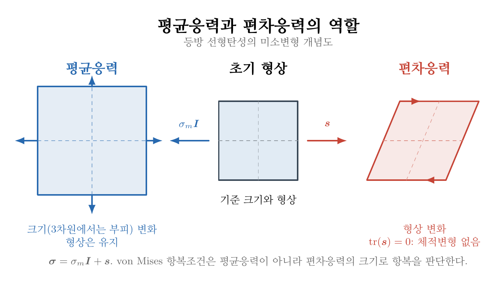
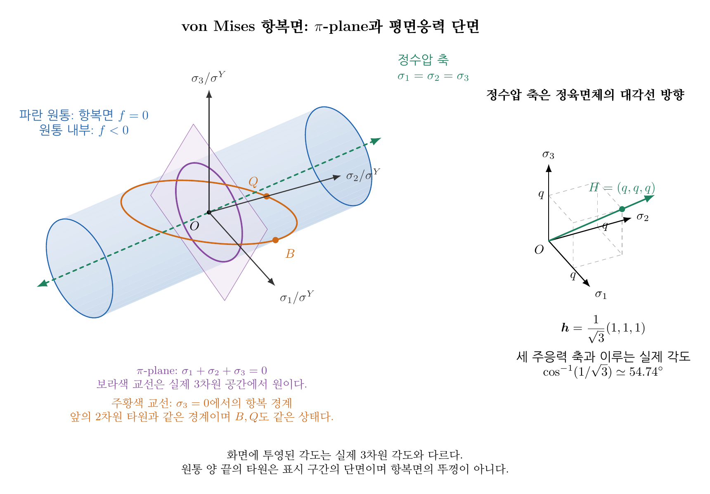
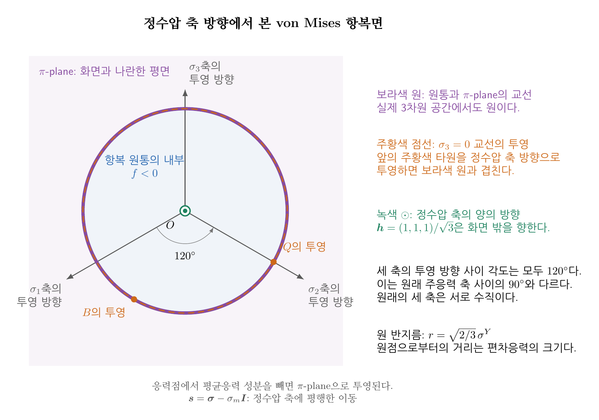

**목차**

* TOC
{:toc}

# 1. 두 항복조건을 비교하는 이유

[12-1장](/assets/lecture_notes/3_1_metal_plasticity/metal_plasticity_12_plastic_yield.md)에서는
다축 응력텐서를 등가응력 $\sigma_{eq}$으로 환산하고, 이를 일축 항복응력 $\sigma^Y$와
비교하여 항복을 판정하는 일반적인 틀을 배웠다. 이 장에서는 연성금속에 널리 사용하는
[Tresca](https://en.wikipedia.org/wiki/Henri_Tresca)와 [von Mises](https://en.wikipedia.org/wiki/Richard_von_Mises) 항복조건을 각각 정의하고, 같은 응력 상태에 대한 두 예측을 비교한다.

# 2. Tresca 항복 조건

## 2.1. 최대 전단응력에서 출발하기

Tresca 조건은 **최대 전단응력이 임계값에 도달하면 항복한다**는 가정에서 출발한다.
강의자료 [11장(좌표축 회전에 따른 응력성분 변환)](/assets/lecture_notes/3_1_metal_plasticity/metal_plasticity_11_stress_transformation.md)의 결과를 사용하면

$$
\tau_{\max}=\frac{\sigma_{\max}-\sigma_{\min}}{2}.
$$

일축 인장시험에서 항복할 때 세 주응력은 $(\sigma^Y,0,0)$이므로

$$
\tau_{\max}^{Y}=\frac{\sigma^Y}{2}.
$$

이 값을 다축 상태에도 같은 임계값으로 적용하면

$$
\frac{\sigma_{\max}-\sigma_{\min}}{2}=\frac{\sigma^Y}{2}
$$

이고, 따라서 Tresca 등가응력은

$$
\boxed{\sigma^{\mathrm{Tresca}}=\sigma_{\max}-\sigma_{\min}}
$$

로 정의된다. 세 주응력의 쌍별 차이를 사용하면 다음과 같이 쓸 수 있다.

$$
\sigma^{\mathrm{Tresca}}=\max\left(
\lvert\sigma_1-\sigma_2\rvert,\
\lvert\sigma_2-\sigma_3\rvert,\
\lvert\sigma_3-\sigma_1\rvert
\right).
$$

항복함수는 $f_{\mathrm{Tresca}}=\sigma^{\mathrm{Tresca}}-\sigma^Y$이며,
항복의 경계는 $\sigma^{\mathrm{Tresca}}=\sigma^Y$다.
**최대 전단응력과 Tresca 등가응력은 2배 차이**이므로 혼동하지 않아야 한다.

## 2.2. 인장과 압축이 함께 있는 예제

주응력이 $(80,20,-40)\,\mathrm{MPa}$이고 $\sigma^Y=150\,\mathrm{MPa}$이면

$$
\tau_{\max}=\frac{80-(-40)}2=60\,\mathrm{MPa},
\qquad \sigma^{\mathrm{Tresca}}=120\,\mathrm{MPa}.
$$

따라서 $f_{\mathrm{Tresca}}=120-150=-30\,\mathrm{MPa}<0$이며 항복면 내부다.
$\lvert\sigma_i\rvert$의 최댓값인 $80\,\mathrm{MPa}$를 Tresca 등가응력으로 쓰면 안 된다.
최대 인장과 최대 압축 사이의 차이가 중요하다.

## 2.3. 순수전단에서의 항복응력

다음 순수전단 응력 상태를 생각하자.

$$
[\boldsymbol\sigma]=\begin{bmatrix}0&\tau&0\\\tau&0&0\\0&0&0\end{bmatrix}.
$$

세 주응력은 $(\lvert\tau\rvert,0,-\lvert\tau\rvert)$이므로

$$
\sigma^{\mathrm{Tresca}}=2\lvert\tau\rvert.
$$

따라서 Tresca가 예측하는 순수전단 항복응력의 크기는

$$
\boxed{\tau_Y^{\mathrm{Tresca}}=\frac{\sigma^Y}{2}}.
$$

# 3. [Von Mises 항복 조건](https://en.wikipedia.org/wiki/von_Mises_yield_criterion)

## 3.1. 평균응력과 편차응력

[11장](/assets/lecture_notes/3_1_metal_plasticity/metal_plasticity_11_stress_transformation.md)에서 응력을 평균응력과 편차응력으로 분해했다.

$$
\sigma_m=\frac{\operatorname{tr}(\boldsymbol\sigma)}{3},
\qquad \boldsymbol s=\boldsymbol\sigma-\sigma_m\boldsymbol I,
\qquad \operatorname{tr}(\boldsymbol s)=0.
$$

등방 선형탄성에서 평균응력 부분은 체적변형, 편차응력 부분은 형상변화와 연결된다.
von Mises 조건은 편차응력으로부터 항복을 판단한다.
전단응력뿐 아니라 서로 다른 수직응력도 편차응력에 기여한다.

{: style="width: 900px; max-width: 100%; height: auto; display: block; margin: 0 auto;" }

*그림: 등방 선형탄성의 미소변형 범위에서 평균응력은 형상을 유지한 체적변화와,
편차응력은 체적을 유지한 형상변화와 연결된다. von Mises 조건은 편차응력의 크기를 사용한다.*

편차응력의 두 번째 불변량 $J_2$를 다음과 같이 정의한다.[^j2-derivation]

$$
J_2=\frac12\boldsymbol s:\boldsymbol s
=\frac12\sum_{i=1}^{3}\sum_{j=1}^{3}s_{ij}^2.
$$

콜론은 같은 위치 성분의 곱을 모두 더하는 이중내적이다.
대칭 응력텐서에서는 $s_{12}$와 $s_{21}$을 모두 더하므로

$$
J_2=\frac12(s_{11}^2+s_{22}^2+s_{33}^2)
+s_{12}^2+s_{23}^2+s_{13}^2.
$$

$J_2$는 전체 응력의 두 번째 불변량 $I_2$와 다르며, 응력의 제곱 단위를 갖는다.

## 3.2. 일축시험으로 계수 정하기

다음 일축 응력 상태를 생각하자.

$$
[\boldsymbol\sigma]
=\begin{bmatrix}
\sigma&0&0\\
0&0&0\\
0&0&0
\end{bmatrix}.
$$

이때 평균응력과 편차응력은

$$
\sigma_m=\frac\sigma3,
\qquad
[\boldsymbol s]
=\begin{bmatrix}
\dfrac{2\sigma}{3}&0&0\\
0&-\dfrac{\sigma}{3}&0\\
0&0&-\dfrac{\sigma}{3}
\end{bmatrix}.
$$

따라서

$$
J_2=\frac12\left[
\left(\frac{2\sigma}{3}\right)^2+
\left(-\frac\sigma3\right)^2+
\left(-\frac\sigma3\right)^2\right]
=\frac{\sigma^2}{3}.
$$

일축 상태에서 $\lvert\sigma\rvert$가 되도록 계수를 정하면 **von Mises 등가응력**은

$$
\boxed{\sigma^{VM}=\sqrt{3J_2}
=\sqrt{\frac32\boldsymbol s:\boldsymbol s}}
$$

가 된다. 항복함수는 $f_{VM}=\sigma^{VM}-\sigma^Y$이고,
항복의 경계는 $\sigma^{VM}=\sigma^Y$다.

## 3.3. 주응력과 일반 성분으로 쓰기

주축에서 $s_i=\sigma_i-\sigma_m$를 대입하면

$$
\boxed{\sigma^{VM}=\sqrt{\frac12\left[
(\sigma_1-\sigma_2)^2+(\sigma_2-\sigma_3)^2+(\sigma_3-\sigma_1)^2
\right]}}.
$$

세 주응력의 차이가 모두 들어간다는 점이 최대 차이만 사용하는 Tresca와 다르다.
주응력을 먼저 계산하지 않고 기존 좌표성분으로도 직접 계산할 수 있다.

$$
\boxed{\sigma^{VM}=\sqrt{\frac12\left[
(\sigma_{11}-\sigma_{22})^2+(\sigma_{22}-\sigma_{33})^2+(\sigma_{33}-\sigma_{11})^2
+6(\sigma_{12}^2+\sigma_{13}^2+\sigma_{23}^2)
\right]}}.
$$

전단항의 계수 6은 제곱근 밖의 $1/2$와 함께 적용되므로,
각 전단응력 제곱의 최종 계수는 3이다.
주응력 식과 성분 식은 같은 등가응력을 주어야 하며, 이를 검산에 활용할 수 있다.

## 3.4. 주응력 공간에서 본 von Mises 항복면

9.1절에서 응력을 평균응력 부분과 편차응력 부분으로 나누었다.
이 분해는 주응력 공간에서 다음과 같은 기하학적 의미를 갖는다.

- 평균응력 부분 $\sigma_m\boldsymbol I$는 정수압 축 방향의 성분이다.
- 편차응력 $\boldsymbol s$는 정수압 축에 수직인 방향의 성분이다.
- von Mises 등가응력은 편차응력의 크기에만 의존한다.

주응력 공간에서 정수압 축은 $\sigma_1=\sigma_2=\sigma_3$인 상태를 잇는 직선이다.
그 단위방향벡터는

$$
\boldsymbol h=\frac{1}{\sqrt3}(1,1,1)
$$

이고, 각 주응력 축과 이루는 각도는 모두
$\cos^{-1}(1/\sqrt3)\simeq54.74^\circ$다.
응력점에서 평균응력 부분을 빼는 연산

$$
\boldsymbol s=\boldsymbol\sigma-\sigma_m\boldsymbol I
$$

은 그 점을 정수압 축과 평행하게 이동시켜 평균응력이 0인 평면으로 투영하는 것과 같다.

von Mises 항복조건 $\sigma^{VM}=\sigma^Y$는

$$
\boldsymbol s:\boldsymbol s=\frac{2}{3}(\sigma^Y)^2
$$

이므로, 정수압 축으로부터의 거리가 일정한 응력 상태들의 집합이다.
따라서 3차원 주응력 공간의 항복면은 정수압 축을 중심으로 양쪽으로 무한히 이어지는 원통의 옆면이다.

{: style="width: 1100px; max-width: 100%; height: auto;"}

정수압 축에 수직인 평면에서는 평균응력을 고정한 채 편차응력의 변화만 비교할 수 있다.
이러한 단면을 **$\pi$-plane**이라고 부르며, 그림의 보라색 평면은 그중 원점을 지나도록
평균응력을 0으로 정한 편차평면이다. 이 명칭의 $\pi$는 원주율을 뜻하지 않고
이 단면을 나타내는 관례적 기호다. 그림의 $\pi$-plane에서는

$$
\sigma_1+\sigma_2+\sigma_3=0
$$

을 만족한다. von Mises 원통을 정수압 축에 수직인 $\pi$-plane으로 자른 교선은
평균응력 값과 관계없이 실제 3차원 공간에서 원이다.
그림에서는 평면을 비스듬히 보았기 때문에 타원처럼 보인다.

주황색 교선은 항복 원통을 평면응력 조건 $\sigma_3=0$으로 자른 경계다.

$$
\sigma_3=0,
\qquad
\sigma_1^2-\sigma_1\sigma_2+\sigma_2^2=(\sigma^Y)^2.
$$

이 식은 7.2절의 2차원 그림에서 사용한 주황색 타원과 같다.
두 그림의 $B,Q$는 각각 같은 응력 상태를 나타낸다.
$\pi$-plane은 평균응력을 0으로 고정하지만, 평면응력 단면은 한 주응력 $\sigma_3$를 0으로 고정한다는 차이가 있다.

정수압 축 방향에서 원점을 바라보면 $\pi$-plane이 화면과 나란해져 항복경계가 원으로 보인다.

{: style="width: 1100px; max-width: 100%; height: auto;"}

녹색 $\odot$는 정수압 축의 양의 방향이 화면 밖을 향한다는 뜻이다.
주황색 점선은 $\sigma_3=0$인 항복 타원을 정수압 축 방향으로 투영한 결과다.
투영 과정에서 평균응력은 제거되지만 편차응력과 von Mises 등가응력은 유지되므로,
주황색 점선은 보라색 원과 겹친다. $B,Q$의 투영도 같은 원 위에 놓인다.

세 주응력 축의 투영벡터는

$$
\boldsymbol p_1=\frac13(2,-1,-1),\qquad
\boldsymbol p_2=\frac13(-1,2,-1),\qquad
\boldsymbol p_3=\frac13(-1,-1,2)
$$

이다. 세 벡터의 길이는 모두 $\sqrt{2/3}$이고 서로 다른 두 벡터의 내적은 $-1/3$이므로,
화면에 투영된 방향 사이 각도는 모두 $120^\circ$다.
이는 서로 수직인 원래의 세 주응력 축을 2차원 평면에 투영한 결과다.
원 반지름은 편차응력의 크기이며

$$
r=\sqrt{s_1^2+s_2^2+s_3^2}
=\sqrt{\frac23}\,\sigma^Y
$$

이다. 이 기하학적 표현은 “평균응력은 원통 축 방향의 위치를 바꾸고,
von Mises 항복은 축으로부터의 편차거리로 결정된다”는 사실을 보여준다.

## 3.5. 순수전단에서의 항복응력

순수전단의 주응력 $(\lvert\tau\rvert,0,-\lvert\tau\rvert)$을 대입하면

$$
(\sigma^{VM})^2
=\frac12\left[\tau^2+\tau^2+(2\lvert\tau\rvert)^2\right]=3\tau^2.
$$

따라서

$$
\sigma^{VM}=\sqrt3\lvert\tau\rvert,
\qquad
\boxed{\tau_Y^{VM}=\frac{\sigma^Y}{\sqrt3}\simeq0.577\sigma^Y}.
$$

이 결과를 사용하면 주어진 일축 항복응력으로부터 von Mises 조건의
순수전단 항복응력을 계산할 수 있다.

# 4. 다축 응력의 계산 예제

## 4.1. 인장과 전단이 함께 있는 평면응력

항복응력이 $\sigma^Y=100\,\mathrm{MPa}$인 재료에 다음 응력이 작용한다고 하자.

$$
[\boldsymbol\sigma]
=\begin{bmatrix}80&30&0\\30&0&0\\0&0&0\end{bmatrix}\,\mathrm{MPa}.
$$

평면 내 주응력은 [11장](/assets/lecture_notes/3_1_metal_plasticity/metal_plasticity_11_stress_transformation.md)의 식으로

$$
\sigma_{\pm}=40\pm\sqrt{40^2+30^2}=40\pm50
$$

이므로, 세 주응력을 정렬하면 $(90,0,-10)\,\mathrm{MPa}$다.
Tresca 등가응력은

$$
\sigma^{\mathrm{Tresca}}=90-(-10)=100\,\mathrm{MPa}.
$$

따라서 Tresca 항복면 위에 있다. von Mises 등가응력은 일반 성분 식으로

$$
\sigma^{VM}=\sqrt{80^2+3(30)^2}
=\sqrt{9100}\simeq95.39\,\mathrm{MPa}.
$$

따라서 von Mises 항복면 내부다. 주응력 식으로도

$$
\sigma^{VM}=\sqrt{\frac{(90-0)^2+[0-(-10)]^2+(-10-90)^2}{2}}
=\sqrt{9100}\,\mathrm{MPa}
$$

로 같은 값을 얻는다. 한 응력 상태의 항복 여부도 선택한 모델에 따라 달라질 수 있다.

## 4.2. 평면응력에서도 편차응력은 3차원으로 계산한다

앞의 예제에서 평균응력과 편차응력은

$$
\sigma_m=\frac{80+0+0}{3}=\frac{80}{3}\,\mathrm{MPa},
$$

$$
[\boldsymbol s]=\begin{bmatrix}
160/3&30&0\\30&-80/3&0\\0&0&-80/3
\end{bmatrix}\,\mathrm{MPa}.
$$

따라서

$$
J_2=\frac12\left[
\left(\frac{160}{3}\right)^2+
2\left(-\frac{80}{3}\right)^2+2(30)^2
\right]=\frac{9100}{3}\,\mathrm{MPa}^2.
$$

다시 $\sqrt{3J_2}=\sqrt{9100}\,\mathrm{MPa}$를 얻는다.
평면응력이라고 평균응력을 2로 나누거나 $s_{33}$을 버리면 이 결과와 일치하지 않는다.

## 4.3. 응력이 같은 비율로 증가할 때의 항복하중

하중배율을 $\alpha\ge0$이라 하고, 응력이
$\boldsymbol\sigma(\alpha)=\alpha\boldsymbol\sigma_0$로 증가한다고 하자.
두 등가응력은 모두 응력의 1차 동차함수이므로[^degree-one-homogeneity]

$$
\sigma_{eq}(\alpha\boldsymbol\sigma_0)=\alpha\sigma_{eq}(\boldsymbol\sigma_0).
$$

따라서 초기 항복에 도달하는 배율은

$$
\boxed{\alpha_Y=\frac{\sigma^Y}{\sigma_{eq}(\boldsymbol\sigma_0)}}.
$$

10.1절의 응력행렬을 기준 상태로 사용하면

$$
\alpha_Y^{\mathrm{Tresca}}=\frac{100}{100}=1,
\qquad
\alpha_Y^{VM}=\frac{100}{\sqrt{9100}}\simeq1.048.
$$

이는 응력성분의 비율이 유지되는 비례하중에서의 결과다.
하중 변화에 따라 응력성분의 비율이 바뀌거나 소성변형으로 응력이 재분배되면
한 번 계산한 배율을 그대로 사용할 수 없다.
정수압 상태처럼 $\sigma_{eq}=0$이면 이 식으로 유한한 항복배율을 구할 수 없다.

## 4.4. 계산 순서와 자주 하는 실수

1. 응력행렬과 단위를 적고, 평면응력인지 확인한다.
2. 사용할 항복조건과 같은 시험 조건의 일축 항복응력을 정한다.
3. Tresca에서는 세 주응력을 구하고 부호를 포함해 정렬한다.
4. von Mises에서는 주응력 식 또는 일반 성분 식으로 등가응력을 계산한다.
5. 등가응력과 항복응력을 비교하고, 항복면 내부·위·외부를 구분한다.

특히 다음 오류에 주의한다.

- 평면응력의 두 평면 내 주응력만으로 3차원 최대 전단응력을 계산한다.
- 최대 전단응력과 Tresca 등가응력을 같은 값으로 쓴다.
- von Mises 식에 전단응력을 넣으면서 계수 3을 빠뜨린다.
- 평균응력을 전체 응력에서 빼지 않고 전단성분만 편차응력이라고 생각한다.
- 항복면 위에 있다는 이유만으로 하중을 줄이는 동안에도 소성변형이 계속된다고 해석한다.

# 5. 핵심 정리와 다음 강의

- Tresca 등가응력은 $\sigma^{\mathrm{Tresca}}=\sigma_{\max}-\sigma_{\min}=2\tau_{\max}$다.
- von Mises 등가응력은 $\sigma^{VM}=\sqrt{3J_2}$다.
- 두 조건은 일축 상태에서 같은 항복응력으로 보정되지만, 일반적인 다축 상태에서는 서로 다른 값을 예측할 수 있다.
- 평면응력에서도 면외 주응력 0을 포함한 세 주응력과 3차원 편차응력을 사용한다.

다음 [유동 법칙](/assets/lecture_notes/3_1_metal_plasticity/metal_plasticity_13_flow_rule.md)에서는
항복조건을 바탕으로 소성변형률 증가의 방향과 크기를 기술한다.

# 6. 연습 문제

## 문제 1: 정수압 응력과 항복

응력텐서가 $\boldsymbol\sigma=-200\boldsymbol I\,\mathrm{MPa}$일 때
평균응력, 편차응력, 두 등가응력을 구하라.
이 결과만으로 재료가 어떤 손상이나 파괴도 겪지 않는다고 결론낼 수 있는가?

<!--
풀이와 해답:
평균응력=-200 MPa, 편차응력=0이다.
주응력 차이가 모두 0이므로 Tresca와 von Mises 등가응력도 0이다.
두 모델에서는 항복하지 않는다. 그러나 파괴나 압력 의존 거동까지 배제하는 결과는 아니다.
-->

## 문제 2: 부호가 섞인 주응력

주응력이 $(120,30,-60)\,\mathrm{MPa}$이고 $\sigma^Y=170\,\mathrm{MPa}$이다.
최대 전단응력과 두 등가응력을 계산하고, 각 항복조건에 대해 위치를 판정하라.

<!--
풀이와 해답:
최대 전단응력=[120-(-60)]/2=90 MPa이다.
Tresca 등가응력=180 MPa이므로 $f_{\mathrm{Tresca}}=10$ MPa로 항복면 외부다.
von Mises 등가응력=sqrt[(90^2+90^2+180^2)/2]
=90 sqrt(3)=155.88 MPa이므로 f_VM=-14.12 MPa로 항복면 내부다.
Tresca의 현재 항복 수준에서는 주어진 응력을 탄성 상태로 유지할 수 없다는 뜻이다.
-->

## 문제 3: 등2축 인장과 정수압 인장의 구분

주응력이 각각 $(80,80,0)\,\mathrm{MPa}$와 $(80,80,80)\,\mathrm{MPa}$인
두 상태의 Tresca·von Mises 등가응력을 구하라.
평면응력에서 같은 크기의 두 인장응력이 정수압 응력이 아닌 이유를 설명하라.

<!--
풀이와 해답:
첫 상태는 주응력 차이가 (0,80,-80)이므로 두 등가응력 모두 80 MPa이다.
둘째 상태는 차이가 모두 0이므로 두 등가응력 모두 0이다.
첫 상태에서는 면외 주응력 0이 나머지 두 주응력과 다르므로 편차응력이 존재한다.
-->

## 문제 4: 평면응력의 편차응력과 등가응력

다음 응력 상태에서 평균응력, 편차응력과 $J_2$를 구하라.
이를 이용한 von Mises 등가응력이 일반 성분 식의 결과와 같은지 확인하라.

$$
[\boldsymbol\sigma]=\begin{bmatrix}90&20&0\\20&30&0\\0&0&0\end{bmatrix}\,\mathrm{MPa}.
$$

<!--
풀이와 해답:
평균응력=(90+30+0)/3=40 MPa이다.
편차응력=[[50,20,0],[20,-10,0],[0,0,-40]] MPa이다.
J2=(50^2+(-10)^2+(-40)^2)/2+20^2=2500 MPa^2이다.
von Mises 등가응력=sqrt(7500)=86.60 MPa이다.
일반 성분 식에서는 sigma_VM^2=90^2-90(30)+30^2+3(20)^2=7500 MPa^2로 같다.
-->

## 문제 5: 좌표변환에 대한 항복 판정의 불변성

다음 두 행렬은 같은 응력을 서로 다른 좌표계에서 표현한 것이다.
각각의 von Mises 등가응력을 계산하여 같은지 확인하라.
Tresca 등가응력도 좌표변환으로 바뀌지 않는 이유를 주응력과 연결하여 설명하라.

$$
[\boldsymbol\sigma]_A=\begin{bmatrix}80&20&0\\20&50&0\\0&0&0\end{bmatrix}\,\mathrm{MPa},
\qquad
[\boldsymbol\sigma]_B=\begin{bmatrix}85&-15&0\\-15&45&0\\0&0&0\end{bmatrix}\,\mathrm{MPa}.
$$

<!--
풀이와 해답:
A에서는 sigma_VM^2=80^2-80(50)+50^2+3(20)^2=6100 MPa^2이다.
B에서는 sigma_VM^2=85^2-85(45)+45^2+3(-15)^2=6100 MPa^2이다.
따라서 두 상태의 von Mises 등가응력은 sqrt(6100)=78.10 MPa로 같다.
주응력은 두 좌표계 모두 (90,40,0) MPa이며 좌표변환으로 보존된다.
Tresca 등가응력도 90-0=90 MPa로 같다.
-->

## 문제 6: 비례하중의 초기 항복배율

기준 응력 상태가 다음과 같고, 실제 응력이 $\alpha\boldsymbol\sigma_0$로 증가한다.
일축 항복응력이 $200\,\mathrm{MPa}$일 때 두 조건의 초기 항복배율을 구하라.

$$
[\boldsymbol\sigma_0]=\begin{bmatrix}60&20&0\\20&0&0\\0&0&0\end{bmatrix}\,\mathrm{MPa}.
$$

<!--
풀이와 해답:
평면 내 주응력은 30 +/- sqrt(30^2+20^2)=30 +/- sqrt(1300) MPa이다.
한 근은 양수, 다른 근은 음수이므로 면외 0은 중간 주응력이다.
Tresca 등가응력=2 sqrt(1300)=sqrt(5200)=72.11 MPa이다.
von Mises 등가응력=sqrt(60^2+3(20)^2)=sqrt(4800)=69.28 MPa이다.
초기 항복배율은 Tresca에서 200/sqrt(5200)=2.774,
von Mises에서 200/sqrt(4800)=2.887이다.
-->

[^j2-derivation]: **편차응력의 두 번째 불변량 유도.** 일반적인 2계 텐서
  $\boldsymbol A$ 의 두 번째 불변량은

  $$
  I_2(\boldsymbol A)
  =\frac12\left[(\operatorname{tr}\boldsymbol A)^2
  -\operatorname{tr}(\boldsymbol A^2)\right]
  $$

  이다. 여기에 편차응력 $\boldsymbol s$를 대입하면
  $\operatorname{tr}\boldsymbol s=0$이므로

  $$
  I_2(\boldsymbol s)=-\frac12\operatorname{tr}(\boldsymbol s^2).
  $$

  응력텐서는 대칭이므로 $s_{ij}=s_{ji}$이고,

  $$
  \operatorname{tr}(\boldsymbol s^2)
  =\sum_{i=1}^{3}\sum_{j=1}^{3}s_{ij}s_{ji}
  =\sum_{i=1}^{3}\sum_{j=1}^{3}s_{ij}^2
  =\boldsymbol s:\boldsymbol s.
  $$

  따라서 편차응력의 두 번째 불변량 자체는
  $I_2(\boldsymbol s)=-\boldsymbol s:\boldsymbol s/2$이다.
  소성역학에서는 양수가 되도록 부호를 바꾼 양을 $J_2$로 정의하여

  $$
  J_2\equiv-I_2(\boldsymbol s)
  =\frac12\boldsymbol s:\boldsymbol s
  $$

  로 사용한다. 또한 $I_1=\operatorname{tr}\boldsymbol\sigma$와
  전체 응력의 두 번째 불변량 $I_2$를 사용하면

  $$
  J_2=\frac13I_1^2-I_2
  $$

  이며, 주축에서는

  $$
  J_2=\frac16\left[
  (\sigma_1-\sigma_2)^2+(\sigma_2-\sigma_3)^2
  +(\sigma_3-\sigma_1)^2\right]
  $$

  을 얻는다.

[^degree-one-homogeneity]: **1차 동차함수 (homogeneous function of degree one).**
    함수 $g$가 양의 배율 $\alpha>0$에 대해
    $g(\alpha\boldsymbol x)=\alpha g(\boldsymbol x)$를 만족하면
    양의 배율에 대한 1차 동차함수라고 한다. 즉 입력을 같은 배수로 늘리면 출력도 그 배수만큼 증가한다.
    Tresca와 von Mises 등가응력에서는 응력텐서의 모든 성분을 $\alpha$배 하면
    $\sigma_{eq}(\alpha\boldsymbol\sigma)=\alpha\sigma_{eq}(\boldsymbol\sigma)$가 된다.
    예를 들어 모든 응력성분을 2배 하면 등가응력도 2배가 된다.
    여기서 1차 동차인 것은 **등가응력**이며, 항복함수
    $f(\boldsymbol\sigma)=\sigma_{eq}(\boldsymbol\sigma)-\sigma^Y$는
    고정된 상수항 $-\sigma^Y$ 때문에 일반적으로 1차 동차함수가 아니다.
    실제로 $f(\alpha\boldsymbol\sigma)=\alpha\sigma_{eq}(\boldsymbol\sigma)-\sigma^Y$인 반면,
    $\alpha f(\boldsymbol\sigma)=\alpha\sigma_{eq}(\boldsymbol\sigma)-\alpha\sigma^Y$이다.
    또한 두 등가응력은 음의 배율까지 포함하면
    $\sigma_{eq}(\alpha\boldsymbol\sigma)=\lvert\alpha\rvert\sigma_{eq}(\boldsymbol\sigma)$를 만족하므로,
    위의 1차 동차 관계에서는 $\alpha>0$이라는 조건을 명시한다.

---

[이전 강의](/assets/lecture_notes/3_1_metal_plasticity/metal_plasticity_12_plastic_yield.md) · [강의 목록](/_lectures/3_1_metal_plasticity.md) · [다음 강의](/assets/lecture_notes/3_1_metal_plasticity/metal_plasticity_13_flow_rule.md)
