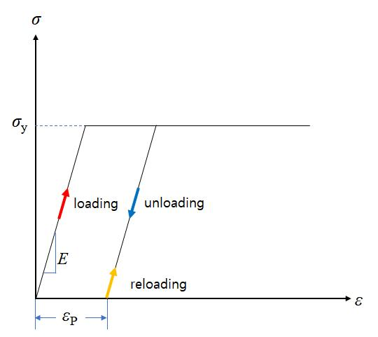
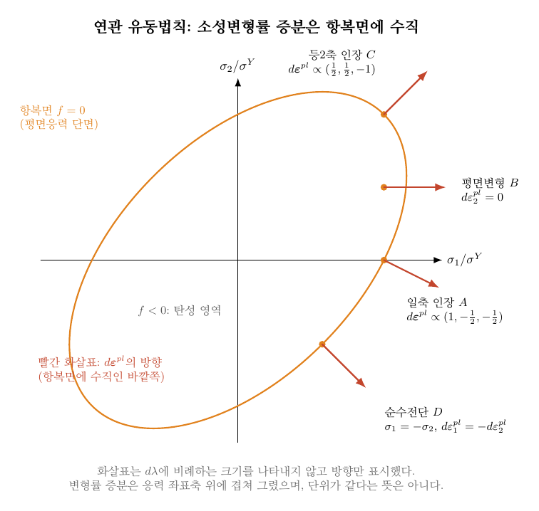
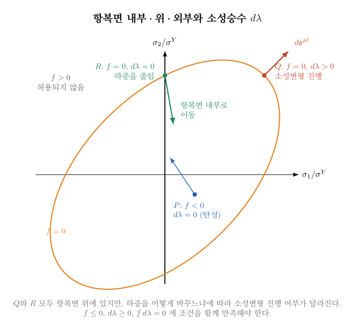
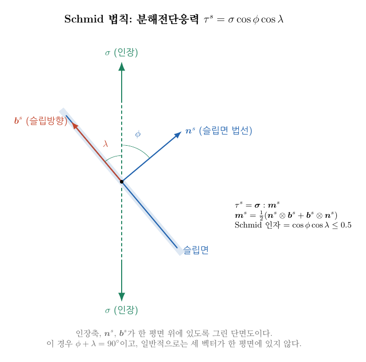

**목차**

* TOC
{:toc}

# 1. 12장에서 13장으로

[12장](/assets/lecture_notes/3_1_metal_plasticity/metal_plasticity_12_plastic_yield.md)에서는
항복함수 $f(\boldsymbol\sigma)=\sigma_{eq}(\boldsymbol\sigma)-\sigma^Y$를 정의하고,
$f<0$이면 탄성 영역, $f=0$이면 항복면 위라고 구분했다.
그러나 12장의 5.4절에서 강조했듯이 항복조건은 **소성변형이 가능한 경계**만 정해 줄 뿐,
항복면 위의 응력 상태에서 소성변형률이 어느 방향으로 얼마나 생기는지는 알려 주지 않는다.
이 강의의 목적은 바로 그 빈칸을 채우는 것이다.

| 질문 | 답하는 법칙 | 다루는 곳 |
|---|---|---|
| 어떤 응력 상태에서 소성변형이 시작되는가? | 항복조건 | 12장 |
| 소성변형률은 **어느 방향**으로 생기는가? | **유동법칙** | 4–5절 |
| 소성변형률은 **얼마나** 생기는가? | 소성승수 $d\lambda$ | 6절 |
| 소성변형이 진행되면 항복응력은 어떻게 달라지는가? | 경화법칙 | 15장 |

먼저 전체 변형률을 탄성과 소성으로 나누고(2–3절),
항복함수의 응력에 대한 그래디언트 (gradient), 즉 항복면의 법선방향으로
소성변형률 증분의 방향을 정하는 **연관 유동법칙**을 살펴본다(4–6절).
그다음에는 금속의 소성변형이 실제로는 전위의 슬립으로 일어난다는 점에서 출발하여
결정 수준의 유동법칙을 다루고(7–10절),
11절에서 두 관점이 어떻게 이어지는지 비교한다.

# 2. 영구 변형과 변형률 분해

경화가 없는 탄소성 재료의 응력–변형률 곡선은 다음과 같다.
처음에는 직선으로 탄성 변형하다가 항복응력에 도달하면 응력이 거의 늘지 않은 채 변형만 계속된다.

탄성변형은 하중을 제거하면 회복되지만 소성변형은 영구적으로 남는다.
단순한 일축 탄소성 모델에서는 $|\sigma|=\sigma^Y$에 도달할 때 소성변형이 시작된다.
12장의 1.1절에서 보았듯이 소성변형이 시작된 뒤에도 탄성변형은 계속 존재하므로,
전체 변형률은 탄성 변형률과 소성 변형률의 **합**으로 나눈다.

$$
\varepsilon=\varepsilon^{el}+\varepsilon^{pl}
$$

변형률 텐서에도 같은 분해를 적용하며, 미소변형률 가정에서는
변형률 속도($\dot{\boldsymbol \varepsilon}$)[^time-derivative-dot] 및 증분($d\boldsymbol \varepsilon$)에 대해서도 성립한다.

$$
\boldsymbol{\varepsilon}=\boldsymbol{\varepsilon}^{el}+\boldsymbol{\varepsilon}^{pl},
\qquad
\dot{\boldsymbol \varepsilon}=\dot{\boldsymbol \varepsilon}^{el}+\dot{\boldsymbol\varepsilon}^{pl},
\qquad
d\boldsymbol{\varepsilon}=d\boldsymbol{\varepsilon}^{el}+d\boldsymbol{\varepsilon}^{pl}
$$

우리가 시험기에서 직접 부과하는 것은 전체 변형률(또는 하중)이다.
이 전체 변형률 증분 가운데 얼마가 소성변형이 되고 얼마가 탄성변형으로 남는지를 정하는 규칙이 **유동법칙**(flow rule)이다.
전체 변형률에서 소성 변형률 몫이 정해지면 나머지는 자동으로 탄성 몫이 된다.

$$
d\boldsymbol\varepsilon^{el}=d\boldsymbol\varepsilon-d\boldsymbol\varepsilon^{pl}
$$

# 3. Hooke 법칙: 응력은 탄성변형률에서만 나온다

응력은 전체 변형률이 아니라 **탄성** 변형률에만 Hooke 법칙([9장](/assets/lecture_notes/3_1_metal_plasticity/metal_plasticity_09_elasticity.md))으로 연결된다.

$$
\boldsymbol{\sigma} = \boldsymbol{E}:\boldsymbol{\varepsilon}^{el}
=\boldsymbol{E}:(\boldsymbol\varepsilon-\boldsymbol\varepsilon^{pl})
$$

성분으로 쓰면 다음과 같다.

$$
\sigma_{ij} =\sum_{k=1}^3\sum_{l=1}^3 E_{ijkl}\varepsilon^{el}_{kl} \text{ with }\ \ i=1,2,3 \ \ \ j=1,2,3
$$

일축 상태에서는 $\sigma=E(\varepsilon-\varepsilon^{pl})$이 된다.
12장의 문제 1처럼 $E=200\,\mathrm{GPa}$, $\sigma=250\,\mathrm{MPa}$, 전체 변형률 $\varepsilon=0.006$이면
$\varepsilon^{el}=0.00125$이고 $\varepsilon^{pl}=0.00475$이다.
하중을 제거하면 $\varepsilon^{el}$만 회복되고 $\varepsilon^{pl}$은 잔류변형률로 남는다.

물질의 탄성계수가 변하지 않는다면, 위 구성관계식을 시간미분하면 아래와 같이 표현된다.
$$
\dot{\boldsymbol\sigma}=\boldsymbol E:(\dot{\boldsymbol\varepsilon}-\dot{\boldsymbol\varepsilon}^{pl})
$$

주어진 시간 증분($d t$)에 대한 응력과 변형률의 증분으로 나타내면 아래와 같다.

$$
d\boldsymbol\sigma=\boldsymbol E:(d\boldsymbol\varepsilon-d\boldsymbol\varepsilon^{pl})
$$

같은 전체 변형률 증분이라도 $d\boldsymbol\varepsilon^{pl}$이 크면 그만큼 응력 증가가 작아진다.
소성변형이 진행되는 동안 응력–변형률 곡선의 기울기가 탄성계수보다 작아지는 이유가 여기에 있다.

# 4. 유동법칙 (flow rule)

## 4.1. 연관 유동법칙 (normality rule; 혹은 associated flow rule)

소성변형률의 증분은 유동법칙을 따라 정해진다.
금속에서 가장 널리 쓰이는 것은 'normality' 규칙, 즉 **연관 유동법칙(associated flow rule)**이다.

$$
\boxed{d\boldsymbol{\varepsilon}^{pl}=d\lambda\frac{\partial f}{\partial\boldsymbol{\sigma}}}
$$

연관 유동법칙에서 $f$는 항복함수이면서 동시에 소성변형의 방향을 정하는 함수(plastic potential)이고,
$d\lambda$는 소성승수(plastic multiplier)의 증분이다.
소성변형률 텐서 증분 $d\boldsymbol\varepsilon^{pl}$의 **방향**은
항복함수의 응력에 대한 그래디언트 $\partial f/\partial\boldsymbol\sigma$가 정하고,
그 **크기**는 $d\lambda$가 정한다.
항복함수는 응력의 스칼라 함수이므로 응력텐서로 미분하면 2계 텐서가 되며, 성분으로는 다음과 같다.

$$
d\varepsilon^{pl}_{ij}=d\lambda\frac{\partial f}{\partial\sigma_{ij}},
\qquad i,j=1,2,3
$$

주 공간(principal space)에서는 세 주응력과 세 주변형률의 관계로 간단히 쓸 수 있다.

$$
d{\varepsilon}^{pl}_i=d\lambda\frac{\partial f}{\partial{\sigma_i}} \text{ with } i=1,2,3
$$

즉 행렬로 표현하자면

$$
\begin{bmatrix}
d\varepsilon^{pl}_{11}\\
d\varepsilon^{pl}_{22}\\
d\varepsilon^{pl}_{33}\\
d\varepsilon^{pl}_{23}\\
d\varepsilon^{pl}_{13}\\
d\varepsilon^{pl}_{12}
\end{bmatrix}
=d\lambda
\begin{bmatrix}
\frac{\partial f}{\partial\sigma_{11}}\\
\frac{\partial f}{\partial\sigma_{22}}\\
\frac{\partial f}{\partial\sigma_{33}}\\
\frac{\partial f}{\partial\sigma_{23}}\\
\frac{\partial f}{\partial\sigma_{13}}\\
\frac{\partial f}{\partial\sigma_{12}}
\end{bmatrix}
$$

혹은 주 공간에서

$$
\begin{bmatrix}
d\varepsilon^{pl}_1\\
d\varepsilon^{pl}_2\\
d\varepsilon^{pl}_3
\end{bmatrix}
=d\lambda
\begin{bmatrix}
\frac{\partial f}{\partial\sigma_1}\\
\frac{\partial f}{\partial\sigma_2}\\
\frac{\partial f}{\partial\sigma_3}
\end{bmatrix}
$$

'연관'이라는 이름은 방향을 정하는 함수(**소성 포텐셜** $g$)를 항복함수 $f$와 같게 둔다는 데서 왔다.
일반적으로는 $d\boldsymbol\varepsilon^{pl}=d\lambda\,\partial g/\partial\boldsymbol\sigma$이며,
$g\neq f$이면 비연관(non-associated) 유동법칙이라고 부른다.
금속에서는 대체로 $g=f$로 충분하다.
또한 $f$의 단위는 응력이고 $\partial f/\partial\boldsymbol\sigma$는 무차원이므로,
$d\boldsymbol\varepsilon^{pl}$이 변형률(무차원)이 되려면 $d\lambda$도 무차원이어야 한다.

## 4.2. 기하학적 의미: 항복면에 수직인 방향

12장의 5.3절에서 항복면 $f=0$을 응력 공간에서 탄성 영역의 경계로 정의했다.
응력공간에서 스칼라 함수 $f$의 응력에 대한 그래디언트
$\partial f/\partial\boldsymbol\sigma$는 $f$가 가장 빨리 증가하는 방향이다.
따라서 항복면에 수직이면서 바깥쪽을 향하는 법선방향이 된다.
연관 유동법칙은 이 기하학적 성질을 이용하며, 다음을 뜻한다.

> 소성변형률 증분은 응력 공간의 현재 응력점에서 항복면의 바깥쪽 법선방향을 가리킨다.

{: style="width: 1000px; max-width: 100%; height: auto;"}

그림은 12장 5.3절과 같이 $\sigma_3=0$인 평면응력 단면을 보여 준다.
일축 인장 $A$에서는 $d\boldsymbol\varepsilon^{pl}\propto(1,-\tfrac12,-\tfrac12)$이므로 가로 방향이 줄어든다.
평면변형 $B$에서는 방향 2의 소성변형률이 0이다.
등2축 인장 $C$에서는 평면 내 두 방향이 늘어나고 두께가 줄어들며,
순수전단 $D$에서는 두 방향의 소성변형률이 부호만 반대이다.
이 방향들은 5.4절의 예제와 같은 결과이다.

그림은 응력 공간의 축 위에 변형률 증분의 방향을 겹쳐 그린 것이다.
$d\boldsymbol\varepsilon^{pl}$이 응력의 단위를 갖는다는 뜻이 아니라, 방향만 비교한 것임에 주의한다.
한편 항복면이 볼록(convex)하면 이 규칙은 Drucker의 안정성 가정과 연결되는데,
Tresca와 von Mises 항복면은 모두 볼록하다.

## 4.3. 소성변형이 진행되는 조건

속도 비의존 소성모델에서는 다음 세 조건을 동시에 만족해야 한다.

$$
f\leq0,\qquad d\lambda\geq0,\qquad f\,d\lambda=0
$$

첫째 조건은 12장 5.3절에서 $f>0$을 "허용되지 않는 상태"라고 한 것을 수식으로 쓴 것이다.
셋째 조건은 $f<0$이면 $d\lambda=0$이고, $d\lambda>0$이면 반드시 $f=0$이라는 뜻이다.
즉 소성변형은 응력이 항복면 위에 있을 때만 진행된다.
세 경우를 정리하면 다음과 같다.

| 상태 | $f$ | $d\lambda$ | 거동 |
|---|---|---|---|
| 탄성 영역 | $f<0$ | $0$ | 탄성 (12장 5.3절의 "항복면 내부") |
| 항복면 위, 소성변형 없음 | $f=0$ | $0$ | 응력이 항복면에 머무르거나, 하중을 줄여 항복면 내부로 이동 (12장 5.4절) |
| 항복면 위, 소성변형 진행 | $f=0$ | $>0$ | 하중을 계속 증가시켜 소성변형이 진행됨 |

{: style="width: 1000px; max-width: 100%; height: auto;"}

그림의 $Q$와 $R$은 모두 항복면 위에 있지만 하중을 어떻게 바꾸느냐에 따라 거동이 달라진다.
$Q$에서 하중을 계속 증가시키면 소성변형이 진행되어 $d\lambda>0$이다.
반면 $R$에서 하중을 줄이면 추가 소성변형 없이 응력이 항복면 내부로 들어가므로 $d\lambda=0$이다.

소성변형이 계속 진행되는 동안에는 갱신된 응력도 항복면 위에 머물러야 한다.
이 요구를 **일관성(consistency) 조건** $df=0$이라고 하며,
이 조건으로부터 $d\lambda$의 크기가 정해진다(6절).

# 5. von Mises 연관 유동법칙

## 5.1. 방향: 편차응력

12장의 8절에서 von Mises 등가응력을 $\sigma^{VM}=\sqrt{\tfrac32\boldsymbol s:\boldsymbol s}$로 정의했다.
항복함수는 $f=\sigma^{VM}-\sigma^Y$이며, 주응력으로 쓰면 다음과 같다.

$$
\sigma^{VM}=\sqrt{\frac{1}{2}\bigg((\sigma_1-\sigma_2)^2+(\sigma_2-\sigma_3)^2+(\sigma_3-\sigma_1)^2\bigg)}
$$

편차응력도 응력의 함수이므로 평균응력을 미분한 항이 생긴다.
그러나 $\operatorname{tr}(\boldsymbol s)=0$이어서 그 항이 사라지고,
다음을 얻는다.[^deviatoric-components][^deviatoric-derivative]

$$
\frac{\partial(\boldsymbol s:\boldsymbol s)}{\partial\boldsymbol\sigma}=2\boldsymbol s
$$

항복강도를 정하는 내부변수를 고정하고 제곱근을 미분하면,
$\sigma^{VM}>0$인 항복면 위에서 다음과 같다.[^mises-chain-rule]

$$
\frac{\partial f}{\partial\boldsymbol\sigma}
=\frac{\partial\sigma^{VM}}{\partial\boldsymbol\sigma}
=\frac{3}{2}\frac{\boldsymbol s}{\sigma^{VM}}
$$

따라서 von Mises 연관 유동법칙은 다음과 같다.

$$
\boxed{d\boldsymbol\varepsilon^{pl}=d\lambda\,\frac{3}{2}\frac{\boldsymbol s}{\sigma^{VM}}}
$$

소성변형률 증분은 **편차응력 $\boldsymbol s$와 같은 방향**이며, 이를 Lévy–Mises 유동법칙이라고도 한다.
평균응력이 아니라 편차응력의 모양이 소성변형의 방향을 정한다는 뜻이다.

## 5.2. 소성변형은 부피를 바꾸지 않는다

편차응력은 $\mathrm{tr}\,\boldsymbol s=0$이므로 위 식에서 곧바로 다음을 얻는다.

$$
\mathrm{tr}(d\boldsymbol\varepsilon^{pl})=0
$$

소성변형에서는 부피가 변하지 않는다(비압축성).
정수압 응력은 $\boldsymbol s=0$이므로 $d\boldsymbol\varepsilon^{pl}=0$이며,
12장의 문제 2에서 정수압 응력이 항복을 일으키지 않았던 것과 같은 이유이다.
따라서 부피 변화는 탄성변형에서만 생기며,
탄성변형률이 작은 금속에서는 큰 소성변형 중의 부피 변화를 무시할 수 있다.

## 5.3. 크기: $d\lambda$는 등가 소성변형률 증분

14장에서 다룰 등가 소성변형률 증분은 다음과 같이 정의된다.

$$
d\bar\varepsilon^{pl}=\sqrt{\tfrac23\,d\boldsymbol\varepsilon^{pl}:d\boldsymbol\varepsilon^{pl}}
$$

von Mises 연관 유동법칙을 대입하고 $\boldsymbol s:\boldsymbol s=\tfrac23(\sigma^{VM})^2$을 이용하면

$$
d\boldsymbol\varepsilon^{pl}:d\boldsymbol\varepsilon^{pl}
=d\lambda^2\frac{9}{4}\frac{\boldsymbol s:\boldsymbol s}{(\sigma^{VM})^2}
=d\lambda^2\frac{9}{4}\cdot\frac{2}{3}=\frac32 d\lambda^2
\quad\Rightarrow\quad d\bar\varepsilon^{pl}=d\lambda
$$

를 얻는다.
즉 von Mises 연관 유동법칙에서 소성승수는 곧 **등가 소성변형률 증분**이다.
덕분에 일축 시험에서 구한 경화곡선(15장)을 다축 응력 상태에도 같은 척도로 적용할 수 있다.

## 5.4. 예제

### 예제 1. 일축 인장

응력 상태가

$$
[\boldsymbol\sigma]=
\begin{bmatrix}
\sigma&0&0\\
0&0&0\\
0&0&0
\end{bmatrix}
$$

이면 12장 8.2절에서 $\sigma_m=\sigma/3$, $\sigma^{VM}=\sigma$이고,

$$
[\boldsymbol s]=
\begin{bmatrix}
\dfrac{2\sigma}{3}&0&0\\
0&-\dfrac{\sigma}{3}&0\\
0&0&-\dfrac{\sigma}{3}
\end{bmatrix}
$$

였다. 따라서

$$
d\boldsymbol\varepsilon^{pl}
=d\lambda\frac32\frac{1}{\sigma}
\begin{bmatrix}
\dfrac{2\sigma}{3}&0&0\\
0&-\dfrac{\sigma}{3}&0\\
0&0&-\dfrac{\sigma}{3}
\end{bmatrix}
=d\lambda
\begin{bmatrix}
1&0&0\\
0&-\dfrac12&0\\
0&0&-\dfrac12
\end{bmatrix}
$$

인장 방향 소성변형률이 $+d\lambda$이면 두 가로 방향은 각각 $-d\lambda/2$이다.
세 성분의 합이 0이므로 비압축이며, $d\lambda$는 일축 소성변형률 증분 $d\varepsilon_1^{pl}$과 같다.

### 예제 2. 등2축 인장 $(100,100,0)\,\mathrm{MPa}$

12장 문제 4의 상태이다. $\sigma_m=200/3$, $\boldsymbol s=(100/3,\,100/3,\,-200/3)$, $\sigma^{VM}=100\,\mathrm{MPa}$이므로

$$
d\boldsymbol\varepsilon^{pl}=d\lambda\,\frac32\frac{\boldsymbol s}{100}=d\lambda\,(0.5,\;0.5,\;-1)
$$

평면 내 두 방향으로는 늘어나고 두께 방향으로는 줄어든다.
$\sigma_3=0$이라고 해서 $d\varepsilon_3^{pl}=0$인 것은 아니다.
응력 성분이 0인 방향에서도 소성변형률은 0이 아닐 수 있다.

### 예제 3. 순수전단 $\sigma_{12}=\tau$

12장 8.5절에서 $\sigma^{VM}=\sqrt3\,\tau$였고, 순수전단에서는 $\boldsymbol s=\boldsymbol\sigma$이므로

$$
d\varepsilon_{12}^{pl}=d\lambda\frac32\frac{\tau}{\sqrt3\tau}=\frac{\sqrt3}{2}d\lambda,
\qquad d\gamma_{12}^{pl}=2\,d\varepsilon_{12}^{pl}=\sqrt3\,d\lambda
$$

수직 성분은 모두 0이다.
공학 전단 소성변형률과 등가 소성변형률 사이에는 $d\gamma^{pl}=\sqrt3\,d\bar\varepsilon^{pl}$의 관계가 있다.

### 예제 4. 평면변형 인장

방향 2의 소성변형률이 0, 즉 $d\varepsilon_2^{pl}=0$이 되는 평면응력 상태를 찾자.
응력 상태가

$$
[\boldsymbol\sigma]=
\begin{bmatrix}
\sigma_1&0&0\\
0&\sigma_2&0\\
0&0&0
\end{bmatrix}
$$

이면

$$
\boldsymbol s=\left(\sigma_1-\sigma_m,\ \sigma_2-\sigma_m,\ -\sigma_m\right),\qquad \sigma_m=\frac{\sigma_1+\sigma_2}{3}
$$

이다. $d\varepsilon_2^{pl}\propto s_2=0$이려면 $\sigma_2=\sigma_m=(\sigma_1+\sigma_2)/3$이어야 하므로 $\sigma_2=\sigma_1/2$이다.
이때 $\boldsymbol s=(\sigma_1/2,\,0,\,-\sigma_1/2)$이고

$$
\sigma^{VM}=\sqrt{\frac32\cdot\frac{\sigma_1^2}{2}}=\frac{\sqrt3}{2}\sigma_1
$$

이다. $\sigma^{VM}=\sigma^Y$에서 $\sigma_1=2\sigma^Y/\sqrt3\approx1.155\,\sigma^Y$를 얻는다.
한 방향의 소성변형이 구속되면 일축 인장보다 높은 응력에서 항복한다는 뜻이며,
12장의 비례하중 항복배율 계산과 같은 방법으로 확인할 수 있다.

## 5.5. Tresca와 유동법칙

Tresca 항복면은 육각형의 모서리를 가지므로 모서리에서는 기울기가 하나로 정해지지 않는다.
면 위에서는 $\sigma_{\max}-\sigma_{\min}$의 미분만 남아 소성변형률이 최대·최소 주응력 방향의 두 성분으로만 나타난다.
모서리에서는 이웃한 두 면의 법선 방향을 비음수 비율로 섞은 방향이 모두 가능하다.
이런 수학적 불편함 때문에 수치해석에서는 매끄러운 von Mises 항복면이 널리 쓰인다.

# 6. 소성승수의 결정 (심화)

지금까지는 $d\lambda$를 하나의 크기로만 다루었다.
이제 일관성 조건 $df=0$과 Hooke 법칙으로 $d\lambda$를 구해 보자.
항복함수의 응력에 대한 그래디언트, 즉 항복면의 바깥쪽 법선을
$\boldsymbol n=\partial f/\partial\boldsymbol\sigma$로 두고,
항복응력의 증가를 $d\sigma^Y=H\,d\lambda$로 쓴다.
$H$는 경화 정도를 나타내는 계수로, 15장에서 구체적으로 다룬다.
일관성 조건은 다음과 같다.

$$
df=\boldsymbol n:d\boldsymbol\sigma-d\sigma^Y=0
$$

여기에 $d\boldsymbol\sigma=\boldsymbol E:(d\boldsymbol\varepsilon-d\lambda\,\boldsymbol n)$을 대입하면

$$
\boldsymbol n:\boldsymbol E:d\boldsymbol\varepsilon-d\lambda\,\boldsymbol n:\boldsymbol E:\boldsymbol n-H\,d\lambda=0
$$

이고, $d\lambda$에 대해 정리하면 다음과 같다.

$$
\boxed{d\lambda=\frac{\boldsymbol n:\boldsymbol E:d\boldsymbol\varepsilon}{\boldsymbol n:\boldsymbol E:\boldsymbol n+H}}
$$

등방 탄성체에 von Mises 조건을 적용하면 $\boldsymbol n$이 편차 텐서이므로
$\boldsymbol E:\boldsymbol n=2G\,\boldsymbol n$, $\boldsymbol n:\boldsymbol n=3/2$이고,
따라서 $\boldsymbol n:\boldsymbol E:\boldsymbol n=3G$이다.

$$
d\lambda=\frac{2G\,\boldsymbol n:d\boldsymbol\varepsilon}{3G+H}
$$

일축 상태에서는 $d\sigma=E_t\,d\varepsilon$으로 쓰고, 접선계수 $E_t$는 다음을 만족한다.

$$
\frac{1}{E_t}=\frac1E+\frac1H
$$

경화가 없으면($H=0$) $E_t=0$이 되어 항복응력이 더 이상 오르지 않는다.
경화가 있으면 $H>0$이므로 $E_t$는 $E$보다 작지만 0은 아니다.
한편 소성일 $dW^{pl}=\boldsymbol\sigma:d\boldsymbol\varepsilon^{pl}=\sigma^{VM}d\bar\varepsilon^{pl}$은 14장에서 다룬다.
이 식은 연관 유동에서 $\boldsymbol\sigma:\partial\sigma^{VM}/\partial\boldsymbol\sigma=\sigma^{VM}$이기 때문에 성립한다.

# 7. 전위 슬립과 Schmid 법칙

4–6절은 재료를 연속체로 보고 현상론적으로 소성변형률을 기술한 것이다.
금속에서 소성변형은 실제로 **전위의 슬립** 메커니즘으로 일어난다.
한 슬립계는 슬립면의 법선 $\boldsymbol n^s$와 슬립방향 $\boldsymbol b^s$로 정해지며, 두 벡터는 서로 수직이다($\boldsymbol n^s\cdot\boldsymbol b^s=0$).
앞에서 항복면의 법선을 나타낸 $\boldsymbol n=\partial f/\partial\boldsymbol\sigma$와
구분하기 위해 슬립계의 양에는 위첨자 $s$를 붙인다.

외부 응력 $\boldsymbol\sigma$가 가해졌을 때 슬립계 $s$에 전달되는 **분해전단응력**은 다음과 같다.
[8장](/assets/lecture_notes/3_1_metal_plasticity/metal_plasticity_08_force_stress.md)의 면 위 견인력 $\boldsymbol\sigma\cdot\boldsymbol n^s$를 슬립방향 $\boldsymbol b^s$로 투영한 값이다.

$$
\tau^s=({\boldsymbol\sigma}\cdot {\boldsymbol n}^s)\cdot \boldsymbol b^s=\sum_{i=1}^3\sum_{j=1}^3\sigma_{ij}n_i^sb_j^s
$$

이를 **Schmid 텐서** $\boldsymbol m^s$로 표현할 수 있다.

$$
\boldsymbol m^s = \frac{1}{2}(\boldsymbol{n}^s\otimes\boldsymbol{b}^s+
\boldsymbol{b}^s\otimes\boldsymbol{n}^s)
$$

$$
m^s_{ij}=\frac{1}{2}(n_i^sb_j^s+n_j^sb_i^s), \text{ with } i=1,2,3 \ \ \ j=1,2,3
$$

응력텐서가 대칭($\sigma_{ij}=\sigma_{ji}$)이므로 $n_i^sb_j^s$ 대신 $m^s_{ij}$를 써도 같은 값을 얻는다.

$$
\tau^s=\sum_{i=1}^3\sum_{j=1}^3\sigma_{ij}n_i^sb_j^s=\sum_{i=1}^3\sum_{j=1}^3\sigma_{ij}m_{ij}^s
$$

이중내적을 쓰면 더 간단히 표기할 수 있다.

$$
\tau^s=\boldsymbol\sigma:\boldsymbol m^s
$$

{: style="width: 1000px; max-width: 100%; height: auto;"}

일축 인장에서 인장축과 슬립면 법선 사이의 각을 $\phi$, 인장축과 슬립방향 사이의 각을 $\lambda$라 하면 위 식은 다음과 같이 간단해진다.

$$
\tau^s=\sigma\cos\phi\cos\lambda
$$

$\cos\phi\cos\lambda$를 Schmid 인자라고 하며, 그 최댓값은 $0.5$이다.

Schmid 텐서에는 한 가지 중요한 성질이 있다.
$\mathrm{tr}\,\boldsymbol m^s=\boldsymbol n^s\cdot\boldsymbol b^s=0$이므로 슬립은 부피를 바꾸지 않는 순수 편차(전단) 변형이다.
이는 5.2절의 비압축성과 같은 성질이다.
또한 $\boldsymbol m^s$가 편차 텐서이므로 $\boldsymbol\sigma:\boldsymbol m^s$는 $\boldsymbol\sigma$ 대신 편차응력 $\boldsymbol s$를 써도 같은 값이다.
결정 소성도 평균응력(정수압)의 영향을 받지 않는다는 뜻이다.

# 8. 전위 슬립 조건 (속도 비의존)

모든 슬립계의 임계분해전단응력(CRSS) $\tau_c$가 같다면,
소성변형은 최대 분해전단응력이 $\tau_c$에 도달할 때 시작된다.

$$
\max_s|\tau^s|=\tau_c
$$

이것이 결정 수준의 항복조건으로, 12장의 $f=0$에 해당한다.
단결정에서는 슬립계마다 $|\boldsymbol\sigma:\boldsymbol m^s|=\tau_c$를 만족하는 응력 공간의 평면이 하나씩 있고,
이 평면들로 둘러싸인 안쪽 영역이 탄성 영역이다.
$\pm$ 방향을 각각 세면 fcc의 12개 슬립계에서 24개의 평면이 생긴다.

예를 들어 fcc 단결정에서 $(111)[10\bar1]$ 슬립계의 Schmid 인자가 $0.408$이고 $\tau_c=20\,\mathrm{MPa}$이면
일축 항복응력은 $\sigma^Y=\tau_c/0.408\approx49\,\mathrm{MPa}$이다.
다결정에서는 결정립마다 방향이 다르므로 거시적인 항복응력을 $\sigma^Y=M\tau_c$로 쓰며,
$M$은 Taylor 인자이다(방향이 무작위인 fcc 다결정에서 약 $3.06$).
12장의 일축 항복응력이 재료의 조직과 시험 조건에 따라 달라지는 이유 중 하나이다.

# 9. 속도 의존형 정식화

위의 조건은 여러 슬립계가 같은 값에 동시에 도달할 수 있어 어느 슬립계가 활성화될지 정하기 어렵다.
이를 더 유연하게 다루기 위해, 각 슬립계의 전단 변형률 속도를 분해전단응력과 임계분해전단응력의 **멱함수**로 표현하는 속도 의존형(viscoplastic) 정식화를 쓴다.

$$
\dot\gamma^s/\dot{\gamma_0}=(\tau^s/\tau_c^s)^n
$$

이 식은 $\pm$ 전단 방향을 제대로 반영하지 못한다.
$\tau^s<0$일 때 $\dot\gamma^s<0$이어야 하지만, $n$이 짝수이면 $\dot\gamma^s$가 항상 양수가 되기 때문이다.
그래서 응력의 크기만 멱함수에 넣고 부호는 $\text{sgn}(\tau^s)$로 따로 곱한다.

$$
\dot\gamma^s/\dot{\gamma_0}=(|\tau^s|/\tau_c^s)^n\text{sgn}(\tau^s)
$$

지수 $n$은 속도 민감도를 나타낸다.
$n$이 클수록 $\tau^s/\tau_c^s=1$ 근처에서 $\dot\gamma^s$가 급격히 변하여 속도 비의존 극한($n\to\infty$)에 가까워진다.
예를 들어 $n=20$이면

$$
\frac{\tau^s}{\tau_c^s}=\pm1.05\ \Rightarrow\ \frac{\dot\gamma^s}{\dot\gamma_0}=\pm1.05^{20}\approx\pm2.65
$$

이다. 응력이 $\tau_c$보다 5%만 커도 기준 속도의 약 2.65배로 변형한다.
이 정식화에서는 $|\tau^s|<\tau_c^s$인 슬립계도 작지만 0이 아닌 $\dot\gamma^s$를 가지므로,
활성 슬립계를 따로 골라낼 필요가 없다.

# 10. 결정립 내 변형률

한 결정립에 슬립계가 12개 있다면, 소성 변형률 속도는 모든 슬립계가 기여하는 전단의 합이다.

$$
\dot{\boldsymbol\varepsilon}^{pl}=\sum_{s=1}^{12} \dot\gamma^s \boldsymbol{m}^s
$$

앞의 전단 변형률 속도 식을 대입하면

$$
\dot{\boldsymbol\varepsilon}^{pl}=\sum_{s=1}^{12} \dot\gamma_0\bigg(\frac{|\tau^s|}{\tau_c^s}\bigg)^n\text{sgn}(\tau^s) \boldsymbol{m}^s
$$

이고, Schmid 법칙 $\tau^s=\boldsymbol m^s:\boldsymbol\sigma$까지 대입하면 응력만으로 소성 변형률 속도를 얻는다.

$$
\dot{\boldsymbol\varepsilon}^{pl}=\sum_{s=1}^{12} \dot\gamma_0\bigg(\frac{|\boldsymbol m^s:\boldsymbol\sigma|}{\tau_c^s}\bigg)^n\text{sgn}(\boldsymbol m^s:\boldsymbol\sigma) \boldsymbol{m}^s
$$

첨자로 쓰면 각 성분이 어떻게 합해지는지 분명하게 보인다.

$$
\dot{\varepsilon}^{pl}_{ij}
=\sum_{s=1}^{12}\dot\gamma_0
\left(\frac{|\tau^s|}{\tau_c^s}\right)^n
\operatorname{sgn}(\tau^s)m^s_{ij},
\qquad
\tau^s=\sum_{k=1}^{3}\sum_{l=1}^{3}m^s_{kl}\sigma_{kl}
$$

# 11. 연속체 유동법칙과 결정 유동법칙의 비교

4–6절의 연속체 유동법칙과 7–10절의 결정 유동법칙은 서로 다른 스케일에서 쓰이지만 구조가 닮았다.
둘 다 소성변형률의 **방향**을 정하는 텐서와 그 **크기**를 정하는 스칼라의 곱으로 이루어진다.

| | 연속체 (von Mises, 4–6절) | 결정 슬립 (7–10절) |
|---|---|---|
| 항복조건 | $f=\sigma^{VM}-\sigma^Y=0$ | $\lvert\tau^s\rvert=\tau_c^s$ (슬립계마다) |
| 소성변형률 방향 | 항복면의 법선 $\partial f/\partial\boldsymbol\sigma\propto\boldsymbol s$ | $\boldsymbol m^s$ (슬립계마다 고정) |
| 크기 | $d\lambda=d\bar\varepsilon^{pl}$ | $\dot\gamma^s$ |
| 전체 소성변형률 | $d\boldsymbol\varepsilon^{pl}=d\lambda\,\boldsymbol n$ | $\dot{\boldsymbol\varepsilon}^{pl}=\sum_s\dot\gamma^s\boldsymbol m^s$ |
| 부피 변화 | $\operatorname{tr}d\boldsymbol\varepsilon^{pl}=0$ | $\operatorname{tr}\boldsymbol m^s=0$ |
| 정수압의 영향 | 없음 | 없음 |
| 속도 의존성 | 없음 | $n$이 유한하면 있음 |

실제로 단결정의 속도 비의존 항복면(모든 슬립계 평면의 안쪽 영역)에 normality를 적용하면
$d\boldsymbol\varepsilon^{pl}=\sum_s d\gamma^s\,\boldsymbol m^s$의 꼴이 되어 결정 수준의 식과 일치한다.
슬립계 식은 결정 항복면에 대한 연관 유동법칙으로 볼 수 있다는 뜻이다.
또한 한 결정립에서 서로 독립인 슬립계가 5개 이상 작동하면 임의의 편차 변형을 수용할 수 있는데,
이것이 다결정에서 von Mises 조건이 잘 맞는 배경이다.

# 12. 핵심 정리와 다음 강의

- 변형률은 $d\boldsymbol\varepsilon=d\boldsymbol\varepsilon^{el}+d\boldsymbol\varepsilon^{pl}$로 나누고, 응력은 탄성 몫에서만 정해진다.
- 연관 유동법칙 $d\boldsymbol\varepsilon^{pl}=d\lambda\,\partial f/\partial\boldsymbol\sigma$에서 방향은 항복면의 바깥쪽 법선방향이, 크기는 $d\lambda$가 정한다.
- $f\le0,\ d\lambda\ge0,\ f\,d\lambda=0$은 12장의 "항복면 내부·위·외부"와 "항복면 위에서도 소성변형이 진행되지 않을 수 있다"는 설명을 수식으로 쓴 것이다.
- von Mises에서는 $d\boldsymbol\varepsilon^{pl}=d\lambda\,\tfrac32\boldsymbol s/\sigma^{VM}$이며, 소성변형은 비압축성이고 $d\lambda=d\bar\varepsilon^{pl}$이다.
- 결정 수준에서는 $\dot{\boldsymbol\varepsilon}^{pl}=\sum_s\dot\gamma^s\boldsymbol m^s$이며, 슬립도 부피를 바꾸지 않는 전단이다.

항복조건, 유동법칙, 경화법칙은 각각 다른 역할을 한다.
이 강의에서는 소성변형률의 방향과 크기($d\lambda$)가 어떻게 정해지는지 다루었다.
다음 [소성일](/assets/lecture_notes/3_1_metal_plasticity/metal_plasticity_14_plastic_work.md)에서는 소성변형 중에 소모되는 일과 등가 변형률을 다루고,
15장에서는 소성변형이 진행됨에 따라 $\sigma^Y$가 어떻게 변하는지(경화)를 다룬다.

# 13. 연습 문제

## 문제 1

소성변형률 증분을 탄성변형률 증분과 전체 변형률 증분으로 나타내라.
$E=200\,\mathrm{GPa}$인 재료에서 $\varepsilon=0.006$, $\sigma=250\,\mathrm{MPa}$일 때
$\varepsilon^{pl}$과 하중을 제거한 뒤의 잔류변형률을 구하라.

<!--
풀이와 해답:
d epsilon^p=d epsilon-d epsilon^e이다.
epsilon^el=250/200000=0.00125, epsilon^pl=0.006-0.00125=0.00475이다.
하중을 제거하면 탄성변형률만 회복되므로 잔류변형률은 0.00475이다.
-->

## 문제 2

연관 유동법칙에서 소성변형률 증분의 방향은 무엇으로 결정되는가?
또한 $d\lambda$는 무엇을 결정하는가?

<!--
풀이와 해답:
항복함수의 응력에 대한 그래디언트, 즉 항복면의 바깥쪽 법선방향으로 결정된다.
d lambda는 소성변형률 증분의 크기를 정한다.
-->

## 문제 3

세 조건 $f\le0,\ d\lambda\ge0,\ f\,d\lambda=0$에 따라
(a) $f<0$, (b) $f=0$이고 하중을 계속 증가시키는 경우, (c) $f=0$에서 하중을 줄이는 경우 $d\lambda$의 값을 쓰고 12장 5.4절과 연결하여 설명하라.

<!--
풀이와 해답:
(a) d lambda=0, 탄성.
(b) d lambda>0, 소성변형이 진행되며 일관성 조건 df=0으로 크기가 정해진다.
(c) d lambda=0, 항복면 위에 있더라도 추가 소성변형 없이 내부로 이동한다.
-->

## 문제 4

von Mises 연관 유동법칙에서 일축 인장의 소성변형률 증분이

$$
d\boldsymbol\varepsilon^{pl}
=d\lambda
\begin{bmatrix}
1&0&0\\
0&-1/2&0\\
0&0&-1/2
\end{bmatrix}
$$

임을 보이고,
$d\varepsilon_1^{pl}=0.002$일 때 나머지 성분과 $d\bar\varepsilon^{pl}$를 구하라.

<!--
풀이와 해답:
s=sigma*[[2/3,0,0],[0,-1/3,0],[0,0,-1/3]], sigma_VM=sigma이므로
(3/2)s/sigma_VM=[[1,0,0],[0,-1/2,0],[0,0,-1/2]]이다.
d epsilon_2=d epsilon_3=-0.001이고 d epsilon_bar=d lambda=0.002이다.
-->

## 문제 5

응력이 $(120,\,60,\,0)\,\mathrm{MPa}$인 평면응력 상태에서 $\sigma^{VM}$과
von Mises 연관 유동의 $d\boldsymbol\varepsilon^{pl}/d\lambda$를 구하고, 비압축성을 확인하라.
$d\varepsilon_2^{pl}$가 0인 이유도 설명하라.

<!--
풀이와 해답:
sigma_m=60, s=(60,0,-60), sigma_VM=sqrt(1.5*7200)=sqrt(10800)=103.9 MPa.
d epsilon/d lambda=1.5*s/103.9=(0.866,0,-0.866)이고 합은 0이다.
sigma_2가 평균응력과 같아 s_2=0이므로 방향 2의 소성변형률은 0이다(평면변형 상태).
-->

## 문제 6

순수전단 $\sigma_{12}=\tau$에서 $d\gamma^{pl}$와 $d\bar\varepsilon^{pl}$의 비를 구하라.

<!--
풀이와 해답:
s=sigma, sigma_VM=sqrt(3) tau이므로 d epsilon_12=d lambda*sqrt(3)/2, d gamma=sqrt(3) d lambda.
d epsilon_bar=d lambda이므로 d gamma/d epsilon_bar=sqrt(3).
-->

## 문제 7

$E=200\,\mathrm{GPa}$, $\nu=0.3$, $H=1\,\mathrm{GPa}$인 재료에서 von Mises 연관 유동을 가정할 때
$\boldsymbol n:\boldsymbol E:\boldsymbol n$와 일축 접선 계수 $E_t$를 구하라.

<!--
풀이와 해답:
G=E/(2(1+nu))=76.9 GPa이므로 n:E:n=3G=230.8 GPa.
일축에서는 1/E_t=1/E+1/H이므로 E_t=EH/(E+H)=200*1/201=0.995 GPa.
-->

## 문제 8

Schmid 법칙에서 분해전단응력이 임계분해전단응력에 도달하면 무엇이 시작되는가?
$\tau_c=20\,\mathrm{MPa}$, Schmid 인자 $0.408$인 단결정이 일축 인장에서 항복하는 응력을 구하라.

<!--
풀이와 해답:
해당 슬립계에서 전위 슬립이 시작된다.
sigma=tau_c/0.408=49 MPa.
-->

## 문제 9

$n=20$인 멱함수 모델에서 $\tau^s/\tau_c^s=\pm1.05$일 때 $\dot\gamma^s/\dot\gamma_0$를 구하고,
$\mathrm{sgn}(\tau^s)$가 필요한 이유를 설명하라.

<!--
풀이와 해답:
1.05^20=2.65이므로 +2.65와 -2.65이다.
짝수 n에서 (tau/tau_c)^n은 tau의 부호와 무관하게 양수가 되어 슬립 방향이 틀려지므로 sgn이 필요하다.
-->

## 문제 10

소성승수는 소성변형이 발생하지 않을 때 어떤 값을 갖는가?
슬립이 부피 변화를 일으키지 않는 이유를 Schmid 텐서로 설명하라.

<!--
풀이와 해답:
0이다.
tr m=n·b=0이므로 슬립에 의한 소성변형률은 부피를 바꾸지 않는다.
-->

[^deviatoric-components]: **성분으로 확인하는 평균응력 항의 소거.**
    이를 응력으로 미분할 때, 편차응력 $\boldsymbol s$도 응력 $\boldsymbol\sigma$의
    함수라는 점을 고려해야 한다. 먼저 평균응력과 편차응력의 정의를 성분으로 쓰면

    $$
    \sigma_m=\frac13\sum_{k=1}^{3}\sigma_{kk},
    \qquad s_{ij}=\sigma_{ij}-\sigma_m\delta_{ij},
    \qquad \sum_{i=1}^{3}s_{ii}=0
    $$

    이다. 여기서 $\delta_{ij}$는 $i=j$이면 1, 아니면 0인 Kronecker delta다.
    이하 반복 첨자는 1부터 3까지 합한다. 평균응력의 미분까지 포함하면

    $$
    \frac{\partial\sigma_m}{\partial\sigma_{kl}}=\frac13\delta_{kl},
    \qquad
    \frac{\partial s_{ij}}{\partial\sigma_{kl}}
    =\delta_{ik}\delta_{jl}-\frac13\delta_{ij}\delta_{kl}
    $$

    을 얻는다. 이 성분 미분은 텐서의 전체 성분에 대해 쓴 것이며,
    전단 성분을 하나로 묶는 Voigt 표기의 미분과는 구분한다.
    이제 $\boldsymbol s:\boldsymbol s=s_{ij}s_{ij}$에 연쇄법칙을 적용한다.

    $$
    \begin{aligned}
    \frac{\partial(\boldsymbol s:\boldsymbol s)}{\partial\sigma_{kl}}
    &=2s_{ij}\frac{\partial s_{ij}}{\partial\sigma_{kl}}\\
    &=2s_{ij}\left(\delta_{ik}\delta_{jl}-\frac13\delta_{ij}\delta_{kl}\right)\\
    &=2s_{kl}-\frac23\left(s_{11}+s_{22}+s_{33}\right)\delta_{kl}\\
    &=2s_{kl}.
    \end{aligned}
    $$

[^mises-chain-rule]: **von Mises 등가응력의 제곱근 미분.**
    마지막으로 제곱근의 미분을 적용한다. 이때 항복강도 $\sigma^Y$를 정하는
    내부변수는 고정하고 응력만 미분하므로 $\partial\sigma^Y/\partial\boldsymbol\sigma=0$이다.
    $\sigma^{VM}>0$인 항복면 위에서

    $$
    \begin{aligned}
    \frac{\partial f}{\partial\boldsymbol\sigma}
    &=\frac{\partial}{\partial\boldsymbol\sigma}
    \left(\sqrt{\frac32\boldsymbol s:\boldsymbol s}-\sigma^Y\right)\\
    &=\frac{1}{2\sqrt{\frac32\boldsymbol s:\boldsymbol s}}
    \frac32\,(2\boldsymbol s)\\
    &=\frac{3}{2}\frac{\boldsymbol s}{\sigma^{VM}}.
    \end{aligned}
    $$

[^deviatoric-derivative]: **편차응력의 이중내적을 응력텐서로 미분하기.**
    $\Phi(\boldsymbol\sigma)=\boldsymbol s:\boldsymbol s$라 두자.
    이중내적의 미분에 곱의 법칙을 적용하면

    $$
    d\Phi
    =d\boldsymbol s:\boldsymbol s+\boldsymbol s:d\boldsymbol s
    =2\boldsymbol s:d\boldsymbol s
    $$

    이다. 편차응력과 그 증분은

    $$
    \boldsymbol s
    =\boldsymbol\sigma-\frac13\operatorname{tr}(\boldsymbol\sigma)\boldsymbol I,
    \qquad
    d\boldsymbol s
    =d\boldsymbol\sigma
    -\frac13\operatorname{tr}(d\boldsymbol\sigma)\boldsymbol I
    $$

    이므로

    $$
    \begin{aligned}
    d\Phi
    &=2\boldsymbol s:d\boldsymbol\sigma
    -\frac23\operatorname{tr}(d\boldsymbol\sigma)
    \boldsymbol s:\boldsymbol I\\
    &=2\boldsymbol s:d\boldsymbol\sigma
    -\frac23\operatorname{tr}(d\boldsymbol\sigma)
    \operatorname{tr}(\boldsymbol s)\\
    &=2\boldsymbol s:d\boldsymbol\sigma.
    \end{aligned}
    $$

    마지막 등식에서는 편차응력의 대각합이 0이라는
    $\operatorname{tr}(\boldsymbol s)=0$을 사용했다. 한편 텐서에 대한
    스칼라 함수의 미분 정의에 따라

    $$
    d\Phi
    =\frac{\partial\Phi}{\partial\boldsymbol\sigma}
    :d\boldsymbol\sigma
    $$

    이므로, 임의의 $d\boldsymbol\sigma$에 대해 두 식이 같으려면

    $$
    \frac{\partial(\boldsymbol s:\boldsymbol s)}
    {\partial\boldsymbol\sigma}=2\boldsymbol s
    $$

    이다. 즉 응력의 정수압 성분에 의한 항은
    $\boldsymbol s:\boldsymbol I=\operatorname{tr}(\boldsymbol s)=0$ 때문에 사라진다.

[^time-derivative-dot]: 기호 위의 점은 **시간에 대한 미분**을 뜻한다. 예를 들어
    $\dot{\boldsymbol\varepsilon}=d\boldsymbol\varepsilon/dt$는 변형률의 시간 변화율,
    즉 변형률 속도(strain rate)다. 반면 $d\boldsymbol\varepsilon$는 짧은 과정에서
    발생한 변형률 증분을 나타내며, 시간미분 자체를 뜻하지 않는다.

---

[이전 강의](/assets/lecture_notes/3_1_metal_plasticity/metal_plasticity_12_plastic_yield.md) · [강의 목록](/_lectures/3_1_metal_plasticity.md) · [다음 강의](/assets/lecture_notes/3_1_metal_plasticity/metal_plasticity_14_plastic_work.md)
