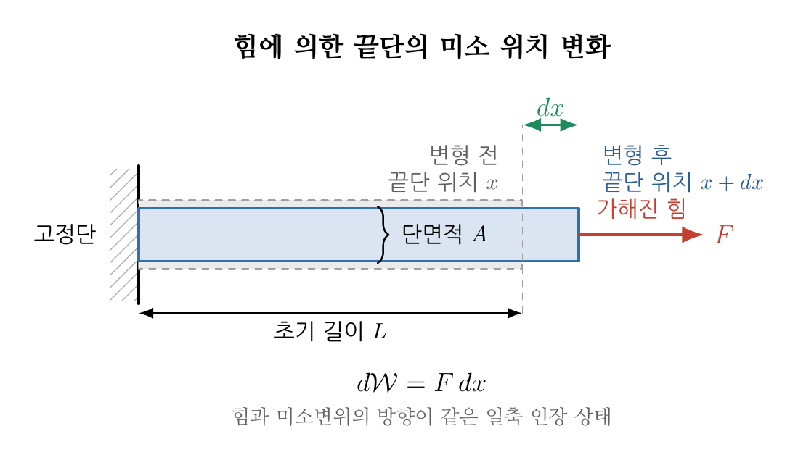

**Contents**

* TOC
{:toc}

# 1. 학습 목표

이번 강의가 끝나면 다음을 할 수 있어야 한다.

- 힘이 한 일에서 단위 부피당 일과 응력 일률을 유도할 수 있다.
- 탄성일과 소성일의 물리적 차이를 설명할 수 있다.
- 등가소성변형률 증분과 누적 등가소성변형률을 구분할 수 있다.
- von Mises 소성에서 소성일을 등가응력과 등가소성변형률로 나타낼 수 있다.
- 일축인장과 단순전단의 등가소성변형률을 계산할 수 있다.

# 2. 힘이 한 일에서 단위 부피당 일로

힘 $F$가 그 방향으로 물체를 $dx$만큼 움직일 때 미소 일은

$$
d\mathcal W=F\,dx
$$

{: style="width: 900px; max-width: 100%; height: auto;"}

이다. 여기서 $\mathcal W$는 물체 전체에 가해진 일이며 단위는 $\mathrm J$이다.
길이 $L$과 단면적 $A$인 균일한 봉을 생각하면 $F=\sigma A$이고
$d\varepsilon=dx/L$이므로

$$
\frac{d\mathcal W}{AL}
=\frac{F\,dx}{AL}
=\sigma\,d\varepsilon
$$

이다. 따라서 단위 부피당 일의 증분 $dw$는 일축 상태에서

$$
dw=\sigma\,d\varepsilon
$$

로 쓸 수 있다. 단위 부피당 일은 다음과 같이 응력과 같은 단위를 갖는다.

$$
\left[\frac{\mathrm J}{\mathrm m^3}\right]
=\left[\frac{\mathrm{N\,m}}{\mathrm m^3}\right]
=\left[\frac{\mathrm N}{\mathrm m^2}\right]
=[\mathrm{Pa}]
$$

일반적인 3차원 응력 상태에서는 작은 변형을 가정하여

$$
\boxed{dw=\boldsymbol\sigma:d\boldsymbol\varepsilon
=\sum_{i=1}^{3}\sum_{j=1}^{3}\sigma_{ij}\,d\varepsilon_{ij}}
$$

로 확장한다. 여기서 $:$는 이중내적이다. 응력과 변형률이 대칭텐서이므로
성분합에는 $\sigma_{12}d\varepsilon_{12}$와
$\sigma_{21}d\varepsilon_{21}$가 모두 포함된다. 공학전단변형률
$d\gamma_{12}=2d\varepsilon_{12}$를 쓰면 두 항의 합은
$\tau_{12}d\gamma_{12}$가 된다.

시간으로 나누면 단위 부피당 일률(stress power)은

$$
\dot w=\boldsymbol\sigma:\boldsymbol D
$$

이다. 작은 변형에서는 $\boldsymbol D=\dot{\boldsymbol\varepsilon}$이다.[^finite-work]

# 3. 탄성일과 소성일

작은 변형의 가산분해

$$
d\boldsymbol\varepsilon
=d\boldsymbol\varepsilon^{el}+d\boldsymbol\varepsilon^{pl}
$$

을 대입하면 전체 일 증분도

$$
dw
=\underbrace{\boldsymbol\sigma:d\boldsymbol\varepsilon^{el}}_{dw^{el}}
+\underbrace{\boldsymbol\sigma:d\boldsymbol\varepsilon^{pl}}_{dw^{pl}}
$$

로 나뉜다.

| 구분 | 식 | 물리적 의미 |
|---|---|---|
| 탄성일 $dw^{el}$ | $\boldsymbol\sigma:d\boldsymbol\varepsilon^{el}$ | 탄성에너지로 저장되며 이상적인 탄성 제하에서 회수된다. |
| 소성일 $dw^{pl}$ | $\boldsymbol\sigma:d\boldsymbol\varepsilon^{pl}$ | 소성변형에 사용되며 대부분 열로 소산되고 일부는 전위 등의 미세조직 변화에 저장될 수 있다. |

누적 소성일은 변형 경로를 따라 적분하여 구한다.

$$
w^{pl}(t)=\int_0^t
\boldsymbol\sigma:d\boldsymbol\varepsilon^{pl}
=\int_0^t\boldsymbol\sigma:\dot{\boldsymbol\varepsilon}^{pl}\,dt
$$

따라서 최종 응력과 최종 소성변형률만으로 누적 소성일을 정할 수 없으며,
변형이 진행되는 동안의 응력 경로가 필요하다. 또한 모든 소성일이 즉시 열이 되는 것은
아니므로, 소성일과 발생 열을 항상 같은 값으로 두어서는 안 된다.[^taylor-quinney]

# 4. von Mises 등가소성변형률

## 4.1. 증분의 정의

3차원 소성변형률 증분을 하나의 스칼라 크기로 나타내기 위해 von Mises
등가소성변형률 증분(equivalent plastic strain increment)을

$$
\boxed{d\bar\varepsilon^{pl}
=\sqrt{\frac23\,
d\boldsymbol\varepsilon^{pl}:d\boldsymbol\varepsilon^{pl}}}
$$

로 정의한다. 이 식은 소성 비압축성
$\operatorname{tr}(d\boldsymbol\varepsilon^{pl})=0$을 전제로 한다.
성분으로 쓰면

$$
d\bar\varepsilon^{pl}
=\sqrt{\frac23\sum_{i=1}^{3}\sum_{j=1}^{3}
d\varepsilon_{ij}^{pl}d\varepsilon_{ij}^{pl}}
$$

이다. 주방향에서 전단성분이 0이면

$$
d\bar\varepsilon^{pl}
=\sqrt{\frac23\left[
(d\varepsilon_1^{pl})^2+(d\varepsilon_2^{pl})^2+(d\varepsilon_3^{pl})^2
\right]}
$$

로 단순해진다.

## 4.2. 누적값과 변형 경로

누적 등가소성변형률은 각 증분의 크기를 변형 경로를 따라 더한 값이다.

$$
\boxed{\bar\varepsilon^{pl}(t)
=\int_0^t d\bar\varepsilon^{pl}
=\int_0^t\sqrt{\frac23\,
\dot{\boldsymbol\varepsilon}^{pl}:
\dot{\boldsymbol\varepsilon}^{pl}}\,dt}
$$

$d\bar\varepsilon^{pl}\geq0$이므로 소성변형이 진행되는 동안 누적값은 감소하지 않는다.
하중 방향이 바뀌어 소성변형률 텐서의 일부 성분이 상쇄되더라도 이미 누적된
$\bar\varepsilon^{pl}$은 사라지지 않는다. 따라서 일반적인 비례하지 않는 하중 경로에서는
최종 $\boldsymbol\varepsilon^{pl}$을 정의식에 한 번 대입한 값과
증분을 적분한 누적값이 서로 다를 수 있다.

# 5. 왜 계수가 $2/3$인가?

일축 인장에서 축방향 소성변형률 증분을 $d\varepsilon^{pl}$이라 하자.
소성 비압축성으로 인해 가로방향 증분은

$$
d\varepsilon_1^{pl}=d\varepsilon^{pl},
\qquad
d\varepsilon_2^{pl}=d\varepsilon_3^{pl}
=-\frac12d\varepsilon^{pl}
$$

이다. 이를 정의에 대입하면

$$
\begin{aligned}
d\bar\varepsilon^{pl}
&=\sqrt{\frac23\left[
(d\varepsilon^{pl})^2
2\left(-\frac12d\varepsilon^{pl}\right)^2\right]}\\
&=|d\varepsilon^{pl}|.
\end{aligned}
$$

즉 $2/3$은 일축 소성변형에서 등가소성변형률 증분이 축방향
소성변형률 증분의 절댓값과 같도록 정규화하는 계수다.

# 6. 소성일의 등가 표현

von Mises 연관 유동법칙은

$$
d\boldsymbol\varepsilon^{pl}
=d\lambda\frac32\frac{\boldsymbol s}{\sigma^{VM}},
\qquad
\sigma^{VM}=\sqrt{\frac32\boldsymbol s:\boldsymbol s}
$$

이다. 13장에서 확인했듯이 이때 $d\bar\varepsilon^{pl}=d\lambda$이다.
응력을 $\boldsymbol\sigma=\sigma_m\boldsymbol I+\boldsymbol s$로 분해하여
소성일에 대입하면

$$
\begin{aligned}
dw^{pl}
&=\boldsymbol\sigma:d\boldsymbol\varepsilon^{pl}\\
&=(\sigma_m\boldsymbol I+\boldsymbol s):
\left(d\lambda\frac32\frac{\boldsymbol s}{\sigma^{VM}}\right)\\
&=d\lambda\frac32\frac{\boldsymbol s:\boldsymbol s}{\sigma^{VM}}\\
&=\sigma^{VM}d\lambda.
\end{aligned}
$$

두 번째 줄의 정수압 성분은
$\boldsymbol I:\boldsymbol s=\operatorname{tr}(\boldsymbol s)=0$이므로 사라진다.
따라서

$$
\boxed{dw^{pl}=\sigma^{VM}d\bar\varepsilon^{pl}}
$$

이다. 이 관계는 다축 응력 상태의 소성일을 일축식과 같은 형태로 표현한다.
변형경화가 있으면 $\sigma^{VM}$은 소성변형과 함께 변하므로

$$
w^{pl}=\int_0^{\bar\varepsilon^{pl}}
\sigma^{VM}\,d\bar\varepsilon^{pl}
$$

이며, 이는 유동응력–등가소성변형률 곡선 아래의 면적이다.

# 7. 계산 예제

## 7.1. 일축인장

일축인장 중 축방향 소성변형률이 $0$에서 $0.10$까지 증가하고
유동응력 $300\ \mathrm{MPa}$가 일정하다고 하자. 이때

$$
\bar\varepsilon^{pl}=0.10,
\qquad
w^{pl}=300\times0.10=30\ \mathrm{MPa}
=30\ \mathrm{MJ/m^3}
$$

이다. $1\ \mathrm{MPa}=1\ \mathrm{MJ/m^3}$이므로 응력–변형률 곡선 아래의
면적을 그대로 단위 부피당 에너지로 해석할 수 있다.

## 7.2. 단순전단

단순전단에서 공학소성전단변형률 증분을 $d\gamma^{pl}$이라 하면
$d\varepsilon_{12}^{pl}=d\varepsilon_{21}^{pl}=d\gamma^{pl}/2$이다. 따라서

$$
d\bar\varepsilon^{pl}
=\sqrt{\frac23\left[
2\left(\frac{d\gamma^{pl}}{2}\right)^2\right]}
=\frac{|d\gamma^{pl}|}{\sqrt3}.
$$

순수전단응력 $\tau$에 대한 von Mises 응력은
$\sigma^{VM}=\sqrt3|\tau|$이므로, 전단 방향이 응력 방향과 같을 때

$$
dw^{pl}=\tau\,d\gamma^{pl}
=\sigma^{VM}d\bar\varepsilon^{pl}
$$

이 되어 텐서식과 등가식이 같은 소성일을 준다.

# 8. 핵심 정리

- 단위 부피당 일 증분은 $dw=\boldsymbol\sigma:d\boldsymbol\varepsilon$이다.
- 소성일은 $dw^{pl}=\boldsymbol\sigma:d\boldsymbol\varepsilon^{pl}$이며 경로를 따라 누적된다.
- von Mises 등가소성변형률은 소성변형률 증분의 스칼라 크기이며 누적값은 감소하지 않는다.
- von Mises 연관 유동에서는 $dw^{pl}=\sigma^{VM}d\bar\varepsilon^{pl}$이다.
- 일축인장에서는 $d\bar\varepsilon^{pl}=|d\varepsilon^{pl}|$이고,
  단순전단에서는 $d\bar\varepsilon^{pl}=|d\gamma^{pl}|/\sqrt3$이다.

# 9. 연습 문제

## 문제 1

$\sigma=250\ \mathrm{MPa}$의 일정한 일축응력 아래에서 축방향 소성변형률이
$0.08$ 증가하였다. 단위 부피당 소성일을 구하라.

<!--
풀이와 해답:
일축인장에서는 dε̄pl=|dεpl|이므로
wpl=σ εpl=250 MPa × 0.08=20 MPa=20 MJ/m³이다.
-->

## 문제 2

공학소성전단변형률이 단조롭게 $0$에서 $0.12$까지 증가하였다.
누적 von Mises 등가소성변형률을 구하라.

<!--
풀이와 해답:
ε̄pl=γpl/√3=0.12/√3≈0.0693이다.
-->

## 문제 3

소성변형률 텐서가 하중 반전 후 처음 값으로 돌아오더라도 누적
등가소성변형률이 0으로 돌아오지 않는 이유를 설명하라.

<!--
풀이와 해답:
누적 등가소성변형률은 각 증분의 크기 dε̄pl≥0을 경로를 따라 적분한 값이다.
서로 반대인 텐서 증분은 최종 소성변형률 성분에서는 상쇄될 수 있지만,
각 증분의 스칼라 크기는 모두 양으로 누적된다.
-->

## 문제 4

von Mises 소성에서 정수압 응력이 소성일에 직접 기여하지 않는 이유를 설명하라.

<!--
풀이와 해답:
소성변형률 증분은 편차응력 방향이고 trace가 0이다.
따라서 정수압 성분의 기여는 σm I:dεpl=σm tr(dεpl)=0이다.
-->

[^finite-work]: 이 장의 $\boldsymbol\sigma:d\boldsymbol\varepsilon$은 작은 변형에서
    Cauchy 응력과 미소변형률을 사용한 표현이다. 유한변형에서는 선택한 기준배치와
    변형률 척도에 맞는 일-켤레(work-conjugate) 응력과 변형률을 사용해야 한다.

[^taylor-quinney]: 소성일 중 열로 전환되는 비율은 재료와 온도, 변형률 및
    변형률속도에 따라 달라질 수 있다. 따라서 별도의 실험값이나 모델 없이
    일정한 열전환율을 가정하지 않는다.

[이전 강의]() | [강의 목록]() | [다음 강의]()
