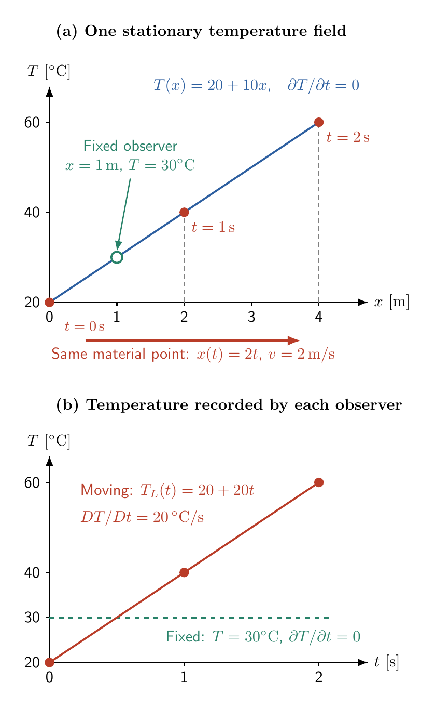

**목차**

* TOC
{:toc}

관련 자료는 다음 순서로 읽을 수 있다.

- [변위와 미소변형률]()
- [변위와 미소변형률 연습문제]()
- [유한변형의 운동학]()
- [물질미분]()

# 1. 물질미분 (material derivative)

## 1.1. 물질점을 따라 관찰하는 변화율

**물질미분은 움직이는 물질점이 경험하는 물리량의 변화율**이다.
온도장 $T(\boldsymbol x,t)$에서 고정된 위치의 온도 변화율은
$\left.\partial T/\partial t\right\vert_{\boldsymbol x}$이다. 그러나 물질점은 이동하므로,
다른 온도의 위치로 이동하며 경험하는 변화도 포함해야 한다.

물질점의 운동을 $\boldsymbol x=\boldsymbol\Phi(\boldsymbol X,t)$로 나타내면,
같은 물질점이 경험하는 온도는

$$
T_L(\boldsymbol X,t)=T_E(\boldsymbol\Phi(\boldsymbol X,t),t)
$$

이다.

앞으로 공간좌표 $\boldsymbol x$로 표현한 Eulerian 온도 $T_E(\boldsymbol x,t)$를 단순히 $T$라 쓰겠다.

물질미분 연산자를 $D/Dt$로 표기하겠다.

물질점의 이름표 $\boldsymbol X$를 고정하고 연쇄법칙(chain rule)을 적용하면

$$
\begin{aligned}
\frac{DT}{Dt}
&=\left.\frac{\partial T_L}{\partial t}\right|_{\boldsymbol X}\\
&=\left.\frac{\partial T}{\partial t}\right|_{\boldsymbol x}
+\frac{\partial T}{\partial x_i}
\left.\frac{dx_i}{dt}\right|_{\boldsymbol X}\\
&=\left.\frac{\partial T}{\partial t}\right|_{\boldsymbol x}
+v_i\frac{\partial T}{\partial x_i}.
\end{aligned}
$$

$\left.\partial T_L/\partial t\right\vert_{\boldsymbol X}$는 물질점의 이름표
$\boldsymbol X$를 고정하고 같은 물질점을 따라 관찰하는 시간변화율을 의미한다. 이를 **Lagrangian 기술법에서의 시간 미분**이라고 부르기도 한다.
그런데, 이를 공간에 고정된 관찰점에서의 시간 변화율로 바꾸면, 이송항을 더해야 한다. 즉, 공간에
고정된 위치에서의 시간에 대한 변화율($\left.\frac{\partial T}{\partial t}\right\vert_{\boldsymbol x}$) 더하기, 이송항($\boldsymbol v\cdot\nabla_xT=\sum_i v_i \frac{\partial T}{\partial x_i}$)으로 표현할 수 있다.

여기서 $\left.d\boldsymbol x/dt\right\vert_{\boldsymbol X}$는 **같은 물질점
$\boldsymbol X$를 따라가며 현재 위치를 시간미분한 값**, 즉 물질점의 속도다.
$\boldsymbol x=\boldsymbol\Phi(\boldsymbol X,t)$이므로 두 표기는 다음과 같이 연결된다.

$$
\boldsymbol v
=\left.\frac{d\boldsymbol x}{dt}\right|_{\boldsymbol X}
=\left.\frac{\partial\boldsymbol\Phi}{\partial t}\right|_{\boldsymbol X}.
$$

반복 첨자 $i$는 공간 방향에 대한 합을 뜻한다(3차원에서는 $i=1,2,3$).
우변은 해당 물질점의 현재 위치에서 평가한다. 벡터 표기로 쓰면

$$
\boxed{\frac{DT}{Dt}
=\left.\frac{\partial T}{\partial t}\right|_{\boldsymbol x}
+\boldsymbol v\cdot\nabla_xT}.
$$

첫 항($\left.\frac{\partial T}{\partial t}\right\vert_{\boldsymbol x}$)은 고정된 위치에서의 시간 변화이고, 둘째 항은 물질점의 이동에 의한 변화인
**이송항 (convective term)**이다. 따라서 Lagrangian 기술법에서는 같은 물질점의
시간 미분이 곧 물질미분이며, Eulerian 기술법에서는 고정 위치의 시간 미분($\left.\frac{\partial T}{\partial t}\right\vert_{\boldsymbol x}$)에 이송항($\boldsymbol v\cdot\nabla_xT$)을 더한다.

## 1.2. 시간에 따라 변하지 않는 온도장에서의 물질미분

$x$를 m 단위로 측정할 때, 시간에 따라 **변하지 않는** 1차원 온도장을

$$
T(x)=20\,{}^\circ\mathrm C
+\left(10\,{}^\circ\mathrm C/\mathrm m\right)x
$$

라고 하자. 한 물질점이 $v=2\,\mathrm{m/s}$로 이동하면

$$
\left.\frac{\partial T}{\partial t}\right|_x=0,
\qquad
\frac{DT}{Dt}=v\frac{dT}{dx}
=2\,\mathrm{m/s}\times 10\,{}^\circ\mathrm C/\mathrm m=20\,{}^\circ\mathrm C/\mathrm s.
$$

고정된 위치에 붙어있는 온도계의 값은 변하지 않지만, 공간에서 2 $\mathrm{m/s}$의 속도로
이동하는 물질점은 더 따뜻한 곳으로 가므로, 초당 $20\,{}^\circ\mathrm C$의 온도 증가를 경험한다.

{: style="max-width: 100%; height: auto;"}

위 그림의 (a)에서 파란 선은 각 고정 위치에서 시간에 따라 변하지 않는 온도장
$T(x)$를 나타낸다. 온도는 위치 $x$에 따라 달라진다. 그에 비해 빨간 점들은 $x(0)=0$에서 출발한
**같은 물질점**의 $t=0,1,2\,\mathrm s$ 위치와 온도를 나타낸다.
초록색 원은 공간에 고정된 관찰점($x=1\,\mathrm m$)이다. (b)는 (a)의 녹색점에 고정된 관찰자
그리고 물질과 함께 이동하는 관찰자(빨간 점)가 기록하는 온도를 시간에 대해 그린 것으로,
녹색 고정점에서는 $30\,{}^\circ\mathrm C$로 시간에 따라 달라지지 않는 온도를 관찰하지만
빨간색 이동점에서는 시간이 0, 1, 2초로 흐름에 따라 온도가 $20,40,60\,{}^\circ\mathrm C$로 상승한다.

## 1.3. 공간과 시간에 모두 의존하는 온도장

이번에는 앞의 1.2절에서 사용한 온도장에 시간에 따른 온도 상승을 추가하자.
공간에 따른 온도 기울기는 그대로 두고, 모든 고정 위치에서 온도가 초당
$3\,{}^\circ\mathrm C$씩 상승한다고 가정한다. $x$는 m, $t$는 s 단위로 측정하며,

$$
T(x,t)=20\,{}^\circ\mathrm C
+\left(10\,{}^\circ\mathrm C/\mathrm m\right)x
+\left(3\,{}^\circ\mathrm C/\mathrm s\right)t
$$

라고 하자. 공간 $\boldsymbol x$에 고정된 한 위치에서의 온도 상승률과 공간에 대한
온도 변화에 대한 기울기는 각각

$$
\left.\frac{\partial T}{\partial t}\right|_x
=3\,{}^\circ\mathrm C/\mathrm s,
\qquad
\frac{\partial T}{\partial x}=10\,{}^\circ\mathrm C/\mathrm m
$$

이다. 물질점이 $v=2\,\mathrm{m/s}$로 이동하면

$$
\begin{aligned}
\frac{DT}{Dt}
&=\left.\frac{\partial T}{\partial t}\right|_x
+v\frac{\partial T}{\partial x}\\
&=3\,{}^\circ\mathrm C/\mathrm s
+\left(2\,\mathrm{m/s}\right)\left(10\,{}^\circ\mathrm C/\mathrm m\right)\\
&=\boxed{23\,{}^\circ\mathrm C/\mathrm s}.
\end{aligned}
$$

공간 $\boldsymbol x$에 고정된 온도계는 $3\,{}^\circ\mathrm C/\mathrm s$의 온도 상승률을 측정한다.
이동하는 물질점은 이 시간 변화에 더해 더 따뜻한 위치로 이동하는 효과도 경험하므로,
$23\,{}^\circ\mathrm C/\mathrm s$의 온도 상승률을 경험한다.

물질점의 경로에 온도장을 직접 대입해도 같은 결과를 확인할 수 있다.
$t=0$에서 $x=X$인 물질점의 운동은 $x(X,t)=X+vt$이므로,

$$
\begin{aligned}
T_L(X,t)&=T(X+vt,t)\\
&=20\,{}^\circ\mathrm C
+\left(10\,{}^\circ\mathrm C/\mathrm m\right)X
+\left(23\,{}^\circ\mathrm C/\mathrm s\right)t,\\
\left.\frac{\partial T_L}{\partial t}\right|_X
&=23\,{}^\circ\mathrm C/\mathrm s.
\end{aligned}
$$

두 효과가 항상 같은 부호인 것은 아니다. 같은 온도장에서 물질점이 반대 방향으로
$v=-2\,\mathrm{m/s}$로 이동하면 물질미분은
$DT/Dt=3\,{}^\circ\mathrm C/\mathrm s-20\,{}^\circ\mathrm C/\mathrm s=-17\,{}^\circ\mathrm C/\mathrm s$다.
각 위치의 온도는 상승하고 있어도, 물질점은 더 차가운 위치로 빠르게 이동하므로
자신이 경험하는 온도는 감소한다.

## 1.4. 2차원 온도장에서의 물질미분

이번에는 온도가 두 공간 좌표 $x_1$, $x_2$에 따라 달라지는 경우를 생각하자.
고정된 직교좌표계에서 $x_1$, $x_2$는 m, $t$는 s 단위로 측정하며, 온도장을

$$
T(x_1,x_2,t)=20\,{}^\circ\mathrm C
+\left(10\,{}^\circ\mathrm C/\mathrm m\right)x_1
-\left(5\,{}^\circ\mathrm C/\mathrm m\right)x_2
+\left(3\,{}^\circ\mathrm C/\mathrm s\right)t
$$

로 둔다. 즉, $x_1$이 증가하는 방향으로는 따뜻해지고, $x_2$가 증가하는 방향으로는
차가워진다. 고정된 위치에서는 온도가 초당 $3\,{}^\circ\mathrm C$씩 상승한다.
물질점의 속도는 일정한 벡터

$$
\boldsymbol v=(v_1,v_2)=(2,1)\,\mathrm{m/s}
$$

라고 하자. 2차원에서는 이송항에 두 방향의 기여가 모두 들어가므로

$$
\begin{aligned}
\frac{DT}{Dt}
&=\left.\frac{\partial T}{\partial t}\right|_{x_1,x_2}
+v_1\frac{\partial T}{\partial x_1}
+v_2\frac{\partial T}{\partial x_2}\\
&=3\,{}^\circ\mathrm C/\mathrm s
+\left(2\,\mathrm{m/s}\right)\left(10\,{}^\circ\mathrm C/\mathrm m\right)
+\left(1\,\mathrm{m/s}\right)\left(-5\,{}^\circ\mathrm C/\mathrm m\right)\\
&=\boxed{18\,{}^\circ\mathrm C/\mathrm s}.
\end{aligned}
$$

$x_1$ 방향의 이동은 $20\,{}^\circ\mathrm C/\mathrm s$의 온도 상승률에,
$x_2$ 방향의 이동은 $5\,{}^\circ\mathrm C/\mathrm s$의 온도 감소율에 기여한다.
따라서 이송항은 $15\,{}^\circ\mathrm C/\mathrm s$이고, 고정 위치의 시간 변화율
$3\,{}^\circ\mathrm C/\mathrm s$를 더하면 물질점이 경험하는 변화율은
$18\,{}^\circ\mathrm C/\mathrm s$이다.

물질점의 이름표를 $\boldsymbol X=(X_1,X_2)$, 즉 $t=0$에서의 위치로 두면,
그 물질점의 경로는

$$
x_1(\boldsymbol X,t)=X_1+\left(2\,\mathrm{m/s}\right)t,
\qquad
x_2(\boldsymbol X,t)=X_2+\left(1\,\mathrm{m/s}\right)t
$$

이다. 이 경로를 온도장에 직접 대입하면

$$
\begin{aligned}
T_L(\boldsymbol X,t)
&=T\bigl(x_1(\boldsymbol X,t),x_2(\boldsymbol X,t),t\bigr)\\
&=20\,{}^\circ\mathrm C
+\left(10\,{}^\circ\mathrm C/\mathrm m\right)X_1
-\left(5\,{}^\circ\mathrm C/\mathrm m\right)X_2
+\left(18\,{}^\circ\mathrm C/\mathrm s\right)t,\\
\left.\frac{\partial T_L}{\partial t}\right|_{\boldsymbol X}
&=18\,{}^\circ\mathrm C/\mathrm s
=\frac{DT}{Dt}.
\end{aligned}
$$

여기서 $\boldsymbol X$를 고정한다는 것은 $X_1$, $X_2$를 모두 고정하여 같은 물질점을
따라간다는 뜻이다. 반면 $x_1$, $x_2$를 고정하면 공간의 같은 위치를 관찰하므로
온도 변화율은 $3\,{}^\circ\mathrm C/\mathrm s$이다.

## 1.5. 속도의 물질미분과 가속도

물질미분은 벡터장의 각 성분에도 적용할 수 있다.
고정된 Cartesian(직교) 좌표계에서 속도의 물질미분은 물질점의 가속도다.

$$
\boxed{\boldsymbol a=\frac{D\boldsymbol v}{Dt}
=\left.\frac{\partial\boldsymbol v}{\partial t}\right|_{\boldsymbol x}
+(\boldsymbol v\cdot\nabla_x)\boldsymbol v},
\qquad
 a_i=\frac{\partial v_i}{\partial t}+v_j\frac{\partial v_i}{\partial x_j}.
$$

속도장이 시간에 따라 일정해도, 물질점이 공간적으로 속도 크기나 방향이 다른 곳으로
이동하면 가속도가 생길 수 있다. 예를 들어 정상 유동이 좁아지는 통로를 지나며
빨라지는 경우에는 시간에 대한 편미분이 0이어도 이송항에 의한 가속도가 존재한다.

# 2. 연습문제

## 문제 1: 정상 온도장에서의 이동

시간에 따라 변하지 않는 1차원 온도장이 다음과 같다.

$$
T(x)=30\,{}^\circ\mathrm C+\left(4\,{}^\circ\mathrm C/\mathrm m\right)x
$$

한 물질점이 $v=-1.5\,\mathrm{m/s}$로 이동한다. 고정 위치에서의 시간 변화율과
물질미분을 각각 구하고, 결과의 부호가 뜻하는 바를 설명하라.

<!--
풀이와 해답:
온도장이 시간에 의존하지 않으므로 고정 위치의 시간 변화율은 0이다.
DT/Dt=v dT/dx=(-1.5) 곱하기 4=-6 deg C/s이다.
물질점이 x가 감소하는 방향, 즉 더 차가운 쪽으로 이동하므로 경험하는 온도는 감소한다.
-->

## 문제 2: 2차원 온도장의 물질미분

온도장과 일정한 물질 속도가 다음과 같이 주어진다.

$$
T(x_1,x_2,t)=25\,{}^\circ\mathrm C
+\left(6\,{}^\circ\mathrm C/\mathrm m\right)x_1
-\left(2\,{}^\circ\mathrm C/\mathrm m\right)x_2
+\left(1\,{}^\circ\mathrm C/\mathrm s\right)t,
\qquad
\boldsymbol v=(1,2)\,\mathrm{m/s}.
$$

고정 위치의 시간 변화율, 두 방향의 이송항, 물질미분을 각각 구하라.
또한 $t=0$에 $\boldsymbol X=(X_1,X_2)$에 있던 물질점의 경로를 온도장에
대입하여, $\boldsymbol X$를 고정한 시간미분으로 검산하라.

<!--
풀이와 해답:
고정 위치의 시간 변화율은 1 deg C/s이다.
x_1 방향의 기여는 1 곱하기 6=6 deg C/s이고,
x_2 방향의 기여는 2 곱하기 (-2)=-4 deg C/s이다.
따라서 이송항은 2 deg C/s, 물질미분은 1+6-4=3 deg C/s이다.
경로는 x_1=X_1+(1 m/s)t, x_2=X_2+(2 m/s)t이다.
이를 대입하면 T_L=25 deg C+(6 deg C/m)X_1-(2 deg C/m)X_2+(3 deg C/s)t이다.
X_1, X_2를 고정하고 시간미분하면 3 deg C/s로 일치한다.
-->

## 문제 3: 시간에 따라 변하지 않는 속도장과 가속도

1차원 속도장이 $v(x)=k x$로 주어지고 $k=0.5\,\mathrm{s^{-1}}$이다.
물질점이 $x=4\,\mathrm m$를 지나는 순간의 속도와 가속도를 구하라.
속도장이 시간에 의존하지 않는데도 가속도가 생기는 이유를 설명하라.

<!--
풀이와 해답:
v=0.5 곱하기 4=2 m/s이다.
고정 위치의 속도 시간미분은 0이고 dv/dx=k=0.5 /s이다.
물질점의 가속도 Dv/Dt=v dv/dx=2 곱하기 0.5=1 m/s^2이다.
물질점이 이동하면서 공간적으로 더 큰 속도를 갖는 위치로 가기 때문에 가속된다.
-->

[^mesh-inverse]: 격자 사상 $\boldsymbol x=\boldsymbol\psi(\boldsymbol\xi,t)$의 역변환 $\boldsymbol\xi=\boldsymbol\psi^{-1}(\boldsymbol x,t)$는 같은 시각의 공간 위치에서 격자좌표를 찾는 것이다. 예를 들어 일정한 격자 속도 $w_1$에 대해 $x_1=\xi_1+w_1t$, $x_2=\xi_2$이면 $\xi_1=x_1-w_1t$, $\xi_2=x_2$이다. 이는 물질점의 이름표 $\boldsymbol X$를 구하는 것과 다르다. 미분 가능한 국소 역변환에는 $\det(\partial\boldsymbol\psi/\partial\boldsymbol\xi)\ne0$이 필요하며, 전체 영역에서는 격자가 겹치지 않는 일대일 대응도 확보해야 한다.

---

[강의 목록]()
