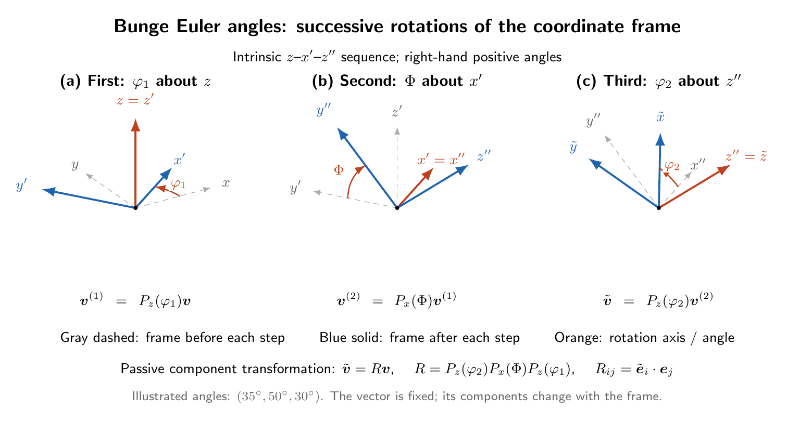

**Contents**

* TOC
{:toc}

# 1. 좌표변환의 관례

이 강의에서는 기존 기저 $\{\boldsymbol e_1,\boldsymbol e_2,\boldsymbol e_3\}$와
새 기저 $\{\tilde{\boldsymbol e}_1,\tilde{\boldsymbol e}_2,
\tilde{\boldsymbol e}_3\}$가 모두 오른손 **직교정규**(orthonormal)  **기저**(basis)라고 가정한다. 따라서

$$
\boldsymbol e_i\cdot\boldsymbol e_j=\delta_{ij},
\qquad
\tilde{\boldsymbol e}_i\cdot\tilde{\boldsymbol e}_j=\delta_{ij}
$$

이다. 좌표변환 행렬(coordinate transformation matrix)을

$$
R_{ij}=\tilde{\boldsymbol e}_i\cdot\boldsymbol e_j
$$

로 정의한다. 이 행렬의 $i$번째 행은 새 기저벡터
$\tilde{\boldsymbol e}_i$를 기존 기저로 표현한 성분이다. 두 기저가 오른손
직교정규 기저이므로 $[\boldsymbol R]$은 proper orthogonal 행렬이며

$$
[\boldsymbol R]^{-1}=[\boldsymbol R]^T,
\qquad
\det[\boldsymbol R]=+1
$$

을 만족한다.

여기서는 물리적 대상을 회전시키지 않고, 같은 대상을 나타내는 좌표성분만 기존
기저에서 새 기저로 바꾸는 **수동적 변환(passive transformation)**을 사용한다.
물체 자체를 회전시키는 능동적 회전(active rotation)에서는 행렬 또는 전치행렬의
위치가 달라질 수 있으므로 행렬의 정의와 회전 방향을 먼저 확인해야 한다.

## 1.1. 좌표변환 행렬과 방향코사인 (direction cosine)

두 단위벡터의 내적은 두 벡터 사이 각도의 코사인이다.
새 축 $\tilde{\boldsymbol e}_i$와 기존 축 $\boldsymbol e_j$ 사이의 각도를
$\theta_{ij}$라 하면

$$
\boxed{R_{ij}=\tilde{\boldsymbol e}_i\cdot\boldsymbol e_j
=\cos\theta_{ij}}
$$

이다. 이 값을 **방향코사인(direction cosine)**이라 하며, 이들을 모은
$[\boldsymbol R]$을 방향코사인 행렬(direction cosine matrix)이라고도 한다.
즉, 좌표변환 행렬과 방향코사인 행렬은 여기서 같은 행렬을 뜻한다.
각 성분은 새 축을 기존 축에 정사영한 값이므로 무차원이다.

## 1.2. Euler 각으로 방향코사인 행렬 구성하기

**Euler 각(Euler angles)**은 두 기저의 상대 방위를 세 번의 회전 각도로
표현하는 방법이다. 방향코사인은 축 사이의 내적으로 행렬을 직접 나타내고,
Euler 각은 같은 행렬을 세 각도로 매개화한다.
Euler 각은 아홉 개의 $\theta_{ij}$ 중 세 개를 단순히 고른 값이 아니다.

여기서는 결정방위 표현에 널리 쓰이는 **Bunge 관례**
$(\varphi_1,\Phi,\varphi_2)$를 사용한다. 기존 기저에서 시작하여 기저를
오른손 법칙의 양의 방향으로 다음 순서로 회전시킨다.

1. 기존 $z$축 둘레로 $\varphi_1$만큼 회전한다.
2. 첫 회전 후의 $x'$축 둘레로 $\Phi$만큼 회전한다.
3. 두 번째 회전 후의 $z''$축 둘레로 $\varphi_2$만큼 회전한다.

즉, 회전축도 앞선 회전을 따라 움직이는 $z$–$x'$–$z''$ 순서이다.

{: style="max-width: 900px; width: 100%; height: auto;"}

애니메이션은 세 회전을 순서대로 보여주며 약 10초마다 반복된다.
회색 점선은 각 단계 시작 시의 기저이고, 주황색 축은 해당 단계의 회전축이다.
표시되는 각도는 현재까지 진행된 회전각이며, 최종값은 $(35^\circ,50^\circ,30^\circ)$이다.
물리적 벡터를 회전시키는 것이 아니라 좌표기저를 회전시키는 과정이다.
[GIF 생성 코드](/assets/tikz/metal_plasticity/bunge_euler_animation.py)

세 단계의 최종 기저를 정지 그림으로 비교하면 다음과 같다.

{: style="max-width: 100%; height: auto;"}

그림에서 회색 점선은 각 단계 직전의 기저, 파란 실선은 회전 후의 기저이며,
주황색은 해당 단계의 회전축과 회전각이다. 회전축 자체는 그 단계에서 변하지 않는다.
세 패널은 동일한 시점에서 본 그림이며, 예시 각도는
$(\varphi_1,\Phi,\varphi_2)=(35^\circ,50^\circ,30^\circ)$이다.
아래 식의 $\boldsymbol v^{(1)},\boldsymbol v^{(2)}$는 각 단계의 **성분 열벡터**를 뜻한다.
[TikZ 소스](/assets/tikz/metal_plasticity/bunge_euler_angles.tex)

각 단계에서 성분을 새 기저로 바꾸는 수동 변환 행렬은

$$
[\boldsymbol P_z(\alpha)]=
\begin{bmatrix}
\cos\alpha&\sin\alpha&0\\
-\sin\alpha&\cos\alpha&0\\
0&0&1
\end{bmatrix},\qquad
[\boldsymbol P_x(\beta)]=
\begin{bmatrix}
1&0&0\\
0&\cos\beta&\sin\beta\\
0&-\sin\beta&\cos\beta
\end{bmatrix}
$$

이다. 각 단계의 성분변환을 차례로 적용하므로

$$
\boxed{[\boldsymbol R]
=[\boldsymbol P_z(\varphi_2)]
[\boldsymbol P_x(\Phi)]
[\boldsymbol P_z(\varphi_1)]}
$$

을 얻는다. 행렬곱은 오른쪽부터 작용한다.
$c_1=\cos\varphi_1$, $s_1=\sin\varphi_1$,
$c_2=\cos\varphi_2$, $s_2=\sin\varphi_2$,
$c=\cos\Phi$, $s=\sin\Phi$로 줄여 쓰면

$$
[\boldsymbol R]=
\begin{bmatrix}
c_1c_2-s_1s_2c & s_1c_2+c_1s_2c & s_2s\\
-c_1s_2-s_1c_2c & -s_1s_2+c_1c_2c & c_2s\\
s_1s & -c_1s & c
\end{bmatrix}.
$$

이 행렬의 각 원소가 바로 $\cos\theta_{ij}$이다.
기존 기저를 시편 기저, 새 기저를 결정 기저로 선택하면
$[\boldsymbol v]_{\mathrm{crystal}}=[\boldsymbol R][\boldsymbol v]_{\mathrm{sample}}$이며,
반대 방향의 변환에는 $[\boldsymbol R]^T$를 쓴다.

### 예: $(\varphi_1,\Phi,\varphi_2)=(90^\circ,90^\circ,0^\circ)$

이 경우 $c_1=c=0$, $s_1=s=c_2=1$, $s_2=0$이므로

$$
[\boldsymbol R]=
\begin{bmatrix}0&1&0\\0&0&1\\1&0&0\end{bmatrix}.
$$

행을 읽으면 $\tilde{\boldsymbol e}_1=\boldsymbol e_2$,
$\tilde{\boldsymbol e}_2=\boldsymbol e_3$,
$\tilde{\boldsymbol e}_3=\boldsymbol e_1$이다.
따라서 기존 성분이 $(1,2,3)^T$인 벡터의 새 성분은 $(2,3,1)^T$이고,
크기는 두 표현에서 모두 $\sqrt{14}$이다.

Euler 각은 유일하지 않다. 특히 $\Phi=0$에서는
$[\boldsymbol R]=[\boldsymbol P_z(\varphi_1+\varphi_2)]$이므로
두 각을 개별적으로 구분할 수 없다.
또한 회전축 순서, 능동·수동 관례, 시편→결정인지 결정→시편인지,
각도의 단위(degree 또는 radian)를 확인해야 다른 자료의 식과 비교할 수 있다.
단순히 “Euler 각”이라는 이름만 같다고 동일한 행렬이 되는 것은 아니다.

<!--
참고: [pymicro의 Bunge Euler 각과 방위행렬 설명](https://pymicro.readthedocs.io/en/latest/cookbook/euler_angles.html),
[orix의 시편→결정 변환 관례](https://orix.readthedocs.io/en/latest/reference/generated/orix.quaternion.Orientation.from_euler.html).
-->

# 2. 벡터 성분의 좌표변환

한 물리적 벡터 $\boldsymbol v$는 두 기저에서

$$
\boldsymbol v
=\sum_{j=1}^3 v_j\boldsymbol e_j
=\sum_{i=1}^3\tilde v_i\tilde{\boldsymbol e}_i
\tag{1}
$$

로 표현된다. 좌표계가 바뀌어도 벡터 자체는 동일하지만, 벡터를 나타내는 기저와
좌표성분은 달라질 수 있다(passive transformation). 직교정규 기저에서는 성분을 내적으로 구할 수 있으므로

$$
v_i=\boldsymbol v\cdot\boldsymbol e_i,
\qquad
\tilde v_i=\boldsymbol v\cdot\tilde{\boldsymbol e}_i
\tag{2}
$$

이다. 식 (1)을 식 (2)에 대입하면

$$
\begin{aligned}
\tilde v_i
&=\tilde{\boldsymbol e}_i\cdot\boldsymbol v\\
&=\tilde{\boldsymbol e}_i\cdot
  \sum_{j=1}^3v_j\boldsymbol e_j\\
&=\sum_{j=1}^3
  (\tilde{\boldsymbol e}_i\cdot\boldsymbol e_j)v_j\\
&=\sum_{j=1}^3R_{ij}v_j
\end{aligned}
\tag{3}
$$

을 얻는다. 물리적 벡터와 그 벡터의 성분으로 구성되는 행렬을 구별하기 위해, 기존 기저와 새
기저에서의 매트릭스를 각각

$$[{\boldsymbol v}]_{\boldsymbol e}$$

와

$$[\boldsymbol v]_{\tilde {\boldsymbol e}}$$

로 표기하면

$$
\boxed{[\boldsymbol v]_{\tilde {\boldsymbol e}}
=[\boldsymbol R][\boldsymbol v]_{\boldsymbol e}}
\tag{4}
$$

이다. 역변환은

$$
[\boldsymbol v]_{\boldsymbol e}
=[\boldsymbol R]^T[\boldsymbol v]_{\tilde {\boldsymbol e}}
$$

혹은

$$
[\boldsymbol v]_{\boldsymbol e}
=[\boldsymbol R]^{-1}[\boldsymbol v]_{\tilde {\boldsymbol e}}
$$

이며, 벡터의 크기 $\|\boldsymbol v\|$는 좌표변환 전후에 변하지 않는다.

# 3. 텐서 성분의 좌표변환

0차 텐서는 스칼라이므로 좌표계와 무관하게 같은 값을 가진다. 1차 텐서인 벡터의
변환은 식 (4)와 같다. 2계 텐서 $\boldsymbol A$의 성분은

$$
\tilde A_{ij}
=\sum_{k=1}^3\sum_{l=1}^3R_{ik}R_{jl}A_{kl}
$$

로 변환된다. 성분행렬 표기로는

$$
\boxed{[\boldsymbol A]_{\tilde {\boldsymbol e}}
=[\boldsymbol R][\boldsymbol A]_{\boldsymbol e}[\boldsymbol R]^T}
\tag{5}
$$

이다. 예를 들어 응력 텐서도

$$
[\boldsymbol\sigma]_{\tilde {\boldsymbol e}}
=[\boldsymbol R][\boldsymbol\sigma]_{\boldsymbol e}[\boldsymbol R]^T
$$

로 변환한다.

일반적인 $n$차 텐서의 각 첨자에는 좌표변환 행렬이 한 번씩 작용한다.

$$
\boxed{
\tilde T_{i_1i_2\cdots i_n}
=\sum_{j_1=1}^3\cdots\sum_{j_n=1}^3
R_{i_1j_1}\cdots R_{i_nj_n}
T_{j_1j_2\cdots j_n}}
\tag{6}
$$

따라서 4차 탄성계수 텐서는

$$
\tilde E_{ijkl}
=\sum_{m=1}^3\sum_{n=1}^3\sum_{o=1}^3\sum_{p=1}^3
R_{im}R_{jn}R_{ko}R_{lp}E_{mnop}
$$

로 변환된다.

좌표변환 뒤에도 2계 텐서의 trace, determinant, 고유값은 변하지 않는다. 이는
좌표변환 계산을 검산하는 유용한 기준이다.

# 4. 2차원 계산 예제

새 기저가 기존 기저에 대해 반시계방향으로 $\theta$만큼 회전했다고 하자.

$$
\tilde{\boldsymbol e}_1
=\cos\theta\,\boldsymbol e_1+\sin\theta\,\boldsymbol e_2,
\qquad
\tilde{\boldsymbol e}_2
=-\sin\theta\,\boldsymbol e_1+\cos\theta\,\boldsymbol e_2
$$

이 강의에서 정의한 수동 변환 행렬(passive transformation matrix; 혹은 coordinate transformation matrix)은

$$
[\boldsymbol R]=
\begin{bmatrix}
\cos\theta&\sin\theta\\
-\sin\theta&\cos\theta
\end{bmatrix}
$$

이다. $\theta=30^\circ$이고

$$
[\boldsymbol v]_{\boldsymbol e}=
\begin{bmatrix}2\\1\end{bmatrix}
$$

이면 새 기저에서의 성분은

$$
[\boldsymbol v]_{\tilde {\boldsymbol e}}
=[\boldsymbol R][\boldsymbol v]_{\boldsymbol e}
=\begin{bmatrix}
\sqrt{3}+1/2\\
-1+\sqrt{3}/2
\end{bmatrix}.
$$

두 성분열의 값은 다르지만

$$
[\boldsymbol v]_{\boldsymbol e}^T[\boldsymbol v]_{\boldsymbol e}
=[\boldsymbol v]_{\tilde {\boldsymbol e}}^T[\boldsymbol v]_{\tilde {\boldsymbol e}}=5
$$

이므로 벡터의 크기는 변하지 않는다.

같은 변환을 다음 2계 텐서에 적용해 보자.

$$
[\boldsymbol A]_{\boldsymbol e}=
\begin{bmatrix}100&20\\20&40\end{bmatrix}.
$$

$\theta=30^\circ$일 때 식 (5)로부터

$$
[\boldsymbol A]_{\tilde {\boldsymbol e}}
=[\boldsymbol R][\boldsymbol A]_{\boldsymbol e}[\boldsymbol R]^T
\simeq
\begin{bmatrix}
102.32&-15.98\\
-15.98&37.68
\end{bmatrix}.
$$

변환 전후에 $\operatorname{tr}(\boldsymbol A)=140$,
$\det(\boldsymbol A)=3600$으로 같으므로 계산 결과를 검산할 수 있다.

# 5. 요약

| 대상 | 좌표변환 |
|---|---|
| 스칼라 $a$ | $\tilde a=a$ |
| 벡터 $\boldsymbol v$ | $[\boldsymbol v]_{\tilde {\boldsymbol e}}=[\boldsymbol R][\boldsymbol v]_{\boldsymbol e}$ |
| 2계 텐서 $\boldsymbol A$ | $[\boldsymbol A]_{\tilde {\boldsymbol e}}=[\boldsymbol R][\boldsymbol A]_{\boldsymbol e}[\boldsymbol R]^T$ |
| $n$계 텐서 $\boldsymbol T$ | 각 첨자에 $R_{ij}$가 한 번씩 작용 (예: $\tilde T_{i_1i_2\cdots i_n}=\sum_{j_1=1}^3\cdots\sum_{j_n=1}^3 R_{i_1j_1}\cdots R_{i_nj_n}T_{j_1j_2\cdots j_n}$) |
| 직교행렬의 성질 | $[\boldsymbol R]^{-1}=[\boldsymbol R]^T$ |
| 좌표변환 불변량 | 벡터의 크기, 2계 텐서의 trace, determinant, 고유값 |

# 6. 연습 문제

## 문제 1

직교 좌표변환 행렬 $[\boldsymbol R]$이 만족하는 역행렬 관계를 쓰시오.

<!--
풀이와 해답:
R의 역행렬은 전치행렬과 같으므로 R^{-1}=R^T이다.
-->

## 문제 2

벡터의 좌표성분은 좌표계를 회전하면 변할 수 있다. 벡터 자체도 변하는지 설명하라.

<!--
풀이와 해답:
수동적 좌표변환에서는 기저와 좌표성분만 달라지며 벡터가 나타내는 물리량 자체는
변하지 않는다.
-->

## 문제 3

2계 텐서 $\boldsymbol A$의 변환된 성분행렬을 $[\boldsymbol R]$로 나타내라.

<!--
풀이와 해답:
강의에서 정의한 수동 좌표변환 관례에 따라
[ \boldsymbol A]_{\tilde {\boldsymbol e}}=[\boldsymbol R][\boldsymbol A]_{\boldsymbol e}[\boldsymbol R]^T로 나타낸다.
-->

## 문제 4

$\theta=90^\circ$일 때 2차원 수동 좌표변환 행렬 $[\boldsymbol R]$을 구하시오.

<!--
풀이와 해답:
cos(90 deg)=0, sin(90 deg)=1이므로
[\boldsymbol R]=\begin{bmatrix}0&1\\-1&0\end{bmatrix}이다.
-->

## 문제 5

$\theta=90^\circ$이고 $[\boldsymbol v]_e=(3,4)^T$일 때
$[\boldsymbol v]_{\tilde e}$를 구하고, 변환 전후의 벡터 크기를 비교하시오.

<!--
풀이와 해답:
[ \boldsymbol v]_{\tilde {\boldsymbol e}}=[\boldsymbol R][\boldsymbol v]_{\boldsymbol e}=(4,-3)^T이다. 변환 전후의 크기는 모두 5이다.
-->

## 문제 6

다음 2계 텐서를 $\theta=90^\circ$ 회전한 새 기저로 변환하고 trace와 determinant가
보존되는지 확인하시오.

$$
[\boldsymbol A]_e=
\begin{bmatrix}10&2\\2&4\end{bmatrix}.
$$

<!--
풀이와 해답:
[\boldsymbol R]=\begin{bmatrix}0&1\\-1&0\end{bmatrix}을 사용하면 [\boldsymbol A]_{\tilde {\boldsymbol e}}=\begin{bmatrix}4&-2\\-2&10\end{bmatrix}이다.
두 행렬의 trace는 모두 14이고 determinant는 모두 36이다.
-->

[이전 강의]() | [강의 목록]() | [다음 강의]()
