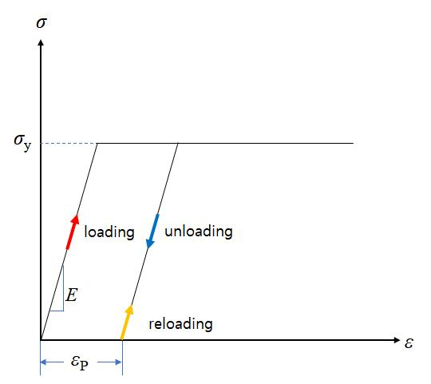
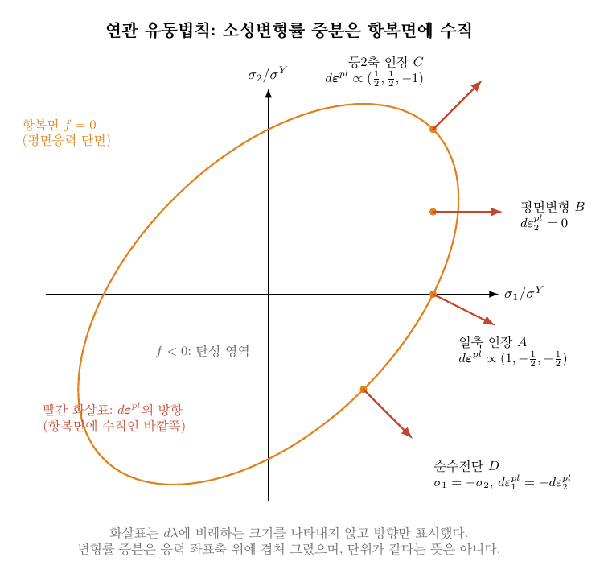
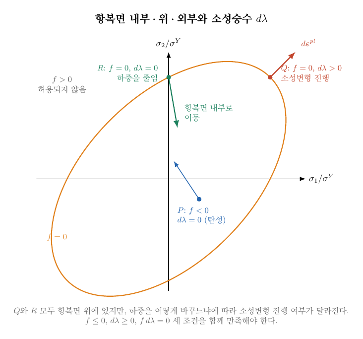
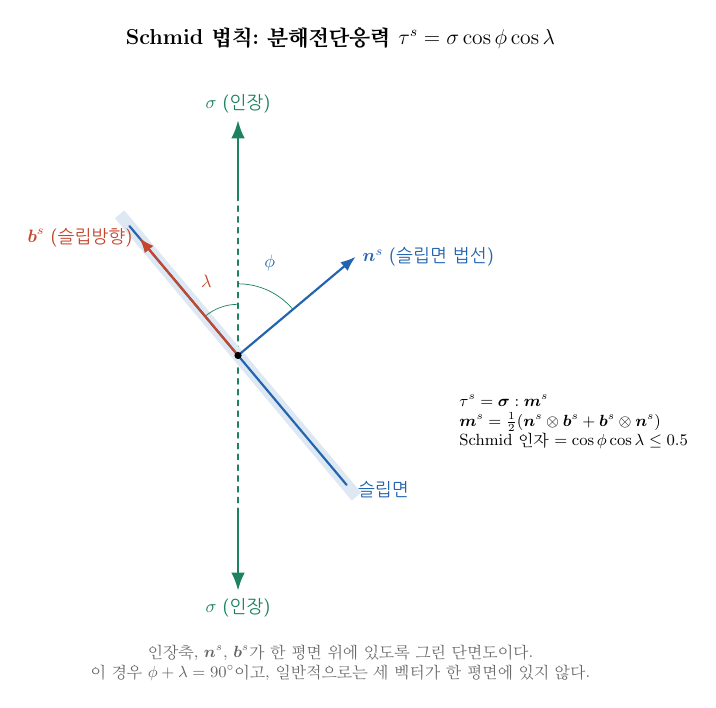
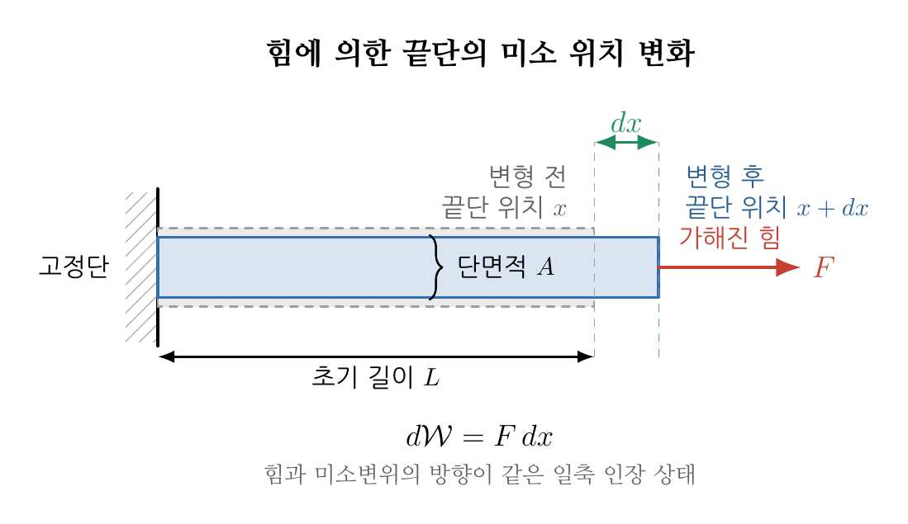

**목차**

* TOC
{:toc}

# 1. 영구 변형 (permanent deformation)

- 경화가 없는 탄소성 거동 재료의 stress vs. strain 곡선:

- 탄성변형은 하중을 제거하면 회복되지만 소성변형은 영구적으로 남는다.
  단순한 일축 탄소성 모델에서는 $|\sigma|=\sigma_y$에 도달할 때 소성변형이 시작된다.

# 2. 변형률 분해

- 전체 변형률은 탄성 변형률과 소성 변형률의 '합'으로 이해된다.

$$
\varepsilon=\varepsilon^{el}+\varepsilon^{pl}
$$

- 텐서의 경우에도 마찬가지

$$
\boldsymbol{\varepsilon}=\boldsymbol{\varepsilon}^{el}+\boldsymbol{\varepsilon}^{pl}
$$

# 3. Hooke 법칙
- 탄성 변형률은 Hooke 법칙 따른다

$$
\boldsymbol{\sigma} = \boldsymbol{E}:\boldsymbol{\varepsilon}^{el}
$$

$$
\sigma_{ij} =\sum_{k=1}^3\sum_{l=1}^3 E_{ijkl}\varepsilon^{el}_{kl} \text{ with }\ \ i=1,2,3 \ \ \ j=1,2,3
$$

# 4. 유동법칙 (flow rule)

- 소성 변형률의 변화는 flow rule을 따른다.

- 가장 널리 활용되는 flow rule은, 'normality' rule (혹은 associated flow rule)이다.

$$
d\boldsymbol{\varepsilon}^{pl}=d\lambda\frac{\partial f}{\partial\boldsymbol{\sigma}}
$$

$$
f: \text{ yield function and plastic potential},\qquad
d\lambda: \text{ plastic multiplier increment}
$$

- 소성 변형률 텐서 increment(즉 $d\boldsymbol\varepsilon^{pl}$)의 방향은 $\frac{\partial f}{\partial \boldsymbol\sigma}$가 결정하고, 그 크기($|d\boldsymbol\varepsilon^{pl}|$)는 $d\lambda$가 결정한다.

- 주응력 공간에서 위는 아래와 같이 표현된다.

$$
d{\varepsilon}^{pl}_i=d\lambda\frac{\partial f}{\partial{\sigma_i}} \text{ with } i=1,2,3
$$

- Von mises 등가 응력값을 plastic potential에 활용한다면

$$
f=\sqrt{\frac{1}{2}\bigg((\sigma_1-\sigma_2)^2+(\sigma_2-\sigma_3)^2+(\sigma_3-\sigma_1)^2\bigg)}-\sigma^Y
$$

## 4.1. 연관 유동법칙과 항복면의 법선방향

일반적인 유동법칙은 소성 포텐셜 $g$를 사용하여

$$
d\boldsymbol\varepsilon^{pl}
=d\lambda\frac{\partial g}{\partial\boldsymbol\sigma}
$$

로 쓴다. $g=f$이면 **연관 유동법칙**(associated flow rule), $g\ne f$이면
비연관 유동법칙이다. 연관 유동법칙에서
$\partial f/\partial\boldsymbol\sigma$는 항복면 $f=0$에 수직이며 바깥쪽을 향하는
법선방향이다. 따라서 소성변형률 증분의 방향은 현재 응력점에서 항복면의
바깥쪽 법선방향으로 정해진다.

{: style="width: 1000px; max-width: 100%; height: auto;"}

그림은 응력공간 위에 소성변형률 증분의 **방향**을 겹쳐 나타낸 것이다.
두 물리량의 단위가 같다는 뜻은 아니다. $d\lambda$는 이 방향으로 발생하는
소성변형률 증분의 크기를 정한다.

## 4.2. 소성 적재조건

속도 비의존 소성모델은 Kuhn–Tucker 상보조건

$$
f\leq0,\qquad d\lambda\geq0,\qquad f\,d\lambda=0
$$

을 만족한다. 항복면 내부에서는 $f<0$이므로 $d\lambda=0$이고, 항복면 위에서는
하중 방향에 따라 소성적재 또는 탄성제하가 가능하다. 소성적재 중에는 갱신된 응력이
항복면 위에 머물도록 일관성 조건 $df=0$을 함께 적용한다.

{: style="width: 1000px; max-width: 100%; height: auto;"}

즉, $f=0$이라는 사실만으로 $d\lambda>0$이라고 단정할 수 없다. 점 $R$처럼
항복면에서 안쪽으로 제하하면 $d\lambda=0$인 탄성응답이 가능하다.

## 4.3. von Mises 연관 유동법칙

von Mises 항복함수

$$
f=\sigma^{VM}-\sigma^Y,
\qquad
\sigma^{VM}=\sqrt{\frac32\boldsymbol s:\boldsymbol s}
$$

를 응력으로 미분하면

$$
\boxed{
\frac{\partial f}{\partial\boldsymbol\sigma}
=\frac32\frac{\boldsymbol s}{\sigma^{VM}}}
$$

을 얻는다.[^mises-gradient] 따라서

$$
\boxed{
d\boldsymbol\varepsilon^{pl}
=d\lambda\frac32\frac{\boldsymbol s}{\sigma^{VM}}}
$$

이다. $\operatorname{tr}(\boldsymbol s)=0$이므로
$\operatorname{tr}(d\boldsymbol\varepsilon^{pl})=0$이며, von Mises 연관 유동은
소성변형 중 부피를 바꾸지 않는다.

von Mises 등가소성변형률 증분을

$$
d\bar\varepsilon^{pl}
=\sqrt{\frac23d\boldsymbol\varepsilon^{pl}:d\boldsymbol\varepsilon^{pl}}
$$

로 정의하면 위 유동법칙에서 $d\bar\varepsilon^{pl}=d\lambda$가 된다.
따라서 소성승수는 단순한 임의 계수가 아니라 누적 등가소성변형률의 증분으로
해석할 수 있다.

## 4.4. 대표 응력상태의 유동방향

- 일축 인장 $(\sigma,0,0)$:
  $d\boldsymbol\varepsilon^{pl}propto(1,-1/2,-1/2)$이다. 축방향으로 늘어나면서
  두 가로방향으로 같은 만큼 수축한다.
- 등2축 인장 $(\sigma,\sigma,0)$:
  $d\boldsymbol\varepsilon^{pl}\propto(1/2,1/2,-1)$이다. 두 면내 방향으로
  늘어나고 두께방향으로 수축한다.
- 순수전단 $\sigma_{12}=\tau$:
  $d\varepsilon_{12}^{pl}=d\varepsilon_{21}^{pl}=d\lambda\,\operatorname{sgn}(\tau)/2$이며
  공학소성전단변형률 증분은 $d\gamma^{pl}=d\lambda\,\operatorname{sgn}(\tau)$이다.

이 예들은 같은 항복면 위에서도 현재 응력상태에 따라 법선방향, 즉
소성변형률 증분의 성분비가 달라짐을 보여 준다.

## 4.5. 일관성 조건으로 소성승수 구하기 (심화)

항복면의 법선을 $\boldsymbol n=\partial f/\partial\boldsymbol\sigma$로 두고,
등방경화에 의한 항복응력 증가를 $d\sigma^Y=H\,d\lambda$로 쓰자.
소성적재 중 일관성 조건은

$$
df=\boldsymbol n:d\boldsymbol\sigma-d\sigma^Y=0
$$

이다. Hooke 법칙의 증분형

$$
d\boldsymbol\sigma
=\boldsymbol E:(d\boldsymbol\varepsilon-d\lambda\boldsymbol n)
$$

을 대입하면

$$
\boxed{
d\lambda
=\frac{\boldsymbol n:\boldsymbol E:d\boldsymbol\varepsilon}
{\boldsymbol n:\boldsymbol E:\boldsymbol n+H}}
$$

을 얻는다. 즉 소성승수는 부과한 전체 변형률 증분, 탄성계수, 현재 항복면의
법선방향과 경화계수로 정해진다. 등방탄성체의 von Mises 조건에서는
$\boldsymbol E:\boldsymbol n=2G\boldsymbol n$,
$\boldsymbol n:\boldsymbol n=3/2$이므로

$$
d\lambda
=\frac{2G\,\boldsymbol n:d\boldsymbol\varepsilon}{3G+H}
$$

이다. $H=0$이면 완전소성, $H>0$이면 소성변형과 함께 항복면이 확장되는
경화거동에 해당한다. 구체적인 경화법칙은 다음 장에서 다룬다.

# 5. 전위 슬립과 Schmid 법칙

- 금속에서 소성 변형은 전위의 슬립 메커니즘으로 수용된다.

- 한 슬립계는 슬립면 법선 $\boldsymbol n$과 슬립방향 $\boldsymbol b$로 이루어진다.

{: style="width: 1000px; max-width: 100%; height: auto;"}

일축 인장응력 $\sigma$가 작용하면 분해전단응력은
$\tau^s=\sigma\cos\phi\cos\lambda$이다. 따라서 인장축과 슬립면 법선 및
슬립방향 사이의 기하학이 어떤 슬립계가 먼저 활성화되는지를 결정한다.

- Schmid 법칙

  - 외부 응력 $\boldsymbol \sigma$가 가해졌을 때, 슬립계 s에 전달되는 분해 전단 응력은 아래와 같이 구한다.

$$
\tau^s=({\boldsymbol\sigma}\cdot {\boldsymbol n}^s)\cdot \boldsymbol b^s=\sum_{i=1}^3\sum_{j=1}^3\sigma_{ij}n_i^sb_j^s
$$

  - 이를 Schmid tensor $\boldsymbol m$을 활용해 표현할 수 있다.

$$
\boldsymbol m^s = \frac{1}{2}(\boldsymbol{n}^s\otimes\boldsymbol{b}^s+
\boldsymbol{b}^s\otimes\boldsymbol{n}^s)
$$

$$
m^s_{ij}=\frac{1}{2}(n_i^sb_j^s+n_j^sb_i^s), \text{ with } i=1,2,3 \ \ \ j=1,2,3
$$

- 응력텐서의 특징 $\sigma_{ij}=\sigma_{ji}$로 인해 아래를 만족한다.

$$
\tau^s=({\boldsymbol\sigma}\cdot {\boldsymbol n}^s)\cdot \boldsymbol b^s=\sum_{i=1}^3\sum_{j=1}^3\sigma_{ij}n_i^sb_j^s=\sum_{i=1}^3\sum_{j=1}^3\sigma_{ij}m_{ij}^s
$$

- double contraction 활용해 더욱 간략히 표기할 수 있다.

$$
\tau^s=\boldsymbol\sigma:\boldsymbol m^s
$$

# 6. 전위 슬립 조건

- 모든 슬립계의 CRSS값, $\tau_c$가 동일하다면, 소성 변형의 시작은 최대 분해 전단 응력값이 $\tau^{crss}$ 값과 같을 때 발생한다.

$$
\max_s|\tau^s|=\tau_c
$$

# 7. 속도 의존형 정식화

- 앞서 논의한 아래와 같은 항복 조건을 좀 더 유연하게 적용한 경우가 있다.

$$
\max_s|\tau^s|=\tau_c
$$

- 각 슬립계에서, 다음과 같은 '멱함수'의 형태로 각 전단 변형률 속도와 연계된다.

- 우선 각 슬립계의 전달 변형률 속도를 각 슬립계에 작용하는 분해전단 응력,
  그리고 각 슬립계의 임계 분해 전단 응력의 함수로 표현한다.

$$
\dot\gamma^s/\dot{\gamma_0}=(\tau^s/\tau_c^s)^n
$$

- 위 식의 문제는 $\pm$ 전단 방향을 제대로 고려하지 못한다는 점이다.
  - $\tau^s<0$ 일 때 항상 $\dot\gamma^s<0$을 만족하지 못한다.
  - 이는 $n$값이 짝수냐 홀수냐에 따라 영향을 받는다.

- 아래 표현이 더욱 적절하다.

$$
\dot\gamma^s/\dot{\gamma_0}=(|\tau^s|/\tau_c^s)^n\text{sgn}(\tau^s)
$$

- 멱함수 안의 전단응력 크기는 항상 양수로 두고, $\text{sgn}(\tau^s)$를 곱하여 $\dot\gamma^s$와 $\tau^s$의 부호를 일치시킨다.

# 8. 결정립 내 변형률

- 한 결정립 내 여러 슬립계가 12개 있다면

$$
\dot{\boldsymbol\varepsilon}^{pl}=\sum_s^{12} \dot\gamma^s \boldsymbol{m}^s
$$

- 따라서, 앞선 전단 변형 속도 식을 대입하면

$$
\dot{\boldsymbol\varepsilon}^{pl}=\sum_s^{12} \dot\gamma_0\bigg(\frac{|\tau^s|}{\tau_c^s}\bigg)^n\text{sgn}(\tau^s) \boldsymbol{m}^s
$$

- Schmid law를 대입하면

$$
\dot{\boldsymbol\varepsilon}^{pl}=\sum_s^{12} \dot\gamma_0\bigg(\frac{|\boldsymbol m^s:\boldsymbol\sigma|}{\tau_c^s}\bigg)^n\text{sgn}(\boldsymbol m^s:\boldsymbol\sigma) \boldsymbol{m}^s
$$

- 위 식을 첨자표기법으로 나타내면 각 성분의 합을 명확히 확인할 수 있다.

$$
\dot{\varepsilon}^{pl}_{ij}
=\sum_{s=1}^{12}\dot\gamma_0
\left(\frac{|\tau^s|}{\tau_c^s}\right)^n
\operatorname{sgn}(\tau^s)m^s_{ij},
\qquad
\tau^s=\sum_{k=1}^{3}\sum_{l=1}^{3}m^s_{kl}\sigma_{kl}
$$

# 9. 연속체 유동법칙과 결정 유동법칙의 연결

앞의 연속체 유동법칙은 하나의 항복면과 그 법선으로 거시적 소성변형률을 기술한다.
결정 유동법칙은 각 슬립계의 분해전단응력과 전단변형률속도를 먼저 구한 뒤
$\dot{\boldsymbol\varepsilon}^{pl}=\sum_s\dot\gamma^s\boldsymbol m^s$로 합한다.
두 표현의 해상도는 다르지만 모두 응력상태로부터 소성변형률의 방향과 크기를
정한다는 공통점을 갖는다.

속도 비의존 연속체 소성모델에서는

$$
f\leq0,\qquad d\lambda\geq0,\qquad f\,d\lambda=0
$$

인 상보조건을 만족한다. $f<0$이면 $d\lambda=0$이고 탄성적으로 거동한다. $f=0$에서
소성 적재가 일어나면 갱신된 응력이 항복면 위에 머물도록 $df=0$인 일관성 조건을
적용한다. von Mises 연관 유동법칙에서는
$\operatorname{tr}(d\boldsymbol\varepsilon^{pl})=0$이므로 소성 체적변형이 없다.

# 10. 소성일과 등가소성변형률

## 10.1. 응력 일률과 소성일

힘 $F$가 그 방향으로 물체를 $dx$만큼 움직이면 $d\mathcal W=F\,dx$이다.
길이 $L$, 단면적 $A$인 균일한 봉에서 $F=\sigma A$,
$d\varepsilon=dx/L$이므로 단위 부피당 일은 $dw=\sigma\,d\varepsilon$이다.

{: style="width: 900px; max-width: 100%; height: auto;"}

3차원 작은 변형에서는

$$
dw=\boldsymbol\sigma:d\boldsymbol\varepsilon,
\qquad
dw^{pl}=\boldsymbol\sigma:d\boldsymbol\varepsilon^{pl}
$$

이다. 소성일은 경로를 따라

$$
w^{pl}(t)=\int_0^t
\boldsymbol\sigma:\dot{\boldsymbol\varepsilon}^{pl}\,dt
$$

로 누적되므로 최종 응력과 최종 소성변형률만으로는 일반적으로 정할 수 없다.
소성일의 대부분은 열로 소산되고 일부는 전위 등 미세조직 변화에 저장될 수 있으므로,
별도 가정 없이 소성일 전체를 발생 열과 같다고 두어서는 안 된다.

## 10.2. 등가소성변형률의 누적

누적 von Mises 등가소성변형률은

$$
\boxed{
\bar\varepsilon^{pl}(t)
=\int_0^t\sqrt{\frac23
\dot{\boldsymbol\varepsilon}^{pl}:
\dot{\boldsymbol\varepsilon}^{pl}}\,dt}
$$

이다. 각 증분의 크기를 더하므로 소성변형이 진행되는 동안 감소하지 않는다.
하중반전으로 최종 소성변형률 텐서의 일부 성분이 상쇄되어도 이미 누적된
$\bar\varepsilon^{pl}$은 사라지지 않는다.

일축 소성변형에서는 소성 비압축성에 의해

$$
d\varepsilon_1^{pl}=d\varepsilon^{pl},\qquad
d\varepsilon_2^{pl}=d\varepsilon_3^{pl}=-\frac12d\varepsilon^{pl}
$$

이므로 $d\bar\varepsilon^{pl}=|d\varepsilon^{pl}|$이다. 단순전단에서는
$d\bar\varepsilon^{pl}=|d\gamma^{pl}|/\sqrt3$이다.

## 10.3. 소성일의 등가 표현

von Mises 연관 유동법칙을 사용하면

$$
\boxed{dw^{pl}=\sigma^{VM}d\bar\varepsilon^{pl}}
$$

을 얻는다. 정수압 성분은
$\boldsymbol I:d\boldsymbol\varepsilon^{pl}=\operatorname{tr}(d\boldsymbol\varepsilon^{pl})=0$
이므로 소성일에 직접 기여하지 않는다. 변형경화가 있으면 누적 소성일은

$$
w^{pl}=\int_0^{\bar\varepsilon^{pl}}
\sigma^{VM}\,d\bar\varepsilon^{pl}
$$

이며 유동응력–등가소성변형률 곡선 아래의 면적이다.

예를 들어 유동응력 $300\,\mathrm{MPa}$가 일정한 일축 인장에서
$\bar\varepsilon^{pl}=0.10$까지 변형되면
$w^{pl}=30\,\mathrm{MPa}=30\,\mathrm{MJ/m^3}$이다.

# 11. 연습 문제

## 문제 1

소성변형률 증분을 탄성변형률 증분과 전체 변형률 증분으로 나타내라.

<!--
풀이와 해답:
d epsilon^p=d epsilon-d epsilon^e이다.
-->

## 문제 2

연관 유동법칙에서 소성변형률 증분의 방향은 무엇으로 결정되는가?

<!--
풀이와 해답:
항복함수의 응력에 대한 gradient, 즉 항복면의 법선방향으로 결정된다.
-->

## 문제 3

Schmid 법칙에서 분해전단응력이 임계분해전단응력에 도달하면 무엇이 시작되는가?

<!--
풀이와 해답:
해당 슬립계에서 전위 슬립이 시작된다.
-->

## 문제 4

소성승수는 소성변형이 발생하지 않을 때 어떤 값을 갖는가?

<!--
풀이와 해답:
0이다.
-->

## 문제 5

von Mises 연관 유동법칙에서 소성변형률 증분의 trace가 0인 이유를 설명하라.

<!--
풀이와 해답:
소성변형률 증분은 편차응력 s에 비례하고 tr(s)=0이므로
tr(d epsilon^pl)=0이다. 따라서 소성 체적변형이 없다.
-->

## 문제 6

일축 유동응력 $250\,\mathrm{MPa}$가 일정한 상태에서 등가소성변형률이
$0.08$ 증가하였다. 단위 부피당 소성일을 구하라.

<!--
풀이와 해답:
w^pl=sigma^VM Delta epsilon_bar^pl=250 MPa x 0.08=20 MPa=20 MJ/m^3이다.
-->

## 문제 7

공학소성전단변형률이 단조롭게 $0$에서 $0.12$까지 증가하였다.
누적 von Mises 등가소성변형률을 구하라.

<!--
풀이와 해답:
epsilon_bar^pl=gamma^pl/sqrt(3)=0.12/sqrt(3) about 0.0693이다.
-->

[^mises-gradient]: $\boldsymbol s=\boldsymbol\sigma-\tfrac13\operatorname{tr}(\boldsymbol\sigma)\boldsymbol I$와
    $\operatorname{tr}(\boldsymbol s)=0$을 사용하면
    $\partial(\boldsymbol s:\boldsymbol s)/\partial\boldsymbol\sigma=2\boldsymbol s$이다.
    이를 $\sigma^{VM}=\sqrt{(3/2)\boldsymbol s:\boldsymbol s}$에 연쇄법칙으로 적용하면
    $\partial\sigma^{VM}/\partial\boldsymbol\sigma=(3/2)\boldsymbol s/\sigma^{VM}$을 얻는다.

---

[이전 강의](/assets/lecture_notes/5_1_polycrystalline_plasticity/metal_plasticity_12_plastic_yield.md) · [강의 목록](/_lectures/5_1_polycrystalline_Plasticity.md) · [다음 강의](/assets/lecture_notes/5_1_polycrystalline_plasticity/metal_plasticity_14_hardening.md)
